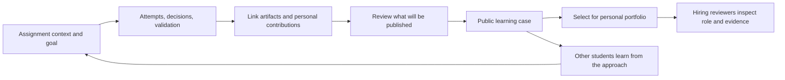

# Peerchive evolution proposal: a public archive that turns assignment processes into portfolios

[한국어](PROOFU_EVOLUTION_PLAN.md) | **English**

Peerchive is the new name for the project originating from **ProofU**, an undergraduate graduation project developed in 2019. Combining *Peer + Archive*, the name expresses a public archive where students learn from one another’s assignment and project experiences. It distinguishes this project from the separate career command center project named `proofu`. The repository address `proofu-univ` and document paths remain unchanged; the archived code is the original ProofU implementation.

Written: October 13, 2026 (Asia/Seoul) · Status: proposal · Audience: product planning, system design, and implementation decisions

This document follows the original purpose described by the project creator. Features, schedules, and metrics are proposals to validate, not descriptions of implemented functionality or established market demand. This work covers documentation, not application implementation or the start of operations.

- [System, data, and authorization design](planning/SYSTEM_DESIGN.en.md)
- [Delivery plan, validation, and release gates](planning/DELIVERY_PLAN.en.md)
- [Existing code analysis](PROJECT_ANALYSIS.en.md)
- [Original history and backup](HISTORY_RECONSTRUCTION.en.md)

## 1. Restore the original purpose as the product's center

The original ProofU began with assignment materials privately passed from older university students to younger ones, often called “jokbo” in Korea. Access depended on personal connections. The idea was to turn assignment processes and outcomes into public records that anyone could learn from.

The second purpose was to connect those records to personal portfolios. Beyond uploading a finished artifact, students would explain the problem, how they solved it, and their role within the team, helping employers understand entry-level candidates' experience and capabilities.

The original Trello-style Kanban board was an implementation choice for showing assignment progress. The proposed evolution makes a recording method better suited to that purpose central, while keeping Kanban as an optional task management view.

**Product definition: a service that connects students' attempts, decisions, validation, and assignment artifacts to publishable learning cases and personal portfolios.**

A proposed user-facing message is: “Finish your assignment. Capture the process. Show what you learned.” Use “jokbo” to explain the founding context, but use “assignment archive,” “learning case,” and “project record” for discovery and product communication.

## 2. Who should benefit, and how?

| User | Hypothesized difficulty today | Behavior enabled by Peerchive | How to validate |
|---|---|---|---|
| Student starting an assignment | Finished examples are available, but approaches and trial and error are hard to find | Find approaches from cases with similar constraints and stages, then make a personal plan | Interviews about recent assignments and case discovery exercises |
| Student working on an assignment | Creating a portfolio at the end of term requires reconstructing memories and gathering files | Leave short records once or twice a week that become material for later explanations | Four-week recording experiment and writing-time measurement |
| Team project participant | Team outcomes and individual contributions are mixed together | Connect personally owned outcomes, decisions, and contribution evidence to a personal case | Teammate confirmation and recruiter reading exercises |
| Student preparing for employment | Tool lists and finished screenshots do not explain distinctive experience | Present two or three assignments through problems, contributions, and validation | Compare understanding against existing portfolio materials |
| Recruiter or hiring reviewer | There is little time to inspect a repository and understand actual experience | Read a 60–90-second summary of the role and result, then inspect evidence | Simulated reviews and interview-question exercises |
| Instructor or mentor | Good examples are worth preserving, but assignment disclosure and assessment misunderstandings are concerns | Review what can be published and optionally provide feedback | Instructor interviews and publication policy review |

Start with **software team assignments and capstone students** at one university or club. This is a useful starting point for combining code, reports, presentations, and design. Other disciplines are a later expansion, but the first design should already work with files and records without a GitHub account.

The initial adoption unit is a semester cohort or capstone team, rather than an entire university. Personal and club projects permitted for publication should work even without instructor participation. Validate employer accounts after students find portfolio sharing useful.

## 3. Work alongside GitHub while answering a different question

GitHub profile READMEs already support self-introductions. “A bio plus repository links” alone offers weak differentiation. [Official GitHub profile README guide](https://docs.github.com/en/account-and-profile/how-tos/profile-customization/managing-your-profile-readme)

| Tool or format | Existing role | Peerchive's focus |
|---|---|---|
| GitHub repositories and profiles | Code, change history, development collaboration, and self-introduction | Connect assignment context, decisions, validation, and personal contributions in a form recruiters and other students understand |
| Trello-style Kanban | To-do, in-progress, and completed task states | Capture reasons for attempts, failures, and improvements that task status omits |
| General documents and portfolio sites | Flexible explanations and attractive presentation | Reuse records from the semester and manage team contributions, evidence, and publication scope together |
| Coursework submission and grading tools | Assignment distribution, submission, and assessment | Preserve student-controlled learning cases and employment presentations after the course ends |

This differentiation is a product hypothesis to validate with users, not a demonstrated competitive advantage. Other tools can produce similar experiences. Test whether **preparation takes less time and personal contributions become easier to understand**.

As checked on October 13, 2026, GitHub announced that Classroom was retired on August 28, 2026, while existing repositories, accounts, and organizations were unaffected. Do not plan Classroom-specific integration; start with ordinary repository links. [Official GitHub retirement announcement](https://github.com/orgs/community/discussions/205975)

Peerchive does not need to provide Git hosting, an IDE, autograding, general project management, or an applicant tracking system. First complete the flow that explains work created with existing tools as the student's own experience.

## 4. Core experience: workspace → learning case → personal portfolio



The workspace and public case are separate representations. A workspace may contain unfinished records, internal feedback, and private materials. A public case is a version at a specific point in time containing only selected content with the necessary consent. A personal portfolio is another version that selects and explains the student's contributions from public cases.

Implement the original goal of “public history” as **an accumulation of cases anyone can read**. Do not extend it to automatic disclosure of all work in progress or original university assignment documents. Let authors choose what they eventually want to show from their first entry, so publication review does not become a burdensome last-minute process.

## 5. Default experience beyond Kanban: process records with questions and evidence

### 5.1 Record types

| Record | Writing prompt | Possible evidence |
|---|---|---|
| Goal | What are you trying to make or discover? What counts as success? | Self-written requirements or a permitted assignment summary |
| Attempt | What did you try, and how did the result differ from expectations? | Code links, screenshots, or experiment results |
| Decision | Which alternative did you choose, and why? | Comparison tables, discussion summaries, or related changes |
| Validation | How did you check it, and what remains uncertain? | Test results, user feedback, or measurement conditions |
| Reflection | What did you learn, and what would you change next time? | Earlier records or before/after comparisons |

Do not require every type on every occasion. Default input has three fields: “What I did / What I learned / Evidence,” with an optional record type. Support attaching a file or link first and adding a short explanation afterward. Do not force recording with daily empty slots or streak scores.

### 5.2 Process view structure

Within an assignment, provide a default **stage view**: understand the problem → explore approaches → implement or create → validate → reflect and organize. These stages guide navigation rather than impose completion gates. Failed validation can return to implementation, and research or design assignments can rename stages.

Records can also be viewed chronologically, but public presentation groups important turning points. A significant design change and its validation should be more visible than ten completed tasks. Keep revision history when entries change, and make corrections visible rather than silently rewriting earlier explanations.

Keep Kanban under a “Tasks” tab. Cards can have an assignee, planned date, and status, with an optional connection to a process record when completed. Link important work without requiring a record for every completion. For the MVP, prioritize lists and status menus over drag-and-drop.

### 5.3 Comparing alternatives

| Method | Strength | Limitation | Proposal |
|---|---|---|---|
| Kanban alone | Easy to start; task status is clear | Reasoning, validation, and personal contributions can disappear | Secondary view |
| Free-form journal or blog | Flexible explanations | Blank-page burden and later organization costs | Support free notes |
| Automatic commit collection | Convenient collection of development activity | Misses non-code contributions; activity volume can be confused with skill | Optional evidence |
| Short, question-led records | Decisions and learning are easier to reuse | Requires a recording habit | MVP default |

The claim that this is more useful remains a hypothesis. If students find recording burdensome, experiment with fewer types or a file-first flow.

## 6. Information structure for assignment cases and portfolios

### 6.1 Public assignment case

The opening view contains a one-line introduction, featured artifact, assignment context, period, team size, members who have agreed to be shown, tools, and learning outcomes. Continue with problem and constraints → approach and alternatives → two to five significant process records → artifacts and validation → limitations and reflection → sources and usage conditions.

Use a self-written summary rather than the original assignment problem as the default. Support a combination of documents, images, videos, and source links. Grades and instructors' real names are not required. Treat course, term, and assignment context separately; identical course titles do not imply identical assignments.

### 6.2 Personal profile and portfolio

Basic profile information includes a name or display name, short introduction, target roles, permitted contact methods, and featured cases. School, department, expected graduation date, and real name are optional. Students can prepare portfolios privately.

For each featured case:

1. Explain the problem and result in two or three sentences.
2. Identify the personal role and artifacts directly created.
3. Link one important decision and one piece of validation evidence.
4. Separate team outcomes from personal contributions.
5. Provide original links and remaining limitations.

Distinguish self-declared skill tags such as “used TypeScript” from experience evidence such as “designed input validation and checked it with these tests.” Do not create overall capability or employability scores. Hiring reviewers can save projects or download PDFs, while contact information follows the student's permissions.

### 6.3 Two readers, one underlying record

A “Learning detail” view highlights alternatives, failures, and references. A “Portfolio summary” view leads with the problem, contribution, result, and evidence. Use the same public release with different information ordering. Students can choose project order for target roles, without allowing private materials to enter generated summaries.

## 7. Concrete usage example

Jimin, a fictional student, builds a library occupancy web app as a team assignment. Jimin writes a summary of the assignment and sets a success condition: users can compare occupancy in two buildings.

In the first week, Jimin attaches survey results and an early screen, recording an attempt that exposed difficulty obtaining data. In the second week, Jimin compares real-time sensors with manual entry and records why manual entry was chosen. In the third week, Jimin explains usability-test participants, conditions, and limitations. Include numerical claims only when actual measurements exist.

The team project contains shared artifacts. Jimin links screen-flow design and API input validation to personal contribution claims, with a visible status showing whether relevant teammates have confirmed them.

After submission, teammates consent to the artifacts and names selected for publication. If the course's publication rules are unclear, the team can prepare concepts and approaches without the original problem or answers, while keeping publication on hold.

The portfolio then shows “adjusting scope and validating a solution under incomplete data conditions,” rather than only “developed a library web app.” Other students learn which constraints led to which decisions instead of submitting a copy of the code.

## 8. Trust through publication, attribution, and personal contributions

This section proposes product and operating policies. It does not establish any school's rules or offer definitive legal interpretations. Before launch, review material rights, course-specific publication conditions, and personal-data handling.

| Situation | Default behavior |
|---|---|
| Assignment in progress | Private to the team, with a publication preview |
| Publication permission not established | Do not publish automatically after submission or a date passes |
| Team artifact | Check consent for the selected version, member display, and material use |
| Referenced external cases or libraries | Keep attribution and usage conditions; do not remove origins and present others' work as personal output |
| Instructor problem sheets, others' answers, or personal data | Review upload and publication scope; exclude or redact as needed |
| Help with another student's active assignment | Focus on principles and approaches; propose prohibiting work completed on another person's behalf and answer sales |
| Consent withdrawal or report | Hide the release, record investigation and appeals, and block affected derived portfolios |

Do not force a blanket publication license on members. Distinguish “viewing only,” “reuse under the stated license,” and “original conditions of the linked material apply.” Do not label unlicensed materials as freely reusable.

“Contribution confirmation” means that a relevant teammate confirmed the role described by the author. It is not instructor certification, verified capability, or a guarantee of legal rights. Display self-authorship, teammate confirmation, external evidence links, and mentor feedback separately. Label unconfirmed claims as “author's description, unconfirmed,” rather than requiring deletion.

A server timestamp records when information entered the platform. Claimed work dates, commit dates, hashes, or access logs alone do not certify actual performance or originality. Let students optionally explain AI tools, the assistance received, and what they reviewed themselves. Do not automatically approve AI-generated text as their own contribution.

## 9. MVP scope and acceptance criteria

The MVP tests **one complete flow from assignment records to a public case that can be read in a personal portfolio**.

| Priority | Feature | Completion criterion |
|---|---|---|
| P0 | Accounts and profiles | Registration, login, deletion requests, and separation of public/private information |
| P0 | Personal and team assignment spaces | Context entry, invitations, permission management, private by default |
| P0 | Process records | Three-field entry, file/link evidence, revisions, visible save status |
| P0 | Personal contributions | Connect records/artifacts; distinguish claims from teammate confirmations |
| P0 | Public releases | Preview, consent, sensitive-content review, publish/withdraw, no automatic workspace exposure |
| P0 | Public discovery | Filters for topic, tools, and assignment type; approach-led descriptions; basic reporting |
| P0 | Personal portfolios | Select featured public cases, summarize contributions, share links, basic print view |
| P0 | Authorization, files, and operations | Block private access, scan files, allow administrator restriction with audit records |
| P1 | Optional Kanban and comments | Status menus, assignment feedback, separate comment-publication settings |
| P1 | GitHub connection | Start with public links; optional repository metadata/evidence synchronization |
| P1 | Application portfolios | Role-specific ordering/summaries, expiring and revocable restricted sharing, PDFs |
| P2 | Mentor and employer features | Requested reviews and discovery/contact limited to consenting students |
| P2 | Institutional integration | Course publication policies, learning-record export, standards integration review |

Do not initially rebuild chat, calendars, or the university notice crawler. Preserve their archived implementations and reconsider them when user experiments establish demand. Complete case writing, publication, and reuse before expanding tool integrations.

## 10. Screens and interaction design

### 10.1 Main screens

| Screen | Question answered immediately | Main actions |
|---|---|---|
| My work | Which assignment should I record, and what evidence did I last save? | Create assignment, add short record |
| Assignment workspace | What problem are we solving, and what have we learned? | View process records, artifacts, and tasks |
| Record editor | How should I capture what I did and learned? | Add evidence first, save, choose inclusion in publication |
| Publication preparation | Whose information and which materials will be shown? | Select versions, preview, request consent, publish |
| Public case | What was made, why, and how was it checked? | Inspect result, read significant records, follow sources |
| Personal portfolio | What did this student directly contribute, and what supports it? | Featured cases, contributions, evidence, permitted contact |
| Discovery | Which approach helps with my problem and constraints? | Filter by topic/tool/record type, save reference attribution |

Start web navigation with “Explore / My assignments / Portfolio.” Separate editing from public presentation and show visibility next to sharing actions. Team management, notifications, and settings are secondary navigation.

### 10.2 Text wireframes

```text
Assignment workspace
[Assignment title] [Team only · Not published]         [Add record]
Problem and success conditions / What to check next
[Process] [Artifacts] [Tasks] [Contributions]          [Prepare publication]
  Stages: Understand · Explore · Create · Validate · Reflect
  Records: Title / What I did / What I learned / Evidence / Author
  Save status: Saved, saving, error with retry
```

```text
Public case / Portfolio summary
[Featured artifact]  Problem · Result · Period · Team size
Personal role: Responsibility and linked evidence / Confirmation status
Key decision → Validation method → Improvement → Remaining limitations
[Process details] [Artifacts and sources] [Related cases]
Release version and publication date / Revision or withdrawal status / Report
```

### 10.3 Visual and accessibility principles

Adopt the simple typography, strong contrast, and limited accent colors suggested by the UI/UX skill search. Do not apply the search's generic marketing hero layout to workspaces. Use document-oriented screens that foreground students' records and artifacts.

Start with system fonts supporting Korean text, checking licensing and loading before adding web fonts. Use a light background, dark body text, and blue primary actions, without communicating publication or confirmation states through color alone. Begin with body text of at least 16px, line height around 1.6, and reading width around 65–80 characters.

Prioritize attachments and short entries on mobile, and case editing/review on desktop. Writing and reading should work at a 360px width. Check touch targets, visible labels, keyboard focus, error placement, and save feedback on slow networks. Provide move menus, up/down buttons, and keyboard alternatives to dragging. Use animation only to explain save/status transitions and respect reduced-motion preferences.

## 11. Growth, operations, and business hypotheses

A reason to return is the ability to turn assignment records into featured cases without writing a separate introduction each time. Even before publication, the service should help students organize their own experience and team contributions. Avoid a structure that benefits only students with polished showcases.

Seed public content with 10–20 consenting graduate or club cases, including failures and constraints. When search results are sparse, use collections by case type instead of a generic popularity feed. University email verification is optional affiliation evidence, not a mandatory entry requirement.

Potential revenue sources include universities' consent-based exhibitions, optional portfolio editing/export conveniences, and employers' discovery of consenting candidates. Keep basic recording, personal data export, and control over publication as free core value. Do not fix initial revenue or prices; measure staff time, storage, and operational burden before testing paid options.

Do not propose selling student data or ranking students by school or views. Unwanted recruiting contact, collection of grades/sensitive information, and automated rejection decisions are outside the initial scope.

## 12. Important decisions and open questions

| Area | Current proposal | Condition for change |
|---|---|---|
| Initial users | Software capstone/team assignment cohort | The accessible cohort belongs to another discipline |
| Default records | Short process entries with evidence | Reduce to files/links if weekly writing burden is high |
| Publication timing | Private drafting followed by explicit publication | Even validated institutional policies require a separate choice for automatic publication |
| Tool relationship | Complement GitHub links and files | Recording effort makes automatic connection necessary for activation |
| Technical direction | New modern app alongside the original archive | Existing live data/users are established |
| Employer features | Start with reading public portfolios | Repeated hiring review and contact demand is demonstrated |

Before starting, confirm the recruitable student cohort, the first assignments' publication conditions, available operating time/budget, existence of a production database, and students' Git usage. Without these answers, begin a manual case-organization experiment with three to five consenting completed assignments.

## 13. References and interpretation limits

These official materials were checked on October 13, 2026. They establish tool/standard capabilities and limitations; student demand, employment impact, and product success still require direct validation.

- [GitHub profile README](https://docs.github.com/en/account-and-profile/how-tos/profile-customization/managing-your-profile-readme): confirms existing self-introduction support.
- [GitHub Classroom retirement announcement](https://github.com/orgs/community/discussions/205975): confirms retirement timing and preservation of existing repositories.
- [1EdTech CLR](https://www.1edtech.org/standards/clr): describes records connecting learner achievements and evidence. Peerchive is not currently a certified issuer or standards-compliant service.

## Summary

The original ProofU's goal was to turn privately circulated university assignment materials into a public archive of learning processes and outcomes, then help students present their own contributions as employment portfolios. The proposed evolution centers on short records of attempts, decisions, validation, and reflection, linked to artifacts and personal contributions. Kanban remains an optional task view. Students explicitly publish reviewed versions; private workspace content is not exposed automatically. GitHub remains a source of evidence rather than a replacement target. This is a product and engineering proposal, not an implemented feature announcement.

## Preservation of the original records

The 18 commits dated June–November 2019 are a feature-based reconstruction of code uploaded in 2020, not actual development logs from that period. This evolution proposal does not change that history. The original remains on the [backup branch](https://github.com/polynomeer/proofu-univ/tree/backup/pre-reconstruction-20261013), and future modernization is to be added through subsequent commits.
