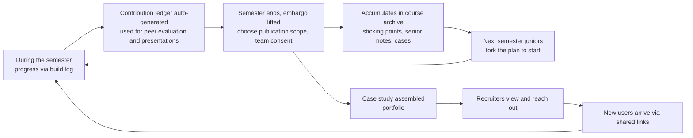
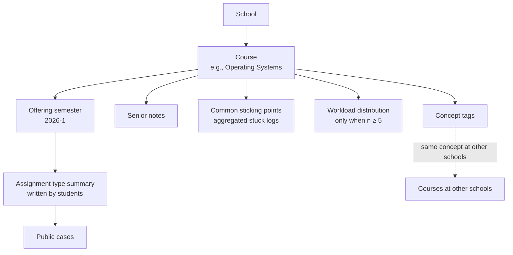
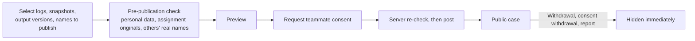

# Peerchive evolution plan: the assignment ends, the process remains

[한국어](PROOFU_EVOLUTION_PLAN.md) | **English**

Written: 2026-10-18 (Asia/Seoul) · Status: consolidated proposal · For: product planning, design, and go/no-go on implementation

Peerchive is the new name for the project that continues from **ProofU**, an undergraduate graduation project built in 2019. Combining *Peer + Archive*, the name captures the goal of a public archive where students learn from one another's assignment and project experiences. The project was renamed to distinguish it from a separate career-management project called `proofu`. The GitHub repository name and address also changed from `proofu-univ` to [`peerchive`](https://github.com/polynomeer/peerchive). Document file paths are unchanged, and the preserved code is the original ProofU implementation.

This document consolidates the initial proposal of 2026-10-13, the concept addendum of 2026-10-14, and the clean-slate plan (v2) of 2026-10-14 into a single reference document. The earlier documents remain in the Git history. All features, schedules, and metrics are hypotheses to be validated; they do not represent implemented features or confirmed market demand.

| Document | Covers |
|---|---|
| **Product plan (this document)** | Problem, concept, features, screens, policy, MVP scope, business |
| [System design](planning/SYSTEM_DESIGN.en.md) | Architecture, tech stack, domain model, publication state transitions, permissions, API, AI, operations |
| [Delivery plan](planning/DELIVERY_PLAN.en.md) | Validation experiments, roadmap, backlog, acceptance scenarios, metrics, risks, costs |
| [Existing code analysis](PROJECT_ANALYSIS.en.md) · [Original history and backup](HISTORY_RECONSTRUCTION.en.md) | The preserved ProofU original |

---

## 0. One-line summary

**Peerchive turns university students' team and individual assignments into a "tool that keeps the team alive" during the semester, a "public map for juniors" after the semester, and an "evidence-backed portfolio" at job-hunting time.**

| When | Value to the student | Core features |
|---|---|---|
| During the semester | Progress management; free-rider disputes settled by records | Build log, milestones, contribution ledger, messenger bot |
| After the semester | Jokbo that belongs to everyone, not just the well-connected | Course archive, senior notes, plan fork |
| Job hunting | A portfolio that assembles itself without rewriting | Case studies, competency × evidence, public profile |

Slogan candidates:
- Main: **"The assignment ends. The process remains."**
- For juniors and exploration: **"Leave a map, not the answers."**
- For authors and portfolios: **"Finish the assignment, keep the process, and show it as your experience."**

"Jokbo" (assignment materials privately handed down from senior students) is used when explaining the founding background; inside the service we use "course archive," "assignment case," and "build log."

---

## 1. Revisiting the starting point

### 1.1 The original idea and the 2019 implementation

| Original intent | 2019 ProofU implementation |
|---|---|
| Turn jokbo passed around through personal connections into a public record | Public board search, sorting by view count |
| Archive and showcase everything from process to output, like GitHub | Trello-style kanban (Todo/Doing/Done), board and card attachments |
| Turn outputs into portfolios for new-grad job hunting | MyPage activity timeline, language/field charts |
| Team-based assignments | Teams, members, join requests, team chat, calendar, school notices |

### 1.2 Limits of the kanban-centered implementation

1. **Kanban only keeps "status."** Once a card moves to Done, why, how, and what was hard disappears. A list of Done cards is not information for either juniors or recruiters.
2. **The reason to use it during the semester was weaker than Trello, Notion, or KakaoTalk.** A distant reward like "it becomes a portfolio later" does not build a recording habit.
3. **The portfolio was an activity-volume chart.** Commit counts, card counts, and language ratios do not explain competence.
4. **The unit of publication was ambiguous.** Publishing an in-progress board as-is leaks answers to students taking the same course that semester; keeping it private means the archive never accumulates.

This plan starts by tackling these four head-on. Kanban is not discarded; it remains as a "to-do" view (§6.6).

---

## 2. Problem definition

### 2.1 Users and pain points (hypotheses)

| User | Current difficulty | Current alternatives and their limits | What changes with Peerchive | How to verify |
|---|---|---|---|---|
| **Current student (author)** | Free riders in team assignments, confusion over roles and deadlines, no basis for peer evaluation. When the semester ends, the assignment vanishes onto a hard drive | Group chats, Notion, Drive, Trello: conversations and files are scattered, so who did what is never recorded | Keeps the process through short logs and a bot, and uses the contribution ledger for peer evaluation | Manually operated experiment, 4-week recording retention |
| **Junior (explorer)** | Doesn't know the time required, where people get stuck, or what order to start in. Only well-connected students get jokbo | Community boards, contacting seniors, blogs: fragmentary, unfair, prone to drifting into answer trading | Sees the map (time, sticking points, senior notes) on the course page and forks a plan | Course hub prototype experiment |
| **Team project participant** | Team results and individual contribution are mixed, making it hard to explain one's own role | Self-introduction essays: no evidence | Links evidence to role declarations and gets teammate confirmation | Teammate confirmation experiment, recruiter reading experiment |
| **Job seeker** | Hard to stand out with only a tech list and finished screens. Rewrites the portfolio from memory at the end of the semester | Notion portfolio: high rewriting cost | Presents 2–3 cases assembled from records, centered on problem, contribution, and validation | Experiment comparing writing time and comprehension |
| **Recruiter** | New-grad projects all look alike, and there is no time to read whole repositories. With generative AI, judging from outputs alone is even harder | Résumés, coding tests, interviews | Sees role and result in a 90-second summary, drills down to evidence, and forms interview questions | Mock review experiment |
| **Professor / TA** | Hard to track team progress and judge free riding; wants to preserve good examples but worries about assignment leaks | LMS, meetings | Checks publication scope and embargo, and participates selectively | Stakeholder interviews, policy review |

Secondary customers are **universities** (capstone/PBL outcome management and exhibitions) and **companies** (new-grad screening), addressed in the monetization phase (§17).

### 2.2 First target

- **Students in software-related team assignments and capstones** at one university department, plus graduates and upper-year students who have already taken those courses. Code coexists with reports, presentations, and designs, making this a good starting point.
- Designed from the start to work **without a GitHub account**, using only files, links, and logs, so it can expand to non-development majors.
- The distribution unit is not the whole school but **one semester cohort, 2–3 courses, 10–20 teams**. It must be able to start at the student or club level even without professor participation. Company features are validated only after student-side value is confirmed.

---

## 3. Core insights

### 3.1 Anatomy of jokbo: remove the answers and most of the value remains

| Jokbo component | What the student gets | Problematic? | Peerchive's response |
|---|---|---|---|
| Assignment answers, past exam solutions | Output to use as-is | Academic dishonesty, undermines assessment | **Not handled.** Upload warnings, reporting, embargo |
| Time spent, perceived difficulty | Semester scheduling | No | **Workload distribution** based on weekly check-ins |
| Common sticking points | Fewer trial-and-error cycles | No | **Stuck logs** and per-course aggregation |
| Reference material and tool recommendations | Learning path | No (with attribution) | Per-case references, course hub curation |
| Sense of output quality | Understanding expectations | Borders on answer leakage | **Milestone snapshots and evolution view** instead of full final outputs |
| Grading tendencies, professor style | Scoring strategy | Reputation and dispute risk | Not handled. Only links to published grading criteria and the author's own reflections |
| Senior advice | Direction, motivation | No | **Senior notes** |

The legitimate, beneficial core of jokbo is a map: **"Where is it hard, how long does it take, and what should I do first?"** If we build an information structure that gives people plenty of reason to come even without answers, answer-seeking won't become the platform's center.

### 3.2 The motivation to record during the semester is "proving my share"

Records accumulate only when they give the writer an immediate benefit. During the semester, a student's strongest motivation is **wanting credit for what they did in a team assignment**. So the contribution ledger and peer-evaluation report are the core in-semester value, and the public archive and portfolio are designed as reuse of records already made. We never make people rewrite content just for publication.

### 3.3 It answers a different question than GitHub

| | GitHub | Peerchive |
|---|---|---|
| What is recorded | **What** changed in the code | **Why and how** people judged and learned |
| Basic unit | Commit, PR | Milestone, decision, stuck point |
| Primary reader | Collaborating developers | Juniors taking the same course, recruiters |
| Discovery axes | Repository, language | School, course, assignment type, concept, sticking point |
| Non-development assignments | Poor fit | Reports, designs, presentations, and experiments alike |
| What gets forked | Code | **The plan** (milestones, checklists, time allocation). Answers are not forked |

Self-introduction is already possible with a GitHub profile README, so "self-introduction + repository links" alone is weakly differentiated ([GitHub profile README guide](https://docs.github.com/en/account-and-profile/how-tos/profile-customization/managing-your-profile-readme)). GitHub is not something to replace but **a place to pull evidence from**. Also, since GitHub Classroom shut down on 2026-08-28, we do not plan a Classroom-specific integration and start with generic repository links and a GitHub App ([GitHub shutdown notice](https://github.com/orgs/community/discussions/205975), checked 2026-10-13).

---

## 4. Concept and positioning

### 4.1 Product definition

**A service that lets university students reuse the progress, sticking points, decisions, validations, and outputs they recorded while doing assignments: as team collaboration records during the semester, as public learning cases for juniors after the semester, and as an evidence-linked personal portfolio at job-hunting time.**

### 4.2 Relationship to existing tools

| Tool | What it already does | Relationship to Peerchive |
|---|---|---|
| GitHub | Code version control and collaboration | Integrated as a source of evidence |
| Trello, Notion | General task and document management | Differentiated by an assignment-specific structure (milestones, contribution, publication policy) |
| KakaoTalk, Discord | Team conversation | A bot joins and collects decisions and progress from conversations into records |
| Course review communities | Course reviews, anonymous boards | An archive of assignment *processes*, not professor ratings. No professor ratings |
| Notion/LinkedIn portfolios | Self-introduction, showcase | A portfolio assembled from records and linked to evidence |
| LMS, grading tools | Distributing, collecting, and grading assignments | A record the student owns even after the course ends |

This differentiation is not a proven competitive advantage but a hypothesis to confirm through user research, validated by **"Does preparation time go down, and is my contribution easier to understand?"** Peerchive does not build Git hosting, an IDE, auto-grading, general project management, or a recruiting ATS.

```text
                   Process-centered
                         ▲
          Peerchive ●    │
                         │      ● Dev blog
   Team/assignment ◀─────┼──────▶ Individual
                         │
         Trello ●        │  ● GitHub     ● Notion portfolio
                   Result-centered
```

### 4.3 Positioning in the generative AI era (hypothesis)

As of 2026, the cost of producing outputs has dropped sharply. We therefore **assume** that (1) professors, finding it hard to judge understanding from outputs alone, will want to see the process, and (2) recruiters will ask "why did you do it that way?" more than they look at finished screens. If true, the habit of recording the process becomes a real advantage for students, which also matches the meaning of the original name **ProofU** (Prove you).

| What we promise | What we don't promise |
|---|---|
| An *explainable process* in which milestones, decisions, and sticking points leading to the output are linked in chronological order | Certification of performance or originality |
| A descriptive display of the type and number of pieces of evidence for each contribution claim | Overall competency scores, employability scores |
| Optional disclosure of AI usage scope, and a record of how it was verified and revised | Flagging AI usage as a penalty signal |

---

## 5. Core loop



### 5.1 Three distinct representations

| Representation | Who sees it | Contents |
|---|---|---|
| **Assignment space** | Team (private) | Unfinished records, internal team feedback, all private materials |
| **Public case** | Anyone | A *point-in-time snapshot* built only from content the author selected and teammates consented to |
| **Portfolio** | Recruiters and others | Another version that picks and explains one's own contributions from public cases |

The original goal of a "public assignment history" is implemented as **accumulating public cases anyone can view**. It is not extended to mean that all in-progress information and assignment originals are published automatically.

---

## 6. Process recording: build log + milestones instead of kanban

### 6.1 Comparing format candidates

| Format | Strengths | Limits | For juniors | For recruiters | Writing burden | Verdict |
|---|---|---|---|---|---|---|
| Kanban (2019) | Familiar, shows status | Loses reasons and context | Low | Low | Low | Secondary "to-do" view |
| Gantt chart | Schedule management | Overkill for assignments | Low | Low | Medium | Not adopted |
| Free journal / blog | Freedom of expression | Blank-page burden, hard to search | Medium | Medium | High | Supported as free notes |
| Automatic commit collection | Zero input | Misses non-development work; activity ≠ competence | Low | Medium | None | Optional evidence |
| Lab notebook | Scientific thinking | Heavy format | Medium | High | High | Absorbed into decision log template |
| Retrospective only | Easy to organize | Memory loss | Medium | High | Medium | Absorbed into retrospective mode |
| **Build log + milestones + weekly check-in** | Short posts preserve process, judgment, and sticking points; searchable and reassemblable | Requires a habit → supplemented by bot and AI | **High** | **High** | **Low–medium** | **Default approach** |

The judgment that it is more useful is still a hypothesis. If real students find it burdensome, we will experiment with fewer tags or a file-centered flow.

### 6.2 Build log

Short posts (1–5 lines + images, files, links) accumulate chronologically, like a social media thread. The default input is **"what I did / what I learned / evidence,"** and tags are optional. You can attach a file or photo first and write the line later. We do not force it with daily blanks or streak scores.

| Tag | Meaning | Structured fields | Example |
|---|---|---|---|
| 🔨 Progress | What was done | – | "Login API done, including token expiry handling" |
| 🧱 Stuck | Where you got stuck and what you tried | Symptom, context keywords, error message (optional), attempts, time spent (range) | "CORS error. Tried proxy config → failed" |
| 💡 Solved | Resolution or workaround for a stuck point | Linked stuck entry, solution. **Unresolved is allowed** | "Fixed by adding server headers, 3 hours" |
| ⚖️ Decision | A choice and its reasons | Options → criteria → choice → in hindsight | "MySQL vs Firebase → MySQL given teammates' experience" |
| 🗣️ Meeting | Meeting summary and decisions | Attendees, decisions, follow-up tasks | Drafted by bot/AI, approved by teammates |
| ✅ Validation | How it was checked and the result | Subject, conditions, result, remaining uncertainty | "Usability test with 5 people; 2 couldn't find the map button" |
| 🔁 Reflection | Lessons, what I'd do differently | – | Written via an end-of-semester reflection interview |

- When writing a 🧱 stuck log, we ask **"Is the solution part the assignment answer itself?"** If it is close to answer code, we guide the author to rewrite it as a concept or approach explanation.
- The "in hindsight" field of ⚖️ decisions is filled in via a notification after the assignment ends, and becomes the raw material for the most persuasive sentences in a portfolio.
- Editing a record keeps a version, and error corrections are shown with a corrected status instead of silently overwriting the original.
- The actual date of work (`claimed_date`) is self-reported, and the server save time (`recorded_at`) is displayed separately.

### 6.3 Milestones and snapshots (evolution view)

An assignment is split into 3–6 stages (e.g., planning → midterm presentation → implementation → validation → final submission), and each milestone is assigned a **snapshot of the output at that point** (screen capture, draft report PDF, slides, repository tag link).

- In a public case, the **evolution view** shows snapshots side by side so you can see how the assignment grew. It is a non-code, visual version of a code diff.
- Instead of full final outputs, juniors get a sense of level like "this much is normal at the midterm presentation."
- Milestones are an ordering guide, not completion gates. You can go back from validation to implementation, names are free-form, and a common template can be imported from the course hub.
- In public views, logs are grouped around **key turning points** (decisions, resolved sticking points, validations) rather than shown as a full chronological list.

### 6.4 Weekly check-in

The minimum input to reduce recording fatigue. A weekly notification asks only:

1. Time invested this week (0 / ~2h / ~5h / ~10h / 10h+)
2. Perceived difficulty (1–5)
3. One line: the most important progress or sticking point → can be promoted directly to a stuck or decision log

The MVP is a 60-second form, extended in P1 to a 3-minute **AI reflection interview** ("What took the longest this week?", "How did you solve it?"). At the end of the semester, a 15-minute interview produces reflection and case study material. AI-generated records are saved only after the student approves them.

Check-ins are team-private by default. The course hub's workload distribution is shown as an anonymous aggregate **only from check-ins whose authors consented to statistics sharing, and only when 5 or more are gathered for the same course and assignment type** (threshold to be finalized in the pilot).

### 6.5 Input paths that lower the recording burden

| Path | Behavior | Phase |
|---|---|---|
| Web/mobile quick log | A single input box and tag buttons; take a photo first, add a line | MVP |
| Messenger bot | Invite the bot to Discord (first) or Slack. `/log stuck CORS error` or a 📌 reaction on a message saves it as a log. KakaoTalk starts as notifications only due to API and cost constraints | MVP (Discord) |
| Meeting summary | AI summarizes conversations in a meeting channel the team consented to, producing a 🗣️ meeting log draft | P1 |
| AI reflection interview | §6.4 | P1 |
| GitHub connection | Attach repository, PR, and commit links (MVP); turn selected repository metadata into evidence via a GitHub App (P1) | MVP/P1 |

### 6.6 Kanban stays as a "to-do" view

- A to-do list with assignees, deadlines, and status. The MVP prioritizes **a list view and a status-change menu**; the board (drag) view is P1, and dragging has keyboard and button alternatives.
- When completing a to-do, we ask once **"Did you get stuck? Was there anything to decide?"** and convert a response into a build log. Completion works even without a response.
- This is the form in which 2019 ProofU's Board/List/Card survives in v2.

### 6.7 Retrospective mode

Assignments already finished (graduates, past semesters) have no in-progress records. Included in the MVP to supply content for the cold start.

- Milestones and logs are reconstructed backward with reference to file dates, commit history, and presentation material versions.
- Every item is marked **`retrospective`**, and we do not hide that it carries a lower trust indicator than in-progress records.
- The goal is for a graduate to leave one case within 30 minutes.

---

## 7. Contribution ledger: the core in-semester feature

It settles free riding and contribution disputes, the biggest stress of team assignments, with records.

| Element | Behavior |
|---|---|
| Automatic collection | Each teammate's logs, completed to-dos, uploaded outputs, meeting participation, and (when integrated) commits and PRs accumulate chronologically |
| Role declaration | Each person declares "what I was responsible for" in a sentence and links related logs and output versions as evidence |
| Teammate confirmation | Other teammates confirm the declaration or comment. **If the declaration or evidence changes, earlier confirmations do not carry over to the current declaration.** People cannot confirm their own declarations, and even the owner cannot edit someone else's declaration |
| Weekly report | Each week, a per-teammate activity summary is shared with the team (bot message) |
| Peer evaluation report | A per-teammate contribution summary PDF for submitting to the course's peer evaluation at the end of the semester |

**Principles**
- Activity is never converted into scores or percentages. Instead of "30 logs," we show **types and evidence**, like "3 decisions, 5 resolved sticking points, 2 roles confirmed by teammates." Without activity rankings, gaming such as splitting logs doesn't arise.
- Display states are distinguished: **self-described (unconfirmed) / teammate-confirmed / external evidence linked / mentor opinion.** Unproven contributions are not forced to be deleted; they are clearly marked "self-described, unconfirmed."
- "Teammate-confirmed" only means that teammate acknowledged the claim; it is not professor certification, a competency verification, or a guarantee of legal rights.
- A comment tone guide keeps it a factual record rather than blame.

---

## 8. Course archive: the public version of jokbo

### 8.1 Structure



Cases from the same course are *only grouped*; the same course or title is not treated as the same assignment. Class, semester, and assignment contexts are each kept distinct.

### 8.2 Course page

1. Course introduction and prerequisite concept tags (written by students, merged by operators, marked "student-written")
2. List of assignment types — **summaries written by students**, not assignment originals
3. Distribution of perceived time and difficulty (anonymous aggregate; "not enough data yet" below the threshold)
4. Common sticking points — 🧱 stuck logs sorted by "I got stuck here too" count
5. Senior notes (§8.3)
6. List of public cases with milestone snapshot previews
7. "At other schools" — courses and sticking points at other schools with the same concept tags (compensates for thin supply in a single-school pilot)

### 8.3 Senior notes

A short reflection left for juniors by a student who finished the course or assignment. It uses a question template: what I should have done in the first week / what ate the most time / what I'd do differently / concepts and materials I wish I'd known in advance.

- Can be written without a public case, so knowledge can remain even for assignments whose cases are hard to publish.
- Author display can be real name, display name, or anonymous. Even when anonymous, operators can identify the author for handling reports.
- Much easier than a full case, so it becomes **the first supply source for the graduate campaign**.

### 8.4 Plan fork: fork the plan, never the answers

GitHub's fork is applied to *plans*. Juniors fork a senior's assignment's **milestone structure, to-do checklist, weekly time allocation, and reference list** to start their own assignment space. Code, report bodies, and the solution content of stuck logs are not forked. The fork count becomes a reward signal for the original author ("my record was used by N juniors") and can be shown on the portfolio.

### 8.5 Stuck Q&A (P1)

Juniors can post questions on public 🧱 stuck logs (if the author allows it). Answers focused on principles and approaches are encouraged; completing another student's in-progress assignment on their behalf or selling answers is not allowed. Other students' "this helped" signals are used **only to sort cards by usefulness** and are not summed into an author's personal score.

### 8.6 Policy

- **Professor names, grading tendencies, and star ratings are not handled.** This is a different domain from course review services and avoids reputation disputes. The instructor field is hidden by default.
- Cases for in-progress assignments in the same course and semester are subject to **embargo** (§9.2).
- The "school context" captured by the original ProofU's school notice collection (YUnotice) is inherited through the school → course structure, but without crawling.

---

## 9. Publication and archiving

### 9.1 Publication levels

Publication is **per snapshot**. The in-progress assignment space itself is never published.

| Level | What is visible | Exposure | Phase |
|---|---|---|---|
| 🔒 Private | Team only | – | MVP (default) |
| 📄 Summary public | Assignment summary, milestones, selected stuck/decision/validation logs. Output bodies excluded | Archive, search, profile | MVP |
| 🌐 Fully public | The above + selected output versions and contributions | Archive, search, profile | MVP |
| 🔗 Limited sharing | Only people with an expiring, revocable link. Not shown in search or archive | For job applications | P1 |

### 9.2 Embargo

Assignments with course and semester information **cannot be published until the end date of that semester.** After it ends, a "Publish it?" notification is sent. We do not decide that publication is allowed under school policy merely because the semester or submission date has passed, and **there is no automatic publication.** Senior notes covering only concepts, or records stating they are from a different semester's course, may be exceptions. Whether embargo is an enforced default or the author's choice is an open decision (§19).

### 9.3 Publication process



- A publication candidate consists of the selected versions, displayed names, attachments, and sources, and consent is obtained **for that candidate's content**. If the content changes, affected consents are requested again.
- Names, logs, and shared materials of teammates who did not consent or did not respond are excluded, or publication is put on hold. Even if a teammate leaves, the usage terms for shared materials are not automatically loosened.
- The pre-publication check uses AI and rules to detect student ID numbers, phone numbers, files that look like assignment problem sheets, and others' real names, and **warns**; the student makes the decision.
- Withdrawal is possible at any time and immediately removes the content from public cases, portfolios, and search. We explain that copies already downloaded and external search engine caches cannot be guaranteed to be recalled.

### 9.4 Default behavior by situation

| Situation | Default behavior |
|---|---|
| Assignment being written | Team-private, public preview available |
| Publication eligibility unconfirmed | No automatic publication even after the date passes |
| Team output | Confirm the version to publish, member display, and consent to use materials |
| External examples and libraries referenced | Keep sources and usage terms. Never remove sources to present it as one's own result |
| Contains professor's problem sheet, others' answers, or personal data | Upload warning, publication scope check, exclusion or redaction |
| Help requests from other students mid-assignment | Feedback focused on principles and approaches. No completing it for them, no selling answers |
| Consent withdrawal, report | Hide the public version, record the cause review and appeal, and block derived portfolios too |

### 9.5 Licenses and timestamps

- We do not force a blanket public license on members. Each output distinguishes **view only (default) / reuse allowed under a stated license / original terms of an external link**. Materials without a separate license are never shown as freely reusable.
- The server save time only marks when it entered the platform; work dates, commit dates, or hashes alone do not certify actual work or originality.

---

## 10. Profile and portfolio

### 10.1 Profile

```text
┌────────────────────────────────────────────────┐
│ Jimin Kim · Aspiring backend dev · Grad 2027.02│
│ "A developer who adjusts scope and validates   │
│  under imperfect conditions"                   │
│ [Contact] [PDF] [GitHub]                       │
├────────────────────────────────────────────────┤
│ Featured case studies (3)                      │
│  ▸ Library occupancy web app — scope adjusted  │
│    to manual input instead of real-time        │
│    sensors, confirmed by usability testing     │
│    Role: API, input validation (2 teammates    │
│    confirmed)                                  │
│  ▸ OS shell implementation — zombie process    │
│    debugging case                              │
├────────────────────────────────────────────────┤
│ Competency × evidence                          │
│  API design    Decisions 3 · Outputs 2 ·       │
│                Teammate-confirmed              │
│  Debugging     Resolved stuck points 8         │
│  Collaboration Meeting notes 5 · Roles conf. 4 │
├────────────────────────────────────────────────┤
│ Junior impact: my plan forked 12 times ·       │
│ stuck answers 9                                │
│ 4-year assignment timeline ─●──●───●──●●──●─   │
└────────────────────────────────────────────────┘
```

- Basic information: name or display name, one-line introduction, target role, public contact method, featured cases. School, department, expected graduation date, and real name are optional, and the profile can be created privately first.
- Student ID numbers and grades are not collected. School email verification is an optional badge.
- Contact is offered only through methods the student allows.

### 10.2 Case study

Each featured case shows: **problem and result (2–3 sentences) → personal role and outputs made directly → key decisions → sticking points and solutions → validation evidence → distinction between team result and personal contribution → remaining limitations → original links.**

| Phase | Generation method |
|---|---|
| **MVP** | A **template-assembled draft** that arranges the public snapshot's milestones, decisions, sticking points, validations, and contribution declarations in the order above. No generative model, so cost and privacy risk are low |
| **P1** | AI polishes the wording only within the publication scope the student chose. **Every sentence carries a source log, and sentences without a source are highlighted and must be fixed or deleted before publishing** |

Multiple versions with different emphasis can be made per target role (backend/frontend/data/product planning/design).

### 10.3 One record, two views

The same public version is used, with information in a different order.
- **Detailed learning view** (juniors): alternatives, failures, sticking points, and references first.
- **Portfolio summary view** (recruiters): problem, contribution, result, and evidence first.

### 10.4 Competency × evidence matrix

The 2019 MyPage "language/field chart" (activity volume) is replaced by an **evidence visualization**.

| Competency \ Case | Library occupancy app | OS shell | Capstone |
|---|---|---|---|
| API design | Decision 1 · Teammate-confirmed | – | Snapshots 2 |
| Debugging | Resolved stuck points 2 | Resolved stuck points 3 | – |
| User validation | Usability test | – | Interview summary |

- Rows are chosen from role-specific presets or entered directly.
- Skill tags distinguish **self-declaration** ("I used TypeScript") from **experience evidence** ("I designed the input validation module and tested it this way").
- Cells show only the type and number of pieces of evidence, never ranking level with scores or color intensity. Clicking a cell navigates to that evidence.

### 10.5 Interview prep pack (P1)

For each featured case, expected questions are generated from decision and stuck logs ("Why did you choose manual input over real-time sensors?", "What was your biggest failure?", "Were there disagreements within the team?"), and the student leaves private answer notes. If the student allows it, some are shown on the recruiter view as **"Good questions to ask this candidate."**

### 10.6 Export

- PDF portfolio, basic print view (MVP), improved application PDF (P1)
- 2–3 sentence summaries and public links for résumés and cover letters
- A markdown card for the GitHub profile README — a path from GitHub into Peerchive
- Export of all of the student's own data (free core value)

---

## 11. Recruiter features

| Feature | Description | Phase |
|---|---|---|
| Public profile viewing | Viewable via link without login, designed so role and evidence can be grasped within 90 seconds | MVP |
| Evidence drill-down | Case sentence → original log, snapshot, teammate confirmation | MVP |
| Save, PDF | Save profiles of interest, download PDF | P1 |
| Portfolio Q&A | AI answers questions like "What did you personally do in this project?" by **citing only evidence inside the public snapshot**. If there is no evidence, "no record." Active only when the student turns it on | P2 |
| Talent search | Only students who turned on "job seeking"; filters by competency, course, region | P2 |
| Contact request | Contact details revealed only when the student accepts | P2 |
| Industry-linked assignments | Companies provide real problems as capstone assignments and view the results | P3 |

Unwanted recruiting contact, collection of grades or sensitive information, and automatic rejection decisions are out of scope.

---

## 12. Professor and school features (P2 onward, B2B candidates)

| Feature | Description |
|---|---|
| Class space | A professor creates a class, bulk-creates team assignment spaces, and distributes milestone templates |
| Progress dashboard | Per-team milestone progress, recent activity, alerts for stalled teams. Log bodies only within the scope the team allows |
| Peer evaluation integration | Peer evaluation collection based on the contribution ledger |
| Publication policy and embargo requests | Class-level publication defaults, requests to postpone publication of cases from a specific course and semester |
| Showcase gallery | Online exhibition for capstone competitions and graduation exhibitions |
| Learning record export | Long-term, consider integration with standards like CLR/Open Badges. Simple teammate confirmations are not issued as certificates ([1EdTech CLR](https://www.1edtech.org/standards/clr)) |

---

## 13. Screen design

### 13.1 Information architecture

```text
Peerchive
├── Home (logged in: my assignments dashboard / logged out: explore course archive)
├── Explore
│   ├── School > Course > Assignment type > Case
│   ├── Stuck search (error messages, keywords)
│   └── Concept tags
├── My assignments
│   └── Assignment space [Overview | Build log | To-do | Outputs | Contribution | Publish]
├── Portfolio [Case studies | Profile | Export]
├── @username (public profile)
└── Settings (integrations: GitHub, Discord / notifications / publication defaults)
```

The top menu starts with **Explore / My assignments / Portfolio**. Editing areas and public showcase areas are visually distinguished, and share buttons always display the publication scope.

### 13.2 Key screens

| Screen | Question the first view answers | Key actions |
|---|---|---|
| My assignments dashboard | What do I need to do this week, and what is blocked? | Quick log, check-in, prepare publication |
| Assignment space | What problem am I solving now, and what have I found out? | Logs, to-dos, outputs, contribution |
| Publication prep | Whose information is published, what, and how? | Select, check, preview, request consent, post |
| Course page | How long does this course take, and where do people get stuck? | Read senior notes and sticking points, fork a plan |
| Public case | What was built and why, and how was it verified? | Evolution view, key decisions and sticking points, sources |
| Public profile | What did this student do directly, and what's the evidence? | Cases, matrix, permitted contact |

**My assignments dashboard**
```text
┌ This week ──────────────────────────────────────────────┐
│ OS Assignment 2  Due D-5  ▓▓▓▓░░ Milestone 3/5          │
│   └ 🧱 1 unresolved stuck · teammate Minsu no log 3 days │
│ Capstone Design  Midterm presentation D-12              │
│ [Quick log ________________] [🔨][🧱][⚖️] [📎]          │
└─────────────────────────────────────────────────────────┘
┌ Weekly check-in (60s) ──── [Start] ┐
└ 1 assignment now publishable ── [Prepare publication] ┘
```

**Assignment space — build log**
```text
[Overview] [Build log] [To-do] [Outputs] [Contribution] [Publish]   🔒 Team only
Filter: All | 🧱Stuck | ⚖️Decision | ✅Validation | My logs
──── Milestone 2: Midterm presentation (10/20) [Snapshot: slides v1] ────
10/22 Jimin  🧱 CORS error, tried proxy config → failed
10/22 Jimin  💡 Fixed by adding server headers (3h)     ↳ linked to stuck
10/23 Minsu  ⚖️ Map API: Kakao vs Naver → Kakao for free quota
10/24 Bot    🗣️ Meeting summary (#meeting, approved)
Save: Saved / Saving / Error — retry
```

**Public case (junior's view)**
```text
Operating Systems · 2026-1 · Shell implementation assignment · 2 people · ~25 hours
Evolution view:  [Planning] → [Parser done] → [Pipes implemented] → [Final]
Common sticking points: Zombie processes (3) · Pipe fd leaks (2)
⚖️ Key decisions 2  🧱 Stuck 5 (4 resolved)  ✅ Validations 2
[Fork this plan]  [Senior notes]  [Report]
Public version v2 · Posted date · Edit/withdrawal status
```

### 13.3 Visual and accessibility principles

- **Document-style UI:** Student records and outputs are the protagonists. No marketing-style hero layouts in the workspace.
- Start from system fonts that support Korean; light background, dark body text, blue primary actions. Body text 16px or larger, line height about 1.6, reading width 65–80 characters.
- **Always display publication status** (🔒/📄/🌐/🔗 badges). Publication and confirmation states are never distinguished by color alone; text is always included.
- Mobile is optimized first for quick logs and photo attachments; desktop for case editing and publication review. Writing and viewing must work at 360px width.
- Touch targets, explicit labels, keyboard focus, error locations, and save status on slow networks. Dragging has move-menu and up/down button alternatives. Animation is used only to explain state transitions, and reduced-motion is respected.

---

## 14. One-semester scenario

A fictional student, Jimin (third year), works on an operating systems assignment with teammate Minsu and on a library occupancy web app assignment with another team.

| When | Jimin's action | Peerchive's role |
|---|---|---|
| Week 1 | Checks "average 25 hours, many get stuck on zombie processes" and senior notes on the course page, forks a senior's plan | Course archive, plan fork |
| Weeks 2–4 | While working in Discord, types `/log stuck` when stuck | Bot, build log |
| Week 5 | The web app team compares real-time sensors with manual input and records why they chose manual input as a ⚖️ decision | Decision log |
| Week 8 | Assigns the midterm presentation slides as a milestone snapshot | Milestones |
| Week 11 | Records the subjects, conditions, and limits of the usability test as ✅ validation. Only actually measured numbers | Validation log |
| Every week | 60-second check-in, receives weekly contribution report | Check-in, contribution ledger |
| Week 15 | Links evidence to the role declaration "screen flow design and API input validation," gets teammate confirmation. Attaches the contribution report PDF to the peer evaluation | Contribution ledger |
| End of semester | "Publish it?" notification. The web app, whose course publication rules are unclear, is published as a summary; the OS assignment is fully published. Teammates consent | Embargo lifted, publication check |
| Break | Edits and publishes the case draft. Instead of "built a library web app," what shows is **"experience adjusting scope and validating under imperfect data conditions"** | Case study |
| Second half of fourth year | Includes the profile link in job applications. An interviewer asks questions after reading the decision log | Public profile |
| Next semester | 12 juniors fork the plan and get answers to their stuck questions | Junior impact metric |

---

## 15. Academic integrity and ethics policy

This section is an operational and product policy proposal and does not assert any specific school's regulations or legal interpretation. Before launch, file rights, each school's assignment publication conditions, and personal data processing need review.

| Topic | Policy | Phase |
|---|---|---|
| Academic dishonesty | In-semester embargo, "fork the plan, never the answers," guidelines against sharing answers, reporting and hiding | MVP |
| Assignment originals | Upload warning (not blocking) when file names or patterns look like problem sheets or answers. Student-written summaries instead of assignment originals by default | MVP (rules) · P1 (improvements) |
| Full code | Repository link + key excerpts recommended | MVP guideline |
| Professor and course ratings | Not handled. Professor names hidden by default | MVP |
| Copyright | Outputs belong to the student (team); view-only by default. Warnings on uploading others' works | MVP |
| Team consent | Consent from parties included in the publication scope; materials of non-consenting members excluded | MVP |
| Personal data | Minimal collection, no student IDs or grades, optional school verification, choice of deleting or anonymizing public content on account deletion | MVP |
| AI | Generated content labeled and approval required; private data used only for that team's work; API terms that exclude training use; core features usable without AI | P1 |
| Contribution display | No activity scores or rankings; self-description and teammate confirmation distinguished | MVP |
| Recruiting | Not exposed in talent search unless the student turns it on; no selling student data; no school or view-count rankings | P2 |
| Faculty requests | Embargo request channel | P2 |

These measures **do not promise complete prevention of dishonesty.** The goal is to keep the default usage flow from drifting into answer sharing.

---

## 16. MVP scope

The MVP's purpose is to validate the flow in which **an assignment is recorded during the semester (build log, contribution ledger), becomes a public case after the semester (embargo, consent), is read by juniors (course hub), and is read in a personal portfolio**.

| Priority | Feature | Done criteria |
|---|---|---|
| P0 | Account, profile | Magic link, Google, GitHub login; deletion request; separation of public/private information |
| P0 | Assignment space, team invites | Course, semester, assignment summary input; invites and permissions; private by default; other teams blocked |
| P0 | Build log | Tags and structured fields (stuck, decision, validation), stuck↔solved linking, file/link evidence, edit versions, save status, mobile quick log |
| P0 | Milestones, snapshots | Reordering, assigning output versions, evolution view |
| P0 | To-do | List view, status-change menu, log conversion prompt on completion |
| P0 | Retrospective mode | `retrospective` label persists through to public views |
| P0 | Contribution ledger | Role declaration, evidence linking, teammate confirmation (invalidated on edit), weekly summary, peer evaluation report PDF |
| P0 | Discord bot | Account linking, `/log`, 📌 reaction collection, project selection |
| P0 | Weekly check-in (form) | Time, difficulty, one line; promotion to log; separate statistics consent |
| P0 | Publication, embargo | Publication candidate, check, preview, consent, posting, withdrawal; server-enforced embargo; no automatic exposure of the workspace |
| P0 | Minimal course hub | School, course, concept tags; course page (cases, sticking points, senior notes); writing senior notes; plan fork; basic reporting |
| P0 | Portfolio | Featured case selection, template case draft, contribution summary, link sharing, print view |
| P0 | Permissions, files, operations | Blocking access to private content, file scanning and quarantine, admin switch-to-private with audit logs |
| P1 | AI assistance | Reflection interview, meeting summary, AI case polishing (citations required), improved pre-publication check |
| P1 | Advanced archive | Workload distribution aggregation, usefulness signals, stuck Q&A, semantic search for similar sticking points |
| P1 | Advanced portfolio | Competency × evidence matrix, per-role versions, interview prep pack, limited sharing links, application PDF, README card |
| P1 | Advanced collaboration | Kanban board view, per-log feedback comments (publication handled separately), GitHub App |
| P2 | Recruiters, institutions | Portfolio Q&A, talent search and contact, mentor review, class space and dashboard, faculty embargo requests |

**What we won't build:** built-in chat (replaced by the messenger bot), a separate calendar engine (replaced by deadlines and .ics export), a school notice crawler, Git hosting, auto-grading. The original implementations stay in the archive and will be reconsidered if real demand is confirmed.

If available time is under 20 hours per week, a reduced plan applies: the Discord bot, peer evaluation PDF, and plan fork move to P1, leaving only the build log, contribution ledger, publication, and minimal course hub.

---

## 17. Business model (hypothesis)

| Target | Product | Rationale and conditions |
|---|---|---|
| Students | **Free.** Recording, publication, portfolio, export of own data, publication control | Student records are the platform's value |
| Students (optional) | Premium: custom portfolio domain and themes, expanded AI interviews, many per-role versions | Willingness to pay during hiring season needs validation |
| Universities, departments | Class space, progress dashboard, showcase gallery SaaS | Demand from capstone/PBL operation and outcome management |
| Companies | Search and contact consenting candidates, employer branding, industry-linked assignments | Only after student supply is sufficient |

Initial pricing and revenue are not fixed; paid hypotheses will be validated after measuring labor, storage, AI, and operational burden. For the first year, the goal is **density at one school and one department** rather than revenue. We do not propose selling student data or ranking students by school or view count.

---

## 18. Evolving without discarding the original ProofU

- The original `frontend/` and `backend/` are left as-is for record preservation, and the new app is built in `apps/` and `packages/` in the same repository. Why we don't incrementally upgrade the original, and the concept inheritance mapping, are in [System design §2](planning/SYSTEM_DESIGN.en.md#2-using-the-original-proofu).
- **Peerchive's first public case is ProofU itself.** Milestones: 2019 graduation project → 2020 repository upload → 2026 history cleanup → Peerchive planning and implementation. Decision logs: "Why kanban in 2019 / why switch to build logs in 2026"; stuck logs: the missing `backend/api/user.js` and outdated dependencies. It becomes the first real-world test of retrospective mode and the owner's own portfolio.
- The fact that the 18 commits from 2019 are a feature-by-feature reconstruction of code uploaded in 2020, not the actual development log of the time, must remain in this case's body and milestone labels.

---

## 19. Key decisions and open questions

| Item | Current proposal | Condition for change |
|---|---|---|
| First target | 2–3 software-related courses at one school, 10–20 teams | When the actually reachable cohort is in a different major |
| Default recording method | Build log + milestones + weekly check-in | If the writing burden is high, scale down to files, links, and check-ins |
| Core in-semester value | Contribution ledger, peer evaluation report | If free riding shows up weakly in interviews, shift to progress management |
| Publication timing | Explicit publication after the semester, embargo | Even after validating institutional policy, automatic publication is a separate option |
| Messenger integration | Discord first | If target students mainly use KakaoTalk, focus on web/PWA quick log |
| AI | Template drafts in MVP, AI in P1 | Results of cost and quality experiments |
| Technical direction | Preserve original + new app side by side | When existing production data or users are confirmed |
| Company features | Start with reading public profiles | When repeated recruiting review and contact demand is confirmed |

**Questions for the owner**
1. First pilot school and department: can we reach a cohort of juniors or clubs at the school connected to the original ProofU?
2. First 2–3 courses: which courses did the owner take personally and can write the first senior notes for?
3. Target students' team channels: Discord or KakaoTalk?
4. Embargo: enforced default or author's choice?
5. Development time: is the assumption of 20–30 hours per week correct?
6. Does an existing production DB exist, and what share of target students use Git?

Even without answers, we can start with a manual experiment using 3–5 consented completed assignments and graduates' senior notes ([Delivery plan §2](planning/DELIVERY_PLAN.en.md#2-validation-experiments-before-development)).

---

## 20. References and scope of interpretation

Official sources checked on 2026-10-13. External documents were used to confirm the features and limits of tools and standards; student demand, employment impact, and product success must be validated directly.

- [GitHub profile README](https://docs.github.com/en/account-and-profile/how-tos/profile-customization/managing-your-profile-readme): confirms that a self-introduction feature is already provided.
- [GitHub Classroom shutdown notice](https://github.com/orgs/community/discussions/205975): confirms the shutdown date and preservation of existing repositories.
- [1EdTech CLR](https://www.1edtech.org/standards/clr): a record standard linking learner achievements and evidence. Peerchive is currently not an accredited issuing or standards-compliant service.

## Preserving the original record

The 18 commits from June–November 2019 are a feature-by-feature reconstruction of code uploaded in 2020, not the actual development log of the time. This plan does not change that history. The original is kept on the [backup branch](https://github.com/polynomeer/peerchive/tree/backup/pre-reconstruction-20261013), and the modernization implementation will proceed in separate follow-up commits.
