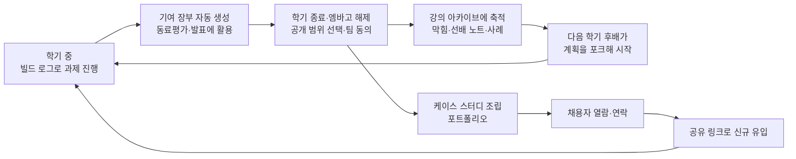
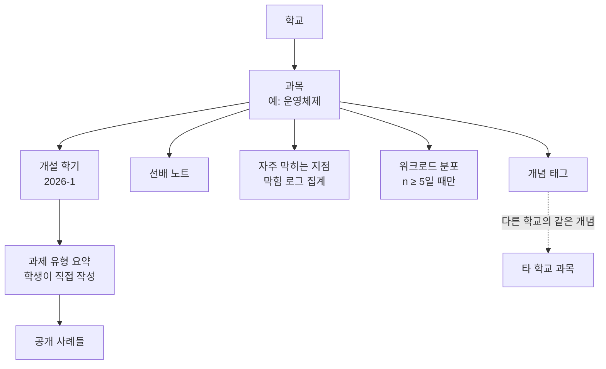
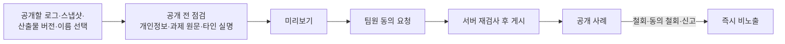

# Peerchive 고도화 기획: 과제는 끝나도, 과정은 남는다

**한국어** | [English](PROOFU_EVOLUTION_PLAN.en.md)

작성일: 2026-10-18 (Asia/Seoul) · 갱신: 2026-10-23 (정체성 포지션 §4.4, 졸업생·토픽·기관 확장 §8.9.9–§8.9.11, 공개 범위·팔로우 §10.7 반영) · 상태: 통합 제안 · 대상: 제품 기획, 설계, 구현 착수 판단

Peerchive(피어카이브)는 2019년 대학교 학부 졸업작품 **ProofU**에서 이어지는 프로젝트의 새 이름입니다. *Peer + Archive*를 결합해 학생들이 서로의 과제·프로젝트 경험에서 배우는 공개 아카이브라는 목적을 담았습니다. 별도의 커리어 관리 프로젝트 `proofu`와 구분하기 위해 이름을 변경했습니다. GitHub 저장소 이름과 주소도 `proofu-univ`에서 [`peerchive`](https://github.com/polynomeer/peerchive)로 변경했습니다. 문서 파일 경로는 유지하며, 보존된 코드는 기존 ProofU의 구현입니다.

이 문서는 2026-10-13 초기 제안, 2026-10-14 컨셉 보완안, 2026-10-14 백지 기획(v2)을 하나로 통합한 기준 문서입니다. 이전 문서들은 Git 이력에 남아 있습니다. 기능·일정·지표는 모두 검증할 가설이며 구현된 기능이나 확인된 시장 수요를 의미하지 않습니다.

| 문서 | 다루는 내용 |
|---|---|
| **제품 기획 (이 문서)** | 문제·컨셉·기능·화면·정책·MVP 범위·사업 |
| [시스템 설계](planning/SYSTEM_DESIGN.md) | 아키텍처·기술 스택·도메인 모델·공개 상태 전이·권한·API·AI·운영 |
| [실행 계획](planning/DELIVERY_PLAN.md) | 검증 실험·로드맵·백로그·수용 시나리오·지표·위험·비용 |
| [기존 코드 분석](PROJECT_ANALYSIS.md) · [원본 이력과 백업](HISTORY_RECONSTRUCTION.md) | 보존된 ProofU 원본 |

---

## 0. 한 줄 요약

**Peerchive는 대학생의 조별·개인 과제를 학기 중에는 ‘팀이 살아남는 도구’로, 학기 후에는 ‘후배를 위한 공개 지도’로, 취업 때는 ‘근거 있는 포트폴리오’로 바꿔 주는 서비스입니다.**

| 시기 | 학생에게 주는 가치 | 핵심 기능 |
|---|---|---|
| 학기 중 | 진행 관리, 무임승차 논쟁을 기록으로 해소 | 빌드 로그, 마일스톤, 기여 장부, 메신저 봇 |
| 학기 후 | 족보를 인맥이 아닌 모두의 것으로 | 강의 아카이브, 선배 노트, 플랜 포크 |
| 취업 때 | 다시 쓰지 않아도 조립되는 포트폴리오 | 케이스 스터디, 역량×근거, 공개 프로필 |

슬로건 후보:
- 대표: **“과제는 끝나도, 과정은 남는다.”**
- 후배·탐색 쪽: **“답이 아니라 지도를 남겨 주세요.”**
- 작성자·포트폴리오 쪽: **“과제를 끝내고, 과정을 남기고, 나의 경험으로 보여 주세요.”**

‘족보’는 창업 배경을 설명할 때 쓰고, 서비스 안의 언어는 ‘강의 아카이브’, ‘과제 사례’, ‘빌드 로그’로 씁니다.

---

## 1. 출발점 다시 보기

### 1.1 최초 아이디어와 2019 구현

| 최초 의도 | 2019 ProofU 구현 |
|---|---|
| 선배에게 알음알음 받는 족보를 공개 이력으로 | 공개 보드 검색, 조회수 정렬 |
| 깃허브처럼 과정부터 산출물까지 아카이빙·전시 | Trello형 칸반(Todo/Doing/Done), 보드·카드 첨부파일 |
| 산출물을 포트폴리오화해 신입 취업에 활용 | MyPage 활동 타임라인, 언어·분야 차트 |
| 팀 단위 과제 | 팀·멤버·가입 신청, 팀 채팅, 캘린더, 학교 공지 |

### 1.2 칸반 중심 구현의 한계

1. **칸반은 ‘상태’만 남긴다.** 카드가 Done으로 넘어가면 왜·어떻게·무엇이 어려웠는지는 사라진다. 후배와 채용자 모두에게 Done 카드 목록은 정보가 되지 않는다.
2. **학기 중에 쓸 이유가 Trello·노션·카톡보다 약했다.** “나중에 포트폴리오가 된다”는 먼 보상만으로는 기록 습관이 생기지 않는다.
3. **포트폴리오가 활동량 차트였다.** 커밋 수·카드 수·언어 비율은 역량을 설명하지 못한다.
4. **공개의 단위가 모호했다.** 진행 중인 보드를 그대로 공개하면 같은 학기 수강생에게 답안이 새고, 비공개로 두면 아카이브가 쌓이지 않는다.

이 기획은 네 가지를 정면으로 해결하는 데서 시작합니다. 칸반은 버리지 않고 ‘할 일’ 보기로 남깁니다(§6.6).

---

## 2. 문제 정의

### 2.1 사용자와 고통 (가설)

| 사용자 | 지금의 어려움 | 지금 쓰는 대안과 한계 | Peerchive에서 달라지는 행동 | 확인 방법 |
|---|---|---|---|---|
| **재학생(작성자)** | 조별과제 무임승차, 역할·마감 혼선, 동료평가 근거 없음. 학기가 끝나면 과제가 하드디스크에서 사라짐 | 단톡방·노션·드라이브·Trello: 대화와 파일이 흩어져 누가 무엇을 했는지 안 남음 | 짧은 로그와 봇으로 과정을 남기고, 기여 장부를 동료평가에 씀 | 수동 운영 실험, 4주 기록 유지율 |
| **후배(탐색자)** | 소요 시간·막히는 지점·시작 순서를 모름. 족보는 인맥 있는 사람만 받음 | 커뮤니티 게시판·선배 연락·블로그: 단편적, 불공평, 정답 거래로 흐르기 쉬움 | 과목 페이지에서 지도(시간·막힘·선배 노트)를 보고 계획을 포크 | 과목 허브 프로토타입 실험 |
| **팀 프로젝트 참여자** | 팀 결과와 개인 기여가 섞여 본인 역할을 설명하기 어려움 | 자기소개서 서술: 근거 없음 | 역할 선언에 근거를 연결하고 팀원 확인을 받음 | 팀원 간 확인 실험, 채용자 읽기 실험 |
| **취업 준비생** | 기술 목록과 완성 화면만으로 차별점을 설명하기 어려움. 포트폴리오를 학기 말에 기억으로 다시 씀 | 노션 포트폴리오: 재작성 비용이 큼 | 기록에서 조립된 케이스 2~3개를 문제·기여·검증 중심으로 소개 | 작성 시간·이해도 비교 실험 |
| **채용자** | 신입 프로젝트가 다 비슷해 보이고, 저장소 전체를 읽을 시간이 없음. 생성형 AI로 결과물만으로는 판단이 더 어려움 | 서류·코딩테스트·면접 | 90초 요약에서 역할·결과를 보고 근거로 이동, 면접 질문을 만듦 | 모의 검토 실험 |
| **교수·조교** | 팀 진행 상황 파악, 무임승차 판정이 어렵고 좋은 사례를 남기고 싶지만 과제 유출이 걱정됨 | LMS·면담 | 공개 범위·엠바고를 확인하고 선택적으로 참여 | 담당자 인터뷰, 정책 검토 |

부가 고객으로 **대학**(캡스톤·PBL 성과 관리·전시)과 **기업**(신입 검증)이 있으며, 수익화 단계에서 다룹니다(§17).

### 2.2 첫 대상

- 한 대학·학과의 **소프트웨어 계열 팀 과제·캡스톤 학생**과, 그 과목을 이미 들은 졸업생·고학년. 코드와 보고서·발표·디자인이 함께 있어 시작점으로 적합합니다.
- 처음부터 **GitHub 계정 없이** 파일·링크·로그만으로 쓸 수 있게 설계해 비개발 전공으로 확장할 수 있게 합니다.
- 유통 단위는 학교 전체가 아니라 **한 학기 코호트, 과목 2~3개, 팀 10~20개**입니다. 교수가 참여하지 않아도 학생·동아리 단위로 시작할 수 있어야 합니다. 기업 기능은 학생 쪽 가치가 확인된 뒤 검증합니다.
- 캠퍼스 커뮤니티 앱(Fizz 등)이 학교 단위로 순차 개방하듯, 과목 허브도 **기준 공급량을 채운 과목부터 단계적으로 엽니다**(§8.6). 빈 과목 페이지를 먼저 보여 주지 않고, 개방 전에는 “준비 중 · 열리면 알림”과 선배 노트 작성 요청을 보여 줍니다.

---

## 3. 핵심 통찰

### 3.1 족보의 해부: 정답을 빼도 가치의 대부분은 남는다

| 족보 구성요소 | 학생이 얻는 것 | 문제 여부 | Peerchive의 대응 |
|---|---|---|---|
| 과제 답안·기출 정답 | 그대로 쓸 결과물 | 학업 부정, 평가 무력화 | **다루지 않음.** 업로드 경고·신고·엠바고 |
| 소요 시간·난이도 체감 | 학기 일정 계획 | 없음 | 주간 체크인 기반 **워크로드 분포** |
| 흔히 막히는 지점 | 시행착오 단축 | 없음 | **막힘 로그**와 과목별 집계 |
| 참고 자료·도구 추천 | 학습 경로 | 없음(출처 표기) | 사례별 참고 자료, 과목 허브 큐레이션 |
| 결과물의 수준 감각 | 기대치 파악 | 답안 유출과 경계 | 최종물 전문이 아닌 **마일스톤 스냅샷과 진화 보기** |
| 평가 성향·교수 스타일 | 점수 전략 | 평판·분쟁 위험 | 다루지 않음. 공개된 평가 기준 링크와 본인 회고만 |
| 선배의 조언 | 방향·동기 | 없음 | **선배 노트** |

족보의 합법적이고 유익한 핵심은 **“어디가 어렵고, 얼마나 걸리고, 무엇을 먼저 해야 하는가”**라는 지도입니다. 답안이 없어도 찾아올 이유가 충분한 정보 구조를 만들면, 답안을 찾는 사용이 플랫폼의 중심이 되지 않습니다.

### 3.2 학기 중 기록의 동기는 ‘내 몫의 증명’

기록은 쓰는 사람에게 당장 이득이 있어야 쌓입니다. 학기 중 학생에게 가장 강한 동기는 **조별과제에서 내가 한 일을 인정받고 싶은 마음**입니다. 그래서 기여 장부와 동료평가 리포트를 학기 중 핵심 가치로 두고, 공개 아카이브와 포트폴리오는 이미 남긴 기록의 재활용으로 설계합니다. 공개를 위해 별도로 글을 다시 쓰게 만들지 않습니다.

### 3.3 GitHub와는 다른 질문에 답한다

| | GitHub | Peerchive |
|---|---|---|
| 기록 대상 | 코드가 **무엇이** 바뀌었나 | 사람이 **왜·어떻게** 판단하고 배웠나 |
| 기본 단위 | 커밋·PR | 마일스톤·결정·막힘 |
| 주 독자 | 협업 개발자 | 같은 과목을 들을 후배, 채용자 |
| 탐색 축 | 저장소·언어 | 학교·과목·과제 유형·개념·막힌 지점 |
| 비개발 과제 | 부적합 | 보고서·디자인·발표·실험도 동일하게 |
| 포크 대상 | 코드 | **계획**(마일스톤·체크리스트·시간 배분). 답은 포크하지 않음 |

GitHub 프로필 README로 자기소개는 이미 가능하므로 ‘자기소개 + 저장소 링크’만으로는 차별성이 약합니다([GitHub 프로필 README 안내](https://docs.github.com/en/account-and-profile/how-tos/profile-customization/managing-your-profile-readme)). GitHub는 대체 대상이 아니라 **근거를 가져오는 곳**입니다. 또한 GitHub Classroom이 2026-08-28 종료되었으므로 Classroom 전용 연동은 계획하지 않고 일반 저장소 링크·GitHub App으로 시작합니다([GitHub 종료 공지](https://github.com/orgs/community/discussions/205975), 2026-10-13 확인).

---

## 4. 컨셉과 포지셔닝

### 4.1 제품 정의

**대학생이 과제를 진행하며 남긴 진행·막힘·결정·검증·산출물을, 학기 중에는 팀 협업 기록으로, 학기 후에는 후배를 위한 공개 학습 사례로, 취업 때는 근거가 연결된 개인 포트폴리오로 재사용하게 하는 서비스.**

### 4.2 기존 도구와의 관계

| 도구 | 이미 하는 일 | Peerchive와의 관계 |
|---|---|---|
| GitHub | 코드 버전 관리·협업 | 연동해서 근거로 가져옴 |
| Trello·노션 | 범용 작업·문서 관리 | 과제 특화 구조(마일스톤·기여·공개 정책)로 차별화 |
| 카톡·디스코드 | 팀 대화 | 봇으로 들어가 대화 속 결정·진행을 기록으로 수집 |
| 캠퍼스 커뮤니티(에브리타임·Fizz) | 학교 인증 익명 게시판, 시간표, 강의평가 | 학교·학과·스터디 방은 참고해 두되(§8.9) 교수·강의 평가는 하지 않음. 커뮤니티를 과제 *과정* 아카이브로 이어 주는 것이 차이 |
| 노션·링크드인 포트폴리오 | 자기소개·전시 | 기록에서 조립되고 근거로 연결되는 포트폴리오 |
| LMS·채점 도구 | 과제 배포·제출·평가 | 수업이 끝난 뒤에도 학생이 소유하는 기록 |

이 차별화는 입증된 경쟁 우위가 아니라 사용자 조사로 확인할 가설이며, **“준비 시간이 줄고, 내 기여가 더 쉽게 이해되는가”**로 검증합니다. Peerchive는 Git 호스팅·IDE·자동 채점·범용 프로젝트 관리·채용 ATS를 만들지 않습니다.

```text
                    과정 중심
                       ▲
          Peerchive ●  │
                       │      ● 개발 블로그
   팀/과제 단위 ◀──────┼──────▶ 개인 단위
                       │
         Trello ●      │  ● GitHub     ● 노션 포트폴리오
                    결과 중심
```

### 4.3 생성형 AI 시대의 포지셔닝 (가설)

2026년 현재 결과물을 만드는 비용이 크게 낮아졌습니다. 이에 따라 (1) 교수는 결과물만으로 이해도를 판단하기 어려워 과정을 보려 하고, (2) 채용자는 완성된 화면보다 “왜 그렇게 했는가”를 묻는 비중을 늘릴 것이라고 **가정**합니다. 맞다면 과정을 남기는 습관이 학생의 실질적 이점이 되며, 원래 이름 **ProofU**(Prove you)의 의미와도 일치합니다.

| 약속하는 것 | 약속하지 않는 것 |
|---|---|
| 결과물에 이르는 마일스톤·결정·막힘이 시간 순서로 연결된 *설명 가능한 과정* | 수행·독창성의 인증 |
| 기여 주장마다 근거의 종류·개수를 서술적으로 표시 | 종합 역량 점수, 취업 가능성 점수 |
| AI 사용 범위의 선택적 공개, 어떻게 검증·수정했는지의 기록 | AI 사용을 감점 신호로 표시 |

### 4.4 정체성 포지션: 실명은 기록에, 익명은 라운지에

에브리타임·블라인드·Fizz는 인증된 익명성이 핵심 강점입니다. Peerchive는 그 강점을 정면으로 따라가지 않고 **정체성을 중심에 두고 익명을 공간별 모드로** 둡니다. 소속 인증은 강하게 하고, 무엇을 얼마나 드러낼지는 공간마다 사용자가 고릅니다.

**익명을 중심에 두지 않는 이유**
1. ProofU(Prove you)와 기여 장부·포트폴리오는 “누가 했는가”를 증명하는 일이며, 익명 활동은 증명으로 쌓이지 않습니다.
2. 국내 캠퍼스 익명 커뮤니티는 에브리타임이 이미 표준이어서 같은 경쟁은 네트워크 효과에서 집니다. 반대로 “기록과 사람이 남는 곳”은 익명 커뮤니티가 구조적으로 하기 어렵습니다.
3. 익명 중심 서비스는 괴롭힘·명예훼손 대응이 운영의 대부분이 되기 쉬워, 소규모 팀이 감당하기 어렵습니다.

그래도 공감하고 떠드는 공간에는 익명이 필요하므로, 정체성을 네 단계로 나누고 공간마다 쓸 수 있는 단계를 정합니다.

| 단계 | 보이는 것 | 쌓이는 것 | 쓰는 곳 |
|---|---|---|---|
| 0. 익명 | `익명1`(스레드 안에서만 유지) | 없음 | 공식 학교 라운지, 공감 토픽 |
| 1. 소속 표시 익명 | `○○대 · 졸업생`, `부트캠프 수료생` | 없음 | 학교를 넘나드는 토픽, 커리어·현직자 Q&A(§8.9.10) |
| 2. 표시명 | `@devjimin` 같은 지속 가명 | 팔로워, 공개 글, 공개 기록 | 공개 프로필, 스터디, 크리에이터 활동 |
| 3. 실명 | 김지민 | 팔로워, 포트폴리오, 동문 명부 | 동문회·OB, 실명 방, 채용자에게 보이는 프로필 |

- **0~1단계 글은 2~3단계 프로필과 절대 연결하지 않습니다.** 팔로우·공개 글 목록·활동 기록에는 2~3단계만 나타나므로, 유명해진 사용자의 익명 글도 추적되지 않습니다.
- **표시명(2단계)은 실명과 별도의 정체성입니다.** 실명을 밝히지 않고도 팔로워와 평판을 쌓을 수 있게 하며, 표시명과 실명의 연결은 사용자가 직접 켤 때만 보입니다.
- 한 계정 안에서 단계를 오가므로, 운영자는 신고 처리를 위해 모든 단계의 작성자를 확인할 수 있습니다(§8.9.6).

---

## 5. 핵심 루프



### 5.1 세 가지 표현을 구분한다

| 표현 | 누가 보나 | 내용 |
|---|---|---|
| **과제 공간** | 팀(비공개) | 미완성 기록, 팀 내부 피드백, 비공개 자료 전부 |
| **공개 사례** | 누구나 | 작성자가 고르고 팀원이 동의한 내용만으로 만든 *특정 시점의 스냅샷* |
| **포트폴리오** | 채용자 등 | 공개 사례 중 본인의 기여를 골라 설명한 또 하나의 버전 |

‘public한 과제 이력’이라는 원래 목적은 **누구나 열람할 수 있는 공개 사례를 축적하는 것**으로 구현합니다. 작성 중인 모든 정보와 과제 원문을 자동으로 공개한다는 의미로 확대하지 않습니다.

---

## 6. 과정 기록: 칸반을 대신하는 빌드 로그 + 마일스톤

### 6.1 형식 후보 비교

| 형식 | 장점 | 한계 | 후배에게 | 채용자에게 | 작성 부담 | 판단 |
|---|---|---|---|---|---|---|
| 칸반(2019) | 익숙, 상태 파악 | 이유·맥락 소실 | 낮음 | 낮음 | 낮음 | 보조 ‘할 일’ 보기 |
| 간트 차트 | 일정 관리 | 과제엔 과함 | 낮음 | 낮음 | 중간 | 채택 안 함 |
| 자유 일지·블로그 | 표현 자유 | 빈 페이지 부담, 검색 어려움 | 중간 | 중간 | 높음 | 자유 메모로 지원 |
| 커밋 자동 수집 | 무입력 | 비개발 누락, 활동량≠역량 | 낮음 | 중간 | 없음 | 선택적 근거 |
| 실험 노트 | 과학적 사고 | 형식이 무거움 | 중간 | 높음 | 높음 | 결정 로그 템플릿에 흡수 |
| 사후 회고만 | 정리가 쉬움 | 기억 손실 | 중간 | 높음 | 중간 | 사후 작성 모드로 흡수 |
| **빌드 로그 + 마일스톤 + 주간 체크인** | 짧은 글로 과정·판단·막힘이 남고 검색·재조립 가능 | 습관 필요 → 봇·AI로 보완 | **높음** | **높음** | **낮음~중간** | **기본 방식** |

더 유용하다는 판단은 아직 가설입니다. 실제 학생이 부담을 느끼면 태그를 줄이거나 파일 중심 흐름으로 바꾸는 실험을 합니다.

### 6.2 빌드 로그

SNS 스레드처럼 짧은 글(1~5줄 + 이미지·파일·링크)을 시간순으로 쌓습니다. 기본 입력은 **‘한 일 / 알게 된 점 / 근거’**이며 태그는 선택입니다. 파일·사진부터 붙이고 한 줄을 나중에 써도 됩니다. 날짜별 빈칸이나 연속 기록 점수로 강제하지 않습니다.

| 태그 | 의미 | 구조화 필드 | 예시 |
|---|---|---|---|
| 🔨 진행 | 한 일 | – | “로그인 API 완성, 토큰 만료 처리까지” |
| 🧱 막힘 | 막힌 지점과 시도 | 증상, 맥락 키워드, 오류 메시지(선택), 시도한 것, 걸린 시간(범주) | “CORS 에러. 프록시 설정 시도 → 실패” |
| 💡 해결 | 막힘의 해결·우회 | 연결된 막힘, 해결 방법. **미해결도 허용** | “서버 헤더 추가로 해결, 3시간” |
| ⚖️ 결정 | 선택과 이유 | 선택지 → 판단 기준 → 선택 → 지나고 보니 | “MySQL vs Firebase → 팀원 경험 고려해 MySQL” |
| 🗣️ 회의 | 회의 요약·결정사항 | 참석자, 결정, 후속 할 일 | 봇·AI가 초안, 팀원 승인 |
| ✅ 검증 | 확인 방법과 결과 | 대상·조건·결과·남은 불확실성 | “사용성 테스트 5명, 2명이 지도 버튼 못 찾음” |
| 🔁 회고 | 배운 점, 다시 한다면 | – | 학기 말 회고 인터뷰로 작성 |

- 🧱 막힘 로그는 작성 시 **“해결 부분이 과제 답 자체인가요?”**를 확인합니다. 정답 코드에 가까우면 개념·접근 설명으로 바꾸도록 안내합니다.
- ⚖️ 결정의 ‘지나고 보니’ 칸은 과제 종료 후 알림으로 채우게 하며, 포트폴리오에서 가장 설득력 있는 문장의 재료가 됩니다.
- 기록을 수정하면 버전이 남고, 오류 정정은 원본을 몰래 덮어쓰지 않고 정정 상태로 표시합니다.
- 실제 수행일(`claimed_date`)은 자기 기입, 서버 저장 시각(`recorded_at`)은 별도로 표시합니다.

### 6.3 마일스톤과 스냅샷 (진화 보기)

과제를 3~6개 구간(예: 기획 → 중간발표 → 구현 → 검증 → 최종제출)으로 나누고, 각 마일스톤에 **그 시점 산출물의 스냅샷**(화면 캡처, 보고서 초안 PDF, 슬라이드, 저장소 태그 링크)을 지정합니다.

- 공개 사례에서는 스냅샷을 나란히 보여 주는 **진화 보기**로 과제가 어떻게 자라났는지 보입니다. 코드 diff의 비개발·시각적 버전입니다.
- 후배는 최종물 전문 대신 “중간발표 때 이 정도면 정상”이라는 수준 감각을 얻습니다.
- 마일스톤은 순서 안내이며 완료 게이트가 아닙니다. 검증에서 구현으로 돌아갈 수 있고, 이름은 자유이며, 과목 허브의 공통 템플릿을 불러올 수 있습니다.
- 공개 화면에서는 로그를 시간순 전체보다 **중요한 전환점**(결정·막힘 해결·검증) 중심으로 묶어 보여 줍니다.

### 6.4 주간 체크인

기록 피로를 줄이는 최소 입력입니다. 주 1회 알림으로 다음만 묻습니다.

1. 이번 주 투입 시간(0 / ~2h / ~5h / ~10h / 10h+)
2. 체감 난이도(1~5)
3. 한 줄: 가장 중요한 진전 또는 막힘 → 바로 막힘·결정 로그로 승격 가능

MVP는 60초짜리 폼이며, P1에서 3분짜리 **AI 회고 인터뷰**(“이번 주 가장 오래 걸린 건?”, “그걸 어떻게 풀었어?”)로 확장합니다. 학기 말에는 15분 인터뷰로 회고와 케이스 스터디 재료를 만듭니다. AI가 만든 기록은 학생이 승인해야 저장됩니다.

체크인은 팀 비공개가 기본입니다. 과목 허브의 워크로드 분포는 **통계 공유에 동의한 체크인만, 같은 과목·과제 유형에서 5명 이상 모였을 때만** 익명 집계로 보여 줍니다(임계값은 pilot에서 확정).

### 6.5 기록 부담을 낮추는 입력 경로

| 경로 | 동작 | 단계 |
|---|---|---|
| 웹·모바일 퀵로그 | 입력창 하나와 태그 버튼, 사진 먼저 찍고 한 줄 | MVP |
| 메신저 봇 | 디스코드(1차)·슬랙에 봇 초대. `/log 막힘 CORS 에러` 또는 메시지에 📌 반응을 달면 로그로 저장. 카카오톡은 API·비용 제약으로 알림 전용부터 | MVP(디스코드) |
| 회의 요약 | 팀이 동의한 회의 채널 대화를 AI가 요약해 🗣️ 회의 로그 초안 생성 | P1 |
| AI 회고 인터뷰 | §6.4 | P1 |
| GitHub 연결 | 저장소·PR·커밋 링크 첨부(MVP), GitHub App으로 선택 저장소 메타데이터 근거화(P1) | MVP/P1 |

### 6.6 칸반은 ‘할 일’ 보기로 남긴다

- 담당자·마감·상태를 가진 할 일 목록. MVP는 **리스트 보기와 상태 변경 메뉴**를 우선하고, 보드(드래그) 보기는 P1이며 드래그에는 키보드·버튼 대안을 둡니다.
- 할 일을 완료할 때 **“막힌 적 있었나요? 결정할 게 있었나요?”**를 한 번 묻고, 응답하면 빌드 로그로 전환합니다. 응답하지 않아도 완료됩니다.
- 2019 ProofU의 Board/List/Card가 v2에서 살아남는 형태입니다.

### 6.7 사후 작성 모드

이미 끝난 과제(졸업생, 지난 학기)는 진행 중 기록이 없습니다. 콜드 스타트 공급을 위해 MVP에 포함합니다.

- 파일 날짜·커밋 이력·발표 자료 버전을 참고해 마일스톤과 로그를 거꾸로 구성합니다.
- 모든 항목은 **`사후 작성`**으로 표시되고, 진행 중 기록보다 신뢰 표시가 낮다는 점을 숨기지 않습니다.
- 목표는 졸업생이 30분 안에 사례 하나를 남기는 것입니다.

---

## 7. 기여 장부: 학기 중 핵심 기능

조별과제의 가장 큰 스트레스인 무임승차·기여도 분쟁을 기록으로 해소합니다.

| 요소 | 동작 |
|---|---|
| 자동 수집 | 팀원별 로그·완료한 할 일·업로드한 산출물·회의 참여·(연동 시) 커밋·PR이 시간순으로 쌓임 |
| 역할 선언 | 각자 “내가 맡은 것”을 문장으로 선언하고 관련 로그·산출물 버전을 근거로 연결 |
| 팀원 확인 | 다른 팀원이 선언을 확인하거나 코멘트. **선언·근거가 바뀌면 이전 확인은 현재 선언에 승계되지 않음.** 본인 선언을 자기가 확인할 수 없고, owner도 타인의 선언을 편집할 수 없음 |
| 주간 리포트 | 매주 팀원별 활동 요약을 팀에 공유(봇 메시지) |
| 동료평가 리포트 | 학기 말 수업 동료평가 제출용 팀원별 기여 요약 PDF |

**원칙**
- 활동량을 점수·비율로 환산하지 않습니다. “로그 30개”보다 “결정 3건, 막힘 해결 5건, 팀원 확인 받은 역할 2개”처럼 **종류와 근거**로 보여 줍니다. 활동량 순위가 없어야 로그 쪼개기 같은 게이밍이 생기지 않습니다.
- 표시 상태를 구분합니다: **본인 설명(미확인) / 팀원 확인 / 외부 근거 연결 / 멘토 의견.** 입증하지 못한 기여는 삭제를 강요하지 않고 ‘본인 설명, 미확인’으로 명확히 합니다.
- ‘팀원 확인’은 해당 팀원이 그 주장을 인정했다는 뜻일 뿐, 교수 인증·능력 검증·법적 권리 보증이 아닙니다.
- 비난이 아닌 사실 기록이 되도록 코멘트 톤 가이드를 둡니다.

---

## 8. 강의 아카이브: 족보의 공개판

### 8.1 구조



같은 과목의 사례를 *묶을 뿐*, 같은 과목·제목이라고 같은 과제로 간주하지 않습니다. 수업·학기·과제 맥락은 각각 구분합니다.

### 8.2 과목 페이지

1. 과목 소개와 선수 개념 태그(학생 작성, 운영자 병합, “학생 작성” 표시)
2. 과제 유형 목록 — 과제 원문이 아닌 **학생이 쓴 요약**
3. 체감 소요시간·난이도 분포(익명 집계, 임계값 미달 시 “아직 데이터가 충분하지 않음”)
4. 자주 막히는 지점 — 🧱 막힘 로그를 “나도 여기서 막혔어요” 수로 정렬
5. 선배 노트(§8.3)
6. 공개 사례 목록과 마일스톤 스냅샷 미리보기
7. “다른 학교에서는” — 같은 개념 태그를 가진 타 학교 과목·막힘(단일 학교 pilot의 공급 부족 보완)

### 8.3 선배 노트

과목·과제를 마친 학생이 후배에게 남기는 짧은 회고입니다. 질문형 템플릿을 씁니다: 첫 주에 했어야 했던 일 / 가장 시간을 잡아먹은 곳 / 다시 한다면 다르게 할 것 / 미리 알았으면 좋았을 개념·자료.

- 공개 사례 없이도 작성할 수 있습니다. 사례 공개가 어려운 과제에서도 지식은 남길 수 있게 하기 위함입니다.
- 작성자 표시는 실명·표시명·익명 중 선택. 익명이라도 운영자는 신고 처리를 위해 작성자를 알 수 있습니다.
- 사례 하나보다 훨씬 쉬워서 **졸업생 캠페인의 첫 공급원**이 됩니다.

### 8.4 플랜 포크: 계획은 포크, 답은 금지

깃허브의 포크를 *계획*에 적용합니다. 후배는 선배 과제의 **마일스톤 구성, 할 일 체크리스트, 주차별 시간 배분, 참고 자료 목록**을 포크해 자기 과제 공간을 시작합니다. 코드·보고서 본문과 막힘의 해결 내용은 포크되지 않습니다. 포크 수는 원작자에게 “내 기록이 후배 N명에게 쓰였다”는 보상 신호가 되고 포트폴리오에 표시할 수 있습니다.

### 8.5 막힘 Q&A (P1)

공개된 🧱 막힘 로그에 후배가 질문을 달 수 있습니다(작성자가 허용한 경우). 원리·접근 위주 답변을 권장하며, 진행 중인 다른 학생의 과제를 대리 완성하거나 답을 판매하는 행위는 허용하지 않습니다. 다른 학생의 “도움됐어요” 신호는 **카드의 유용성 정렬에만** 쓰고 작성자 개인 점수로 합산하지 않습니다.

**스레드 단위 익명 표시.** 기초적인 질문을 부담 없이 할 수 있도록 Q&A 스레드 안에서는 에브리타임·Fizz의 방식처럼 참여자를 `질문자`·`익명1`·`익명2`로 표시할 수 있습니다. 같은 스레드 안에서는 같은 사람이 같은 번호를 유지하고, 스레드가 다르면 번호가 이어지지 않아 다른 글과 연결해 신원을 추정하기 어렵습니다. 막힘 로그 작성자의 답변은 익명을 고른 경우에도 `작성자`로 표시해 신뢰도를 유지합니다. 선배 노트와 같이 운영자는 신고 처리를 위해 실제 작성자를 알 수 있으며, 익명 답변은 포트폴리오의 ‘후배 기여’ 집계에 넣을지 작성자가 선택합니다.

### 8.6 정책

- **교수 실명·평가 성향·별점은 다루지 않습니다.** 강의평가 서비스와 다른 영역이며 평판 분쟁을 피합니다. 담당 교원 필드는 기본 비표시입니다.
- 같은 과목·같은 학기 진행 중 과제의 사례는 **엠바고**(§9.2) 대상입니다.
- 원본 ProofU의 학교 공지 수집(YUnotice)이 담았던 ‘학교 맥락’은 학교 → 과목 구조로 계승하되 크롤링은 하지 않습니다.
- **열람은 누구나, 과목 허브 작성은 학교 인증 계정만.** 선배 노트·막힘 Q&A 답변·과제 유형 요약은 해당 학교 메일로 인증한 재학생·졸업생만 쓸 수 있습니다. 졸업 후 학교 메일이 없어지는 경우를 위해 재학 중 인증 이력을 유지하고, 졸업생은 `졸업생` 표시를 붙입니다. 인증은 작성 자격 확인에만 쓰며 공개 화면에 학번·학과를 노출하지 않습니다(§10.1).
- **과목 허브 단계적 개방.** 과목 페이지는 공개 사례·선배 노트가 기준 개수(초기안: 합계 3개, pilot에서 확정)에 이르면 공개합니다. 개방 전에는 해당 과목을 등록한(§8.7) 학생에게 “준비 중”과 알림 신청, 해당 과목을 마친 학생에게 선배 노트 요청을 보여 줍니다.
- **학생 큐레이터.** 과목마다 해당 과목을 마친 고학년·졸업생 1~2명을 큐레이터로 둡니다. 큐레이터는 개념 태그 병합 제안, 과제 유형 요약 정리, 1차 신고 검토를 맡고, 공개 철회·계정 조치 같은 최종 처리는 운영자가 합니다. 큐레이터 활동은 포트폴리오의 ‘후배 기여’에 표시할 수 있습니다.
- **과목 허브는 공개 아카이브로 유지합니다.** 익명 자유 대화는 과목 허브가 아닌 캠퍼스 커뮤니티(§8.9)에서 하고, 강의평가·장터는 어디에서도 만들지 않습니다.

### 8.7 이번 학기 과목 등록 (P1)

에브리타임의 시간표처럼 학기 초에 **이번 학기 수강 과목**을 등록합니다. 학교·과목 검색으로 직접 고르며, 다른 서비스의 시간표를 크롤링하거나 계정 연동으로 가져오지 않습니다.

- 등록한 과목마다 과목 허브(개방된 경우)·선배 노트·플랜 포크 진입점을 홈에 보여 줍니다. 과목 허브를 찾아오게 하는 대신 학기 초에 먼저 건네는 경로입니다.
- 팀 과제가 생기면 등록된 과목에서 바로 과제 공간을 만들어 과목·학기 정보와 엠바고(§9.2)가 자동으로 채워집니다.
- 과목 등록 정보는 **본인만 봅니다.** 공개 프로필에는 노출하지 않고, 과목 허브의 “이번 학기 수강 중 N명” 같은 수치도 n ≥ 5 익명 집계일 때만 보여 줍니다.
- 학기가 끝나면 등록 과목을 기준으로 “선배 노트를 남겨 주세요”와 “공개할까요?” 알림을 보냅니다.

### 8.8 팀원 찾기 (P1)

학기 초 조별과제 팀 구성을 과목 단위로 돕습니다. 원본 ProofU의 팀 가입 신청을 과목 맥락으로 옮긴 기능입니다.

- 같은 과목을 등록한 학생이 “팀원 찾는 중” 글을 올리고, 지원자는 **원하면** 공개 프로필·공개 사례 링크를 첨부합니다. 첨부하지 않아도 지원할 수 있습니다.
- 지원자 목록은 모집자만 보며, 활동량·포크 수·확인 수로 지원자를 정렬하거나 순위 매기지 않습니다. 거절 사유는 남기지 않습니다.
- 팀이 구성되면 지원·모집 글은 닫히고, 그 자리에서 과제 공간 생성과 초대(§16 과제 공간·팀 초대)로 이어집니다.
- 수업이 팀을 배정하는 과목에서는 이 기능을 숨기도록 과목 큐레이터가 표시할 수 있습니다.
- 같은 모집 방식을 스터디에도 씁니다(§8.9.5). 팀원 모집과 스터디 모집은 한 ‘모집’ 목록에서 종류로 구분합니다.

### 8.9 캠퍼스 커뮤니티: 방과 페이지 (P1)

에브리타임의 학교별 게시판과 Fizz의 학교 인증 피드를 참고해, 학교·학과·동기·스터디 단위로 모이는 커뮤니티를 둡니다. 과제 기록만으로는 학기 중 매일 들어올 이유가 약하다는 2019년의 한계(§1.2)를 보완하고, 커뮤니티에서 오간 질문·스터디를 아카이브 기록으로 이어 주는 것이 목적입니다. 커뮤니티는 아카이브의 입구이지 대체물이 아니며, 커뮤니티 글은 공개 아카이브와 분리합니다.

#### 8.9.1 참고한 기능과 Peerchive의 선택

| 참고 기능 | 에브리타임·Fizz의 일반적 형태 | Peerchive의 선택 |
|---|---|---|
| 학교 인증 공간 | 학교 인증을 해야 그 학교 피드·게시판에 들어감 | 공식 페이지는 해당 학교 인증 구성원만 읽고 씀 |
| 학교별 게시판 | 자유·비밀·새내기·졸업생·정보·모집 게시판 | 공식 페이지에 기본 게시판 세트를 둠(§8.9.3) |
| 사용자 생성 게시판 | 학생이 게시판을 만들고 익명 허용 여부를 정함 | 누구나 중소 규모 ‘방’을 만들고 **방장이 실명·표시명·익명 중 이름 표시 방식을 지정** |
| 익명 글·댓글 번호 | 글 단위 익명 선택, 댓글은 `익명1`·`익명2`, `글쓴이` 표시 | 스레드 단위 익명 표시(§8.5)를 커뮤니티 전체에 적용 |
| 공감·인기글 | 공감(또는 추천) 수로 HOT·BEST 모음 | 공감만 두고 비추천은 두지 않음. 공식 페이지에 ‘많이 공감한 글’ 탭 |
| 투표 | 글에 투표 첨부 | 투표 첨부 지원(P2) |
| 신고와 자동 숨김 | 신고 누적 시 숨김, 이용 제한 | 신고 누적 시 임시 숨김 후 검토(§8.9.6) |
| 학생 모더레이터 | 학교별 학생 모더레이터·앰배서더 | 과목 큐레이터(§8.6)를 공식 페이지 모더레이터로 확장 |
| 모집 게시판 | 스터디·동아리·학회 모집 | 스터디 모집 → 스터디 방 생성 → 스터디 기록 → 공개 사례(§8.9.5) |
| 익명 쪽지·장터·강의평가 | 글에서 익명 쪽지, 중고 거래, 교수·강의 평가 | **만들지 않음**(§8.9.7) |
| 소속 표시 익명·토픽 (블라인드) | 익명 글에 회사명 표시, 회사를 넘나드는 토픽 | 학교·기관을 넘나드는 토픽과 소속 표시 익명(§8.9.10) |
| 모임 운영 도구 (밴드) | 밴드별 프로필, 일정·참석, 공지 읽음, 앨범 | 동문회·OB·수료생 방 템플릿(§8.9.9) |

#### 8.9.2 공간의 종류

| 구분 | 만드는 사람 | 이름 표시 기본값 | 들어가는 방법 | 예 |
|---|---|---|---|---|
| **공식 학교 페이지** | 요청을 받아 운영자가 개설 | **익명** | 해당 학교 메일 인증 | ○○대학교 |
| **공식 학과 페이지** | 요청을 받아 운영자가 개설 | **익명** | 해당 학교 인증 + 학과 선택(자기 신고) | ○○대 컴퓨터공학과 |
| **사용자 방** | 로그인한 누구나 | **방장이 지정**(실명·표시명·익명) | 방장이 정한 가입 방식 | 12학번 컴공 동기방, 운영체제 스터디, ○○ 학회 |
| **과목 허브** | 운영자·큐레이터(§8.6) | 작성자 선택(§8.3) | 누구나 읽기, 학교 인증 계정만 쓰기 | 운영체제 |
| **토픽** (P2) | 운영자 | **소속 표시 익명** | 기관 인증 계정 누구나 | 취준, 대학원, 군대·예비역, 공대 공감, 백엔드 |
| **기관 페이지** (P2) | 요청을 받아 운영자가 개설 | 익명 | 기관별 인증(§8.9.11) | ○○부트캠프, ○○ 교육 프로그램 |

공식 페이지와 사용자 방은 같은 게시판 구조를 쓰고, 권한과 기본값만 다릅니다. 과목 허브는 공개 아카이브이므로 커뮤니티와 섞지 않고, 각 과목 허브에서 “이 과목 이야기하기”로 연결된 방에 들어가게 합니다.

#### 8.9.3 공식 학교·학과 페이지

- **개설 요청.** 학교 인증 학생 누구나 요청할 수 있습니다. 운영자는 같은 학교 인증 학생의 요청이 기준 수(초기안: 10명)에 이르거나 학생회·학과 학생회가 요청하면 개설합니다. 학교 단위 순차 개방(§2.2)과 같은 원리로, 빈 페이지를 미리 만들지 않습니다.
- **공식 표시.** 공식 페이지에만 `공식` 배지를 붙입니다. 사용자 방은 이름에 `공식`·`학생회` 등을 쓸 수 없고, 학교·학과를 사칭하는 방은 신고 대상입니다. ‘공식’은 Peerchive가 개설·운영한다는 뜻이며 학교가 인정했다는 뜻이 아님을 안내합니다.
- **익명 기본.** 글·댓글은 익명이 기본이며, 작성자가 원하면 그 글만 표시명으로 쓸 수 있습니다. 실명은 쓰지 않습니다.
- **열람 범위.** 해당 학교 인증 구성원만 읽고 씁니다. 학과 페이지는 학교 인증 구성원이 읽고, 해당 학과를 선택한 사람이 씁니다. 학과는 학교 메일로 확인할 수 없어 자기 신고로 두고, 학과 모더레이터가 명백한 외부인을 제한할 수 있습니다. 공식 페이지 글은 비로그인·검색엔진에 노출하지 않습니다.
- **기본 게시판.** 자유 / 새내기 / 졸업생 / 질문 / 정보 / 모집(스터디·팀원·동아리) / 공지(모더레이터 전용). 질문 게시판의 기술·과제 질문은 막힘 로그로 옮길 수 있습니다(§8.9.8).
- **모더레이터.** 학생 큐레이터와 같은 방식으로 학교·학과마다 2~3명을 둡니다. 모더레이터도 익명 글의 작성자를 볼 수 없습니다.

#### 8.9.4 사용자 방

누구나 중소 규모의 방을 만들 수 있습니다. 동기방·동아리·학회·관심사 모임처럼 공식 페이지보다 작고 서로 아는 사람이 모이는 곳을 염두에 둡니다.

| 방을 만들 때 정하는 것 | 선택지 | 비고 |
|---|---|---|
| 이름 표시 방식 | **실명 / 표시명 / 익명** | 예: “12학번 컴퓨터공학과” 방을 실명으로 만들면 서로 실명으로 글을 씀 |
| 소속 | 학교 연결 / 학교 무관 | 학교를 연결하면 그 학교 인증 계정만 들어옴 |
| 찾기 | 목록·검색에 노출 / 링크·초대로만 | 익명 방도 목록 노출 가능 |
| 가입 방식 | 자유 가입 / 방장 승인 / 초대 전용 | 실명 방은 승인·초대가 기본 |
| 정원 | 기본 300명, 그 이상은 운영자 검토 | 큰 커뮤니티는 공식 페이지로 유도 |

- **이름 표시 방식을 바꿀 때.** 바뀐 방식은 **이후 글에만** 적용합니다. 익명으로 쓴 글이 실명 방 전환으로 공개되지 않으며, 실명 글도 익명으로 바뀌지 않습니다. 전환 전 멤버 전원에게 알리고 7일 뒤 적용합니다.
- **실명 방.** 실명은 계정에 입력한 이름이며 Peerchive가 신분을 검증하지 않습니다. 학교를 연결한 방은 학교 인증 여부를 이름 옆에 표시합니다. ‘12학번’ 같은 입학연도는 방 이름이나 자기 소개로만 쓰고, 학번(학생 번호)은 수집하지 않는다는 원칙(§10.1)을 유지합니다.
- **익명 방.** 방이 작을수록 익명이 쉽게 깨집니다. 멤버가 10명 미만인 익명 방에서는 글 시각을 ‘오늘·이번 주’ 단위로만 보여 주고, 만들 때 “소규모 익명 방은 말투·시간으로 작성자가 추정될 수 있습니다”라고 안내합니다.
- **방장 권한.** 공지 고정, 글 숨김, 멤버 승인·내보내기, 방 설정 변경. 익명 방의 방장도 작성자를 볼 수 없습니다. 방장이 떠나면 가장 오래된 운영진 또는 멤버에게 넘기고, 없으면 보관 상태가 됩니다.

#### 8.9.5 스터디 구하기

- **모집 글.** 공식 페이지 모집 게시판·과목 허브·사용자 방 어디서든 올릴 수 있습니다. 항목: 주제 또는 과목, 기간, 모집 인원, 진행 방식(온라인·오프라인·시간대), 목표, 만들어질 스터디 방의 이름 표시 방식.
- **지원.** 팀원 찾기(§8.8)와 같습니다. 프로필 첨부는 선택이고, 지원자 순위는 없으며 거절 사유를 남기지 않습니다. 익명 게시판의 모집 글이어도 지원자 정보는 모집자에게만 보입니다.
- **스터디 방.** 모집이 끝나면 스터디 방이 만들어지고 지원자가 초대됩니다. 서로 책임을 지는 모임이므로 **표시명이 기본**이며, 모집 글에서 실명이나 익명을 고를 수 있습니다.
- **스터디 기록.** 스터디 방에는 게시판과 함께 과제 공간과 같은 빌드 로그·마일스톤을 켤 수 있습니다. 주차별로 무엇을 했는지 남기면 끝날 때 스터디 회고를 공개 사례·포트폴리오로 만들 수 있습니다. 익명 스터디 방은 기록을 포트폴리오에 연결하지 않습니다.

#### 8.9.6 익명과 운영

- **익명은 다른 사용자에게 익명이라는 뜻입니다.** 운영자는 신고 처리·법적 요청 대응을 위해 작성자를 확인할 수 있고, 이 사실을 글쓰기 화면에 표시합니다. 방장·모더레이터는 확인할 수 없습니다.
- **익명 글은 프로필과 연결하지 않습니다.** 공개 프로필·포트폴리오·기여 장부에 나타나지 않고 활동 집계에도 들어가지 않습니다. 익명 활동 점수·등급도 두지 않습니다.
- **스레드 단위 번호.** 같은 스레드 안에서만 `익명1`·`익명2`가 유지되고 `글쓴이`가 표시됩니다(§8.5).
- **신고와 임시 숨김.** 서로 다른 인증 사용자의 신고가 기준 수(초기안: 공식 페이지 5건, 사용자 방 3건)에 이르면 글을 임시로 숨기고 모더레이터·운영자가 검토합니다. 권리 침해를 주장하는 게시 중단 요청은 법률 검토를 거친 별도 절차로 처리합니다.
- **이용 제한.** 경고 → 커뮤니티 쓰기 기간 제한 → 커뮤니티 영구 제한. 커뮤니티 제한은 과제 공간·포트폴리오 이용과 분리합니다.
- **금지 행위.** 진행 중인 과제 답안·시험 문제 공유, 교수·특정 개인의 실명 비방과 신상 공개, 학교·학과 사칭, 반복 홍보. 익명 글에 실명·연락처로 보이는 문자열이 있으면 게시 전에 경고합니다(P2).
- **학업 진실성.** 과목과 연결된 방에도 엠바고 정책(§9.2)을 적용합니다. 같은 학기 과제의 답안·코드 공유는 신고 사유이며, 계획·개념 질문은 허용합니다.

#### 8.9.7 만들지 않는 것

- **익명 쪽지.** 익명 글에서 바로 1:1 메시지를 보내는 기능은 괴롭힘 경로가 되기 쉬워 두지 않습니다. 연락이 필요한 경우는 모집 지원과 실명·표시명 방 안에서 해결합니다.
- **교수·강의 평가와 시험 정보.** §8.6 정책을 커뮤니티에도 그대로 적용합니다.
- **장터·실시간 채팅.** 방은 게시판형이며 실시간 대화는 팀이 쓰는 메신저와 봇(§6.5)에 맡깁니다.
- **비추천·활동 순위.** 다수의 비추천으로 글을 묻는 방식과 활동량 순위는 기여를 활동량으로 환산하지 않는다는 원칙(§7)과 맞지 않습니다.

#### 8.9.8 아카이브로 이어지는 길

| 커뮤니티에서 | 아카이브로 | 조건 |
|---|---|---|
| 질문 게시판의 기술·과제 질문과 답 | 막힘 로그(🧱) 또는 막힘 Q&A | 질문자와 채택된 답변자 동의. 옮길 때 이름 표시 방식을 다시 고름 |
| 선배가 남긴 긴 조언 글 | 선배 노트(§8.3) | 작성자 동의, 해당 과목 연결 |
| 스터디 방 기록 | 공개 사례·포트폴리오 | 공개 절차(§9.3)와 멤버 동의 |
| 모집 글 | 과제 공간·스터디 방 | 모집 마감 시 자동 생성 |

커뮤니티에서 아카이브로 옮기는 것은 언제나 작성자의 선택이며, 커뮤니티 글이 자동으로 공개 아카이브나 검색엔진에 노출되지 않습니다.

#### 8.9.9 졸업생 공간: 동문회·OB와 공감 라운지 (P2)

재학생만이 아니라 졸업생·현역·예비역이 함께 머무는 공간을 둡니다. 밴드처럼 아는 사람끼리 모여 **운영하는 도구**와, 블라인드·에브리타임처럼 **공감하고 떠드는 라운지**를 나눠 설계합니다.

**동문회·OB 방** — 사용자 방(§8.9.4)의 템플릿입니다.

| 기능 | 내용 | 참고 |
|---|---|---|
| 방별 프로필 | 방마다 다른 이름·사진(예: OB 방에서는 “12기 김지민”, 스터디 방에서는 표시명) | 밴드 |
| 신분 배지 | `현역`·`OB`·`n기`·`졸업생`. 기수는 자기 신고, 운영진이 수정 가능 | 동아리 OB 문화 |
| 일정·참석 응답 | 홈커밍·네트워킹 세션 공지, 참석/불참/미정 응답, 반복 모임 | 밴드 |
| 공지 읽음 확인·투표·앨범 | 운영진 공지에 읽음 수 표시, 장소·날짜 투표, 행사 사진 앨범(파일 검사 적용) | 밴드 |
| 멤버 명부 | 기수·현재 하는 일·관심 분야·연락 방법을 **공개에 동의한 멤버만** 표시. 방 밖으로 내보내기 불가 | 동문 명부 |

- 이름 표시 기본값은 실명 또는 표시명이며, 동문 네트워킹의 목적상 익명은 권장하지 않습니다.
- 회비·결제 관리는 하지 않습니다.

**공감 라운지** — 공식 학교 페이지의 자유 게시판과 학교를 넘나드는 공감 토픽(§8.9.10)입니다.

- 익명이 기본이며 이미지·짧은 영상도 올릴 수 있습니다. 업로드는 기존 파일 검사·격리 파이프라인을 그대로 거칩니다.
- 졸업 후 학교 메일이 없어져도 재학 중 인증 이력으로 졸업생 게시판과 라운지에 계속 들어올 수 있습니다(§8.6).
- 현역·예비역이 함께 웃을 수 있는 주제(학교생활, 군대, 취준, 첫 직장)를 토픽으로 묶고, 많이 공감한 글은 ‘많이 공감한 글’ 탭에 모읍니다. 작성자 점수로는 합산하지 않습니다.

#### 8.9.10 학교를 넘나드는 토픽과 소속 표시 익명 (P2)

블라인드의 ‘회사 라운지 + 회사를 넘나드는 토픽’ 구조와, 익명 글에 소속만 표시하는 방식을 가져옵니다.

- **토픽.** 취준, 대학원, 창업, 군대·예비역, 공대 공감, 직무별(백엔드·디자인·데이터 등) 채널을 운영자가 엽니다. 기관 인증 계정이면 누구나 참여합니다.
- **소속 표시 익명(1단계).** 토픽의 글에는 `○○대 · 졸업생`처럼 소속과 신분만 보이고 이름은 보이지 않습니다. 익명 글에 맥락이 생겨 신뢰가 오르며, 표시할 소속 범위(학교명 / 학교 유형 / 표시 안 함)는 작성자가 고릅니다.
- **소속 표시 임계값.** 해당 소속의 인증 회원이 기준 수(초기안: 50명) 미만이면 표시를 `부트캠프 수료생`·`대학 졸업생`처럼 넓은 범주로 자동 상향합니다. 작은 집단에서 소속 표시가 익명을 깨뜨리는 것을 막기 위한 장치로, n ≥ 5 익명 집계 원칙(§6.4)의 확장입니다.
- **현직자 답변.** 직무 토픽에서 졸업생 현직자가 후배의 커리어 질문에 답하고, 좋은 답은 작성자 동의로 선배 노트(§8.3)로 옮길 수 있습니다.
- **가져오지 않는 것.** 회사·교육기관 별점 리뷰와 연봉 정보는 교수 평가와 같은 평판 분쟁 위험이 있어 만들지 않습니다. 부트캠프·교육 프로그램에 대한 경험은 별점 대신 선배 노트 형식의 **구조화된 수료 회고**로 남깁니다.

#### 8.9.11 기관 확장: 부트캠프·교육기관·교육 프로그램 (P2)

학력이 아니어도 같은 과정을 거친 사람끼리 모일 수 있도록 ‘학교’를 **‘기관’**으로 일반화합니다. 기관 유형은 대학, 부트캠프, 교육 프로그램, 연합 동아리입니다. 대학 pilot이 안정된 뒤 확장합니다.

| 인증 수단 | 쓰는 경우 | 비고 |
|---|---|---|
| 기관 메일 | 대학, 메일을 발급하는 교육기관 | 기본 수단 |
| 기관 운영진 초대 코드 | 부트캠프·교육 프로그램이 참여할 때 | 기수별 코드, 만료 기한 |
| 기수 운영진 승인 | 기관이 참여하지 않을 때 | 같은 기수 인증 멤버가 승인 |
| 수료증 확인 | 위 수단이 모두 없을 때 | 확인만 하고 원본은 보관하지 않음 |

- 기관 페이지는 공식 학교 페이지와 같은 구조이며, 기수별 방은 동문회·OB 템플릿(§8.9.9)을 씁니다.
- 부트캠프·교육 프로그램은 팀 프로젝트와 포트폴리오가 과정의 중심이어서, 과제 공간·공개 사례·포트폴리오(§6–§10)가 대학보다 직접 맞을 수 있습니다. 기관 단위 판매 가능성은 §17에 가설로 둡니다.

---

## 9. 공개와 아카이빙

### 9.1 공개 수준

공개는 **스냅샷 단위**입니다. 진행 중인 과제 공간 자체를 공개하지 않습니다.

| 수준 | 보이는 것 | 노출 | 단계 |
|---|---|---|---|
| 🔒 비공개 | 팀만 | – | MVP(기본값) |
| 📄 요약 공개 | 과제 요약, 마일스톤, 선택한 막힘·결정·검증 로그. 산출물 본문 제외 | 아카이브·검색·프로필 | MVP |
| 🌐 전체 공개 | 위 + 선택한 산출물 버전·기여 | 아카이브·검색·프로필 | MVP |
| 🔗 제한 공유 | 만료·철회 가능한 링크를 받은 사람만. 검색·아카이브 비노출 | 채용 제출용 | P1 |

### 9.2 엠바고

과목·학기 정보가 있는 과제는 **해당 학기 종료일까지 공개할 수 없습니다.** 종료 후 “공개할까요?” 알림을 보냅니다. 학기 종료나 제출일이 지났다는 이유만으로 학교 정책상 공개 가능하다고 판정하지 않으며, **자동 공개는 하지 않습니다.** 개념만 다룬 선배 노트나, 다른 학기 과목임을 밝힌 기록은 예외로 둘 수 있습니다. 엠바고를 강제 기본값으로 둘지 작성자 선택으로 둘지는 열린 결정입니다(§19).

### 9.3 공개 절차



- 공개 후보는 선택한 버전·노출 이름·첨부·출처로 구성되며, 동의는 **그 후보 내용에 대해** 받습니다. 내용이 바뀌면 영향받는 동의를 다시 받습니다.
- 동의하지 않거나 응답하지 않은 팀원의 이름·로그·공동 자료는 제외하거나 공개를 보류합니다. 팀원이 탈퇴해도 공동 자료 사용 조건이 자동으로 자유화되지 않습니다.
- 공개 전 점검은 AI·규칙으로 학번·전화번호, 과제 문제지로 보이는 파일, 타인 실명을 탐지해 **경고**하며 판단은 학생이 합니다.
- 철회는 언제든 가능하며 공개 사례·포트폴리오·검색에서 즉시 사라집니다. 이미 내려받은 사본과 외부 검색엔진 캐시는 회수를 보장할 수 없다는 점을 안내합니다.

### 9.4 상황별 기본 동작

| 상황 | 기본 동작 |
|---|---|
| 작성 중 과제 | 팀 비공개, 공개 미리보기 가능 |
| 공개 가능 여부 미확인 | 날짜가 지나도 자동 공개하지 않음 |
| 팀 산출물 | 공개 대상 버전·멤버 표시·자료 사용 동의 확인 |
| 참고한 외부 사례·라이브러리 | 출처와 사용 조건을 남김. 출처를 제거해 본인 결과로 표시하지 않음 |
| 교수의 문제지·타인의 답안·개인정보 포함 | 업로드 경고, 공개 범위 확인, 제외·가림 처리 |
| 진행 중인 다른 학생의 도움 요청 | 원리·접근 피드백 중심. 대리 완성·답안 판매 금지 |
| 동의 철회·신고 | 공개 버전 숨김, 원인 확인과 이의제기 기록, 파생 포트폴리오도 차단 |

### 9.5 라이선스와 시각

- 회원에게 일괄 공개 라이선스를 강제하지 않습니다. 산출물별로 **열람만 허용(기본) / 명시한 라이선스로 재사용 허용 / 외부 링크의 원래 조건**을 구분합니다. 별도 라이선스가 없는 자료를 자유 재사용 가능하다고 표시하지 않습니다.
- 서버 저장 시각은 플랫폼에 들어온 시각일 뿐이며, 수행일·커밋 날짜·해시만으로 실제 수행이나 독창성을 인증하지 않습니다.

---

## 10. 프로필과 포트폴리오

### 10.1 프로필

```text
┌────────────────────────────────────────────────┐
│ 김지민 · 백엔드 개발 지망 · 2027.02 졸업 예정       │
│ "불완전한 조건에서 범위를 조정하고 검증하는 개발자"  │
│ [연락하기] [PDF] [GitHub]                          │
├────────────────────────────────────────────────┤
│ 대표 케이스 스터디 (3)                             │
│  ▸ 도서관 혼잡도 웹앱 — 실시간 센서 대신 수동 입력   │
│    으로 범위 조정, 사용성 테스트로 확인              │
│    역할: API·입력 검증 (팀원 2명 확인)              │
│  ▸ 운영체제 셸 구현 — 좀비 프로세스 디버깅 사례       │
├────────────────────────────────────────────────┤
│ 역량 × 근거                                        │
│  API 설계    결정 3 · 산출물 2 · 팀원 확인          │
│  디버깅      막힘 해결 8                            │
│  협업        회의 정리 5 · 역할 확인 4              │
├────────────────────────────────────────────────┤
│ 후배 기여: 내 계획이 12번 포크됨 · 막힘 답변 9       │
│ 4년 과제 타임라인 ─●──●───●──●●──●─                 │
└────────────────────────────────────────────────┘
```

- 기본 정보는 이름 또는 표시명, 한 줄 소개, 관심 직무, 공개 연락 방법, 대표 사례. 학교·학과·졸업 예정일·실명은 선택이며 비공개 상태에서 먼저 만들 수 있습니다.
- 학번·성적은 수집하지 않습니다. 학교 메일 인증은 프로필에서는 선택 배지이고, 과목 허브에 글을 쓸 때만 필요합니다(§8.6).
- 연락처는 학생이 허용한 방식만 제공합니다.
- 공개 프로필은 실명 또는 표시명(§4.4의 2~3단계)으로 만들며, 익명 커뮤니티 활동은 프로필에 나타나지 않습니다. 항목별 공개 범위와 팔로우는 §10.7에서 다룹니다.

### 10.2 케이스 스터디

대표 사례마다 다음을 보여 줍니다: **문제와 결과(2~3문장) → 개인 역할과 직접 만든 산출물 → 핵심 결정 → 막힘과 해결 → 검증 근거 → 팀 결과와 본인 기여의 구분 → 남은 한계 → 원본 링크.**

| 단계 | 생성 방식 |
|---|---|
| **MVP** | 공개 스냅샷의 마일스톤·결정·막힘·검증·기여 선언을 위 순서로 배치하는 **템플릿 조합 초안.** 생성형 모델을 쓰지 않아 비용·개인정보 위험이 낮음 |
| **P1** | 학생이 선택한 공개 범위 안에서만 AI가 문장을 다듬음. **모든 문장에 출처 로그가 붙고, 출처 없는 문장은 하이라이트되어 고치거나 지워야 발행 가능** |

지원 직무별(백엔드/프론트엔드/데이터/기획/디자인)로 강조점을 바꾼 버전을 여러 개 만들 수 있습니다.

### 10.3 하나의 기록, 두 가지 보기

같은 공개 버전을 쓰되 정보 순서를 다르게 합니다.
- **학습용 상세 보기**(후배): 대안·실패·막힘·참고 자료를 먼저.
- **포트폴리오 요약 보기**(채용자): 문제·기여·결과·근거를 먼저.

### 10.4 역량 × 근거 매트릭스

2019 MyPage의 ‘언어·분야 차트’(활동량)를 **근거 시각화**로 바꿉니다.

| 역량 \ 사례 | 도서관 혼잡도 앱 | 운영체제 셸 | 캡스톤 |
|---|---|---|---|
| API 설계 | 결정 1 · 팀원 확인 | – | 스냅샷 2 |
| 디버깅 | 막힘 해결 2 | 막힘 해결 3 | – |
| 사용자 검증 | 사용성 테스트 | – | 인터뷰 요약 |

- 행은 직무별 프리셋에서 고르거나 직접 입력합니다.
- 스킬 태그는 **자기 선언**(“TypeScript를 썼다”)과 **경험 근거**(“입력 검증 모듈을 설계하고 이렇게 테스트했다”)를 구분합니다.
- 셀에는 근거의 종류와 개수만 표시하고 점수·색 농도로 수준을 매기지 않습니다. 셀을 누르면 해당 근거로 이동합니다.

### 10.5 면접 준비 팩 (P1)

대표 사례마다 결정·막힘 로그에서 예상 질문(“왜 실시간 센서 대신 수동 입력을 택했나?”, “가장 크게 실패한 것은?”, “팀 내 의견 충돌은?”)을 만들고, 학생이 답변 메모를 비공개로 남깁니다. 학생이 허용하면 채용자 화면에 **“이 지원자에게 물어보면 좋은 질문”**으로 일부를 보여 줍니다.

### 10.6 내보내기

- PDF 포트폴리오, 기본 인쇄 보기(MVP), 지원용 PDF 개선(P1)
- 이력서·자기소개서용 2~3문장 요약과 공개 링크
- GitHub 프로필 README용 마크다운 카드 — GitHub에서 Peerchive로 들어오는 경로
- 학생 자신의 전체 데이터 내보내기(무료 핵심 가치)

### 10.7 공개 범위·팔로우·소셜 링크 (P1)

계정의 과제 기록과 게시글을 공개하면 다른 사람이 그 사람의 활동을 모아 볼 수 있고, 팔로우로 이어서 볼 수 있게 합니다.

**항목별 공개 범위**

| 항목 | 선택지 | 비고 |
|---|---|---|
| 공개 사례·케이스 스터디 | 공개 절차(§9.3)를 거친 것만 프로필에 표시 | 계정 공개 설정이 공개 절차와 팀 동의를 우회하지 않음 |
| 과제 수행 목록 | 전체 공개 / 로그인 사용자 / 같은 기관 / 승인한 팔로워 / 비공개 | 과목·학기·제목만. 비공개 과제 공간의 내용은 나타나지 않음 |
| 공개 글 | 위와 같은 다섯 단계 | 표시명·실명으로 쓴 글만. 익명 글(0~1단계)은 어떤 설정에서도 나타나지 않음 |
| 선배 노트·스터디 기록 | 위와 같은 다섯 단계 | 익명으로 쓴 선배 노트는 제외 |
| 팔로워·팔로잉 목록 | 공개 / 비공개 | |

**팔로우**
- 공개 계정은 바로 팔로우되고, 비공개 계정은 승인 후 팔로우됩니다. 팔로우 대상은 실명 또는 표시명 프로필뿐입니다.
- 팔로우 피드는 공개 사례, 선배 노트, 공개 글, 스터디 기록 중심입니다. 사진 위주 피드가 되지 않도록 기록과 글을 우선합니다.
- 팔로워 수 표시는 사용자가 켜고 끌 수 있습니다. **전체 인기인 랭킹은 두지 않고**, 추천은 같은 과목·기관·관심 분야 기준으로만 합니다. 활동량을 순위로 바꾸지 않는다는 원칙(§7)을 팔로워에도 적용합니다.
- 차단·뮤트·팔로워 삭제를 제공하며, 차단한 사람에게는 공개 범위와 관계없이 프로필이 보이지 않습니다.

**소셜 링크**
- 인스타그램·유튜브·링크드인·GitHub·블로그 링크를 프로필에 달 수 있습니다.
- 링크한 페이지에서 Peerchive 프로필로 되돌아오는 링크가 확인되면 `확인됨`을 표시합니다. 확인은 계정 소유를 뜻할 뿐 인물·경력 검증이 아닙니다.
- 실명 프로필과 표시명 프로필은 서로 다른 링크를 달 수 있으며, 둘 사이의 연결은 사용자가 켤 때만 보입니다(§4.4).

---

## 11. 채용자 기능

| 기능 | 내용 | 단계 |
|---|---|---|
| 공개 프로필 열람 | 로그인 없이 링크로 열람, 90초 안에 역할·근거를 파악하도록 설계 | MVP |
| 근거 드릴다운 | 케이스 문장 → 원본 로그·스냅샷·팀원 확인 | MVP |
| 저장·PDF | 관심 프로필 저장, PDF 내려받기 | P1 |
| 포트폴리오 Q&A | “이 프로젝트에서 본인이 직접 한 건?” 같은 질문에 **공개 스냅샷 안의 근거만 인용해** AI가 답함. 근거가 없으면 “기록 없음”. 학생이 켜야 활성화 | P2 |
| 인재 탐색 | ‘구직 중’을 켠 학생만, 역량·과목·지역 필터 | P2 |
| 연락 요청 | 학생이 수락할 때만 연락처 공개 | P2 |
| 기업 연계 과제 | 기업이 실제 문제를 캡스톤 과제로 제공하고 결과를 열람 | P3 |

학생이 원치 않는 채용 연락, 성적·민감 정보 수집, 자동 탈락 판단은 범위에서 제외합니다.

---

## 12. 교수·학교 기능 (P2 이후, B2B 후보)

| 기능 | 내용 |
|---|---|
| 수업 스페이스 | 교수가 수업을 만들고 팀 과제 공간을 일괄 생성, 마일스톤 템플릿 배포 |
| 진행 대시보드 | 팀별 마일스톤 진행, 최근 활동, 정체된 팀 알림. 로그 본문은 팀이 허용한 범위만 |
| 동료평가 연동 | 기여 장부 기반 동료평가 수집 |
| 공개 정책·엠바고 요청 | 수업 단위 공개 기본값, 특정 과목·학기 사례의 공개 연기 요청 |
| 성과 전시관 | 캡스톤 경진대회·졸업작품전 온라인 전시 |
| 학습 기록 내보내기 | 장기적으로 CLR/Open Badges 같은 표준 연동 검토. 단순 팀원 확인을 인증서로 발급하지 않음([1EdTech CLR](https://www.1edtech.org/standards/clr)) |

---

## 13. 화면 설계

### 13.1 정보 구조

```text
Peerchive
├── 홈 (로그인: 이번 학기 과목·내 과제 대시보드 / 비로그인: 강의 아카이브 탐색)
├── 탐색
│   ├── 학교 > 과목 > 과제 유형 > 사례
│   ├── 과목 > 팀원 찾기 (P1)
│   ├── 막힘 검색 (에러 메시지·키워드)
│   └── 개념 태그
├── 커뮤니티 (P1, 학교 인증 필요)
│   ├── 우리 학교 · 우리 학과 (공식, 익명 기본)
│   ├── 내 방 (동기방·스터디·동아리, 방장이 이름 표시 방식 지정)
│   ├── 모집 (스터디·팀원·동아리)
│   ├── 토픽 (P2, 학교·기관을 넘나듦, 소속 표시 익명)
│   ├── 동문회·OB·수료생 방 (P2, 일정·명부)
│   └── 방 찾기 · 방 만들기 · 공식 페이지 개설 요청
├── 팔로우 피드 (P1)
├── 내 과제
│   └── 과제 공간 [개요 | 빌드 로그 | 할 일 | 산출물 | 기여 | 공개]
├── 포트폴리오 [케이스 스터디 | 프로필 | 내보내기]
├── @사용자명 (공개 프로필: 사례·과제 목록·공개 글·팔로워·소셜 링크)
└── 설정 (연동: GitHub·디스코드 / 알림 / 공개 기본값)
```

상단 메뉴는 **탐색 / 내 과제 / 포트폴리오**로 시작하고, 커뮤니티를 여는 P1부터 **커뮤니티**를 추가합니다. 편집 영역과 공개 전시 영역을 시각적으로 구분하고, 공유 버튼에는 공개 범위를 함께 표시합니다. 커뮤니티의 글쓰기 화면에는 현재 공간의 이름 표시 방식(🙈 익명 / 🏷️ 표시명 / 🪪 실명)을 텍스트와 함께 항상 표시합니다.

### 13.2 주요 화면

| 화면 | 첫 화면에서 답할 질문 | 주요 행동 |
|---|---|---|
| 내 과제 대시보드 | 이번 주 무엇을 해야 하고 무엇이 막혀 있나? | 퀵로그, 체크인, 공개 준비 |
| 과제 공간 | 지금 어떤 문제를 풀고 있고 무엇을 알아냈나? | 로그·할 일·산출물·기여 |
| 공개 준비 | 누구의 어떤 정보가 어떻게 공개되나? | 선택, 점검, 미리보기, 동의 요청, 게시 |
| 과목 페이지 | 이 과목은 얼마나 걸리고 어디서 막히나? | 선배 노트·막힘 읽기, 계획 포크 |
| 공개 사례 | 무엇을 왜 만들었고 어떻게 확인했나? | 진화 보기, 핵심 결정·막힘, 출처 |
| 공개 프로필 | 이 학생이 직접 무엇을 했고 근거는? | 케이스·매트릭스·허용된 연락 |

**내 과제 대시보드**
```text
┌ 이번 주 ────────────────────────────────────────┐
│ 운영체제 과제2  마감 D-5  ▓▓▓▓░░ 마일스톤 3/5    │
│   └ 🧱 막힘 1건 미해결 · 팀원 민수 3일째 로그 없음  │
│ 캡스톤디자인    중간발표 D-12                      │
│ [퀵로그 ________________] [🔨][🧱][⚖️] [📎]       │
└──────────────────────────────────────────────────┘
┌ 주간 체크인 (60초) ───── [시작] ┐
└ 공개 가능해진 과제 1건 ── [공개 준비] ┘
```

**과제 공간 — 빌드 로그**
```text
[개요] [빌드로그] [할 일] [산출물] [기여] [공개]      🔒 팀만 보기
필터: 전체 | 🧱막힘 | ⚖️결정 | ✅검증 | 내 로그
──── 마일스톤 2: 중간발표 (10/20) [스냅샷: 슬라이드 v1] ────
10/22 지민  🧱 CORS 에러, 프록시 설정 시도 → 실패
10/22 지민  💡 서버 헤더 추가로 해결 (3h)         ↳ 막힘 연결됨
10/23 민수  ⚖️ 지도 API: 카카오 vs 네이버 → 무료 쿼터로 카카오
10/24 봇    🗣️ 회의 요약 (#회의, 승인됨)
저장: 저장됨 / 저장 중 / 오류 — 재시도
```

**공개 사례 (후배 시점)**
```text
운영체제 · 2026-1 · 셸 구현 과제 · 2인 · 약 25시간
진화 보기:  [기획] → [파서 완성] → [파이프 구현] → [최종]
자주 막힌 곳: 좀비 프로세스(3) · 파이프 fd 누수(2)
⚖️ 핵심 결정 2  🧱 막힘 5 (해결 4)  ✅ 검증 2
[이 계획 포크하기]  [선배 노트]  [신고]
공개 버전 v2 · 게시일 · 수정·철회 상태
```

### 13.3 시각·접근성 원칙

- **문서형 UI:** 학생 기록과 산출물이 주인공입니다. 마케팅형 Hero 배치를 작업 공간에 쓰지 않습니다.
- 한국어를 지원하는 시스템 글꼴부터, 밝은 배경·진한 본문·파란 주요 행동. 본문 16px 이상, 행간 약 1.6, 읽기 폭 65~80자.
- **공개 상태를 항상 표시**(🔒/📄/🌐/🔗 배지). 색만으로 공개·확인 상태를 구분하지 않고 텍스트를 함께 씁니다.
- 모바일은 퀵로그·사진 첨부, 데스크톱은 케이스 편집·공개 검토에 우선 맞춥니다. 360px 폭에서도 작성·열람 가능.
- 터치 영역, 명시적 라벨, 키보드 포커스, 오류 위치, 느린 네트워크의 저장 상태 표시. 드래그에는 이동 메뉴·위아래 버튼 대안. 애니메이션은 상태 전환 설명에만 쓰고 reduced-motion을 존중합니다.

---

## 14. 한 학기 시나리오

가상의 학생 지민(3학년)이 팀원 민수와 운영체제 과제, 다른 팀과 도서관 혼잡도 웹앱 과제를 진행합니다.

| 시기 | 지민의 행동 | Peerchive의 역할 |
|---|---|---|
| 개강 1주 | 과목 페이지에서 “평균 25시간, 좀비 프로세스에서 많이 막힘”과 선배 노트 확인, 선배 계획 포크 | 강의 아카이브, 플랜 포크 |
| 2~4주 | 디스코드에서 작업하다 막힐 때 `/log 막힘` | 봇, 빌드 로그 |
| 5주 | 웹앱 팀이 실시간 센서와 수동 입력을 비교, 수동 입력을 택한 이유를 ⚖️ 결정으로 남김 | 결정 로그 |
| 8주 | 중간발표 슬라이드를 마일스톤 스냅샷으로 지정 | 마일스톤 |
| 11주 | 사용성 테스트의 대상·조건·한계를 ✅ 검증으로 남김. 수치는 실제 측정값만 | 검증 로그 |
| 매주 | 60초 체크인, 주간 기여 리포트 수신 | 체크인, 기여 장부 |
| 15주 | “화면 흐름 설계·API 입력 검증” 역할 선언에 근거 연결, 팀원 확인. 동료평가에 기여 리포트 PDF 첨부 | 기여 장부 |
| 학기 종료 | “공개할까요?” 알림. 수업 공개 규칙이 불명확한 웹앱은 요약 공개, 운영체제 과제는 전체 공개. 팀원 동의 | 엠바고 해제, 공개 점검 |
| 방학 | 케이스 초안을 고쳐 발행. ‘도서관 웹앱 개발’ 대신 **‘불완전한 데이터 조건에서 범위를 조정하고 검증한 경험’**이 보임 | 케이스 스터디 |
| 4학년 하반기 | 공채 지원서에 프로필 링크. 면접관이 결정 로그를 보고 질문 | 공개 프로필 |
| 다음 학기 | 후배 12명이 계획을 포크하고 막힘 질문에 답변 | 후배 기여 지표 |

---

## 15. 학업 진실성·윤리 정책

이 절은 운영·제품 정책 제안이며 특정 학교 규정이나 법률 해석을 단정하지 않습니다. 출시 전 파일 권리, 학교별 과제 공개 조건, 개인정보 처리에 대한 검토가 필요합니다.

| 주제 | 정책 | 단계 |
|---|---|---|
| 학업 부정 | 학기 중 엠바고, “계획은 포크, 답은 금지”, 정답 공유 금지 가이드, 신고·숨김 | MVP |
| 과제 원문 | 문제지·답안으로 보이는 파일명·패턴 감지 시 업로드 경고(차단 아님). 과제 원문 대신 학생이 쓴 요약이 기본 | MVP(규칙)·P1(개선) |
| 코드 전문 | 저장소 링크 + 핵심 발췌를 권장 | MVP 가이드 |
| 교수·강의 평가 | 다루지 않음. 교수 실명 기본 비표시 | MVP |
| 저작권 | 산출물은 학생(팀) 소유, 열람만 허용이 기본. 타인 저작물 업로드 경고 | MVP |
| 팀 동의 | 공개 범위에 포함된 당사자 동의, 미동의자 자료 제외 | MVP |
| 개인정보 | 최소 수집, 학번·성적 미수집, 학교 인증 선택, 탈퇴 시 공개물 삭제/익명화 선택 | MVP |
| AI | 생성물 표시·승인 필수, 비공개 데이터는 해당 팀 작업에만, 학습 미사용 API 조건, AI 없이도 핵심 기능 사용 가능 | P1 |
| 기여 표시 | 활동량 점수·순위 없음, 본인 설명과 팀원 확인 구분 | MVP |
| 채용 | 학생이 켜지 않으면 인재 탐색 비노출, 학생 데이터 판매 없음, 학교·조회수 순위 없음 | P2 |
| 교원 요청 | 엠바고 요청 채널 | P2 |
| 커뮤니티 익명 | 다른 사용자에게만 익명, 운영자는 작성자 확인 가능. 익명 글은 프로필·포트폴리오와 연결하지 않음 | P1 |
| 커뮤니티 운영 | 신고 누적 임시 숨김, 단계별 이용 제한, 학교·학과 사칭 금지, 과목 연결 방에 엠바고 적용 | P1 |
| 게시 중단 요청 | 권리 침해 주장에 대한 처리 절차를 법률 검토 후 확정 | P1 출시 전 |
| 정체성 분리 | 익명·소속 표시 익명 글은 실명·표시명 프로필, 팔로우, 활동 기록과 연결하지 않음 | P1 |
| 소속 표시 임계값 | 인증 회원이 기준 수 미만인 소속은 넓은 범주로 표시 | P2 |
| 공개 프로필 | 항목별 공개 범위, 비공개 계정·차단, 인기인 랭킹 없음 | P1 |
| 동문 명부 | 동의한 멤버만, 방 밖 내보내기 불가 | P2 |

이 장치들은 **완전한 부정 방지를 약속하지 않습니다.** 목표는 기본 사용 흐름이 답안 공유로 흘러가지 않게 하는 것입니다.

---

## 16. MVP 범위

MVP의 목적은 **한 과제가 학기 중에 기록되고(빌드 로그·기여 장부), 학기 후 공개 사례가 되어(엠바고·동의), 후배에게 읽히고(과목 허브) 개인 포트폴리오에서 읽히는 흐름**을 검증하는 것입니다.

| 우선순위 | 기능 | 완료 기준 |
|---|---|---|
| P0 | 계정·프로필 | 매직링크·Google·GitHub 로그인, 탈퇴 요청, 공개/비공개 정보 분리 |
| P0 | 과제 공간·팀 초대 | 과목·학기·과제 요약 입력, 초대·권한, 비공개 기본, 타 팀 접근 차단 |
| P0 | 빌드 로그 | 태그·구조화 필드(막힘·결정·검증), 막힘↔해결 연결, 파일·링크 근거, 수정 버전, 저장 상태, 모바일 퀵로그 |
| P0 | 마일스톤·스냅샷 | 순서 변경, 산출물 버전 지정, 진화 보기 |
| P0 | 할 일 | 리스트 보기, 상태 변경 메뉴, 완료 시 로그 전환 프롬프트 |
| P0 | 사후 작성 모드 | `사후 작성` 표시가 공개 화면까지 유지 |
| P0 | 기여 장부 | 역할 선언·근거 연결·팀원 확인(수정 시 무효화), 주간 요약, 동료평가 리포트 PDF |
| P0 | 디스코드 봇 | 계정 연결, `/log`, 📌 반응 수집, 프로젝트 지정 |
| P0 | 주간 체크인(폼) | 시간·난이도·한 줄, 로그로 승격, 통계 동의 분리 |
| P0 | 공개·엠바고 | 공개 후보·점검·미리보기·동의·게시·철회, 엠바고 서버 강제, 작업 공간 자동 노출 없음 |
| P0 | 과목 허브 최소판 | 학교·과목·개념 태그, 과목 페이지(사례·막힘·선배 노트), 선배 노트 작성, 플랜 포크, 기본 신고 |
| P0 | 포트폴리오 | 대표 사례 선택, 템플릿 케이스 초안, 기여 요약, 링크 공유, 인쇄 보기 |
| P0 | 권한·파일·운영 | 비공개 조회 차단, 파일 검사·격리, 관리자 비공개 전환과 감사 기록 |
| P1 | AI 보조 | 회고 인터뷰, 회의 요약, AI 케이스 다듬기(인용 필수), 공개 전 점검 고도화 |
| P1 | 아카이브 고도화 | 워크로드 분포 집계, 유용성 신호, 막힘 Q&A, 유사 막힘 의미 검색 |
| P1 | 포트폴리오 고도화 | 역량×근거 매트릭스, 직무별 버전, 면접 준비 팩, 제한 공유 링크, 지원용 PDF, README 카드 |
| P1 | 협업 고도화 | 칸반 보드 보기, 로그별 피드백 댓글(공개 여부 분리), GitHub App |
| P1 | 캠퍼스 커뮤니티 | pilot 학교 공식 페이지 1개, 사용자 방(실명·표시명·익명 지정), 모집·스터디 방, 스레드 익명 번호, 신고·임시 숨김, 질문 → 막힘 로그 옮기기 |
| P2 | 채용자·기관 | 포트폴리오 Q&A, 인재 탐색·연락, 멘토 리뷰, 수업 스페이스·대시보드, 교원 엠바고 요청 |
| P1 | 공개 프로필·팔로우 | 표시명 프로필, 항목별 공개 범위, 팔로우·비공개 계정·차단, 팔로우 피드, 소셜 링크와 되돌림 확인 |
| P2 | 커뮤니티 고도화 | 공식 학과 페이지 확대, 투표, 많이 공감한 글 탭, 익명 글 실명·연락처 경고, 스터디 기록 공개 사례화 |
| P2 | 졸업생·토픽 | 동문회·OB 방 템플릿(방별 프로필·일정·참석·공지 읽음·앨범·명부), 공감 라운지 미디어, 학교를 넘나드는 토픽, 소속 표시 익명 |
| P2 | 기관 확장 | 부트캠프·교육 프로그램 기관 페이지, 초대 코드·기수 승인 인증, 수료 회고 |

커뮤니티는 운영 부담이 크므로 MVP에서 아카이브 흐름이 검증된 뒤 pilot 학교 한 곳에서만 엽니다. 각 단계로 넘어가는 조건은 “커뮤니티 활동이 기록·포트폴리오로 이어지는가”입니다.

**만들지 않는 것:** 자체 채팅(메신저 봇으로 대체, 커뮤니티 방도 게시판형), 별도 캘린더 엔진(마감·.ics 내보내기로 대체), 학교 공지 크롤러, Git 호스팅, 자동 채점. 원본 구현은 아카이브에 남기고 실제 수요가 확인되면 재검토합니다.

투입 시간이 주 20시간 미만이면 디스코드 봇·동료평가 PDF·플랜 포크를 P1로 미루고, 빌드 로그·기여 장부·공개·과목 허브 최소판만 남기는 축소안을 적용합니다.

---

## 17. 비즈니스 모델 (가설)

| 대상 | 상품 | 근거·조건 |
|---|---|---|
| 학생 | **무료.** 기록·공개·포트폴리오·자기 데이터 내보내기·공개 제어 | 학생 기록이 곧 플랫폼 가치 |
| 학생(선택) | 프리미엄: 포트폴리오 커스텀 도메인·테마, AI 인터뷰 확대, 직무별 버전 다수 | 취업 시즌 지불 의향 검증 필요 |
| 대학·학과 | 수업 스페이스·진행 대시보드·성과 전시관 SaaS | 캡스톤·PBL 운영과 성과 관리 수요 |
| 기업 | 동의한 후보 탐색·연락, 채용 브랜딩, 기업 연계 과제 | 학생 공급이 충분해진 뒤 |
| 부트캠프·교육기관 | 기수별 프로젝트 공간·수료생 포트폴리오 전시·수료생 네트워크 | 기관 확장(§8.9.11) 이후. 팀 프로젝트가 과정의 중심이라 대학보다 도입 결정이 빠를 수 있다는 가설 |

초기 가격·수익은 확정하지 않으며 인건비·스토리지·AI·운영 부담을 측정한 뒤 유료 가설을 검증합니다. 초기 1년은 수익보다 **한 학교·한 학과에서의 밀도**가 목표입니다. 학생 데이터 판매, 학교·조회수 기반 학생 순위는 제안하지 않습니다.

---

## 18. 원본 ProofU를 버리지 않는 고도화

- 원본 `frontend/`·`backend/`는 기록 보존 대상으로 그대로 두고, 새 앱은 같은 저장소의 `apps/`·`packages/`에 만듭니다. 원본을 점진적으로 업그레이드하지 않는 이유와 개념 계승 매핑은 [시스템 설계 §2](planning/SYSTEM_DESIGN.md#2-기존-proofu의-활용)에 있습니다.
- **Peerchive의 첫 공개 사례는 ProofU 자신입니다.** 마일스톤은 2019 졸업작품 → 2020 저장소 업로드 → 2026 이력 정리 → Peerchive 기획·구현. 결정 로그는 “2019년엔 왜 칸반을 택했나 / 2026년엔 왜 빌드 로그로 바꾸나”, 막힘 로그는 누락된 `backend/api/user.js`와 구버전 의존성입니다. 사후 작성 모드의 첫 실전 테스트이자 오너 본인의 포트폴리오가 됩니다.
- 2019년 커밋 18개는 2020년 업로드 코드를 기능별로 재구성한 기록이며 실제 당시 개발 로그가 아니라는 사실을 이 사례 본문과 마일스톤 표시에 반드시 남깁니다.

---

## 19. 주요 결정과 열린 질문

| 항목 | 현재 제안 | 바뀔 조건 |
|---|---|---|
| 첫 대상 | 한 학교 소프트웨어 계열 과목 2~3개, 팀 10~20개 | 실제 접근 가능한 코호트가 다른 전공일 때 |
| 기본 기록 방식 | 빌드 로그 + 마일스톤 + 주간 체크인 | 작성 부담이 높으면 파일·링크·체크인 중심으로 축소 |
| 학기 중 핵심 가치 | 기여 장부·동료평가 리포트 | 인터뷰에서 무임승차 문제가 약하게 나오면 진행 관리 중심으로 |
| 공개 시점 | 학기 후 명시적 공개, 엠바고 | 기관 정책을 검증해도 자동 공개는 별도 선택 |
| 메신저 연동 | 디스코드 먼저 | 대상 학생이 주로 카카오톡이면 웹·PWA 퀵로그 중심 |
| AI | 템플릿 초안은 MVP, AI는 P1 | 비용·품질 실험 결과 |
| 기술 방향 | 원본 보존 + 새 앱 병존 | 실제 운영 중인 기존 데이터·사용자가 확인될 때 |
| 기업 기능 | 공개 프로필 읽기부터 | 반복 채용 검토·연락 수요가 확인될 때 |
| 과목 허브 작성 자격 | 열람은 누구나, 작성은 학교 메일 인증 재학생·졸업생 | 인증 단계 때문에 선배 노트 공급이 크게 줄면 인증 없이 쓰고 `미인증` 표시 |
| 과목 허브 개방 | 공개 사례·선배 노트 합계 3개 이상인 과목부터 공개 | pilot에서 빈 페이지보다 “준비 중” 이탈이 더 크면 기준 하향 |
| 학생 큐레이터 | 과목별 고학년·졸업생 1~2명, 최종 조치는 운영자 | 큐레이터를 구하기 어려우면 운영자가 직접 맡음 |
| 막힘 Q&A 익명 | 스레드 단위 익명 표시 허용, 운영자는 작성자 확인 가능 | 익명 답변에서 신고·정답 거래가 늘면 표시명 기본으로 |
| 이번 학기 과목 등록 | 직접 검색·등록, 본인만 열람, 외부 시간표 연동 없음 | 학교가 공개 개설 과목 데이터를 제공하면 일괄 가져오기 검토 |
| 팀원 찾기 | P1, 프로필 첨부 선택, 지원자 순위 없음 | 인터뷰에서 팀 구성 고충이 약하면 제외 |
| 커뮤니티 도입 | P1, pilot 학교 한 곳, 아카이브 흐름 검증 후 | 커뮤니티 → 기록(막힘 로그·스터디 기록) 전환이 거의 없으면 모집·스터디 방만 남김 |
| 이름 표시 방식 | 공식 학교·학과 페이지는 익명 기본, 사용자 방은 방장이 실명·표시명·익명 지정, 변경은 이후 글에만 적용 | 익명 방 신고가 운영 여력을 넘으면 사용자 방의 익명 선택을 인증 방장·정원 제한으로 좁힘 |
| 공식 페이지 개설 | 같은 학교 인증 학생 10명 요청 또는 학생회 요청 시 운영자 개설 | 요청이 너무 적으면 pilot 학교는 운영자가 먼저 개설 |
| 학과 확인 | 자기 신고 + 학과 모더레이터의 외부인 제한 | 학과 사칭·외부인 문제가 반복되면 학과 학생회 확인 등 추가 수단 검토(학번 수집은 하지 않음) |
| 익명 쪽지 | 만들지 않음 | 모집·스터디 연락에서 불편이 크게 확인되면 실명·표시명 방 안의 메시지부터 검토 |
| 정체성 포지션 | 정체성 중심, 익명은 공간별 모드(§4.4). 0~1단계 글은 프로필과 연결하지 않음 | pilot에서 익명 라운지 외에는 활동이 거의 없으면 익명 공간 비중 재검토 |
| 표시명 | 실명과 별도의 지속 가명 정체성, 팔로우 가능 | 표시명이 사칭·평판 세탁에 쓰이면 표시명 프로필에도 기관 인증 배지 필수화 |
| 팔로워 수 | 본인이 표시 여부 선택, 인기인 랭킹 없음 | 크리에이터 유입에 팔로워 수 공개가 중요하다고 확인되면 기본 표시로 |
| 소속 표시 익명 | 토픽에서 사용, 인증 회원 50명 미만 소속은 넓은 범주로 | pilot 규모에서 임계값 조정 |
| 졸업생·동문 공간 | P2, 동문회·OB 방 템플릿과 공감 라운지 | 졸업생 공급(선배 노트)에 효과가 크면 P1로 앞당김 |
| 기관 확장 | P2, 대학 pilot 안정 후 부트캠프·교육 프로그램 | 대학 pilot 접근이 어렵고 부트캠프 협력이 먼저 가능하면 순서 교체 |
| 기관별 평가 | 별점·연봉 정보 없음, 구조화된 수료 회고만 | 변경 계획 없음 |

**오너에게 확인할 질문**
1. 첫 pilot 학교·학과: 원본 ProofU 맥락이 있는 학교의 후배·동아리 코호트에 접근할 수 있는가?
2. 첫 과목 2~3개: 직접 수강해 첫 선배 노트를 쓸 수 있는 과목은?
3. 대상 학생들의 팀 채널: 디스코드인가, 카카오톡인가?
4. 엠바고: 강제 기본값인가, 작성자 선택인가?
5. 개발 투입 시간: 주 20~30시간 가정이 맞는가?
6. 기존 운영 DB가 존재하는가, 대상 학생의 Git 사용 비율은?
7. pilot 학교의 메일 인증: 학생 메일 도메인이 확인되는가, 졸업 후에도 메일이 유지되는가?
8. 과목 목록: 학교가 공개하는 개설 과목 목록을 과목 등록·허브의 기준 데이터로 쓸 수 있는가?
9. 학생 큐레이터: 첫 과목 2~3개마다 맡아 줄 고학년·졸업생을 구할 수 있는가?
10. 커뮤니티 운영: 신고 검토에 주 몇 시간을 쓸 수 있는가, pilot 학교에서 모더레이터를 맡을 학생이 있는가?
11. pilot 학교 학생들이 이미 에브리타임에서 하는 대화 중 Peerchive로 옮겨 올 이유가 있는 것은 무엇인가(스터디 모집·과제 질문 등)?
12. 동문회·동아리 OB 중 첫 졸업생 공간을 함께 열 수 있는 모임이 있는가?
13. 협력 가능한 부트캠프·교육 프로그램이 있는가, 그 기관은 수료생 메일이나 기수별 명단을 발급하는가?

답이 없어도 동의한 완성 과제 3~5개와 졸업생 선배 노트로 수동 실험부터 시작할 수 있습니다([실행 계획 §2](planning/DELIVERY_PLAN.md#2-개발-전-검증-실험)).

---

## 20. 참고 자료와 해석 범위

2026-10-13에 확인한 공식 자료입니다. 외부 문서는 도구·표준의 기능과 제한을 확인하는 데 사용했으며, 학생 수요·취업 효과·제품 성공은 직접 검증해야 합니다.

- [GitHub 프로필 README](https://docs.github.com/en/account-and-profile/how-tos/profile-customization/managing-your-profile-readme): 자기소개 기능을 이미 제공함을 확인.
- [GitHub Classroom 종료 공지](https://github.com/orgs/community/discussions/205975): 종료 시점과 기존 저장소 보존을 확인.
- [1EdTech CLR](https://www.1edtech.org/standards/clr): 학습자 성취와 근거를 연결하는 기록 표준. Peerchive는 현재 공인 발급·표준 준수 서비스가 아닙니다.
- Fizz·에브리타임(2026-10-20 반영): 학교 인증, 학교 단위 순차 개방, 스레드 단위 익명 표시, 시간표 등 캠퍼스 커뮤니티 앱에서 널리 알려진 기능 패턴만 참고했습니다. 각 서비스의 내부 정책·운영 수치는 확인하지 않았으며 Peerchive에 맞게 범위를 좁혔습니다(§8.5–§8.9). 커뮤니티(§8.9)는 학교별 게시판, 사용자 생성 게시판, 공감·인기글, 투표, 신고 누적 숨김, 학생 모더레이터, 모집 게시판 패턴을 참고했습니다.
- 블라인드·밴드·인스타그램(2026-10-23 반영): 블라인드의 소속 표시 익명과 소속을 넘나드는 토픽, 밴드의 모임별 프로필·일정·공지 읽음·앨범, 인스타그램의 팔로우·비공개 계정·프로필 링크 패턴을 참고했습니다(§4.4, §8.9.9–§8.9.11, §10.7). 각 서비스의 현재 기능과 정책은 직접 확인하지 않았습니다.

## English summary

The original ProofU aimed to turn privately circulated university assignment materials (“jokbo”) into a public archive of processes and outcomes, then help students present their contributions as employment portfolios. This consolidated plan makes the product useful *during* the semester first: teams record short build logs (progress, stuck, solution, decision, meeting, validation, reflection) along milestones with artifact snapshots, and a contribution ledger with teammate confirmations settles free-rider disputes and feeds peer evaluations. After the term ends (with an embargo and explicit team consent), selected snapshots become public cases in course hubs that map time, sticking points, and senior notes; juniors fork the plan, never the answers. The same records assemble into evidence-cited case studies and a competency-evidence profile for employers. Kanban remains an optional task view. GitHub is an evidence source, not a replacement target. This is a proposal, not an implemented feature announcement.

## 원본 기록 보존

2019년 6월~11월의 커밋 18개는 2020년 업로드 코드를 기능별로 재구성한 기록이며 실제 당시 개발 로그가 아닙니다. 이 기획은 그 이력을 바꾸지 않습니다. 원본은 [백업 브랜치](https://github.com/polynomeer/peerchive/tree/backup/pre-reconstruction-20261013)에 유지하며, 현대화 구현은 향후 별도 후속 커밋으로 진행합니다.
