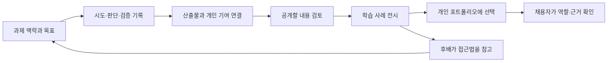

# ProofU 고도화 제안: 과제의 과정이 포트폴리오가 되는 공개 아카이브

작성일: 2026-10-13 (Asia/Seoul) · 상태: 제안 · 대상: 제품 기획, 설계, 구현 착수 판단

이 문서는 사용자가 설명한 최초 목적을 기준으로 작성했습니다. 기능·일정·지표는 앞으로 검증할 제안이며, 현재 구현된 기능이나 확인된 시장 수요를 의미하지 않습니다. 이번 작업은 문서 작성이며 앱 구현·운영 시작은 포함하지 않습니다.

- [시스템·데이터·권한 설계](planning/SYSTEM_DESIGN.md)
- [실행 계획·검증·출시 기준](planning/DELIVERY_PLAN.md)
- [기존 코드 분석](PROJECT_ANALYSIS.md)
- [원본 이력과 백업](HISTORY_RECONSTRUCTION.md)

## 1. 최초 목적을 제품의 중심으로 복원하기

ProofU의 출발점은 대학생이 선배에게 비공개로 전달받는 과제 자료, 이른바 ‘족보’였습니다. 이런 자료에 대한 접근이 인맥에 따라 달라지는 상황에서, 과제의 진행 과정과 결과를 누구나 참고할 수 있는 공개 기록으로 전환하려는 발상이었습니다.

두 번째 목적은 그 기록을 개인의 포트폴리오로 연결하는 것입니다. 결과물만 올리는 데서 그치지 않고, 어떤 문제를 어떻게 해결했고 팀에서 무엇을 맡았는지를 보여 주어 기업이 신입 지원자의 경험과 역량을 이해할 수 있게 합니다.

당시 Trello 형태의 칸반을 선택한 것은 과제 진행을 보여 주기 위한 구현 방식이었습니다. 고도화에서는 그 목적에 더 맞는 기록 방식을 중심에 두고 칸반은 필요할 때 사용하는 작업 관리 보기로 남기는 것이 좋습니다.

**제품 정의: 대학생이 과제를 진행하며 남긴 시도·판단·검증·산출물을 공개 가능한 학습 사례와 개인 포트폴리오로 연결하는 서비스.**

사용자에게 제시할 문구는 “과제를 끝내고, 과정을 남기고, 나의 경험으로 보여 주세요.”로 제안합니다. ‘족보’는 창업 배경 설명에 사용하되, 실제 서비스의 탐색·홍보 언어는 ‘과제 아카이브’, ‘학습 사례’, ‘프로젝트 기록’으로 합니다.

## 2. 누구에게 어떤 도움이 되어야 하는가

| 사용자 | 지금의 어려움이라는 가설 | ProofU에서 달라지는 행동 | 확인할 방법 |
|---|---|---|---|
| 과제를 시작하는 학생 | 결과물은 보지만 접근법과 시행착오를 찾기 어렵다 | 유사한 제약·단계의 사례에서 접근법을 찾아 자기 계획을 세운다 | 최근 과제 시작 경험 인터뷰, 사례 탐색 과제 |
| 과제를 진행하는 학생 | 학기 말에 포트폴리오를 만들려면 기억과 파일을 다시 모아야 한다 | 주 1~2회 짧은 기록으로 이후 소개 글의 재료를 남긴다 | 4주 기록 유지 실험, 작성 시간 측정 |
| 팀 프로젝트 참여자 | 팀 결과와 개인 기여가 섞여 본인의 역할을 설명하기 어렵다 | 담당 결과·판단·기여 근거를 자신의 사례에 연결한다 | 팀원 간 주장 확인, 채용자 읽기 실험 |
| 취업 준비생 | 기술 목록과 완성 화면만으로 차별점을 설명하기 어렵다 | 대표 과제 2~3개를 문제·기여·검증 중심으로 소개한다 | 기존 소개 자료와 비교한 이해도 실험 |
| 채용자 | 저장소 전체를 읽을 시간 없이 지원자의 실제 경험을 파악해야 한다 | 60~90초 요약에서 역할과 결과를 보고 근거로 이동한다 | 모의 검토와 면접 질문 작성 실험 |
| 교수·멘토 | 좋은 사례를 남기고 싶지만 과제 유출이나 평가 오해가 걱정된다 | 공개 가능한 범위를 확인하고 선택적으로 피드백한다 | 수업 담당자 인터뷰, 공개 정책 검토 |

초기 사용자는 한 대학 또는 동아리의 **소프트웨어 팀 과제·캡스톤 학생**으로 좁힙니다. 코드를 활용하되 보고서·발표·디자인도 함께 다루기 좋은 시작점입니다. 비개발 전공은 후속 확장 대상으로 두되 첫 설계부터 GitHub 계정 없이 파일과 기록만으로 사용할 수 있게 합니다.

첫 유통 단위는 학교 전체보다 한 학기 코호트·캡스톤 팀입니다. 교수가 참여하지 않아도 개인·동아리의 공개 허용 프로젝트로 시작할 수 있어야 합니다. 기업 가입은 학생의 포트폴리오 공유가 유용해진 후에 검증합니다.

## 3. GitHub와 함께 사용하되 다른 질문에 답하기

GitHub 프로필 README는 자기소개를 표시할 수 있습니다. 따라서 ‘자기소개 + 저장소 링크’만으로는 차별성이 약합니다. [GitHub 공식 프로필 README 안내](https://docs.github.com/en/account-and-profile/how-tos/profile-customization/managing-your-profile-readme)

| 도구·형태 | 이미 제공하는 역할 | ProofU에서 집중할 역할 |
|---|---|---|
| GitHub 저장소·프로필 | 코드와 변경 기록, 개발 협업, 자기소개 | 과제 맥락·판단·검증·개인 기여를 채용자와 후배가 이해할 형태로 연결 |
| Trello 형태 칸반 | 해야 할 일·진행 중·완료의 작업 상태 | 작업 상태에서 누락되는 시도 이유와 실패·개선의 기록 |
| 일반 문서·포트폴리오 사이트 | 자유로운 설명과 보기 좋은 전시 | 학기 중 기록을 재사용하고 팀 기여·근거·공개 범위를 함께 관리 |
| 수업 제출·채점 도구 | 과제 배포·제출·평가 | 수업이 끝난 뒤에도 학생이 소유하는 학습 사례와 취업 소개 |

이 표의 차별화는 공식적으로 입증된 경쟁 우위가 아니라 사용자 조사로 검증할 제품 가설입니다. 다른 도구에서도 같은 경험을 만들 수 있으므로 **준비 시간이 줄고, 내 기여가 더 쉽게 이해되는가**로 검증합니다.

2026-10-13 기준 GitHub는 Classroom을 2026-08-28 종료했다고 공지했습니다. 기존 저장소·계정·조직은 종료의 영향을 받지 않는다고 설명합니다. 따라서 Classroom 전용 연동은 계획하지 않고 일반 저장소 링크로 시작합니다. [GitHub 공식 종료 공지](https://github.com/orgs/community/discussions/205975)

ProofU가 직접 Git 호스팅, IDE, 자동 채점, 범용 프로젝트 관리, 채용 지원자 추적 시스템까지 제공할 필요는 없습니다. 기존 도구로 만든 결과를 학생 자신의 경험으로 설명하는 흐름부터 완성합니다.

## 4. 핵심 경험: 작업 공간 → 학습 사례 → 개인 포트폴리오



작업 공간과 공개 사례는 다른 표현입니다. 작업 공간에는 미완성 기록, 팀 내부 피드백, 비공개 자료가 있을 수 있습니다. 공개 사례는 작성자가 선택하고 동의를 확인한 내용만으로 만드는 특정 시점의 버전입니다. 개인 포트폴리오는 공개 사례 중 본인의 기여를 골라 설명한 또 하나의 버전입니다.

‘public한 이력’이라는 원래 목적은 **누구나 열람할 수 있는 공개 사례를 축적하는 것**으로 구현합니다. 작성 중인 모든 정보와 학교 과제 원문을 자동 공개한다는 의미로 확대하지 않습니다. 공개 절차가 번거로운 검열처럼 느껴지지 않도록 첫 작성부터 어떤 부분을 나중에 보여 줄지 선택하게 합니다.

## 5. 칸반을 대신할 기본 화면: 질문과 근거가 있는 과정 기록

### 5.1 기록 유형

| 기록 | 작성 질문 | 첨부할 수 있는 근거 |
|---|---|---|
| 목표 | 무엇을 만들거나 알아내려 하는가? 성공 조건은 무엇인가? | 직접 작성한 요구사항, 허용된 과제 요약 |
| 시도 | 무엇을 시도했고 기대와 실제는 어떻게 달랐는가? | 코드 링크, 화면, 실험 결과 |
| 판단 | 대안 중 무엇을 왜 선택했는가? | 비교표, 토론 요약, 관련 변경 |
| 검증 | 어떤 방법으로 확인했고 무엇이 아직 불확실한가? | 테스트 결과, 사용자 피드백, 측정 조건 |
| 회고 | 무엇을 배웠고 다음에는 무엇을 바꾸겠는가? | 이전 기록, 개선 전후 결과 |

모든 유형을 매번 채우게 하지 않습니다. 기본 입력은 ‘한 일 / 알게 된 점 / 근거’ 세 항목이며 기록 유형은 선택입니다. 파일이나 링크부터 붙인 뒤 한 줄 설명을 쓰는 흐름도 제공합니다. 날짜별 빈칸이나 연속 출석 점수로 기록을 강제하지 않습니다.

### 5.2 과정 화면의 구조

한 과제 안에서 문제 이해 → 접근 탐색 → 구현·제작 → 검증 → 정리의 **단계별 보기**를 기본으로 제공합니다. 이 단계는 순서 안내이며 완료 게이트가 아닙니다. 실패한 검증에서 구현으로 돌아갈 수 있고, 연구·디자인 과제는 단계 이름을 바꿀 수 있습니다.

기록은 시간순으로도 볼 수 있지만, 전시에서는 ‘중요한 전환점’으로 묶습니다. 열 개의 작업 완료보다 하나의 설계 변경 이유와 검증 결과가 더 잘 보이도록 합니다. 기록을 수정하면 변경 버전을 남기고, 오류 정정은 원본을 몰래 덮어쓰기보다 정정된 상태로 표시합니다.

칸반은 ‘할 일’ 탭으로 유지합니다. 카드에는 담당자·예정일·상태를 두고 완료할 때 과정 기록을 연결할 수 있습니다. 완료마다 기록을 강제하지 않고 중요한 작업만 연결합니다. MVP에서는 드래그보다 리스트와 상태 변경 메뉴를 우선 구현합니다.

### 5.3 다른 방식과 비교

| 방식 | 장점 | 한계 | 제안 |
|---|---|---|---|
| 칸반만 사용 | 시작이 쉽고 상태 파악이 빠름 | 생각·검증·개인 기여가 사라지기 쉬움 | 보조 보기 |
| 자유 일지·블로그 | 설명 자유도가 높음 | 빈 페이지 부담과 정리 비용이 큼 | 자유 메모 지원 |
| 커밋 자동 수집 | 개발 활동 수집이 편리함 | 비개발 기여 누락, 활동량과 역량 혼동 | 선택적 근거로 사용 |
| 질문 중심의 짧은 기록 | 의사결정과 학습을 재사용하기 쉬움 | 습관 형성 필요 | MVP 기본 방식 |

더 유용한 방식이라는 주장은 아직 가설입니다. 실제 학생이 기록에 부담을 느끼면 유형을 줄이거나 파일 중심 흐름으로 바꾸는 실험을 합니다.

## 6. 과제 사례와 포트폴리오의 정보 구조

### 6.1 공개 과제 사례

첫 화면에는 한 줄 소개, 대표 산출물, 과제 맥락, 기간, 팀 규모, 본인이 선택한 공개 멤버, 사용 도구, 배운 점을 둡니다. 이어서 문제와 제약 → 접근과 대안 → 중요한 과정 2~5개 → 산출물·검증 → 한계·회고 → 출처와 사용 조건을 보여 줍니다.

과제 문제 원문 대신 직접 작성한 요약을 기본으로 합니다. 문서·이미지·영상·소스 링크를 혼합할 수 있습니다. 성적이나 담당 교원의 실명은 필수 정보가 아닙니다. 같은 제목의 수업이라고 같은 문제라고 가정하지 않고 수업·학기·과제 맥락은 각각 구분합니다.

### 6.2 개인 프로필과 포트폴리오

프로필 기본 정보는 이름 또는 표시명, 한 줄 소개, 관심 직무, 공개 연락 방법, 대표 사례입니다. 학교·학과·졸업 예정일·실명은 선택이며 비공개 상태에서 포트폴리오를 먼저 만들 수 있습니다.

대표 사례마다 다음을 보여 줍니다.

1. 해결한 문제와 결과를 두세 문장으로 설명합니다.
2. 개인 역할과 직접 만든 산출물을 명시합니다.
3. 중요한 판단 하나와 검증 근거 하나를 연결합니다.
4. 팀 전체 결과와 본인 기여를 구분합니다.
5. 원본 링크와 남은 한계로 이어집니다.

스킬 태그는 ‘TypeScript를 썼다’와 같은 자기 선언과 ‘입력 검증 모듈을 설계하고 이런 테스트로 확인했다’는 경험 근거를 구분합니다. 종합 역량 점수나 취업 가능성 점수를 만들지 않습니다. 채용자는 프로젝트를 저장하거나 PDF를 내려받을 수 있지만, 연락처는 학생이 허용한 방식만 제공합니다.

### 6.3 하나의 기록을 두 독자에게 보여 주기

‘학습용 상세 보기’는 대안·실패·참고 자료를 보여 주고, ‘포트폴리오 요약 보기’는 문제·기여·결과·근거를 먼저 보여 줍니다. 같은 공개 버전을 사용하되 정보 순서를 다르게 합니다. 지원 직무별 프로젝트 순서는 선택할 수 있고, private 자료가 요약 생성 과정에 섞이지 않게 합니다.

## 7. 구체적인 사용 예시

가상의 학생 지민은 팀 과제로 도서관 혼잡도 안내 웹앱을 만듭니다. 과제 설명을 직접 요약하고, 성공 조건을 ‘두 개 건물의 혼잡도를 비교할 수 있음’으로 설정합니다.

첫 주에는 설문 결과와 초기 화면을 붙이며 데이터 확보가 어려웠다는 시도를 남깁니다. 둘째 주에는 실시간 센서와 수동 입력을 비교한 뒤 수동 입력을 선택한 이유를 기록합니다. 셋째 주에는 사용성 테스트의 대상·조건·한계를 설명합니다. 수치는 실제 측정값이 있을 때만 넣습니다.

팀의 프로젝트에는 공동 산출물이 올라갑니다. 지민은 화면 흐름 설계와 API 입력 검증을 자신의 기여로 연결하고, 관련 팀원이 확인하거나 아직 확인하지 않았다는 상태를 남깁니다.

제출 후 팀원이 공개할 산출물과 이름에 동의합니다. 담당 수업의 공개 규칙이 불명확하면 과제 원문·답안을 제외한 개념과 접근 설명만 준비하고 공개는 보류할 수 있습니다.

공개 사례를 포트폴리오에 넣으면 ‘도서관 웹앱 개발’이라는 목록 대신 ‘불완전한 데이터 조건에서 범위를 조정하고 검증한 경험’이 보입니다. 후배는 코드를 그대로 제출하는 대신 어떤 제약에서 어떤 결정을 했는지 참고합니다.

## 8. 공개·인용·개인 기여의 신뢰 설계

이 절은 운영·제품 정책 제안이며 특정 학교의 규정이나 법률 해석을 단정하지 않습니다. 실제 출시 전에는 파일 권리, 학교별 과제 공개 조건, 개인정보 처리에 관한 검토가 필요합니다.

| 상황 | 기본 동작 |
|---|---|
| 작성 중 과제 | 팀 내부 비공개, 공개 미리보기 가능 |
| 공개 가능 여부 확인 안 됨 | 제출 후 날짜가 지나도 자동 공개하지 않음 |
| 팀 산출물 | 공개 대상 버전·멤버 표시·자료 사용에 대한 동의 확인 |
| 참고한 외부 사례·라이브러리 | 출처와 사용 조건을 남김; 출처를 제거해 본인 결과로 표시하지 않음 |
| 교수의 문제지·타인의 답안·개인정보 포함 | 업로드·공개 범위를 확인하고 제외·가림 처리 |
| 진행 중인 다른 학생의 과제 도움 요청 | 원리·접근 피드백 중심; 대리 완성·답안 판매는 허용하지 않는 정책 제안 |
| 동의 철회·신고 | 공개 버전 숨김, 원인 확인과 이의제기 기록, 관련 파생 포트폴리오도 차단 |

회원에게 일괄 공개 라이선스를 강제하지 않습니다. 산출물별 ‘열람만 허용 / 명시한 라이선스로 재사용 허용 / 외부 링크의 원래 조건 적용’을 구분합니다. 별도 라이선스 없는 자료는 자유 재사용 가능하다고 표시하지 않습니다.

‘기여 확인’은 작성자가 주장한 역할을 해당 팀원이 확인했다는 뜻입니다. 교수 인증·능력 검증·법적 권리 보증으로 확대하지 않습니다. 자기 작성, 팀원 확인, 외부 근거 연결, 멘토 의견을 서로 다른 표시로 보여 줍니다. 입증하지 못한 기여는 삭제를 강요하기보다 ‘본인 설명, 미확인’으로 명확히 합니다.

서버 저장 시각은 플랫폼에 들어온 시각입니다. 실제 수행일·커밋 날짜·해시·접속 로그만으로 학생의 실제 수행이나 독창성을 인증하지 않습니다. AI 사용은 도구·도움받은 범위·본인이 검토한 부분을 선택적으로 설명하게 하며, AI 문장을 무조건 자기 기여로 승인하지 않습니다.

## 9. MVP 범위와 수용 기준

MVP의 목적은 **한 과제가 기록되고 공개 사례로 바뀌어 개인 포트폴리오에서 읽히는 흐름**을 검증하는 것입니다.

| 우선순위 | 기능 | 완료 기준 |
|---|---|---|
| P0 | 계정·프로필 | 가입·로그인·탈퇴 요청, 공개 정보와 비공개 정보 분리 |
| P0 | 개인·팀 과제 공간 | 과제 맥락 입력, 초대·권한 관리, 처음에는 비공개 |
| P0 | 과정 기록 | 세 항목 입력, 링크·파일 근거, 수정 버전, 저장 상태 표시 |
| P0 | 개인 기여 | 관련 기록·산출물 연결, 작성자 주장과 팀원 확인 상태 구분 |
| P0 | 공개 버전 | 미리보기·동의·민감 자료 점검, 공개·철회, 작업 공간 내용 자동 노출 없음 |
| P0 | 공개 탐색 | 주제·도구·과제 유형별 필터, 문제 접근 중심 소개, 기본 신고 기능 |
| P0 | 개인 포트폴리오 | 대표 공개 사례 선택, 기여 요약, 링크 공유와 기본 인쇄 보기 |
| P0 | 권한·파일·운영 | 비공개 조회 차단, 파일 검사, 관리자 비공개 전환과 감사 기록 |
| P1 | 선택적 칸반·댓글 | 상태 변경 메뉴, 과제 내 피드백, 댓글 공개 여부 분리 |
| P1 | GitHub 연결 | 공개 링크로 시작, 선택적 저장소 메타데이터·근거 동기화 |
| P1 | 지원용 포트폴리오 | 직무별 순서·요약, 만료·철회 가능한 제한 공유와 PDF |
| P2 | 멘토·기업 기능 | 요청 기반 리뷰, 동의한 학생에 한한 기업 탐색·연락 흐름 |
| P2 | 기관 연계 | 수업 공개 정책, 학습 기록 내보내기·표준 연동 검토 |

초기에는 채팅·달력·학교 공지 크롤러를 새로 구현하지 않습니다. 기존 구현은 아카이브에 남기고, 사용자 실험에서 실제 수요가 확인되면 재검토합니다. 기술 수집보다 사례 작성·공개·재사용이 먼저입니다.

## 10. 화면과 상호작용 설계

### 10.1 주요 화면

| 화면 | 첫 화면에서 답할 질문 | 주요 행동 |
|---|---|---|
| 내 작업 | 지금 기록할 과제와 마지막으로 남긴 근거는? | 과제 만들기, 짧은 기록 추가 |
| 과제 공간 | 지금 어떤 문제를 풀고 있고 무엇을 알아냈나? | 과정 기록·산출물·할 일 보기 |
| 기록 작성 | 이번에 한 일과 배운 점을 어떻게 남길까? | 근거 먼저 추가, 저장·공개 포함 여부 선택 |
| 공개 준비 | 누구의 어떤 정보가 어떻게 공개되나? | 버전 선택, 미리보기, 동의 요청·공개 |
| 공개 사례 | 무엇을 왜 만들었고 어떤 과정으로 확인했나? | 결과 확인, 중요한 과정 읽기, 출처 이동 |
| 개인 포트폴리오 | 이 학생이 직접 무엇을 했고 근거는 무엇인가? | 대표 사례·기여·근거, 허용된 연락 |
| 사례 탐색 | 내 문제와 제약에 도움이 되는 접근은? | 주제·도구·기록 유형 필터, 참고 출처 저장 |

웹의 상단 메뉴는 ‘탐색 / 내 과제 / 포트폴리오’로 시작합니다. 편집 영역과 공개 전시 영역을 구분하고 공유 버튼에는 공개 범위를 함께 표시합니다. 팀관리·알림·설정은 보조 메뉴로 둡니다.

### 10.2 텍스트 와이어프레임

```text
과제 작업 공간
[과제 제목] [팀 내부 · 공개되지 않음]             [기록 추가]
문제와 성공 조건 / 다음에 확인할 것
[과정] [산출물] [할 일] [기여]                  [공개 준비]
  단계: 문제 이해 · 탐색 · 제작 · 검증 · 회고
  주요 기록: 제목 / 한 일 / 알게 된 점 / 근거 / 작성자
  저장: 저장됨, 저장 중, 오류와 재시도
```

```text
공개 사례 / 포트폴리오 요약
[대표 결과 이미지]  문제 · 결과 · 기간 · 팀 규모
본인 역할: 맡은 범위와 관련 근거 / 확인 상태
중요한 판단 → 확인 방법 → 개선 결과 → 남은 한계
[과정 상세] [산출물과 출처] [관련 사례]
공개 버전과 게시일 / 수정·철회 상태 / 신고
```

### 10.3 시각·접근성 원칙

UI/UX 스킬 검색에서 나온 단순한 타이포그래피·높은 대비·작은 강조색 방향을 채택합니다. 검색 결과의 일반적인 마케팅 Hero 배치는 작업 공간에 적용하지 않습니다. 학생 기록과 산출물이 먼저 보이는 문서형 화면으로 설계합니다.

한국어 본문을 지원하는 시스템 글꼴부터 사용하고, 웹폰트는 필요할 때 라이선스와 로딩을 확인합니다. 밝은 배경, 진한 본문, 파란 주요 행동을 기본으로 하되 색상만으로 공개·검증 상태를 구분하지 않습니다. 본문 16px 이상, 행간 약 1.6, 읽기 폭 약 65~80자 수준을 출발점으로 둡니다.

모바일은 파일 첨부와 짧은 기록 작성, 데스크톱은 사례 편집·검토에 우선 맞춥니다. 360px 폭에서도 작성·열람이 가능해야 합니다. 터치 영역, 명시적 라벨, 키보드 포커스, 오류 위치, 느린 네트워크 저장 상태를 확인합니다. 드래그에는 이동 메뉴·위아래 버튼과 키보드 대안을 반드시 둡니다. 애니메이션은 저장·상태 전환을 설명할 때만 쓰고 reduced-motion을 존중합니다.

## 11. 성장·운영·사업 가설

사용자가 매번 별도의 소개 글을 쓰지 않아도 과제 기록에서 대표 사례를 만들 수 있는 것이 반복 사용 동기입니다. 공개 전에라도 자신의 정리와 팀 기여 기록에 도움이 되어야 하며, 전시가 잘 되는 학생만 혜택을 얻는 구조는 피합니다.

초기 공개 콘텐츠는 동의한 졸업생·동아리의 사례 10~20개로 만들고 실패·제약도 포함합니다. 검색 결과가 적으면 일반 인기 피드보다 유형별 사례 모음을 제공합니다. 대학 이메일 인증을 입장 조건으로 강제하지 않고 선택적 소속 확인으로 둡니다.

수익화 후보는 대학의 동의 기반 전시 운영, 학생의 선택적 포트폴리오 편집·내보내기 편의, 기업의 동의한 후보 탐색입니다. 기본 기록·자기 데이터 내보내기·개인 공개 제어는 무료 핵심 가치로 남기는 것을 권합니다. 초기 수익이나 가격은 확정하지 않으며 인건비·스토리지·운영 부담을 측정한 뒤 유료 가설을 검증합니다.

기업에 학생 데이터를 판매하거나 학교·조회수로 학생 순위를 매기는 모델은 제안하지 않습니다. 학생이 원치 않는 채용 연락, 성적·민감 정보 수집, 자동 탈락 판단도 초기 범위에서 제외합니다.

## 12. 중요한 결정과 남아 있는 질문

| 항목 | 현재 제안 | 바뀔 조건 |
|---|---|---|
| 첫 대상 | 소프트웨어 캡스톤·팀 과제 코호트 | 실제 접근 가능한 코호트가 다른 전공일 때 |
| 기본 기록 방식 | 짧은 과정 기록 + 근거 | 주당 작성 부담이 높으면 파일·링크 중심으로 축소 |
| 공개 시점 | 비공개 작성 후 명시적 공개 | 기관과 공개 정책을 검증해도 자동 공개는 별도 선택 필요 |
| 도구 관계 | GitHub 링크·파일을 보완 | 기록 수집 부담 때문에 자동 연결이 활성화의 장애일 때 |
| 기술 방향 | 별도 현대화 앱과 원본 아카이브 병존 | 실제 운영 중인 기존 데이터·사용자가 확인될 때 |
| 기업 기능 | 공개 포트폴리오 읽기부터 | 반복 채용 검토와 연락 수요가 확인될 때 |

착수 전 확인할 질문은 실제 모집 가능한 학생 수, 첫 과제의 공개 허용 조건, 운영 가능한 시간·예산, 기존 운영 DB의 존재, 대상 학생의 Git 사용 비율입니다. 답이 없어도 동의한 완성 과제 3~5개로 수동 사례 정리 실험부터 시작할 수 있습니다.

## 13. 참고 자료와 해석 범위

2026-10-13에 확인한 공식 자료입니다. 외부 문서는 도구·표준의 기능과 제한을 확인하는 데 사용했으며, 학생 수요·취업 효과·제품 성공은 직접 검증해야 합니다.

- [GitHub 프로필 README](https://docs.github.com/en/account-and-profile/how-tos/profile-customization/managing-your-profile-readme): 자기소개 기능을 이미 제공함을 확인.
- [GitHub Classroom 종료 공지](https://github.com/orgs/community/discussions/205975): 종료 시점과 기존 저장소 보존을 확인.
- [1EdTech CLR](https://www.1edtech.org/standards/clr): 학습자의 성취와 근거를 연결하는 기록 표준을 확인. ProofU는 현재 공인 발급·표준 준수 서비스가 아닙니다.

## English summary

ProofU's original goal was to turn privately circulated university assignment materials into a public archive of learning processes and outcomes, then help students present their own contributions as employment portfolios. The proposed evolution centers on short records of attempts, decisions, validation, and reflection, linked to artifacts and personal contributions. Kanban remains an optional task view. Students explicitly publish reviewed versions; private workspace content is not exposed automatically. GitHub remains a source of evidence rather than a replacement target. This is a product and engineering proposal, not an implemented feature announcement.

## 원본 기록 보존

2019년 6월~11월의 커밋 18개는 2020년 업로드 코드를 기능별로 재구성한 기록이며 실제 당시 개발 로그가 아닙니다. 이번 고도화 제안은 그 이력을 바꾸지 않습니다. 원본은 [백업 브랜치](https://github.com/polynomeer/proofu-univ/tree/backup/pre-reconstruction-20261013)에 유지하며, 현대화 구현은 향후 별도 후속 커밋으로 진행합니다.
