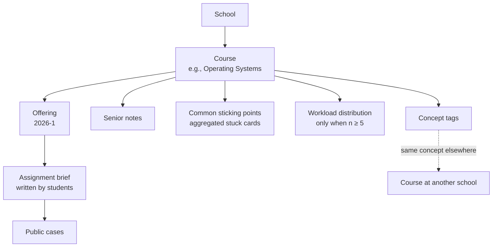
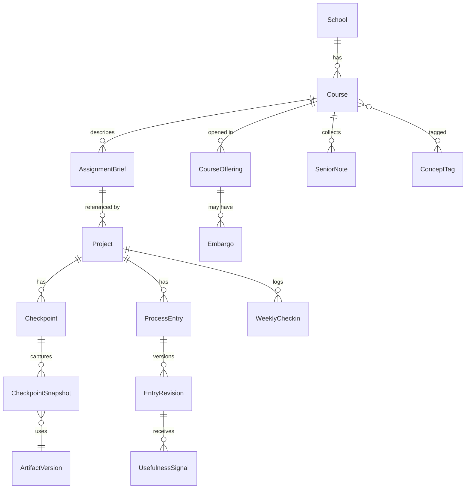
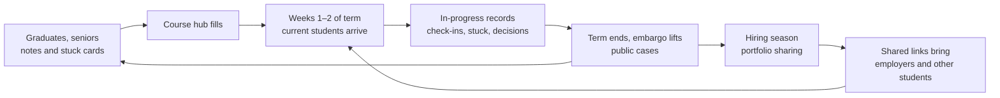

# Peerchive concept addendum: jokbo becomes a senior's map, Kanban becomes a process timeline

[한국어](CONCEPT_ADDENDUM.md) | **English**

Written: October 14, 2026 (Asia/Seoul) · Status: proposal (supplements the existing proposal) · Author: Claude Code

[Product proposal](../PROOFU_EVOLUTION_PLAN.en.md) · [System design](SYSTEM_DESIGN.en.md) · [Delivery plan](DELIVERY_PLAN.en.md)

This document **does not replace** the planning, design, and delivery documents written on October 13, 2026. Their principles stay in force: private drafting followed by explicit publication, consent bound to a manifest, separation of contribution claims from confirmations, preservation of the original archive, and a new app built alongside it. This addendum fills six gaps and proposes only the resulting deltas to the data model, MVP scope, and validation experiments. All features and figures are hypotheses to validate, not implemented functionality.

## 0. Gaps addressed

| # | Existing documents | Addendum | Section |
|---|---|---|---|
| 1 | “Jokbo” is used only as background; its actual value is not decomposed | Split jokbo into components and design the non-answer parts as first-class features | §1 |
| 2 | The Kanban alternative stops at “three-field entries + optional types”; what juniors would find most useful is vague | Checkpoint snapshots, stuck cards, and a 60-second weekly check-in | §3 |
| 3 | Course is optional metadata, so discovery lacks an axis | Promote course hubs to a primary discovery unit; add senior notes | §4, §5 |
| 4 | Generative AI, the largest environmental change, is not reflected in positioning | Reclaim the meaning of “ProofU” as *experience whose process is visible* | §2 |
| 5 | Record → portfolio conversion aids are deferred to P1 | Template-based case study drafts in MVP; competency-evidence matrix and interview prep | §6 |
| 6 | Original ProofU code is preserved but never used | Dogfood ProofU as the first public case; optional read-only runtime exhibit | §9 |

Cold-start supply (§10) and experiments (§11) cover only what these additions require.

## 1. Dissecting jokbo: most of its value survives without the answers

| Jokbo component | What students get | Problem? | Peerchive response |
|---|---|---|---|
| Past answers / solutions | Reusable output | Academic dishonesty | **Not supported.** Upload warnings, reports, embargo |
| Time and difficulty | Semester planning | No | **Workload distribution** from check-ins (§3.4, §4) |
| Common sticking points | Fewer dead ends | No | **Stuck cards** (§3.2) |
| References and tools | Learning path | No (cite sources) | Per-case references, course hub curation |
| Sense of expected quality | Calibrated expectations | Borders on leakage | **Checkpoint snapshots** rather than full final output (§3.1) |
| Grading tendencies / professor style | Score tactics | Reputation risk | Not supported. Only links to published rubrics and own reflection |
| Senior advice | Direction, motivation | No | **Senior notes** (§5) |

The legitimate core of jokbo is **“where it gets hard, how long it takes, and what to do first.”** Peerchive publishes that map, not answers.

> Tagline candidate: **“Leave a map, not the answers.”** Used alongside the existing “Finish your assignment. Capture the process. Show what you learned.” The former speaks to juniors and discovery; the latter to authors and portfolios.

This is also a product-level response to the risk of being perceived as an answer bank (Delivery plan §8): if the structure gives people plenty of reasons to visit without answers, answer-seeking does not become the core use.

## 2. Positioning: experience whose process is visible

### 2.1 Environmental hypotheses

In 2026, generative AI has sharply lowered the cost of producing reports, code, and slides. We **assume**, and will validate through research, that:

1. Instructors find it harder to judge understanding from final outputs alone and increasingly want to see process.
2. Employers find polished portfolio screens less discriminating and ask more “why did you do it that way?” questions.

If true, the habit of recording process becomes a practical advantage, matching what the original name **ProofU** (“prove you”) intended.

### 2.2 What we promise and what we do not

As in the existing design, Peerchive **does not certify** authorship or originality. It promises:

- **An explainable process:** checkpoints, decisions, and sticking points linked in time order.
- **Descriptive evidence density:** the number and kinds of evidence (snapshots, decision records, teammate confirmations) behind each claim, never aggregated into a score.
- **AI transparency:** optional disclosure of AI use, not shown as a penalty; students are encouraged to record how they verified and corrected AI output as a decision.

### 2.3 GitHub versus Peerchive

| | GitHub | Peerchive |
|---|---|---|
| Records | **What** changed in code | **Why and how** a person decided and learned |
| Unit | Commit, PR | Checkpoint, decision, stuck card |
| Primary readers | Collaborating developers | Juniors taking the same course, employers |
| Discovery axis | Repository, language | Course, assignment type, concept, sticking point |
| Non-code work | Poor fit | Reports, design, presentations equally supported |

Repositories remain linked as evidence (System design §11).

## 3. Making the Kanban alternative concrete: the process timeline

The existing entry types and three-field input stay. Four building blocks are added, chosen by what juniors would search for most and what authors can record with the least effort.

```mermaid
flowchart LR
    subgraph Process timeline
      C1[Checkpoint 1<br/>snapshot] --> C2[Checkpoint 2<br/>snapshot] --> C3[Final<br/>snapshot]
      S1((Stuck)) -.-> C2
      D1{Decision} -.-> C2
      S2((Stuck)) -.-> C3
    end
    W[60-second weekly check-in] -.time, difficulty.-> Process timeline
    T[Task view / Kanban] -.on completion: 'Were you stuck?'.-> S2
```

### 3.1 Checkpoints and snapshots (evolution view)

Split an assignment into 3–6 checkpoints (e.g., plan → midterm demo → prototype → final). Each checkpoint holds a **snapshot of the artifact at that time** (screenshot, draft PDF, slides, repository tag link) and a one-line note.

- Public cases show snapshots side by side as an **evolution view**, a visual, non-code counterpart to a code diff.
- Juniors learn “this is normal progress by week 4” without seeing the full final output.
- Checkpoint names are free-form and not completion gates. Course hubs may offer checkpoint templates.
- Data reuses the existing `ArtifactVersion`; `Checkpoint` references it (§8).

### 3.2 Stuck cards (Stuck → Unstuck)

Expected to be the most reusable unit for juniors. A structured subtype of the existing “attempt” type.

| Field | Example | Notes |
|---|---|---|
| Symptom | Child process stays a zombie after `fork()` | Required, one line |
| Context keywords | Operating systems, processes, `waitpid` | Linked to concept tags |
| Error text | `defunct` | Optional, indexed; mask personal data and paths |
| What was tried | Added sleep, ignored signal | Failed attempts are valuable |
| Resolution / workaround | Loop `waitpid` in a `SIGCHLD` handler | **Unresolved is allowed** |
| Time lost | About 3 hours | Buckets: <30 min / 2 h / half day / 1 day+ |
| Answer check | Is this the assignment answer itself? | Prompt shown while writing |

- Published stuck cards appear in the case and aggregate into the course hub's **“common sticking points.”**
- Others can mark “I got stuck here too” and “this helped.” These signals **only rank cards**; they never become a personal score or ranking.
- Resolutions that amount to answer code are redirected to concept-level explanations and are reportable.

### 3.3 Decision records (ADR-lite)

The existing “decision” type gets four slots: **options → criteria → choice → in hindsight**. “In hindsight” is prompted at retrospective time and becomes the most persuasive portfolio material.

### 3.4 Weekly check-in (60 seconds)

Minimal input to reduce recording fatigue. Once a week:

1. Time spent (0 / ~2h / ~5h / ~10h / 10h+)
2. Perceived difficulty (1–5)
3. One line: most important progress or blocker, promotable to a stuck card or decision

Check-ins are private to the team by default. Course hub workload distributions use **only check-ins shared for statistics, and only when at least five people contributed for the same course and assignment type** (k-anonymity; threshold finalized in the pilot).

### 3.5 Relationship to Kanban

Kanban stays as the task view. When a card is completed, a one-click prompt asks **“Were you stuck? Was there a key decision?”** Ignoring it still completes the card. This is how the original ProofU Card survives.

### 3.6 Retrospective mode

Finished assignments have no in-progress records. For cold-start supply, MVP includes **retrospective mode**:

- Rebuild checkpoints from file dates, commit history, and slide versions.
- Everything is marked `retrospective`, and `claimed_date` is shown as self-reported, as in the existing design.
- Lower trust is not hidden. The goal is for a graduate to produce one case in 30 minutes (experiment E2).

### 3.7 Alternatives compared (extends Product proposal §5.3)

| Approach | Usefulness to juniors | Authoring effort | Portfolio conversion | Verdict |
|---|---|---|---|---|
| Kanban only | Low (status only) | Low | Low | Auxiliary view |
| Free journal / blog | Medium (hard to search) | High | Medium | Supported as free notes |
| Automatic commit collection | Low (misses non-code) | Very low | Low | Optional evidence |
| After-the-fact retrospective only | Medium (memory loss) | Medium | High | Absorbed into retrospective mode |
| Distributed Notion template | Medium | Medium | Medium | Manual experiment tool (§11) |
| **Checkpoints + stuck + decisions + 60-second check-in** | **High (structured, searchable)** | **Low–medium** | **High** | **Proposed default** |

## 4. Course hubs: a primary discovery unit

The existing design keeps course context optional and does not assume same-titled courses share the same problem. That principle remains (cases are *grouped*, not treated as the same assignment), but the junior's real entry point, **“the course I'm taking this semester,”** becomes first-class.



**Hub page:** course summary (student-written, admin-merged) and prerequisite concepts; assignment types summarized by students (never the original prompt); top sticking points; senior notes; workload distribution (or “not enough data yet”); public cases with checkpoint previews.

**Policies:**

- **No instructor names, grading tendencies, or star ratings.** This is not a course-review site and avoids reputation disputes. Instructor fields are hidden by default.
- **In-semester embargo:** for cases in the same course and term that are still running, snapshots and stuck-card resolutions are hidden until the term ends by default. Concept-only records or explicitly different terms may be exempt. Works alongside the existing “no automatic publication” rule.
- **Course normalization:** free-form input; only same school + course code, or admin merges, share a hub. Marked “student-written” so it is not mistaken for official data.
- **Cross-school links:** courses and stuck cards sharing a concept tag appear under “at other schools,” which helps when a single-school pilot has little supply.

The intent behind the original YUnotice (school context) continues here, without crawling.

## 5. Senior notes: a legitimate replacement for jokbo

Short reflections written for juniors after finishing a course or assignment, using prompts:

- What should I have done in week one?
- Where did most of the time go?
- What would I do differently?
- Which concepts or resources do I wish I had known?

Rules: can be written without a public case; answers and instructor evaluations are restricted by guidelines and reports; byline is real name, display name, or anonymous (admins can still identify the author for moderation). Senior notes are **the first supply source for the graduate campaign** (§10), since a note is far easier than a full case.

## 6. From records to portfolio: lowering conversion cost

The existing portfolio structure (problem, role, decision, evidence, limits) stays. These aids fill it without rewriting from scratch.

### 6.1 Case study drafts (template-based in MVP, AI-assisted in P1)

- **MVP:** arrange checkpoints, decisions, stuck cards, and contribution claims into **problem → action → result → reflection** by template. Each sentence links to its source record. No generative model, so low cost and privacy risk.
- **P1:** AI polishes text only within the student-selected publication candidate. Claims not supported by source records are highlighted for correction before approval. All AI rules in System design §11 apply.

### 6.2 Competency-evidence matrix

The original MyPage “language/field charts” (activity volume) become **evidence visualization**.

| Competency \ Case | Library occupancy app | OS shell | Capstone |
|---|---|---|---|
| API design | 1 decision · teammate confirmed | – | 2 snapshots |
| Debugging | 2 stuck cards | 3 stuck cards | – |
| User validation | Usability test record | – | Interview summary |

Rows come from role presets (backend, frontend, data, PM, design) or custom input. Cells show only **kinds and counts** of evidence, with no scores or intensity shading. Reviewers click through to the evidence, strengthening scenario F (90-second read).

### 6.3 Interview prep pack (P1)

For each featured case, generate likely questions from decision and stuck records (“Why manual input over live sensors?”, “What was your biggest failure?”, “How did you handle team disagreement?”). Students keep private answer notes. If allowed, some appear to reviewers as **“good questions to ask this candidate.”**

### 6.4 Exports

Two- to three-sentence summaries for résumés; a Markdown card for GitHub profile READMEs, creating a path **from GitHub into Peerchive**; PDF and restricted sharing remain P1 as planned.

## 7. Academic integrity guardrails (additions to Product proposal §8)

| Measure | Behavior | Stage |
|---|---|---|
| In-semester embargo | §4; hide artifacts and resolutions for running same-term cases by default | MVP |
| Original prompt upload warning | Warn (not block) on file names or patterns resembling problem sheets or answers | MVP rules, P1 improvements |
| Links over full code | Recommend repository link + key excerpts over full assignment code | MVP guidance |
| Stuck card answer check | “Is this resolution the assignment answer itself?” | MVP |
| Instructor embargo request channel | Instructors may request delayed publication for a course term | P2 |

These **do not guarantee** misconduct prevention; they keep the default flow from drifting toward answer sharing.

## 8. Data model additions (extends System design §5)

Minimize new tables; subtypes such as stuck and decision live in type-specific structured fields of `EntryRevision`, validated by JSON Schema.

| Entity | Key fields | Rules |
|---|---|---|
| School | id, name, verified_label | Student input + admin merge; not official verification |
| Course | id, school_id, code?, title, merged_into? | Course hub unit; normalization by merging |
| CourseOffering | course_id, term | Basis for embargo end |
| AssignmentBrief | id, offering_id?, course_id, title, summary_by_student | Never the original prompt; shared by projects |
| ConceptTag | id, slug, label, parent_id? | Cross-school links |
| Project (extended) | + course_id?, assignment_brief_id?, retro_mode | `retro_mode` marks retrospective authoring |
| Checkpoint | id, project_id, order, title, planned_at?, claimed_at | Reorderable; not a gate |
| CheckpointSnapshot | checkpoint_id, artifact_version_id, note | Evolution view unit; reuses ArtifactVersion |
| EntryRevision (extended) | + kind_payload (JSON) | `stuck`: symptom, error_text, attempts, resolution?, time_bucket / `decision`: options, criteria, choice, hindsight? |
| WeeklyCheckin | project_id, user_id, week, time_bucket, difficulty, note?, share_for_stats | Private by default; separate consent for statistics |
| UsefulnessSignal | target_entry_id, user_id, kind (`me_too`/`helped`) | One per user; never aggregated into personal scores |
| SeniorNote | id, course_id, author_id, display_mode, answers (JSON), status | Follows existing Publication rules |
| Embargo | scope (course_offering/project), until, reason, requested_by | Enforced in public read queries |
| CaseStudyDraft | project_id, user_id, sections (JSON), source_refs, generator (`template`/`ai`) | Private until approved |
| CompetencyEvidence | portfolio_edition_id, competency, evidence_ref | No score field |
| InterviewPrep | claim_revision, question, answer_note, expose_to_reader | Private by default (P1) |



**Aggregation and privacy:** workload distributions and top sticking points are computed in a separate materialized view from public releases and statistics-consented check-ins only, returning nothing below the group threshold. Invariant 1 of the existing design (private workspace data never reaches public paths) is preserved.

**Search:** add `pg_trgm` to the existing PostgreSQL search for Korean partial matching and error-text search. Semantic “similar sticking points” search is a P1 `pgvector` experiment, embedding only public release text.

## 9. Not throwing away the original ProofU

The existing design preserves the original and builds a new app alongside it. This addendum agrees and adds three ways to *use* it, not just keep it.

### 9.1 The first public case is ProofU itself (dogfooding)

| Checkpoint | Snapshot evidence | Label |
|---|---|---|
| 2019 graduation project ProofU | Preserved `frontend/dist` screens, original logo | Retrospective |
| 2020 repository upload | Original history on the backup branch | Retrospective |
| 2026-10 history reconstruction and cleanup | `docs/HISTORY_RECONSTRUCTION.en.md` | **States that the 2019 commits are reconstructed** |
| 2026-10 Peerchive evolution planning | These documents | In progress |

Decision records: “Why Kanban in 2019?” / “Why a process timeline in 2026?” Stuck cards: the missing `backend/api/user.js`, unrunnable legacy dependencies. This case is the first real test of retrospective mode and an example of continuing a graduation project rather than abandoning it. The fact that the 2019 commits are not the original development log must appear in the case body and checkpoint labels.

### 9.2 Optional runtime exhibit (2–3 day timebox)

Without modifying original files, a separate directory (e.g., `legacy-runtime/`) could hold a container pinned to an old Node version plus **clearly labeled reimplementation overlays** (such as the missing `user.js`) to run the original screens as a read-only demo. The purpose is case evidence and portfolio demonstration, not operation. If the timebox is exceeded, stop and use screenshots. Not part of the MVP schedule; must not violate AGENTS.md preservation rules or `scripts/check_archive.py`.

### 9.3 Concept inheritance map (supplements System design §2)

| Original element | Continues in Peerchive as |
|---|---|
| Card completion | Stuck/decision prompt on completion → process record |
| Board Todo/Doing/Done | Split into checkpoints (time axis) and task view (status axis) |
| MyPage language/field charts | Competency-evidence matrix |
| View-count search ranking | Stuck card usefulness ranking (not personal ranking) |
| YUnotice (school notices) | School context in course hubs |
| Team join requests | Invite-based teams + ask a case author (opt-in, P1) |

## 10. Cold start and growth loop

Break supply into units **smaller than a case**:

| Supply unit | Time hypothesis | Initial target (per course hub) |
|---|---|---|
| Senior note | 10 min | 10 |
| Retrospective stuck card | 5 min each | 20 |
| Retrospective case | 30 min | 3–5 |
| In-progress case | Whole semester | 5–10 pilot teams |



**Timing:** discovery demand peaks in the first two weeks of March and September, case publication at term end (June, December), and portfolio sharing in hiring seasons. From October 2026, the natural sequence is **a graduate senior-note campaign at the end of the 2026 fall term (December), then a course hub pilot when the 2027 spring term opens (March)**, roughly aligned with the 16-week plan.

**First school and courses:** a course hub needs density in 2–3 courses at one school (e.g., Data Structures, Operating Systems, Capstone Design). The school connected to the original ProofU is the first candidate, but the accessible cohort decides (§13).

**Metrics:** the existing core metric is author-side. Add a seeker-side metric.

| Metric | Definition | Pilot hypothesis |
|---|---|---|
| Helped discovery | Students who, after visiting a hub, mark a stuck card or senior note as helpful or save it as a reference | 30% of hub-visiting students |
| Supply conversion | Share of helped students who write a note or card at term end | 20% |

## 11. Additional experiments (supplements Delivery plan §2)

Manual experiments runnable in parallel with weeks 1–2 research, using Notion, static pages, or spreadsheets before writing code.

| ID | Experiment | Method | Proceed condition (draft) | Otherwise |
|---|---|---|---|---|
| E1 | Jokbo replacement | Give 8 students about to take a course a manual hub prototype (senior notes, stuck cards, final output links); they draft a week-one plan and rank usefulness | ≥6 rate stuck cards or senior notes above final outputs | Shrink the course hub; keep case/portfolio focus |
| E2 | Retrospective authoring | 5 graduates rebuild one past assignment as checkpoints, stuck cards, decisions | ≥4 finish within 30 minutes; ≥3 consent to publish | Split input further into notes and cards |
| E3 | 60-second check-in | Weekly messenger reminder + form for 4 weeks | ≥60% response; ≥1 promoted stuck card per week | Adjust timing and questions or shift to term-end reflection |
| E4 | Reviewer comparison | Show 5 reviewers the same student's GitHub link vs. case card + matrix | ≥4 write more specific interview questions from the case card | Improve summary order and matrix presentation |
| E5 | Embargo acceptance | Explain embargo rules to 2–3 instructors/TAs and 8 students | Most instructors say post-term publication is acceptable | Limit hub content to concept level |

As before, fix measurement methods before recruiting and do not generalize small samples.

## 12. MVP scope delta (versus Product proposal §9)

| Change | Item | Reason |
|---|---|---|
| **Add to P0** | Checkpoints + snapshots + evolution view | Quality calibration for juniors; non-code support |
| **Add to P0** | Structured stuck and decision fields | Core reusable discovery unit |
| **Add to P0** | Retrospective mode | Cold-start supply |
| **Add to P0** | Minimal course hub (course page, cases, senior notes, sticking points) | Validate jokbo replacement |
| **Add to P0** | In-semester embargo | Integrity default |
| **Add to P0** | Template-based case study draft | Lower portfolio conversion cost |
| **Reduce P0** | Generic discovery filters/feed → replaced by course hubs and concept tags | Offsets additions |
| **Add to P1** | Workload aggregation, usefulness signals, AI polishing, interview prep, semantic search, ask the author | Meaningful once data accumulates |
| **Add to P2** | Instructor embargo channel, richer cross-school concept links | After institutional partnerships |

**Schedule impact estimate:** roughly +2–3 weeks on the 16-week plan, offset by about 1 week from reduced generic discovery. Place checkpoints, stuck/decision fields, and retrospective mode in weeks 5–7, and course hubs and drafts in weeks 11–12. New backlog items:

| ID | Work | Depends on | Done when |
|---|---|---|---|
| T-04a | Checkpoints, snapshots, evolution view | T-04, T-05 | Reordering works; only selected versions enter public releases |
| T-04b | Stuck/decision fields, retrospective label | T-04 | Per-type schema validation; `retro_mode` label persists to public DTO |
| T-09a | Template-based case study draft | T-06, T-09 | Every sentence links to a source; no private records included (tested) |
| T-10a | Schools, courses, concept tags, course hub, senior notes | T-08 | Merging works; only public releases exposed |
| T-10b | Embargo | T-10a | Regression test: anonymous reads hide artifacts and resolutions before term end |

## 13. Decisions requested from the project owner

1. **First pilot school/department:** Is a junior cohort at the school connected to the original ProofU accessible, or is another school or club more realistic?
2. **First 2–3 courses:** Which courses did you take and could write the first senior notes for?
3. **Embargo default:** Mandatory default or author's choice?
4. **Development time:** Is the existing 25–30 hours/week assumption accurate? Below 10 hours/week, keep only course hubs, retrospective mode, and stuck cards from the P0 additions and defer the rest to P1.
5. **Runtime exhibit (§9.2):** Is the demo value worth 2–3 days?

## 14. Relationship to existing documents

| Topic | Existing documents | This addendum | Conflict |
|---|---|---|---|
| Default recording | Three fields + optional types | Kept; structured stuck/decision, checkpoints, check-ins added | None |
| Kanban | Optional task view | Kept; completion prompt converts to records | None |
| Course context | Optional metadata | Promoted to course hubs; same-assignment assumption still rejected | None (scope expansion) |
| Publication policy | Private by default, explicit publication, consent | Kept; embargo added | None |
| AI | P1 assistant | Template drafts in MVP; AI stays P1 | None |
| Discovery | Topic/tool/type filters | Replaced by course hubs and concept tags | **Priority change proposed** |
| Original code | Preserve, build alongside | Kept; used as first case and optional exhibit | None |
| Metrics | Author-side core metric | Seeker-side metric added | None |

## Preserving the original record

This is documentation only; it includes no app implementation, original code changes, dependency installation, or external sign-up or deployment. The 18 commits dated June–November 2019 are a feature-based reconstruction of code uploaded in 2020, not the original development log. The original history remains on the [backup branch](https://github.com/polynomeer/peerchive/tree/backup/pre-reconstruction-20261013).
