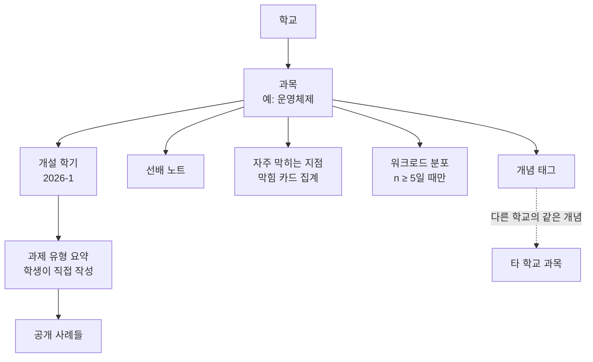
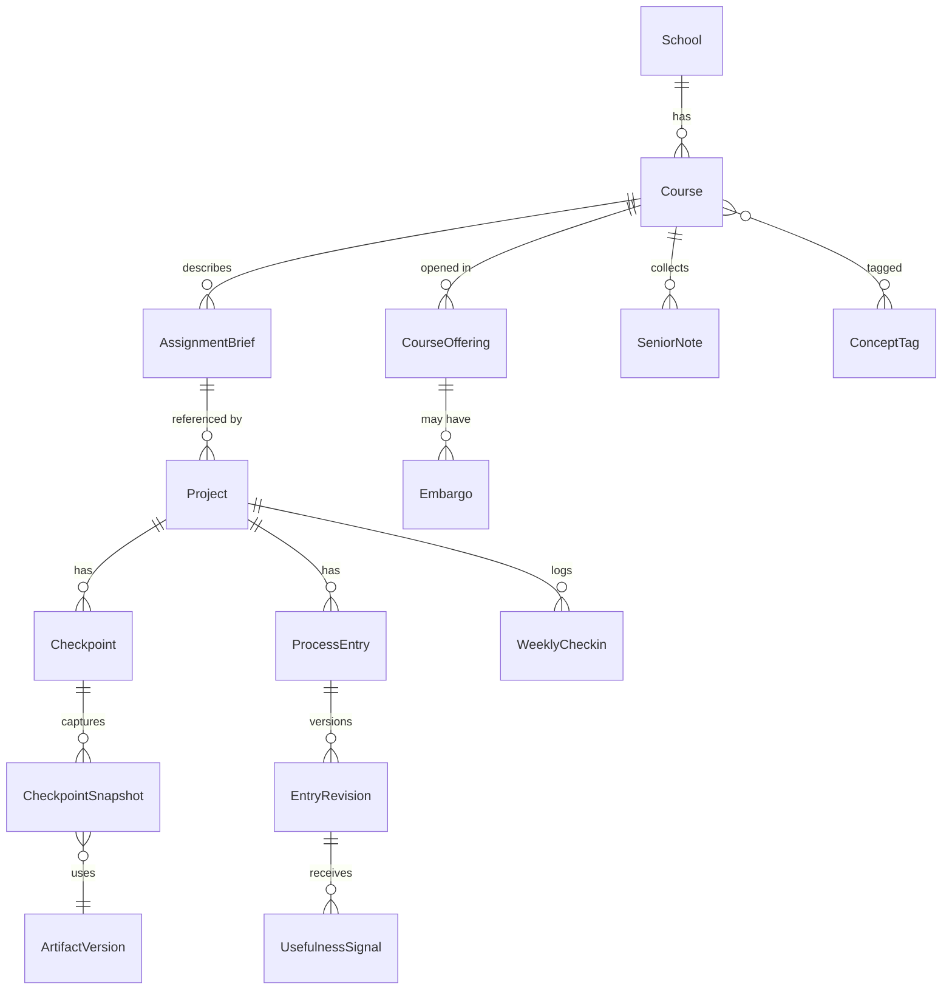
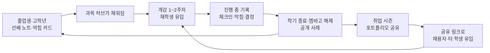

# Peerchive 제품 컨셉 보완안: 족보는 ‘선배의 지도’로, 칸반은 ‘과정 타임라인’으로

**한국어** | [English](CONCEPT_ADDENDUM.en.md)

작성일: 2026-10-14 (Asia/Seoul) · 상태: 제안(기존 제안의 보완) · 작성: Claude Code

[제품 기획](../PROOFU_EVOLUTION_PLAN.md) · [시스템 설계](SYSTEM_DESIGN.md) · [실행 계획](DELIVERY_PLAN.md)

이 문서는 2026-10-13에 작성된 기존 기획·설계·실행 계획을 **대체하지 않습니다.** 기존 문서의 원칙(비공개 작성 후 명시적 공개, 동의 manifest, 기여 주장과 확인의 구분, 원본 아카이브 보존, 새 앱 병존)은 그대로 유지합니다. 아래에서 기존 문서가 덜 다룬 여섯 가지 공백을 채우고, 그에 필요한 데이터 모델·MVP 범위·검증 실험의 차이(delta)만 제안합니다. 모든 기능·수치는 검증할 가설이며 구현된 기능이 아닙니다.

## 0. 보완하는 공백

| # | 기존 문서의 상태 | 보완 방향 | 절 |
|---|---|---|---|
| 1 | ‘족보’를 배경 설명으로만 쓰고, 족보가 실제로 제공하던 가치를 분해하지 않음 | 족보를 구성요소로 나눠 정답을 뺀 나머지 가치를 정식 기능으로 설계 | §1 |
| 2 | 칸반 대안이 ‘세 항목 기록 + 기록 유형’ 수준이라 후배(탐색자)에게 무엇이 가장 유용한지 구체성이 약함 | 체크포인트 스냅샷·막힘 카드·주간 체크인으로 과정 타임라인 구체화 | §3 |
| 3 | 수업(Course)이 선택 메타데이터라 탐색의 축이 약함 | 과목 허브를 1급 탐색 단위로 승격, 선배 노트 도입 | §4, §5 |
| 4 | 생성형 AI 확산이라는 가장 큰 환경 변화를 포지셔닝에 반영하지 않음 | ‘ProofU’ 이름의 의미를 회수해 *과정이 보이는 경험*으로 포지셔닝 | §2 |
| 5 | 기록 → 포트폴리오 전환 장치(초안 생성, 면접 준비)가 P1 이후로 밀림 | 규칙 기반 케이스 스터디 초안을 MVP로, 역량-근거 매트릭스·면접 준비 팩 제안 | §6 |
| 6 | 원본 ProofU 코드는 ‘보존’만 하고 신규 서비스에서의 활용 방안이 없음 | ProofU 자체를 첫 공개 사례로 쓰는 dogfooding, 선택적 원본 실행 전시 | §9 |

콜드 스타트 공급(§10)과 검증 실험(§11)은 위 보완에 따라 추가로 필요한 부분만 다룹니다.

## 1. 족보의 해부: 정답을 빼도 가치의 대부분은 남는다

선배에게 받는 족보는 하나의 파일이 아니라 여러 정보의 묶음입니다. 이를 나눠 보면 문제가 되는 부분은 ‘정답·답안’에 집중되어 있고, 나머지는 공개되어도 공정성을 해치지 않으면서 오히려 정보 격차를 줄이는 정보입니다.

| 족보 구성요소 | 학생이 얻는 것 | 문제 여부 | Peerchive의 대응 |
|---|---|---|---|
| 과제 답안·기출 정답 | 그대로 쓸 결과물 | 학업 부정, 평가 무력화 | **다루지 않음.** 업로드 경고·신고·엠바고로 차단 |
| 소요 시간·난이도 체감 | 학기 일정 계획 | 없음 | 주간 체크인 기반 **워크로드 분포**(§3.4, §4) |
| 흔히 막히는 지점 | 시행착오 단축 | 없음 | **막힘 카드**(Stuck → Unstuck, §3.2) |
| 참고 자료·도구 추천 | 학습 경로 | 없음(출처 표기 필요) | 사례별 참고 자료와 과목 허브 큐레이션 |
| 결과물의 수준 감각 | 기대치 파악 | 답안 유출과 경계 | 최종물 전문이 아닌 **체크포인트 스냅샷**과 진화 과정(§3.1) |
| 평가 성향·교수 스타일 | 점수 전략 | 평판·분쟁 위험 | 다루지 않음. 공개된 평가 기준 링크와 본인 회고만 허용 |
| 선배의 조언 | 방향·동기 | 없음 | **선배 노트**(§5) |

정리하면 족보의 합법적이고 유익한 핵심은 **“어디가 어렵고, 얼마나 걸리고, 무엇을 먼저 해야 하는가”**입니다. Peerchive는 정답이 아니라 이 지도를 공개합니다.

> 슬로건 후보: **“답이 아니라 지도를 남겨 주세요.”** (기존 문구 “과제를 끝내고, 과정을 남기고, 나의 경험으로 보여 주세요.”와 병행. 전자는 후배·탐색 쪽, 후자는 작성자·포트폴리오 쪽 메시지)

이 분해는 ‘공개 답안 모음으로 인식될 위험’(실행 계획 §8)에 대한 제품 차원의 대응이기도 합니다. 답안이 없어도 찾아올 이유가 충분한 정보 구조를 만들면, 답안을 찾는 사용이 핵심이 되지 않습니다.

## 2. 포지셔닝 보완: 결과물이 아니라 과정이 보이는 경험

### 2.1 환경 변화 가설

2026년 현재 생성형 AI로 보고서·코드·슬라이드 같은 결과물을 만드는 비용이 크게 낮아졌습니다. 이로 인해 다음 두 가지 변화가 있다고 **가정**하며, 사용자 조사로 확인합니다.

1. 교수·조교는 결과물만으로 학생의 이해도를 판단하기 어려워지고, 과정(중간 산출물, 판단 이유)을 보려는 요구가 늘어난다.
2. 채용자는 완성된 포트폴리오 화면만으로는 지원자의 실제 역량을 구분하기 어려워지고, “왜 그렇게 했는가”를 묻는 면접 비중이 커진다.

두 가설이 맞다면, 과정을 남기는 습관 자체가 학생에게 실질적인 이점이 됩니다. 원래 이름 **ProofU**(Prove you)가 의도했던 의미와도 일치합니다.

### 2.2 무엇을 약속하고 무엇을 약속하지 않는가

기존 설계의 원칙대로 Peerchive는 수행·독창성을 **인증하지 않습니다.** 대신 다음을 약속합니다.

- **설명 가능한 과정:** 결과물에 이르는 체크포인트·판단·막힘이 시간 순서로 연결되어 있음.
- **근거 밀도의 표시:** 각 기여 주장에 연결된 근거 개수와 종류(스냅샷, 결정 기록, 팀원 확인)를 *서술적으로* 보여 줌. 점수·등급으로 합산하지 않음.
- **AI 사용의 투명성:** 기존 설계처럼 AI 사용 범위를 선택적으로 기록. “AI를 썼다”를 감점 신호로 표시하지 않고, 어떻게 검증하고 고쳤는지를 판단 기록으로 남기도록 유도.

### 2.3 GitHub와의 차이를 한 문장으로

| | GitHub | Peerchive |
|---|---|---|
| 기록 대상 | 코드가 **무엇이** 바뀌었나 | 사람이 **왜·어떻게** 판단하고 배웠나 |
| 기본 단위 | 커밋·PR | 체크포인트·결정·막힘 |
| 주 독자 | 협업 개발자 | 같은 과목을 들을 후배, 채용자 |
| 탐색 축 | 저장소·언어 | 과목·과제 유형·개념·막힌 지점 |
| 비개발 과제 | 부적합 | 보고서·디자인·발표도 동일하게 지원 |

GitHub 저장소는 계속 근거 링크로 연결합니다(기존 설계 §11과 동일).

## 3. 칸반 대안의 구체화: 과정 타임라인

기존 기획은 ‘목표/시도/판단/검증/회고’ 유형과 ‘한 일/알게 된 점/근거’ 세 항목 입력을 제안했습니다. 이를 유지하면서, **후배가 가장 많이 찾을 단위**와 **작성자가 가장 적은 노력으로 남길 단위**를 기준으로 네 가지 구성요소를 구체화합니다.

```mermaid
flowchart LR
    subgraph 과정 타임라인
      C1[체크포인트 1<br/>스냅샷] --> C2[체크포인트 2<br/>스냅샷] --> C3[최종<br/>스냅샷]
      S1((막힘)) -.-> C2
      D1{결정} -.-> C2
      S2((막힘)) -.-> C3
    end
    W[주간 체크인 60초] -.시간·난이도.-> 과정 타임라인
    T[할 일 보기 / 칸반] -.완료 시 '막힘 있었나요?'.-> S2
```

### 3.1 체크포인트와 스냅샷 (진화 보기)

과제를 3~6개의 체크포인트로 나눕니다(예: 기획 → 중간 발표 → 프로토타입 → 최종 제출). 각 체크포인트에 **그 시점의 산출물 스냅샷**(화면 캡처, 보고서 초안 PDF, 슬라이드, 저장소 태그 링크)과 한 줄 메모를 남깁니다.

- 공개 사례에서는 스냅샷을 가로로 나열한 **진화 보기**를 제공합니다. GitHub의 코드 diff에 대응하는 *비개발·시각적 diff*입니다.
- 후배는 최종물 전문 대신 “4주차에 이 정도면 정상 진행”이라는 수준 감각을 얻습니다(§1의 ‘결과물의 수준 감각’).
- 체크포인트 이름은 자유이며 완료 게이트가 아닙니다(기존 ‘단계별 보기’ 원칙과 동일). 과제 생성 시 과목 허브의 공통 체크포인트 템플릿을 불러올 수 있습니다.
- 데이터는 기존 `ArtifactVersion`을 재사용하고 `Checkpoint`가 이를 참조합니다(§8).

### 3.2 막힘 카드 (Stuck → Unstuck)

후배 탐색에서 가장 재사용성이 높을 것으로 예상하는 단위입니다. 기존 ‘시도’ 유형을 구조화한 하위 유형으로 둡니다.

| 필드 | 예시 | 비고 |
|---|---|---|
| 증상 | `fork()` 후 자식 프로세스가 좀비로 남음 | 필수, 한 줄 |
| 맥락 키워드 | 운영체제, 프로세스, `waitpid` | 개념 태그와 연결 |
| 오류 메시지 | `defunct` | 선택. 검색 색인 대상. 개인정보·경로 마스킹 안내 |
| 시도한 것 | 슬립 추가, 시그널 무시 | 실패한 시도도 가치 있음 |
| 해결·우회 | `SIGCHLD` 핸들러에서 `waitpid` 반복 | **미해결 상태도 허용** |
| 걸린 시간 | 약 3시간 | 범주 선택(30분 미만/2시간/반나절/하루 이상) |
| 정답 노출 점검 | 과제 답 자체가 아닌가? | 작성 시 체크 문구 표시 |

- 공개 시 막힘 카드는 사례 상세에 포함되는 동시에 과목 허브의 **“자주 막히는 지점”** 목록으로 모입니다.
- 다른 학생은 카드에 “나도 여기서 막혔어요”와 “이 방법이 도움됐어요”를 남길 수 있습니다. 이 신호는 **카드의 유용성 정렬에만** 쓰고 작성자 개인의 점수·순위로 합산하지 않습니다(기존 원칙 유지).
- 해결 방법이 사실상 과제 정답 코드인 경우는 개념·접근 설명으로 바꾸도록 안내하고, 신고 대상이 됩니다.

### 3.3 결정 기록 (ADR-lite)

기존 ‘판단’ 유형에 템플릿을 더합니다. **선택지 → 판단 기준 → 선택 → 지나고 보니**의 네 칸입니다. ‘지나고 보니’는 과제 종료 후 회고 시점에 채우도록 알림을 보내며, 포트폴리오에서 가장 설득력 있는 문장의 재료가 됩니다.

### 3.4 주간 체크인 (60초)

기록 피로(실행 계획 §8의 위험)를 줄이기 위한 최소 입력입니다. 주 1회 알림으로 다음만 묻습니다.

1. 이번 주 투입 시간(범주: 0 / ~2h / ~5h / ~10h / 10h+)
2. 체감 난이도(1~5)
3. 한 줄: 이번 주 가장 중요한 진전 또는 막힘 → 바로 막힘 카드·결정 기록으로 승격 가능

체크인은 팀 내부 비공개가 기본입니다. 과목 허브의 워크로드 분포는 **공개 동의한 체크인만, 같은 과목·과제 유형에서 최소 5명 이상 모였을 때만** 익명 집계로 보여 줍니다(k-익명성 기준. 정확한 임계값은 pilot에서 확정).

### 3.5 칸반과의 관계

기존 결정대로 칸반은 ‘할 일’ 보기로 유지합니다. 추가로, 카드를 완료할 때 **“막힌 적이 있었나요? / 중요한 결정이 있었나요?”** 원클릭 프롬프트를 띄워 작업 상태를 과정 기록으로 전환합니다. 응답하지 않아도 완료됩니다. 기존 ProofU의 Card가 Peerchive에서 살아남는 방식입니다.

### 3.6 사후 작성 모드

이미 끝난 과제(졸업생, 지난 학기)는 진행 중 기록이 없습니다. 콜드 스타트 공급을 위해 **사후 작성 모드**를 MVP에 포함합니다.

- 파일 날짜, 저장소 커밋 이력, 발표 자료 버전 등을 참고해 체크포인트를 거꾸로 구성합니다.
- 모든 항목은 `사후 작성`으로 표시되고, `claimed_date`는 자기 기입 날짜임을 기존 설계대로 명시합니다.
- 진행 중 기록보다 신뢰 표시가 낮다는 점을 숨기지 않습니다. 대신 졸업생이 30분 안에 사례 하나를 남길 수 있는 것을 목표로 합니다(§11 실험 E2).

### 3.7 대안 비교 (기존 §5.3 확장)

| 방식 | 후배에게 유용성 | 작성 부담 | 포트폴리오 전환 | 판단 |
|---|---|---|---|---|
| 칸반만 | 낮음(상태만 남음) | 낮음 | 낮음 | 보조 보기 |
| 자유 일지·블로그 | 중간(탐색 어려움) | 높음 | 중간 | 자유 메모로 지원 |
| 커밋 자동 수집 | 낮음(비개발 누락) | 매우 낮음 | 낮음 | 선택적 근거 |
| 사후 회고만 | 중간(기억 손실) | 중간 | 높음 | 사후 작성 모드로 흡수 |
| 노션 템플릿 배포 | 중간 | 중간 | 중간 | 수동 실험 도구로 활용(§11) |
| **체크포인트 + 막힘 + 결정 + 60초 체크인** | **높음(구조화·검색 가능)** | **낮음~중간** | **높음** | **제안 기본 방식** |

## 4. 과목 허브: 탐색의 1급 단위

기존 설계는 `CourseContext`를 선택 정보로 두고 “같은 제목의 수업이라고 같은 문제라고 가정하지 않는다”고 했습니다. 이 원칙은 유지하되(같은 과목의 사례를 *묶을 뿐* 같은 과제로 간주하지 않음), 후배의 실제 탐색 경로인 **“내가 이번 학기에 듣는 과목”**을 정식 진입점으로 만듭니다.

### 4.1 구조



### 4.2 과목 허브 페이지 구성

1. 과목 소개(학생이 작성, 운영자 병합 관리) · 선행 개념 태그
2. 과제 유형 목록: “셸 구현”, “스케줄러 시뮬레이션” 등 **학생이 직접 쓴 요약**. 과제 원문은 올리지 않음
3. 자주 막히는 지점 Top N(막힘 카드의 “나도 막혔어요” 기준)
4. 선배 노트(§5)
5. 워크로드 분포(익명 집계, 임계값 미달 시 “아직 데이터가 충분하지 않음”)
6. 공개 사례 목록과 체크포인트 미리보기

### 4.3 정책

- **교수 실명·평가 성향·별점은 다루지 않습니다.** 강의평가 서비스와 다른 영역이며 평판 분쟁을 피합니다. 담당 교원 필드는 기본 비표시, 작성자가 원할 때만.
- **학기 중 엠바고:** 같은 과목·같은 학기에 진행 중인 사례의 산출물 스냅샷과 막힘 카드의 해결 부분은 해당 학기 종료 전까지 비노출을 기본값으로 제안합니다. 과제 진행 중 대리 참고를 막기 위함입니다. 작성자가 다른 학기 과목이라고 명시하거나 개념만 다룬 기록은 예외로 둘 수 있습니다. 기존 ‘자동 공개 없음’ 원칙과 함께 동작합니다.
- **과목명 정규화:** 사용자 입력은 자유롭게 받고, 학교·과목코드가 같거나 운영자가 병합한 경우에만 같은 허브로 묶습니다. 학교 공식 정보로 오인되지 않게 “학생 작성” 표시를 둡니다.
- **학교 간 연결:** 학교가 달라도 같은 개념 태그(예: `프로세스 스케줄링`)를 가진 과목·막힘 카드를 “다른 학교에서는” 영역에 보여 줍니다. 초기 단일 학교 pilot에서 공급이 적을 때 보완 수단이 됩니다.

원본 ProofU의 학교 공지 수집(YUnotice)이 담았던 ‘학교 맥락’이라는 의도는 과목 허브로 계승하되, 크롤링 방식은 쓰지 않습니다(기존 설계와 동일).

## 5. 선배 노트: 족보의 합법적 대체재

과목·과제를 마친 학생이 후배에게 남기는 짧은 회고입니다. 질문형 템플릿을 씁니다.

- 첫 주에 했어야 했던 일은?
- 가장 시간을 많이 잡아먹은 곳은?
- 다시 한다면 다르게 할 것은?
- 미리 알았으면 좋았을 개념·자료는?

규칙:

- 공개 사례 없이도 작성할 수 있습니다(사례 공개가 어려운 과제에서도 지식은 남길 수 있도록).
- 정답·답안 공유, 교수 개인 평가는 작성 가이드와 신고 정책으로 제한합니다.
- 작성자 표시는 실명·표시명·익명(로그인 사용자 기준 비공개 식별) 중 선택합니다. 익명이라도 운영자는 신고 처리를 위해 작성자를 알 수 있습니다.
- **졸업생 캠페인의 첫 공급원**입니다(§10). 사례 하나를 완성하는 것보다 노트 하나를 쓰는 것이 훨씬 쉽기 때문입니다.

## 6. 기록에서 포트폴리오로: 전환 비용을 줄이는 장치

기존 기획의 포트폴리오 구조(문제·역할·판단·근거·한계)는 유지합니다. 그 구조를 *학생이 처음부터 다시 쓰지 않아도* 채워지게 하는 장치를 더합니다.

### 6.1 케이스 스터디 초안 (규칙 기반은 MVP, AI 보조는 P1)

- **MVP:** 체크포인트·결정 기록·막힘 카드·기여 주장을 **문제 → 행동 → 결과 → 회고** 순으로 배치한 초안을 템플릿 조합으로 생성합니다. 각 문장 옆에 원본 기록 링크가 붙습니다. 생성형 모델을 쓰지 않으므로 비용·개인정보 위험이 낮습니다.
- **P1:** 학생이 선택한 공개 후보 범위 안에서만 AI가 문장을 다듬습니다. 근거 기록에 없는 주장이 생기면 하이라이트하고 승인 전 수정하게 합니다. 기존 설계 §11의 AI 원칙(비공개 자료 자동 전송 금지, 학생 최종 승인, 생성 범위 기록)을 그대로 따릅니다.

### 6.2 역량-근거 매트릭스

원본 ProofU MyPage의 ‘언어·분야 차트’(활동량 시각화)를 **근거 시각화**로 바꿉니다.

| 역량 \ 사례 | 도서관 혼잡도 앱 | 운영체제 셸 | 캡스톤 |
|---|---|---|---|
| API 설계 | 결정 기록 1 · 팀원 확인 | – | 스냅샷 2 |
| 디버깅 | 막힘 카드 2 | 막힘 카드 3 | – |
| 사용자 검증 | 사용성 테스트 기록 | – | 인터뷰 요약 |

- 행은 직무별 프리셋(백엔드, 프론트엔드, 데이터, PM, 디자인)에서 고르거나 직접 입력합니다.
- 셀에는 근거의 **종류와 개수**만 표시하고 점수·색 농도로 수준을 매기지 않습니다.
- 채용자는 셀을 눌러 바로 해당 근거로 이동합니다(기존 ‘90초 읽기’ 시나리오 F를 강화).

### 6.3 면접 준비 팩 (P1)

대표 사례마다 예상 질문(“왜 실시간 센서 대신 수동 입력을 택했나?”, “가장 크게 실패한 것은?”, “팀 내 의견 충돌은?”)을 결정·막힘 기록에서 생성하고, 학생이 답변 메모를 비공개로 남깁니다. 학생이 허용하면 채용자 화면에 **“이 지원자에게 물어보면 좋은 질문”**으로 일부를 노출할 수 있습니다. 채용자는 면접 질문을, 학생은 자신이 준비된 질문으로 면접을 유도할 수 있습니다.

### 6.4 내보내기

- 이력서·자기소개서에 붙일 2~3문장 요약과 공개 링크
- GitHub 프로필 README용 마크다운 카드(사례 제목·한 줄 요약·링크). GitHub를 대체하지 않고 **GitHub에서 Peerchive로 들어오는 경로**를 만듭니다.
- 기존 계획의 PDF·제한 공유는 그대로 P1

## 7. 학업 진실성 가드레일 보완

기존 기획 §8의 정책 표에 다음을 추가합니다.

| 장치 | 동작 | 단계 |
|---|---|---|
| 학기 중 엠바고 | §4.3. 같은 과목·학기 진행 중 사례의 산출물·해결 부분 비노출 기본값 | MVP |
| 원문 업로드 경고 | 과제 문제지·답안처럼 보이는 파일명·내용 패턴 감지 시 경고(차단 아님) | MVP(규칙), P1(개선) |
| 코드 전문 대신 링크 | 과제 코드 전문 업로드보다 저장소 링크 + 핵심 발췌 권장 | MVP 가이드 |
| 막힘 카드 정답 점검 | 작성 시 “해결 부분이 과제 답 자체인가요?” 확인 | MVP |
| 교원 엠바고 요청 채널 | 담당 교원이 특정 과목·학기 사례의 공개 연기를 요청 | P2 |

이 장치들은 **완전한 부정 방지**를 약속하지 않습니다. 목표는 플랫폼의 기본 사용 흐름이 답안 공유로 흘러가지 않게 하는 것입니다.

## 8. 데이터 모델 추가 (시스템 설계 §5 확장)

새 테이블을 최소화하고 기존 엔티티를 재사용합니다. 막힘·결정 같은 하위 유형은 별도 테이블 대신 `EntryRevision`의 유형별 구조화 필드(JSON Schema로 검증)로 둡니다.

| 엔티티 | 주요 필드 | 관계·규칙 |
|---|---|---|
| School | id, name, verified_label | 학생 입력 + 운영자 병합. 공식 인증 의미 없음 |
| Course | id, school_id, code?, title, merged_into? | 과목 허브의 단위. 정규화는 병합으로 처리 |
| CourseOffering | course_id, term | 엠바고 판단 기준(학기 종료 시점) |
| AssignmentBrief | id, offering_id?, course_id, title, summary_by_student | 과제 원문 아님. 여러 Project가 참조 가능 |
| ConceptTag | id, slug, label, parent_id? | 과목·막힘 카드·사례의 학교 간 연결 |
| Project (확장) | + course_id?, assignment_brief_id?, retro_mode | `retro_mode=true`면 사후 작성 표시 |
| Checkpoint | id, project_id, order, title, planned_at?, claimed_at | 순서 변경 가능, 완료 게이트 아님 |
| CheckpointSnapshot | checkpoint_id, artifact_version_id, note | 진화 보기의 단위. 기존 ArtifactVersion 재사용 |
| EntryRevision (확장) | + kind_payload(JSON) | `stuck`: symptom, error_text, attempts, resolution?, time_bucket / `decision`: options, criteria, choice, hindsight? |
| WeeklyCheckin | project_id, user_id, week, time_bucket, difficulty, note?, share_for_stats | 기본 비공개. 집계 동의 별도 |
| UsefulnessSignal | target_entry_id, user_id, kind(`me_too`/`helped`) | 사용자당 1회. 개인 점수로 합산 금지 |
| SeniorNote | id, course_id, author_id, display_mode, answers(JSON), status | 공개 흐름은 기존 Publication 규칙 준용 |
| Embargo | scope(course_offering/project), until, reason, requested_by | 공개 조회 쿼리에서 강제 |
| CaseStudyDraft | project_id, user_id, sections(JSON), source_refs, generator(`template`/`ai`) | 학생 승인 전 비공개 |
| CompetencyEvidence | portfolio_edition_id, competency, evidence_ref | 점수 필드 없음 |
| InterviewPrep | claim_revision, question, answer_note, expose_to_reader | 기본 비공개 (P1) |



**집계와 개인정보:** 워크로드 분포·막힘 Top N은 공개 release와 집계 동의 체크인만으로 계산하는 별도 materialized view로 만들고, 그룹 크기가 임계값 미만이면 결과를 반환하지 않습니다. 비공개 작업 공간 테이블을 공개 조회 경로에서 직접 읽지 않는다는 기존 불변조건 1을 유지합니다.

**검색:** 기존 설계의 PostgreSQL 검색에 `pg_trgm`을 더해 한국어 부분 일치와 오류 메시지 검색을 지원합니다. “비슷한 막힘 찾기” 같은 의미 검색은 P1에서 `pgvector`를 실험하되, 공개 release 텍스트만 임베딩합니다.

## 9. 원본 ProofU를 버리지 않는 방법

기존 설계는 원본을 보존하고 새 앱을 옆에 두는 방식을 택했습니다. 이 결정에 동의하며, *보존*을 넘어 *활용*하는 세 가지를 제안합니다.

### 9.1 첫 공개 사례는 ProofU 자신 (dogfooding)

Peerchive의 첫 공개 사례로 이 저장소의 이야기를 작성합니다. 사후 작성 모드(§3.6)의 첫 실전 테스트이기도 합니다.

| 체크포인트 | 스냅샷 근거 | 표시 |
|---|---|---|
| 2019 졸업작품 ProofU | 보존된 `frontend/dist` 화면, 기존 로고 | 사후 작성 |
| 2020 저장소 업로드 | 백업 브랜치의 기존 이력 | 사후 작성 |
| 2026-10 이력 재구성·정리 | `docs/HISTORY_RECONSTRUCTION.md` | **2019년 커밋은 재구성 기록임을 명시** |
| 2026-10 Peerchive 고도화 기획 | 이 문서들 | 진행 중 기록 |

- 결정 기록: “2019년에는 왜 칸반을 택했나” / “2026년에는 왜 과정 타임라인으로 바꾸나”
- 막힘 카드: `backend/api/user.js` 누락, 구버전 의존성 실행 불가 등 실제 문제
- 이 사례는 학생들에게 “졸업작품을 버리지 않고 이어 가는 과정” 자체의 예시가 됩니다. 2019년 커밋이 실제 당시 로그가 아니라는 사실은 사례 본문과 체크포인트 표시에 반드시 남깁니다.

### 9.2 선택적 원본 실행 전시 (시간 상자 2~3일)

원본 파일을 수정하지 않고, 별도 디렉터리(예: `legacy-runtime/`)에 고정된 Node 버전의 컨테이너 설정과 **명시적으로 표시된 재구현 overlay**(누락된 `user.js` 등)를 두어 원본 화면을 읽기 전용 데모로 띄우는 방안입니다. 목적은 운영이 아니라 사례의 스냅샷 근거와 포트폴리오 시연입니다. 기한 내 실패하면 중단하고 화면 캡처로 대체합니다. 이 트랙은 MVP 일정에 포함하지 않으며, 원본 보존 규칙(AGENTS.md)과 `scripts/check_archive.py` 검증을 깨지 않아야 합니다.

### 9.3 개념 계승 매핑 (기존 설계 §2 보완)

| 원본 요소 | Peerchive에서 이어지는 형태 |
|---|---|
| Card 완료 | 완료 시 막힘·결정 프롬프트 → 과정 기록 |
| Board의 Todo/Doing/Done | 체크포인트(시간 축) + 할 일 보기(상태 축)로 분리 |
| MyPage 언어·분야 차트 | 역량-근거 매트릭스 |
| 조회수 정렬 검색 | 막힘 카드 유용성 신호 정렬(개인 순위 아님) |
| YUnotice(학교 공지) | 과목 허브의 학교 맥락 |
| Team Join(가입 신청) | 초대 기반 팀 + 공개 사례 작성자에게 질문하기(opt-in, P1) |

## 10. 콜드 스타트와 성장 루프 보완

기존 기획은 “동의한 졸업생·동아리 사례 10~20개”로 시작한다고 했습니다. 공급 단위를 **사례보다 작게** 쪼개면 초기 콘텐츠를 빠르게 모을 수 있습니다.

| 공급 단위 | 작성 시간 가설 | 초기 목표(1개 과목 허브 기준) |
|---|---|---|
| 선배 노트 | 10분 | 10개 |
| 막힘 카드(사후) | 5분/개 | 20개 |
| 사후 작성 사례 | 30분 | 3~5개 |
| 진행 중 사례 | 학기 내내 | pilot 팀 5~10개 |



**시기:** 학기 초(3월·9월 첫 2주)는 탐색 수요, 학기 말(6월·12월)은 사례 공개, 상·하반기 공채 시즌은 포트폴리오 공유가 몰릴 것으로 예상합니다. 기능 출시와 캠페인 시점을 여기에 맞춥니다. 2026-10 현재 기준으로는 **2026-2학기 말(12월)에 졸업생 노트 캠페인 → 2027-1학기 개강(3월)에 과목 허브 pilot**이 가장 자연스러운 일정입니다(실행 계획의 16주 일정과 대략 맞물림).

**첫 학교·과목 선택:** 과목 허브는 한 학교의 2~3개 과목(예: 자료구조, 운영체제, 캡스톤디자인)에 밀도를 집중해야 의미가 생깁니다. 원본 ProofU의 맥락이 있는 학교의 컴퓨터 계열 학과가 1순위 후보이지만, 실제 접근 가능한 코호트로 결정합니다(§12 질문).

**지표 보완:** 기존 핵심 지표(의미 있는 기록 + 포트폴리오 연결 학생 수)는 *작성자 측*입니다. 여기에 *탐색자 측* 지표를 하나 더 둡니다.

| 지표 | 정의 | pilot 가설 |
|---|---|---|
| 도움 받은 탐색 | 과목 허브 방문 후 막힘 카드·선배 노트에 “도움됐어요”를 남기거나 참고 출처로 저장한 학생 수 | 허브 방문 재학생의 30% |
| 공급 전환 | 도움 받은 학생 중 학기 말 노트·카드를 직접 남긴 비율 | 20% |

## 11. 검증 실험 추가 (실행 계획 §2 보완)

기존 1~2주차 조사와 병행할 수 있는 수동 실험입니다. 코드를 작성하기 전에 노션·정적 페이지·스프레드시트로 진행합니다.

| ID | 실험 | 방법 | 진행 조건 초안 | 미충족 시 |
|---|---|---|---|---|
| E1 | 족보 대체 테스트 | 수강 예정 학생 8명에게 과목 허브 수동 프로토타입(선배 노트·막힘 카드·최종물 링크) 제공, 첫 주 계획 작성 후 정보 유용성 순위 | 6명 이상이 막힘 카드 또는 선배 노트를 최종물보다 유용하다고 응답 | 과목 허브를 축소하고 사례·포트폴리오 중심 유지 |
| E2 | 사후 작성 | 졸업생 5명이 지난 과제 하나를 체크포인트·막힘·결정으로 사후 작성 | 4명 이상이 30분 이내 완료, 공개 동의 3명 이상 | 입력 단위를 노트·카드로 더 쪼갬 |
| E3 | 60초 체크인 | pilot 학생에게 4주간 주 1회 메신저 알림 + 폼 | 응답률 60% 이상, 승격된 막힘 카드 주당 1개 이상 | 알림 시점·질문 수 조정, 학기 말 회고 중심으로 전환 |
| E4 | 채용자 비교 | 같은 학생의 GitHub 링크 vs 케이스 카드+매트릭스를 검토자 5명에게 제시 | 4명 이상이 케이스 카드에서 더 구체적인 면접 질문 작성 | 요약 순서·매트릭스 표현 개선 |
| E5 | 엠바고 수용성 | 교수·조교 2~3명, 학생 8명에게 엠바고 규칙 설명 후 의견 | 교원 다수가 “학기 후 공개라면 허용 가능” 응답 | 과목 허브 공개 범위를 개념 수준으로 제한 |

기존 원칙대로 측정 방법을 모집 전에 고정하고, 작은 표본의 결과를 전체 시장으로 일반화하지 않습니다.

## 12. MVP 범위 조정 제안 (기존 기획 §9 대비 delta)

| 변경 | 항목 | 이유 |
|---|---|---|
| **P0 추가** | 체크포인트 + 스냅샷 + 진화 보기 | 후배에게 수준 감각, 비개발 과제 지원 |
| **P0 추가** | 막힘 카드·결정 기록 구조화 필드 | 탐색 재사용성의 핵심 단위 |
| **P0 추가** | 사후 작성 모드 | 콜드 스타트 공급 |
| **P0 추가** | 과목 허브 최소판(과목 페이지, 사례 목록, 선배 노트, 막힘 목록) | 족보 대체 가설 검증 |
| **P0 추가** | 학기 중 엠바고 | 학업 진실성 기본값 |
| **P0 추가** | 규칙 기반 케이스 스터디 초안 | 포트폴리오 전환 비용 감소 |
| **P0 축소** | 공개 탐색의 범용 필터·피드 → 과목 허브와 개념 태그로 대체 | 위 추가 범위 상쇄 |
| **P1 추가** | 워크로드 분포 집계, 유용성 신호, AI 초안 다듬기, 면접 준비 팩, 의미 검색, 작성자에게 질문하기 | 공급·데이터가 쌓인 뒤 의미 |
| **P2 추가** | 교원 엠바고 요청 채널, 학교 간 개념 연결 고도화 | 기관 협력 이후 |

**일정 영향 추정:** 위 P0 추가는 기존 16주 계획에 약 2~3주를 더하는 규모로 보이며, 범용 탐색 축소로 약 1주를 상쇄합니다. 기존 로드맵의 5~7주차(과정 기록)에 체크포인트·막힘·결정·사후 작성을, 11~12주차(포트폴리오·탐색)에 과목 허브·초안을 배치하는 것을 제안합니다. 백로그 ID로는 다음을 추가합니다.

| ID | 작업 | 의존 | 완료 기준 |
|---|---|---|---|
| T-04a | 체크포인트·스냅샷·진화 보기 | T-04, T-05 | 체크포인트 순서 변경, 스냅샷이 공개 release에 선택 버전으로만 포함 |
| T-04b | 막힘·결정 구조화 필드, 사후 작성 표시 | T-04 | 유형별 스키마 검증, `retro_mode` 표시가 공개 DTO까지 유지 |
| T-09a | 케이스 스터디 규칙 기반 초안 | T-06, T-09 | 모든 문장에 원본 기록 링크, 비공개 기록 미포함 테스트 |
| T-10a | 과목·학교·개념 태그, 과목 허브, 선배 노트 | T-08 | 병합 처리, 공개 release만 노출 |
| T-10b | 엠바고 | T-10a | 학기 종료 전 익명 조회에서 산출물·해결 부분 미노출 회귀 테스트 |

## 13. 사용자에게 결정을 요청하는 질문

아래 답에 따라 §10·§12의 우선순위가 달라집니다.

1. **첫 pilot 학교·학과:** 원본 ProofU의 맥락이 있는 학교(졸업 학교)의 후배 코호트에 접근할 수 있는가, 아니면 다른 학교·동아리가 더 현실적인가?
2. **첫 과목 2~3개:** 직접 수강했고 선배 노트를 쓸 수 있는 과목은 무엇인가? 본인이 첫 선배 노트 작성자가 될 수 있다.
3. **엠바고 기본값:** 학기 중 엠바고를 강제 기본값으로 둘지, 작성자 선택으로 둘지.
4. **개발 투입 시간:** 기존 계획의 주 25~30시간 가정이 맞는지. 주 10시간 이하라면 §12의 P0 추가 중 과목 허브·사후 작성·막힘 카드만 남기고 나머지는 P1로 미루는 축소안을 권합니다.
5. **원본 실행 전시(§9.2)를 시도할지:** 포트폴리오 시연 가치와 2~3일 비용의 교환.

## 14. 기존 문서와의 관계 요약

| 주제 | 기존 문서 | 이 보완안 | 충돌 |
|---|---|---|---|
| 기본 기록 방식 | 세 항목 + 선택 유형 | 유지. 막힘·결정 구조화, 체크포인트·체크인 추가 | 없음 |
| 칸반 | 선택적 할 일 보기 | 유지. 완료 시 기록 전환 프롬프트 | 없음 |
| 수업 맥락 | 선택 메타데이터 | 과목 허브로 승격, 같은 과제로 간주하지 않는 원칙 유지 | 없음(범위 확장) |
| 공개 정책 | 비공개 기본, 명시적 공개, 동의 | 유지. 엠바고 추가 | 없음 |
| AI | P1 보조 | 규칙 기반 초안은 MVP, AI는 P1 유지 | 없음 |
| 탐색 | 주제·도구·유형 필터 | 과목 허브·개념 태그 중심으로 대체 | **우선순위 변경 제안** |
| 원본 코드 | 보존, 새 앱 병존 | 유지. 첫 사례·선택적 실행 전시로 활용 | 없음 |
| 지표 | 작성자 측 핵심 지표 | 탐색자 측 지표 추가 | 없음 |

## 원본 기록 보존

이 문서는 기록 작업이며 앱 구현, 원본 코드 수정, 의존성 설치, 외부 서비스 가입·배포를 포함하지 않습니다. 2019년 6월~11월 커밋 18개는 2020년 업로드 코드를 기능별로 재구성한 기록이며 실제 당시 개발 로그가 아닙니다. 원본 이력은 [백업 브랜치](https://github.com/polynomeer/peerchive/tree/backup/pre-reconstruction-20261013)에 유지됩니다.
