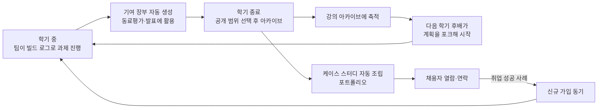
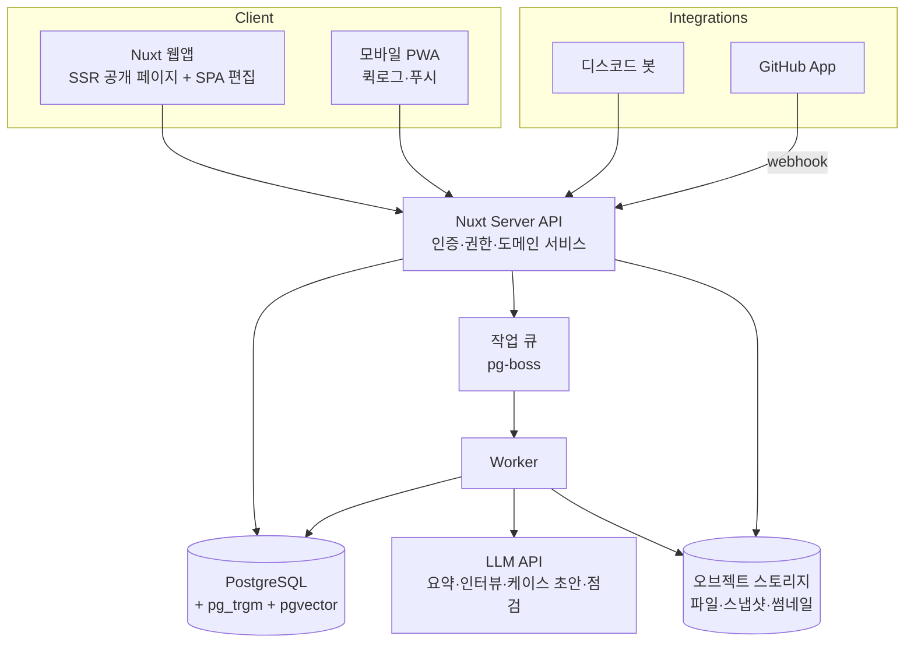
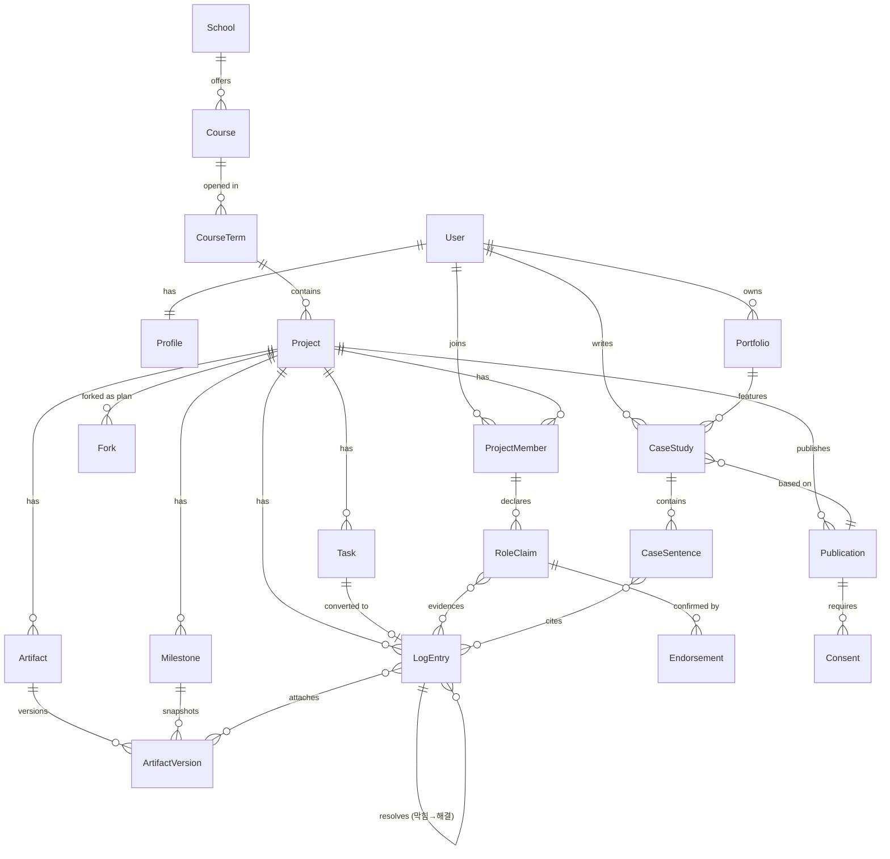

# Peerchive v2 기획·설계 제안서

작성일: 2026-10-14 · 상태: 신규 제안(백지 기획) · 작성: Claude Code

> 이 문서는 기존 기획 문서를 참고하지 않고, 프로젝트 오너가 직접 설명한 최초 목적과 원본 ProofU 코드만을 입력으로 새로 작성한 기획안입니다. 수치·일정은 가설이며 검증 대상입니다.

---

## 0. 한 줄 요약

**Peerchive는 대학생의 조별·개인 과제를 학기 중에는 '팀이 살아남는 도구'로, 학기 후에는 '후배를 위한 공개 지도'로, 취업 때는 '근거 있는 포트폴리오'로 바꿔 주는 서비스입니다.**

- 학기 중: 빌드 로그 + 기여 장부로 조별과제를 굴리고, 무임승차 논쟁을 기록으로 끝낸다.
- 학기 후: 정답이 아닌 *과정*을 공개해 족보를 모두의 것으로 만든다. 후배는 선배의 계획을 **포크**해서 시작한다.
- 취업 때: 쌓인 기록에서 케이스 스터디가 자동으로 조립되고, 채용자는 근거를 클릭해 확인한다.

---

## 1. 출발점 다시 보기

### 1.1 최초 아이디어 (2019 ProofU)

| 최초 의도 | 당시 구현 |
|---|---|
| 족보를 비공개 인맥에서 공개 이력으로 | 공개 보드 검색, 조회수 정렬 |
| 깃허브처럼 과정부터 산출물까지 아카이빙 | Trello형 칸반(Todo/Doing/Done), 카드·보드 첨부파일 |
| 산출물을 포트폴리오화해 신입 취업에 활용 | MyPage의 활동 타임라인, 언어·분야 차트 |
| 팀 단위 과제 | 팀·멤버·가입신청, 팀 채팅 |

### 1.2 칸반 중심 구현의 한계 (회고)

1. **칸반은 '상태'만 남긴다.** 카드가 Done으로 넘어가면 *왜, 어떻게, 무엇이 어려웠는지*는 사라진다. 후배에게도 채용자에게도 Done 카드 목록은 정보가 되지 않는다.
2. **학기 중에 쓸 이유가 Trello·노션·카톡보다 약했다.** 기록은 쓰는 사람에게 당장 이득이 있어야 쌓인다. "나중에 포트폴리오가 된다"는 먼 보상만으로는 습관이 생기지 않는다.
3. **포트폴리오가 활동량 차트였다.** 커밋 수·카드 수·언어 비율은 역량을 설명하지 못한다. 채용자는 "이 사람이 무엇을 판단하고 해결했는가"를 알고 싶어 한다.
4. **공개의 단위가 모호했다.** 진행 중인 보드를 그대로 공개하면 같은 학기 수강생에게 답안 유출이 되고, 공개하지 않으면 아카이브가 쌓이지 않는다.

v2는 이 네 가지를 정면으로 해결하는 데서 시작합니다.

---

## 2. 문제 정의

### 2.1 세 부류의 사용자와 고통

| 사용자 | 지금 겪는 고통 | 지금 쓰는 대안 | 대안의 한계 |
|---|---|---|---|
| **재학생(작성자)** | 조별과제 무임승차, 역할 분담·마감 혼선, 동료평가 때 근거 없음. 학기 끝나면 과제가 하드디스크에서 사라짐 | 카톡 단톡방, 노션, 구글 드라이브, Trello | 대화와 파일이 흩어져 누가 무엇을 했는지 남지 않음 |
| **후배(탐색자)** | 과제가 얼마나 걸리는지, 어디서 막히는지, 무엇부터 해야 하는지 모름. 족보는 인맥 있는 사람만 받음 | 에브리타임 게시판, 선배 연락, 블로그 검색 | 정보가 단편적·비공개·불공평, 정답 거래로 흐르기 쉬움 |
| **채용자** | 신입 지원서의 프로젝트가 다 비슷해 보임. 깃허브는 읽을 시간 없고, 노션 포트폴리오는 근거가 없음. 생성형 AI로 결과물만으로는 실력 판단이 더 어려워짐 | 서류·코딩테스트·면접 | 프로젝트에서 *본인이 실제로 한 판단*을 확인하기 어려움 |

부가 사용자로 **교수·조교**(팀 진행 상황 파악, 무임승차 판정, 우수 사례 전시)와 **대학**(캡스톤·PBL 성과 관리)이 있습니다. 이들은 수익화 단계의 고객 후보입니다(§12).

### 2.2 핵심 통찰

- 족보의 진짜 가치는 정답이 아니라 **"얼마나 걸리고, 어디서 막히고, 무엇부터 해야 하는가"**라는 지도다. 정답을 빼도 가치의 대부분이 남는다.
- 학생이 학기 중에 기록하게 만드는 가장 강한 동기는 **조별과제에서 내 몫을 증명하고 싶은 마음**이다. 포트폴리오는 그 부산물로 만들어야 한다.
- 깃허브는 *코드가 무엇이 바뀌었나*를 기록한다. Peerchive는 *사람이 왜·어떻게 판단했나*를 기록한다. 비개발 전공 과제(보고서·디자인·발표·실험)까지 동일하게 다룬다.

---

## 3. 컨셉과 포지셔닝

### 3.1 컨셉 문장

> **"과제는 끝나도, 과정은 남는다."**
> 후배에게는 지도로, 나에게는 포트폴리오로.

### 3.2 기존 도구와의 관계

| 도구 | 역할 | Peerchive와의 관계 |
|---|---|---|
| GitHub | 코드 버전 관리·협업 | **연동해서 근거로 가져옴.** 대체하지 않음 |
| Trello·노션 | 범용 작업·문서 관리 | 과제에 특화된 구조(마일스톤·기여·공개 정책)로 차별화 |
| 카톡·디스코드 | 팀 대화 | **봇으로 들어가서** 대화 속 결정·진행을 기록으로 수집 |
| 에브리타임 | 강의평가·익명 커뮤니티 | 교수 평가·익명 잡담이 아닌 *과제 과정* 아카이브. 교수 평가는 하지 않음 |
| 노션·링크드인 포트폴리오 | 자기소개·전시 | 기록에서 자동 생성되고 근거로 연결되는 포트폴리오 |
| LMS(이러닝) | 과제 배포·제출·채점 | 제출 이후에도 학생이 소유하는 기록. 장기적으로 연동 |

### 3.3 포지셔닝 맵

```text
                    과정 중심
                       ▲
          Peerchive ●  │
                       │      ● 개발 블로그
   팀/과제 단위 ◀──────┼──────▶ 개인 단위
                       │
         Trello ●      │  ● GitHub     ● 노션 포트폴리오
                       │
                    결과 중심
```

---

## 4. 핵심 루프 (플라이휠)



루프의 출발점은 **"학기 중의 실용성"**입니다. 공개 아카이브와 포트폴리오는 학생이 이미 남긴 기록의 재활용이어야 하며, 공개를 위해 별도로 글을 쓰게 만들지 않습니다.

---

## 5. 칸반을 대체할 '과정 기록' 형식

### 5.1 후보 비교

| 형식 | 장점 | 단점 | 후배에게 | 채용자에게 | 작성 부담 |
|---|---|---|---|---|---|
| 칸반(2019) | 익숙, 상태 파악 | 이유·맥락 소실 | 낮음 | 낮음 | 낮음 |
| 간트 차트 | 일정 관리 | 과제엔 과함, 과정 설명 없음 | 낮음 | 낮음 | 중간 |
| 자유 블로그/일지 | 표현 자유 | 빈 페이지 부담, 검색 어려움 | 중간 | 중간 | 높음 |
| 커밋 자동 수집 | 무입력 | 개발 과제만, 활동량≠역량 | 낮음 | 중간 | 없음 |
| 실험 노트(가설-실험-결과) | 과학적 사고 표현 | 형식이 무거움 | 중간 | 높음 | 높음 |
| **빌드 로그 + 마일스톤** | 짧은 글로 과정·판단·막힘이 남음, 검색·재조립 가능 | 습관 필요 → 봇·AI로 보완 | **높음** | **높음** | **낮음~중간** |

### 5.2 선택: 빌드 로그(Build Log) + 마일스톤

**빌드 로그**는 SNS 스레드처럼 짧은 글(1~5줄 + 이미지·파일·링크)을 시간순으로 쌓는 형식입니다. 각 로그는 다음 중 하나의 **태그**를 가집니다.

| 태그 | 의미 | 예시 |
|---|---|---|
| 🔨 진행 | 한 일 | "로그인 API 완성, 토큰 만료 처리까지" |
| 🧱 막힘 | 막힌 지점과 시도 | "CORS 에러. 프록시 설정 시도 → 실패" |
| 💡 해결 | 막힘의 해결 (막힘 로그에 연결) | "서버에 Access-Control 헤더 추가로 해결, 3시간 소요" |
| ⚖️ 결정 | 선택지와 이유 | "MySQL vs Firebase → 팀원 경험 고려해 MySQL" |
| 🗣️ 회의 | 회의 요약·결정사항 | AI가 회의록에서 자동 생성 |
| 🎯 마일스톤 | 중간 산출물 스냅샷 | "중간발표 슬라이드 v1" |
| 🔁 회고 | 배운 점, 다시 한다면 | 학기 말 AI 인터뷰로 작성 |

**마일스톤**은 과제를 3~6개 구간(예: 기획 → 중간발표 → 구현 → 최종제출)으로 나눈 축이며, 각 마일스톤에 그 시점 산출물의 **스냅샷**이 붙습니다. 공개 화면에서는 스냅샷을 나란히 보여 주는 **진화 보기**로 과제가 어떻게 자라났는지 한눈에 보입니다(비개발 과제용 diff).

**칸반은 버리지 않습니다.** "할 일" 탭으로 유지하되 카드를 완료할 때 "막힌 적 있었나요? 결정할 게 있었나요?"를 한 번 물어 빌드 로그로 전환합니다. 2019 ProofU의 Board/List/Card가 v2에서 살아남는 형태입니다.

### 5.3 기록 부담을 없애는 세 가지 입력 경로

1. **웹·모바일 퀵로그:** 앱을 열면 입력창 하나와 태그 버튼만. 사진 먼저 찍고 한 줄 붙이기.
2. **메신저 봇:** 팀이 이미 쓰는 디스코드(1차)·슬랙에 봇을 초대. `/log 막힘 CORS 에러` 또는 메시지에 📌 이모지 반응을 달면 로그로 저장. 회의 채널 대화는 팀이 동의한 경우에만 AI가 요약해 🗣️ 회의 로그 초안을 만든다. 카카오톡은 비용·API 제약상 알림 전용으로 시작.
3. **AI 회고 인터뷰어:** 주 1회 3분짜리 대화형 질문("이번 주에 가장 오래 걸린 건?", "그걸 어떻게 풀었어?")으로 로그를 끌어낸다. 학기 말에는 15분 인터뷰로 🔁 회고와 케이스 스터디 재료를 만든다. 모든 AI 생성물은 학생이 승인해야 저장된다.

---

## 6. 기능 기획

### 6.1 과제 공간 (Project Space)

과제 하나 = 프로젝트 하나. 개인 과제·조별 과제 모두 지원.

| 탭 | 내용 |
|---|---|
| 개요 | 과목·학기, 과제 한 줄 요약(학생 작성), 목표, 마감, 팀원과 역할 |
| 빌드 로그 | 태그별 타임라인, 필터(내 로그/막힘만/결정만), 마일스톤 구분선 |
| 할 일 | 칸반 lite(리스트 보기 기본, 보드 보기 선택), 담당자·마감, 완료 시 로그 전환 |
| 산출물 | 파일·링크·GitHub 저장소, 버전 관리, 마일스톤 스냅샷 지정 |
| 기여 | 기여 장부(§6.2) |
| 공개 | 공개 범위 설정·미리보기(§6.4) |

### 6.2 기여 장부 (Contribution Ledger) — 학기 중 킬러 기능

조별과제의 가장 큰 스트레스인 무임승차·기여도 분쟁을 기록으로 해소합니다.

- **자동 수집:** 각 팀원의 로그, 완료한 할 일, 업로드한 산출물, 회의 참여, (연동 시) 커밋·PR이 시간순으로 쌓인다.
- **역할 선언:** 각자 "내가 맡은 것"을 문장으로 선언하고 관련 기록을 연결한다.
- **팀원 확인:** 다른 팀원이 선언을 확인(✔️)하거나 코멘트한다. 선언이 수정되면 확인은 초기화된다.
- **주간 리포트:** 매주 팀원별 활동 요약을 팀 전체에 공유(봇 메시지).
- **동료평가 리포트 내보내기:** 학기 말 수업의 동료평가 제출용으로 팀원별 기여 요약 PDF를 생성.

**원칙:** 활동량을 점수로 환산하지 않습니다. "로그 30개"보다 "결정 3건, 막힘 해결 5건, 팀원 확인 받은 역할 2개"처럼 *종류와 근거*로 보여 줍니다. 활동량 순위는 만들지 않습니다(로그 쪼개기 같은 게이밍을 부르기 때문).

### 6.3 강의 아카이브 (Course Archive) — 족보의 공개판

학교 → 과목 → 과제 유형으로 공개 사례가 모입니다.

**과목 페이지 구성**
1. 과목 소개와 선수 지식 태그 (학생 작성, 운영자 병합)
2. 과제 유형 목록 (과제 원문이 아닌 학생이 쓴 요약)
3. **체감 소요시간·난이도 분포** — AI 회고와 주간 체크에서 수집, 5명 이상일 때만 익명 집계 표시
4. **자주 막히는 지점** — 🧱 막힘 로그 집계, "나도 여기서 막혔어요" 수로 정렬
5. **선배 한마디** — "첫 주에 할 일", "다시 한다면" 짧은 글
6. 공개된 과제 사례 목록 (마일스톤 스냅샷 미리보기)

**플랜 포크 (Fork the Plan, not the Answer)**
깃허브의 포크 개념을 *계획*에 적용합니다. 후배는 선배 과제의 **마일스톤 구성, 할 일 체크리스트, 주차별 시간 배분, 참고 자료 목록**을 포크해서 자기 과제 공간을 시작합니다. 코드·보고서 본문은 포크되지 않습니다. 포크 수는 원작자에게 "내 기록이 후배 N명에게 쓰였다"는 보상 신호가 되고, 포트폴리오에 표시할 수 있습니다.

**막힘 Q&A**
공개된 🧱 막힘 로그에 후배가 질문을 달 수 있습니다(작성자가 허용한 경우). 원리·접근 위주 답변을 권장하며, "답 코드 주세요"류는 가이드와 신고로 제한합니다.

**정책**
- 교수 실명·강의평가·별점은 다루지 않는다(에브리타임과 다른 영역, 분쟁 회피).
- 같은 과목·같은 학기 진행 중인 과제는 공개되지 않는다(§6.4 엠바고).

### 6.4 공개와 아카이빙

**공개는 '학기 종료 후 스냅샷' 단위입니다.** 진행 중인 과제 공간 자체를 공개하지 않습니다.

| 공개 수준 | 보이는 것 | 용도 |
|---|---|---|
| 🌐 전체 공개 | 빌드 로그(선택한 것), 마일스톤 스냅샷, 산출물, 기여 | 강의 아카이브 + 포트폴리오 |
| 📄 요약 공개 | 과제 요약, 마일스톤, 막힘·결정 로그만. 산출물 본문 제외 | 과제 원문·답이 민감한 경우 |
| 🔗 링크 공개 | 링크를 가진 사람만 (검색·아카이브 비노출) | 채용 제출용 |
| 🔒 비공개 | 팀만 | 기본값 |

- **엠바고:** 과목·학기 정보가 있는 과제는 해당 학기 종료일까지 공개 버튼이 비활성. 종료 후 "공개할까요?" 알림.
- **팀 동의:** 조별 과제는 공개 범위에 포함된 자료·이름에 대해 팀원 전원의 동의가 필요. 동의하지 않은 팀원의 이름·로그는 자동 제외 옵션.
- **공개 전 점검:** AI가 개인정보(학번·전화번호), 과제 원문으로 보이는 파일, 타인 실명을 탐지해 경고.
- **철회:** 언제든 공개 철회 가능. 포트폴리오·검색에서 즉시 사라짐.

### 6.5 프로필과 포트폴리오

**프로필 = 한 페이지에서 "이 사람이 무엇을 할 수 있는지" 근거와 함께 보이는 곳.**

```text
┌───────────────────────────────────────────────┐
│ 김지민 · 백엔드 개발 지망 · 2027.02 졸업 예정      │
│ "불완전한 조건에서 범위를 조정하고 검증하는 개발자" │
│ [연락하기] [PDF] [GitHub]                         │
├───────────────────────────────────────────────┤
│ 대표 케이스 스터디 (3)                            │
│  ▸ 도서관 혼잡도 웹앱 — 실시간 센서 대신 수동 입력  │
│    으로 범위 조정, 사용성 테스트 12명               │
│    역할: API·입력 검증 (팀원 2명 확인 ✔️)          │
│  ▸ 운영체제 셸 구현 — 좀비 프로세스 디버깅 사례      │
│  ▸ 캡스톤: …                                     │
├───────────────────────────────────────────────┤
│ 역량 × 근거                                       │
│  API 설계    결정 3 · 산출물 2 · 확인 ✔️          │
│  디버깅      막힘해결 8                            │
│  협업        회의 주도 5 · 역할 확인 4             │
├───────────────────────────────────────────────┤
│ 후배 기여: 내 계획이 12번 포크됨 · 막힘 답변 9      │
│ 전체 과제 타임라인 (4년) ─●──●───●──●●──●─         │
└───────────────────────────────────────────────┘
```

**케이스 스터디 자동 조립**
공개된 과제의 빌드 로그·마일스톤·기여 장부에서 AI가 **문제 → 내 역할 → 핵심 결정 → 막힘과 해결 → 결과 → 배운 점** 구조의 초안을 만듭니다.
- 모든 문장에 출처 로그 링크가 붙고, 출처 없는 문장은 노란색으로 표시되어 학생이 고치거나 지워야 발행 가능.
- 지원 직무별(백엔드/프론트/데이터/기획/디자인)로 강조점을 바꾼 버전을 여러 개 만들 수 있음.

**역량 × 근거 매트릭스**
2019 MyPage의 "언어·분야 차트"를 계승하되, 활동량이 아니라 **근거의 종류와 수**를 보여 줍니다. 셀을 누르면 해당 로그로 이동합니다. 점수·등급은 매기지 않습니다.

**내보내기**
PDF 포트폴리오, 이력서용 3줄 요약, GitHub 프로필 README용 배지·카드(GitHub에서 Peerchive로 유입되는 통로).

### 6.6 채용자 기능

| 기능 | 내용 | 단계 |
|---|---|---|
| 공개 프로필 열람 | 로그인 없이 링크로 열람, 90초 안에 역할·근거 파악하도록 설계 | MVP |
| 케이스 근거 탐색 | 케이스 문장 → 원본 로그·스냅샷·팀원 확인으로 드릴다운 | MVP |
| **포트폴리오 Q&A** | 채용자가 "이 프로젝트에서 본인이 직접 한 건?"이라고 물으면, 학생이 공개한 기록 안에서만 근거를 인용해 AI가 답함. 답할 근거가 없으면 "기록 없음"이라고 답함. 학생이 켜야 활성화 | P2 |
| 인재 탐색 | 구직 중 표시를 켠 학생만, 역량·과목·지역 필터 | P2 |
| 연락 요청 | 학생 수락 시에만 연락처 공개 | P2 |
| 기업 연계 과제 | 기업이 실제 문제를 캡스톤 과제로 제공, 결과를 Peerchive에서 열람 | P3 |

### 6.7 교수·학교 기능 (B2B)

| 기능 | 내용 |
|---|---|
| 수업 스페이스 | 교수가 수업을 만들고 팀 과제 공간을 일괄 생성, 마일스톤 템플릿 배포 |
| 진행 대시보드 | 팀별 마일스톤 진행, 최근 활동, 정체된 팀 알림 (로그 본문은 팀이 허용한 범위만) |
| 동료평가 연동 | 기여 장부 기반 동료평가 수집 |
| 성과 전시회 | 캡스톤 경진대회·졸업작품전 온라인 전시관 |
| 공개 정책 | 수업 단위 엠바고·공개 범위 기본값 설정 |

---

## 7. 화면 설계

### 7.1 정보 구조 (사이트맵)

```text
Peerchive
├── 홈 (로그인 시: 내 과제 대시보드 / 비로그인: 강의 아카이브 탐색)
├── 탐색
│   ├── 학교 > 과목 > 과제 유형 > 사례
│   ├── 막힘 검색 (에러 메시지·키워드)
│   └── 개념 태그
├── 내 과제
│   └── 과제 공간 [개요 | 빌드 로그 | 할 일 | 산출물 | 기여 | 공개]
├── 포트폴리오
│   ├── 케이스 스터디 편집
│   ├── 프로필 편집
│   └── 내보내기
├── @사용자명 (공개 프로필)
└── 설정 (연동: GitHub·디스코드 / 알림 / 공개 기본값)
```

### 7.2 주요 화면 와이어프레임

**내 과제 대시보드**
```text
┌ 이번 주 ───────────────────────────────────────┐
│ 운영체제 과제2  마감 D-5  ▓▓▓▓░░ 마일스톤 3/5   │
│   └ 🧱 막힘 1건 미해결 · 팀원 민수 3일째 로그 없음 │
│ 캡스톤디자인    중간발표 D-12                     │
│ [퀵로그 작성 ________________] [🔨][🧱][⚖️] [📎] │
└─────────────────────────────────────────────────┘
┌ AI 주간 회고 (3분) ──────── [시작하기] ┐
└ 공개 가능해진 과제 1건 ─── [공개 준비] ┘
```

**과제 공간 — 빌드 로그**
```text
[개요] [빌드로그] [할 일] [산출물] [기여] [공개]     🔒 팀만 보기
필터: 전체 | 🧱막힘 | ⚖️결정 | 내 로그
──── 🎯 마일스톤 2: 중간발표 (10/20) [스냅샷: 슬라이드 v1] ────
10/22 지민  🧱 CORS 에러, 프록시 설정 시도 → 실패
10/22 지민  💡 서버 헤더 추가로 해결 (3h)        ↳ 막힘 연결됨
10/23 민수  ⚖️ 지도 API: 카카오 vs 네이버 → 무료 쿼터로 카카오
10/24 봇    🗣️ 회의 요약 (디스코드 #회의, 승인됨)
[로그 작성...]
```

**공개 사례 페이지 (후배 시점)**
```text
운영체제 · 2026-1 · 셸 구현 과제 · 2인 · 약 25시간
진화 보기:  [기획] → [파서 완성] → [파이프 구현] → [최종]
자주 막힌 곳: 좀비 프로세스(3) · 파이프 fd 누수(2)
⚖️ 핵심 결정 2  🧱 막힘 5 (해결 4)
[이 계획 포크하기]  [막힘에 질문하기]
```

### 7.3 디자인 원칙

- **문서형 UI:** 기록과 산출물이 주인공. 장식보다 타이포그래피·여백.
- **공개 상태를 항상 표시:** 화면 상단에 🔒/🔗/🌐 배지. 공유 버튼에는 공개 범위를 함께 표기.
- **모바일 우선 입력, 데스크톱 우선 편집:** 퀵로그·사진은 모바일, 케이스 편집·공개 준비는 데스크톱.
- **접근성:** 색만으로 상태를 구분하지 않음, 키보드 조작, 칸반 드래그의 버튼 대안.

---

## 8. 사용자 시나리오: 한 학기

| 시기 | 지민(3학년)의 행동 | Peerchive의 역할 |
|---|---|---|
| 개강 1주 | 운영체제 과제 공지. 과목 페이지에서 "평균 25시간, 좀비 프로세스에서 많이 막힘" 확인, 선배 계획 포크 | 강의 아카이브, 플랜 포크 |
| 2~4주 | 팀원 민수와 디스코드에서 작업. 막힐 때 `/log 막힘` | 디스코드 봇, 빌드 로그 |
| 5주 | 지도 API 선택 회의, 봇이 회의 요약 초안 → 승인 | ⚖️ 결정 로그 |
| 8주 | 중간발표 슬라이드를 마일스톤 스냅샷으로 지정 | 마일스톤 |
| 매주 | 3분 AI 회고, 주간 기여 리포트 수신 | AI 인터뷰어, 기여 장부 |
| 15주 | 동료평가 제출 시 기여 리포트 PDF 첨부 | 동료평가 리포트 |
| 학기 종료 | "공개할까요?" 알림, 요약 공개 선택, 팀원 동의 | 엠바고 해제, 공개 점검 |
| 방학 | AI 15분 인터뷰 → 케이스 스터디 초안 → 수정·발행 | 케이스 자동 조립 |
| 4학년 하반기 | 공채 지원서에 프로필 링크, 면접관이 결정 로그를 보고 질문 | 공개 프로필, 근거 탐색 |
| 다음 학기 | 후배 12명이 지민 계획을 포크, 막힘 질문에 답변 | 후배 기여 지표 |

---

## 9. 시스템 설계

### 9.1 아키텍처



### 9.2 기술 스택

| 영역 | 선택 | 이유 |
|---|---|---|
| 프론트 | **Nuxt (Vue 3) + TypeScript** | 원본이 Vue 2라 개발자 경험 계승. 공개 페이지 SSR로 검색 노출·OG 미리보기 |
| UI | Tailwind CSS + 헤드리스 컴포넌트 | 문서형 UI를 빠르게, 접근성 확보 |
| 서버 | Nuxt Server(Nitro) API + 도메인 서비스 계층 | 1인 개발에 맞는 단일 배포. 필요 시 API 분리 가능하게 계층 분리 |
| DB | **PostgreSQL** + Drizzle ORM + 명시적 migration | 관계·권한·공개 스냅샷을 트랜잭션으로. `pg_trgm`(한국어 부분 검색), `pgvector`(유사 막힘 검색) |
| 큐 | pg-boss (Postgres 기반) | Redis 없이 AI 작업·썸네일·알림 처리 |
| 파일 | S3 호환 스토리지 (예: Cloudflare R2) | 비공개 버킷 + 서명 URL, 저렴한 전송비 |
| 인증 | 이메일 매직링크 + Google·GitHub·카카오 OAuth, HttpOnly 세션 쿠키 | 비개발 전공도 GitHub 없이 가입. 학교 메일 인증은 선택 배지 |
| AI | LLM API (Claude Sonnet급: 요약·케이스 초안·인터뷰 / Haiku급: 태그 분류·민감정보 점검) | 작업별 모델 분리로 비용 제어. 공급자 교체 가능한 어댑터 |
| 봇 | discord.js 기반 별도 프로세스 | 슬래시 커맨드·이모지 반응 수집 |
| 테스트 | Vitest, Playwright, 실DB 통합 테스트 | 권한·공개 누출 회귀 방지가 최우선 |
| 배포 | 컨테이너(웹·워커·봇) + 관리형 Postgres | Fly.io/Railway/국내 클라우드 중 비용·지연 비교 후 결정 |
| 관측 | Sentry + 구조화 로그 | 로그 본문·개인정보 미기록 |

### 9.3 도메인 모델



| 엔티티 | 주요 필드 | 비고 |
|---|---|---|
| User / Profile | email, handle, display_name, headline, job_targets[], contact_policy, open_to_work | 이메일은 비공개 필드 분리 |
| School / Course / CourseTerm | name / code, title, merged_into / year, semester, ends_at | `ends_at`이 엠바고 기준 |
| Project | title, summary_by_student, goal, kind(individual/team), status, course_term_id?, visibility | 기본 private |
| ProjectMember | role(owner/member/viewer), part_label, status | 2019 Member.field/part 계승 |
| Milestone | order, title, due_at, snapshot_version_ids | 완료 강제 없음 |
| LogEntry | author_id, tag(progress/stuck/solution/decision/meeting/milestone/retro), body, payload(JSON), resolves_id?, source(web/discord/ai/task), occurred_at, recorded_at, ai_generated, approved | 태그별 payload: stuck{error_text, time_spent}, decision{options, reason} |
| Task | title, assignee_id, due_at, status, position | 2019 Card 계승 |
| Artifact / ArtifactVersion | kind(file/link/repo) / storage_key, sha256, mime, size, scan_status | 원 파일명으로 경로 생성 안 함 |
| RoleClaim / Endorsement | text, revision / endorser_id, status, comment | 선언 수정 시 확인 무효화 |
| Publication | level(full/summary/link), snapshot(JSON), status, published_at, withdrawn_at | 공개 시점 스냅샷만 공개 API가 읽음 |
| Consent | publication_id, user_id, status | 팀원별 |
| Fork | source_project_id, target_project_id | 계획 요소만 복사 |
| CaseStudy / CaseSentence | job_target, status / text, order, citations[] | 출처 없는 문장은 발행 차단 |
| Question / Answer | log_entry_id, body | 막힘 Q&A |
| AuditLog | actor, action, target, at | 공개·철회·권한 변경 |

### 9.4 권한과 공개의 불변조건

1. 공개 API·검색·포트폴리오·OG 이미지는 **`Publication.snapshot`만 읽는다.** 작업 공간 테이블을 직접 조회하지 않는다.
2. 엠바고 중인 프로젝트는 서버에서 공개 요청 자체를 거부한다(클라이언트 버튼 비활성은 보조).
3. 팀원 동의가 없는 자료는 스냅샷 생성 단계에서 제외된다.
4. 공개 철회 시 스냅샷 상태가 즉시 `withdrawn`이 되고, 파생 데이터(검색 인덱스, 케이스, 임베딩)는 워커가 정리한다. 읽기 경로는 상태를 먼저 확인하므로 정리 지연 중에도 노출되지 않는다.
5. AI 작업에는 해당 사용자가 접근 권한을 가진 데이터만 입력한다. 채용자용 포트폴리오 Q&A는 공개 스냅샷만 근거로 쓴다.
6. 파일은 비공개 버킷, 짧은 만료의 서명 URL로만 제공한다.

### 9.5 API 개요 (REST, `/api/v1`)

| 영역 | 엔드포인트 예 |
|---|---|
| 프로젝트 | `POST /projects`, `GET /projects/:id`, `POST /projects/:id/members`, `POST /projects/:id/fork` |
| 로그 | `POST /projects/:id/logs`, `PATCH /logs/:id`, `POST /logs/:id/resolve` |
| 할 일 | `POST /projects/:id/tasks`, `POST /tasks/:id/complete` (→ 로그 전환 프롬프트 응답 포함) |
| 산출물 | `POST /projects/:id/artifacts/upload-url`, `POST /artifacts/:id/versions`, `POST /milestones/:id/snapshot` |
| 기여 | `POST /projects/:id/claims`, `POST /claims/:id/endorse`, `GET /projects/:id/contribution-report` |
| 공개 | `POST /projects/:id/publications` (스냅샷 생성), `POST /publications/:id/consent`, `POST /publications/:id/publish`, `POST /publications/:id/withdraw` |
| 아카이브 | `GET /schools/:id/courses`, `GET /courses/:id`, `GET /search/stuck?q=` |
| 포트폴리오 | `POST /case-studies/draft`, `PATCH /case-studies/:id`, `GET /u/:handle` |
| AI | `POST /ai/weekly-checkin`, `POST /ai/retro-interview` (스트리밍) |
| 연동 | `POST /integrations/discord/link`, `POST /webhooks/github` |

### 9.6 AI 파이프라인

| 작업 | 입력 | 출력 | 안전장치 |
|---|---|---|---|
| 회의 요약 | 팀이 동의한 디스코드 채널 메시지 | 🗣️ 회의 로그 초안 | 팀원 승인 전 비공개 초안 상태 |
| 주간 회고 인터뷰 | 이번 주 로그·할 일 | 질문 → 학생 답변 → 로그 초안 | 학생 승인 필수 |
| 태그 분류 | 퀵로그 본문 | 태그 추천 | 추천만, 학생이 확정 |
| 공개 전 점검 | 공개 후보 스냅샷 | 개인정보·과제원문·타인 실명 경고 | 경고만, 판단은 학생 |
| 케이스 스터디 초안 | 공개 스냅샷 | 문장 + 인용 로그 ID | 인용 없는 문장 발행 차단 |
| 유사 막힘 검색 | 공개 막힘 로그 임베딩 | 비슷한 사례 추천 | 공개 데이터만 임베딩 |
| 포트폴리오 Q&A (P2) | 채용자 질문 + 공개 스냅샷 | 근거 인용 답변 | 근거 없으면 "기록 없음" |

AI 사용 여부와 범위는 각 로그·케이스에 `ai_generated` 표시로 남깁니다. AI가 없어도 모든 핵심 기능은 수동으로 사용 가능해야 합니다.

### 9.7 검색

- 1단계: PostgreSQL 전문 검색 + `pg_trgm`으로 과목명·에러 메시지 부분 일치.
- 2단계: `pgvector`로 "이 막힘과 비슷한 사례" 의미 검색.
- 별도 검색 엔진(Elasticsearch 등)은 공개 사례 수만 건 이상에서 재검토.

---

## 10. 원본 ProofU를 버리지 않는 고도화 전략

### 10.1 원칙

원본 `frontend/`·`backend/`는 **기록 보존 대상으로 그대로 둡니다.** v2는 같은 저장소의 `apps/` 아래에 새로 만들고, 원본의 도메인 개념을 계승합니다. 원본을 점진적으로 업그레이드(Vue 2 → 3, Sequelize 정비)하는 방식은 다음 이유로 권하지 않습니다.

- 원본에 누락 파일(`backend/api/user.js`)과 구버전 빌드 체인(Webpack 3, Babel 6)이 있어 실행 복원에만 상당한 시간이 든다.
- 평문 비밀번호, 하드코딩된 DB 접속 정보·JWT 키 등 보안 구조를 고치는 비용이 새로 만드는 비용과 비슷하다.
- v2의 핵심(빌드 로그·기여 장부·공개 스냅샷)은 원본에 없는 도메인이다.

### 10.2 개념 계승 매핑

| 원본 (2019) | v2 |
|---|---|
| `User` (email, name, git) | User + Profile (git → GitHub 연동) |
| `Team` + `Member`(field ENUM, part) | Project + ProjectMember(part_label), field ENUM → 역량·관심 태그 |
| `Join` (가입 신청) | 초대 링크 + 공개 사례 작성자에게 질문 |
| `Board` (title, description, language) | Project (summary, 기술 태그) |
| `List` / `Card` (Todo/Doing/Done) | Task (할 일 탭) + 완료 시 LogEntry 전환 |
| `BoardFile` / `CardFile` | Artifact / ArtifactVersion + 마일스톤 스냅샷 |
| `Message` + Socket.IO 채팅 | 자체 채팅은 만들지 않음 → 디스코드 봇 연동 + 🗣️ 회의 로그 |
| Calendar | 마일스톤·마감 (캘린더 내보내기 .ics) |
| YUnotice (학교 공지 크롤링) | 학교 → 과목 구조의 강의 아카이브 (크롤링 없음) |
| MyPage 활동 타임라인·언어 차트 | 4년 과제 타임라인 + 역량×근거 매트릭스 |
| Search (LIKE, 조회수 정렬) | 과목·막힘·개념 검색, 포크·도움됨 기준 정렬 |

### 10.3 ProofU를 Peerchive의 첫 사례로

v2가 완성되면 **ProofU 졸업작품 자체를 첫 공개 사례**로 올립니다.
- 마일스톤: 2019 졸업작품 → 2020 저장소 업로드 → 2026 이력 정리 → Peerchive v2
- ⚖️ 결정: "2019년엔 왜 칸반을 택했나" / "2026년엔 왜 빌드 로그로 바꿨나"
- 🧱 막힘: 원본의 누락 파일·구버전 의존성 문제
- 이것이 "졸업작품을 버리지 않고 이어 가는 과정"의 모범 사례이자, 오너 본인의 포트폴리오가 됩니다.
- 단, 2019년 커밋은 2020년 업로드 코드를 기능별로 재구성한 기록이며 실제 당시 개발 로그가 아니라는 점을 사례에 명시합니다.

### 10.4 저장소 구조 (제안)

```text
peerchive/
├── frontend/          # 2019 원본 (보존, 수정 금지)
├── backend/           # 2019 원본 (보존, 수정 금지)
├── apps/
│   ├── web/           # Nuxt 앱 (페이지·컴포넌트·server/api)
│   ├── worker/        # AI·파일·알림 작업
│   └── bot/           # 디스코드 봇
├── packages/
│   ├── domain/        # 도메인 규칙·상태 전이·공개 정책
│   ├── db/            # Drizzle 스키마·migration
│   └── ai/            # 프롬프트·LLM 어댑터·평가 세트
├── docs/
└── scripts/check_archive.py   # 원본 보존 검증 (계속 CI에서 실행)
```

---

## 11. 신뢰·윤리·정책

| 주제 | 정책 |
|---|---|
| 학업 부정 | 학기 중 엠바고, 과제 원문 업로드 경고, 정답 공유 금지 가이드, 신고·숨김 처리. "계획은 포크, 답은 금지" |
| 교수·강의 평가 | 다루지 않음. 교수 실명은 기본 비표시 |
| 저작권 | 산출물은 학생(팀) 소유. 공개 시 열람만 허용이 기본, 재사용 라이선스는 선택. 과제 문제지 등 타인 저작물은 업로드 경고 |
| 팀 동의 | 공개 범위에 포함된 팀원 전원 동의. 미동의자 자료 자동 제외 |
| 개인정보 | 개인정보보호법 기준 최소 수집. 학번·성적 미수집. 학교 인증은 선택. 탈퇴 시 공개물 처리(삭제/익명화) 선택권 |
| AI | 생성물은 표시·승인 필수. 비공개 데이터는 해당 팀 작업에만 사용, 모델 학습에 사용하지 않는 API 조건 선택 |
| 기여 표시 | 활동량 점수·순위 없음. 팀원 확인과 본인 선언을 구분 표시 |
| 채용 | 학생이 켜지 않으면 인재 탐색 비노출. 기업에 학생 데이터 판매 없음 |

---

## 12. 비즈니스 모델 (가설)

| 대상 | 상품 | 가설 근거 |
|---|---|---|
| 학생 | **무료.** 기록·공개·포트폴리오 전부 | 공급(학생 기록)이 곧 플랫폼 가치 |
| 학생 (선택) | 프리미엄: 포트폴리오 커스텀 도메인·테마, AI 인터뷰 무제한, 직무별 케이스 버전 다수 | 취업 준비 시즌 지불 의향 확인 필요 |
| 대학·학과 | 수업 스페이스·진행 대시보드·성과 전시관 SaaS | 캡스톤·PBL 운영과 성과 관리 수요(대학 재정지원사업 성과 보고 등) |
| 기업 | 인재 탐색·연락, 채용 브랜딩, 기업 연계 과제 운영 | 신입 검증 비용 절감. 학생 공급이 충분해진 뒤 |

초기 1년은 수익보다 **한 학교·한 학과에서의 밀도**를 목표로 합니다.

---

## 13. 로드맵

한국 학사 일정(3월·9월 개강, 6월·12월 종강, 상·하반기 공채)에 맞춥니다. 1인 개발 주 20~30시간 가정입니다.

| 단계 | 기간 | 목표 | 산출물 | 다음 단계 조건 |
|---|---|---|---|---|
| **0. 검증** | 2026-10 ~ 11 (4주) | 문제 확인 | 재학생 10명·채용 담당 3명 인터뷰, 노션+디스코드로 2~3팀 수동 운영(빌드 로그 템플릿, 주간 회고 수동 진행), 졸업생 5명의 선배 한마디·막힘 수집 | 수동 운영 팀 절반 이상이 4주간 주 1회 이상 기록 |
| **1. MVP 개발** | 2026-12 ~ 2027-02 (12주, 겨울방학) | 학기 중 도구 완성 | 과제 공간, 빌드 로그, 할 일, 산출물·마일스톤, 기여 장부·동료평가 리포트, 디스코드 봇, 주간 AI 회고, 공개 스냅샷·엠바고, 기본 프로필 | 내부 테스트에서 권한·공개 누출 0건 |
| **2. 파일럿** | 2027-03 ~ 06 (1학기) | 한 학과 10~20팀 실사용 | 강의 아카이브(과목 3개), 플랜 포크, 학기 말 공개 캠페인 | 파일럿 팀 50% 이상이 학기 말까지 사용, 공개 사례 15건 이상 |
| **3. 포트폴리오** | 2027-07 ~ 08 (여름방학) | 하반기 공채 대응 | 케이스 스터디 자동 조립, 역량×근거, PDF·README 배지, 채용자 열람 최적화 | 케이스 발행 학생 20명 이상, 채용자 테스트 긍정 |
| **4. 확장** | 2027-2학기 ~ | 다학과·다학교, 수익화 실험 | 교수 수업 스페이스, 막힘 Q&A·의미 검색, 포트폴리오 Q&A, 인재 탐색 베타 | 2개 이상 학과 자발적 확산 |

### 13.1 MVP 범위 (단계 1) 상세

| 우선순위 | 기능 | 완료 기준 |
|---|---|---|
| P0 | 가입·로그인(매직링크·Google·GitHub) | 세션 보안, 탈퇴 |
| P0 | 과제 공간·팀 초대 | 비공개 기본, 타 팀 접근 차단 테스트 |
| P0 | 빌드 로그(태그 7종, 막힘↔해결 연결) | 모바일 10초 내 작성 |
| P0 | 할 일(리스트 보기) + 완료 시 로그 전환 | 드래그 없이 순서 변경 |
| P0 | 산출물 업로드·마일스톤 스냅샷 | 서명 URL, 용량 제한 |
| P0 | 기여 장부·역할 선언·팀원 확인·리포트 PDF | 선언 수정 시 확인 초기화 |
| P0 | 디스코드 봇(`/log`, 📌 반응) | 계정 연결, 프로젝트 지정 |
| P0 | 공개 스냅샷·팀 동의·엠바고·철회 | 공개 API가 스냅샷만 읽음 테스트 |
| P1 | 주간 AI 회고, 회의 요약 | 승인 전 초안 상태 |
| P1 | 공개 프로필 기본형 | 비공개 필드 미노출 테스트 |
| P2 | 칸반 보드 보기, GitHub App | 단계 2 이후 |

### 13.2 단계 0에서 바로 할 일 (향후 2주)

1. 인터뷰 질문지 작성: "마지막 조별과제에서 누가 무엇을 했는지 어떻게 증명했나?", "족보를 받아 본 적 있나, 무엇이 가장 유용했나?", "포트폴리오 만들 때 가장 오래 걸린 일은?"
2. 노션 빌드 로그 템플릿 + 디스코드 채널 구조 설계, 파일럿 팀 2~3개 모집(동아리·후배).
3. 졸업생 5명에게 "선배 한마디 + 가장 오래 막힌 곳" 수집 → 과목 페이지 목업.
4. ProofU 원본 화면을 캡처해 첫 사례(§10.3)의 2019 마일스톤 스냅샷 준비.
5. Nuxt + Postgres + Drizzle 스켈레톤과 CI(원본 보존 검증 포함) 구성.

---

## 14. 성공 지표

| 구분 | 지표 | 파일럿 목표(가설) |
|---|---|---|
| **북극성** | 학기 말에 공개된 과제 중 **후배가 포크하거나 '도움됨'을 누른 과제 수** | 파일럿 학기 15건 |
| 활성화 | 가입 7일 내 과제 생성 + 로그 3개 | 60% |
| 습관 | 활성 팀의 주간 로그 작성 주 비율 | 학기 주차의 70% |
| 학기 중 가치 | 기여 리포트를 동료평가·발표에 실제로 쓴 팀 | 30% |
| 공개 전환 | 종료 과제 중 공개(요약 이상)된 비율 | 40% |
| 포트폴리오 | 케이스 스터디를 발행하고 외부에 공유한 학생 | 20명(단계 3) |
| 채용자 | 모의 검토에서 90초 내 역할·근거 파악 성공률 | 80% |
| 안전 | 비공개 누출·잘못된 공개 | 0건 |

활동량(로그 수, 조회수)은 보조 지표로만 보고 목표로 삼지 않습니다.

---

## 15. 리스크와 대응

| 리스크 | 신호 | 대응 |
|---|---|---|
| 기록 피로 | 2~3주 후 로그 급감 | 봇·AI 인터뷰 비중 확대, 태그 축소, 주 1회 회고만으로도 성립하게 |
| 답안 공유 플랫폼화 | 산출물 다운로드만 많고 로그 열람 적음 | 요약 공개 기본값, 산출물 다운로드 제한, 신고 운영 |
| 공개 동의 실패 | 팀원 무응답으로 공개 지연 | 미동의자 자동 제외, 학기 초 공개 합의 기능 |
| 기여 분쟁 확대 | 기여 장부가 팀 갈등 도구가 됨 | 점수·순위 없음, 비난이 아닌 사실 기록, 코멘트 톤 가이드 |
| 콜드 스타트 | 과목 페이지가 비어 있음 | 졸업생 캠페인, 한 학과·과목 3개 집중, 사후 작성 지원 |
| AI 비용·환각 | 비용 급증, 근거 없는 케이스 문장 | 작업별 모델 분리·캐싱, 인용 필수, 사용량 한도 |
| 1인 개발 지연 | 단계 1이 12주 초과 | P1 이하 과감히 미룸. 공개·권한 테스트는 줄이지 않음 |
| 학교·교수 반발 | 특정 과목 공개 반대 | 교수 엠바고 요청 채널, 수업 단위 정책 설정 |

---

## 16. 결정이 필요한 질문

1. **첫 파일럿 학교·학과:** 오너가 접근 가능한 후배·동아리 코호트는 어디인가?
2. **봇 채널:** 대상 학생들이 실제로 쓰는 팀 채널이 디스코드인가 카카오톡인가? (카카오톡이라면 기록 수집 전략을 웹·PWA 중심으로 바꿔야 함)
3. **AI 비중:** 주간 AI 회고를 MVP(P0)로 올릴지, 수동 퀵로그로 먼저 검증할지.
4. **개발 투입 시간:** 주 20시간 미만이면 디스코드 봇과 기여 리포트 PDF를 단계 2로 미루는 축소안 적용.
5. **브랜드:** 서비스명 Peerchive 유지 + 부제("과제는 끝나도, 과정은 남는다")를 쓸지.
