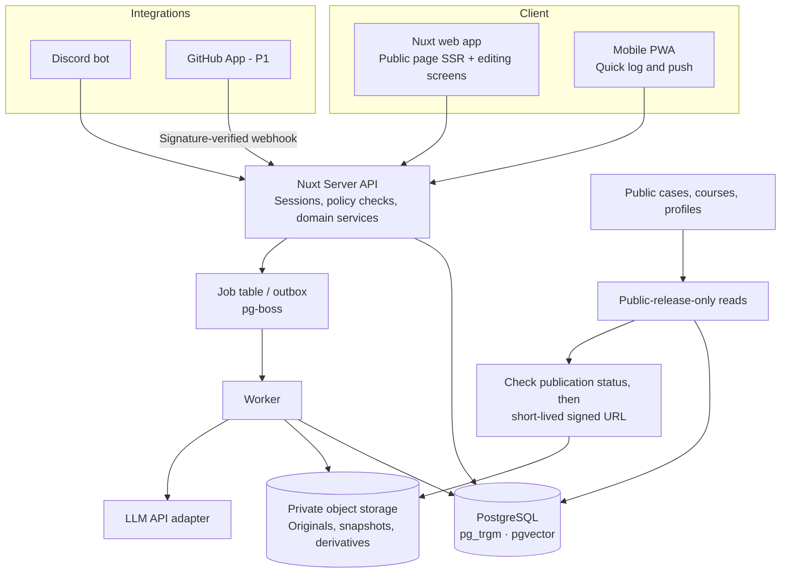
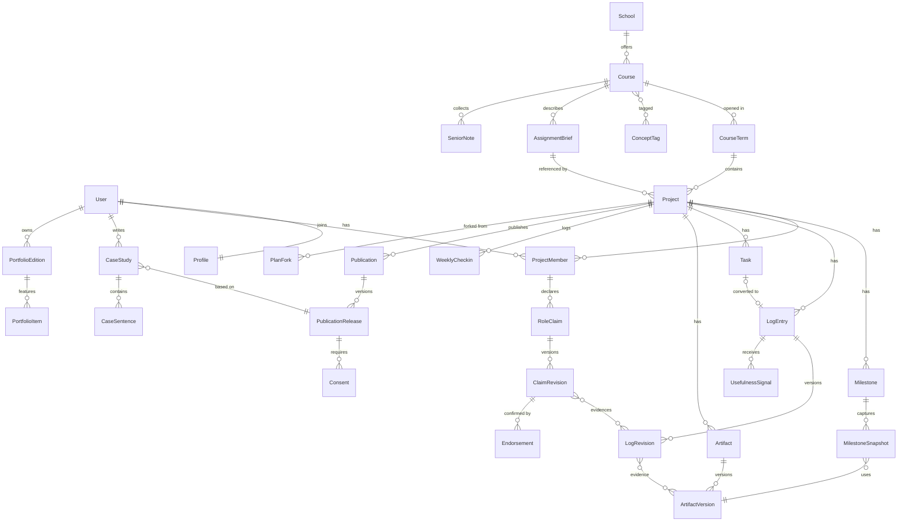
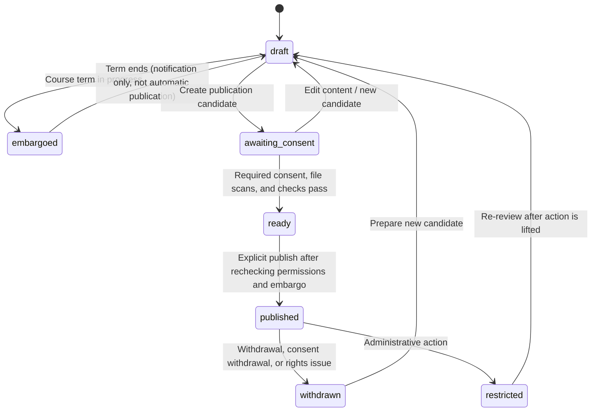

# Peerchive system design

[한국어](SYSTEM_DESIGN.md) | **English**

Written: 2026-10-18 · Status: integrated proposal before implementation

[Product proposal](../PROOFU_EVOLUTION_PLAN.en.md) · [Delivery plan](DELIVERY_PLAN.en.md)

Peerchive is the new name for the project that continues from **ProofU**, an undergraduate graduation project developed in 2019. The preserved code is the original ProofU implementation; the structure below is a design proposal for a new app that has not yet been created.

## 1. Design goals and invariants

Without losing students' work records, the system must let them reuse those records as in-semester collaboration records → public learning cases → personal portfolios. It starts as a single service that one developer can operate, but separates the responsibilities of authentication, records, contribution, publication, archive, files, and AI into modules.

**Invariants**

1. Private work records never reach public APIs, search, course aggregates, previews, OG images, PDFs, or AI recruiter Q&A. Public paths read **only approved public release snapshots**.
2. A publication is a snapshot containing only selected log revisions, artifact versions, and displayed names, and consent is bound to the hash of that snapshot's manifest.
3. The server rejects publish requests for projects under embargo (disabling the client button is only supplementary).
4. When consent to shared material changes or is withdrawn, the public cases, portfolios, search, aggregates, and embeddings that use that material are also blocked. Read paths check state first, so nothing is exposed even if cleanup of derived data is delayed.
5. Distinguish the author's role claim, third-party confirmation, platform recording time, and self-reported work date from one another.
6. AI jobs receive only data the requesting user has permission to access. AI-generated output is labeled and remains a draft until the student approves it.
7. Editing a public version is handled by creating a new version, but when deletion/withdrawal is requested, the actual content can also be removed under the retention policy. "Change history is kept" is not implemented as "permanent deletion is impossible."
8. The original ProofU history and new service data are not used interchangeably as evidence of each other's authenticity.

## 2. Using the original ProofU

### 2.1 Why build the new app alongside it

Leave the original `frontend/` and `backend/` untouched as preserved records and add the new app to the same repository. The reasons for not incrementally upgrading the original (Vue 2 → 3, Sequelize cleanup) are:

- Because of a missing file (`backend/api/user.js`), an outdated build chain (Webpack 3, Babel 6), and native modules, merely restoring it to a runnable state takes considerable time.
- The cost of fixing the security structure — plaintext password comparison and logging, hardcoded DB credentials and JWT key, mutation APIs without ownership checks, long-lived tokens in localStorage — is comparable to the cost of building anew.
- The core of v2 (build log, contribution ledger, public snapshots, course hub) consists of domains that do not exist in the original.

Use the original's user flows, component purposes, and models as design references. Do not carry direct DOM manipulation, Vue 2 lifecycles, plaintext passwords, exposed file paths, or Sequelize sync-based schema changes into new code. Separate the DB, upload paths, secrets, and deployment of any research environment for running the original from those of the new service.

### 2.2 Concept inheritance mapping

| Original (2019) | What carries forward | Peerchive |
|---|---|---|
| `User` (email, name, git) | Purpose of gathering personal experience in one place | User + Profile (visibility controls), git → GitHub integration |
| `Team` + `Member` (field ENUM, part) | Relationship between teams and participants | Project + ProjectMember (part_label). field ENUM → competency/interest tags |
| `Join` (join request) | Participation requests | Invitation links (expiring, single-use) + questions to public case authors (P1) |
| `Board` (title, description, language) | Project space | Project (assignment summary, goal, constraints, period, course, technology tags) |
| `List` / `Card` (Todo/Doing/Done, pos) | Units of work and ordering | Task (to-do view) + conversion to LogEntry on completion. Card completion is not treated as a learning record |
| `BoardFile` / `CardFile` | Linking materials as evidence | Artifact / ArtifactVersion (scan status, version, usage terms) + milestone snapshot |
| `Message` + Socket.IO chat | Team discussion | No built-in chat → Discord bot + 🗣️ meeting log + per-log feedback |
| Calendar (DaySpan) | Schedule context | Milestones and deadlines, `.ics` export |
| YUnotice (school notice crawling) | University context | Course archive structured as School → Course (no crawling) |
| MyPage timeline and language/field charts | Overview of personal activity | Four-year assignment timeline + competency × evidence matrix |
| Search (LIKE, sorted by view count) | Public discovery | Search by course, stuck point, and concept; sorted by fork and usefulness signals |
| Images and logos | ProofU identity | Create separate Peerchive brand assets. Use existing assets only after checking rights and origin |

### 2.3 Running exhibit of the original (optional, time-boxed to 2–3 days)

Without modifying the original files, place a pinned-Node-version container configuration and an **explicitly labeled reimplementation overlay** (the missing `user.js`, etc.) in a separate directory (e.g., `legacy-runtime/`) to bring up the original screens as a read-only demo. The purpose is to provide snapshot evidence for the first ProofU case and a portfolio demonstration. If it fails within the time box, substitute screen captures. It is not included in the MVP schedule and must not break the preservation rules in AGENTS.md or `scripts/check_archive.py`.

## 3. Architecture



Do not build microservices, Kafka, or a generic plugin system from the start. Begin with one web service + one worker + one bot + managed DB and storage.

## 4. Technology stack

| Component | Proposal | Reason and constraints |
|---|---|---|
| Web | **Vue 3 + Nuxt + TypeScript** | Carries forward the original's Vue experience. Combines SSR for public pages (search visibility, OG) with editing screens |
| UI | Tailwind CSS + headless components | Document-style UI, accessibility |
| State | Centered on server state and form state; Pinia only for shared UI state | No ad hoc fetching inside components or global DOM manipulation |
| Server | Nuxt/Nitro server API + domain service modules | A single deployment narrows CORS and authentication boundaries. Handlers do not modify the ORM directly in scattered places |
| DB | **PostgreSQL** + explicit migrations, Drizzle as ORM candidate | Handle relationships, revisions, consent, and policy states transactionally. Settle the ORM in the initial technical experiment |
| Extensions | `pg_trgm`, `pgvector` | Korean partial matching and error-message search; semantic search for similar stuck points (P1) |
| Async | pg-boss (PostgreSQL job table) + outbox | Scanning, publication, withdrawal, AI, and PDF jobs without Redis |
| Files | Private S3-compatible storage (e.g., Cloudflare R2) | Separate contents from the DB, quarantine before scanning, signed URLs |
| Authentication | Established session/OAuth library, HttpOnly cookies. Email magic link + Google, GitHub, Kakao | No home-grown cryptographic protocols. Sign-up possible without GitHub. School email verification is an optional badge |
| AI | Provider-swappable LLM adapter. Higher-tier model for summaries, case drafts, and interviews (e.g., Claude Sonnet family); lightweight model for tag classification and sensitive-information checks (e.g., Claude Haiku family) | Control cost by separating models per job. API terms that exclude training on data |
| Bot | Separate process based on discord.js | Slash commands and emoji reaction collection |
| Verification | Vitest, integration tests against real PostgreSQL, Playwright, AI evaluation sets | Preventing regressions in authorization, consent, and public leakage is the top priority |
| Deployment | Containers (web, worker, bot) + managed Postgres | Choose a provider after comparing region, cost, backup, and processing terms |
| Observability | Sentry + structured logs | Do not log assignment content, tokens, or email addresses |

[Nuxt's server capabilities are built on Nitro](https://github.com/nuxt/nuxt/blob/main/docs/1.getting-started/13.server.md). This document does not pin version numbers; at implementation start, verify a supported Node LTS and library combination and pin the lockfile, runtime version, and CI together.

The alternative is a Vue 3 SPA + a standalone TypeScript API. It requires separate public-page rendering and split deployments, but becomes appropriate if demand grows for external clients or mobile apps to use the API. For now, prioritize a single Nuxt app. The move to PostgreSQL applies to the new app and does not mean deleting the original MySQL code.

## 5. Repository structure (proposed)

```text
peerchive/
├── frontend/                 # 2019 original (preserved)
├── backend/                  # 2019 original (preserved)
├── apps/
│   ├── web/
│   │   ├── app/pages/        # Discovery, assignment space, public cases, courses, portfolio
│   │   ├── app/components/   # Domain-specific UI
│   │   ├── server/api/v1/    # Request validation, policy checks, response mapping
│   │   └── server/modules/   # identity, projects, logs, contribution,
│   │                         # publication, archive, portfolio
│   ├── worker/               # Scanning, publication, withdrawal, aggregation, AI, PDF jobs
│   └── bot/                  # Discord bot
├── packages/
│   ├── domain/               # Rules, state transitions, publication and embargo policy
│   ├── db/                   # Schema, migrations, repositories
│   ├── contracts/            # Input/response schemas, error codes
│   ├── ai/                   # Prompts, LLM adapter, evaluation sets
│   ├── integrations/         # storage, GitHub, Discord adapters
│   └── test-fixtures/        # Scenario data without personal information
├── ops/                      # Local setup, deployment, backup/recovery runbooks
├── docs/
└── scripts/check_archive.py  # Original preservation check (keeps running in CI)
```

Separate the DB schema from external responses so that emails, internal file keys, and the like never end up in public DTOs.

## 6. Domain model



### 6.1 Identity and profile

| Entity | Main fields | Rules |
|---|---|---|
| User | id, display_name, private_email, status | Separate login identifiers from public information |
| Profile | user_id, handle, headline, job_targets[], school_label?, grad_term?, contact_policy, open_to_work | School and expected graduation are optional. Public contact requires separate permission |
| Integration | user_id, provider(discord/github), external_id, scopes, status | Tokens stored encrypted, revocable |

### 6.2 Course archive

| Entity | Main fields | Rules |
|---|---|---|
| School | id, name, verified_label | Student input + operator merging. Carries no meaning of official certification |
| Course | id, school_id, code?, title, merged_into? | Unit of the course hub. Normalization via merging |
| CourseTerm | course_id, year, semester, ends_at | `ends_at` is the embargo reference |
| AssignmentBrief | id, course_id, term_id?, title, summary_by_student | Not the original assignment text. Only groups projects; does not treat them as the same assignment |
| ConceptTag | id, slug, label, parent_id? | Cross-school links between courses, stuck points, and cases |
| SeniorNote | id, course_id, author_id, display_mode(real/display/anonymous), answers(JSON), status | Publication flow follows Publication rules |
| PlanFork | source_release_id, target_project_id, copied_parts | Copies only milestones, checklists, time allocation, and references |
| UsefulnessSignal | target_log_entry_id, user_id, kind(me_too/helped) | Once per user. No summing into personal scores |
| Question / Answer (P1) | target_log_entry_id, author_id, body, status | Only when the author allows it |

### 6.3 Assignment space

| Entity | Main fields | Rules |
|---|---|---|
| Project | id, owner_id, title, summary_by_student, goal, constraints, kind(individual/team), lifecycle, course_term_id?, assignment_brief_id?, retro_mode | Private by default. The owner holds operational responsibility, not exclusive rights over shared material |
| ProjectMember | project_id, user_id, role(owner/editor/reviewer/viewer), part_label, status | `(project_id, user_id)` unique. Public display of names requires separate consent |
| Invitation | project_id, token_hash, role, expires_at, used_at | Expiring, single-use |
| Milestone | id, project_id, order, title, due_at?, claimed_at? | Reorderable; not a completion gate |
| MilestoneSnapshot | milestone_id, artifact_version_id, note | Unit of the evolution view |
| LogEntry | id, project_id, author_id, current_revision_id, source(web/discord/ai/task/retro) | Log identity |
| LogRevision | log_entry_id, revision_no, tag, body, payload(JSON), resolves_entry_id?, claimed_date?, recorded_at, ai_generated, approved_at? | `(log_entry_id, revision_no)` unique. Per-tag payload validated with JSON Schema |
| Task | id, project_id, title, assignee_id?, due_at?, status, position | Carries forward the original Card |
| Artifact | id, project_id, uploader_id, kind(file/link/repo/demo), usage_terms | Ownership and usage terms stated explicitly |
| ArtifactVersion | artifact_id, sha256, object_key, scan_status, media_type, bytes | New version when contents change. Paths are not built from original filenames |
| Reference | owner_scope, url, citation, license_note | Source of references. Shows when the original has been deleted |
| WeeklyCheckin | project_id, user_id, week, time_bucket, difficulty, note?, share_for_stats | Private by default; consent for statistics is separate |

`LogRevision.payload` examples:
- `stuck`: `{symptom, keywords[], error_text?, attempts[], time_bucket}`
- `solution`: `{method, time_bucket}` + `resolves_entry_id`
- `decision`: `{options[], criteria, choice, hindsight?}`
- `validation`: `{target, conditions, result, open_questions}`
- `meeting`: `{attendees[], decisions[], follow_ups[]}`

### 6.4 Contribution

| Entity | Main fields | Rules |
|---|---|---|
| RoleClaim | id, project_id, user_id, current_revision_id | Personal role claim. No enforced percentage totals |
| ClaimRevision | claim_id, revision_no, text, evidence_refs | Evidence is a specific LogRevision or ArtifactVersion |
| Endorsement | claim_revision_id, endorser_id, status, note | Members of the same project only. No self-endorsement. Does not carry over when the revision changes |
| ContributionReport | project_id, period, generated_at, object_key | Weekly summary and peer-evaluation PDF. Private to the team |

### 6.5 Publication and portfolio

| Entity | Main fields | Rules |
|---|---|---|
| Publication | id, project_id, slug, level(summary/full), current_release_id, status | Stable URL and withdrawal status. slug unique |
| PublicationRelease | publication_id, version, snapshot(JSON), manifest_hash, status, access_epoch | Contains only selected revisions and files. `(publication_id, version)` unique |
| Consent | release_manifest_hash, subject_id, scope, status | Consent to the contents of a specific candidate |
| Embargo | scope(course_term/project), until, reason, requested_by | Enforced on publishing and public reads |
| CaseStudy | id, user_id, release_id, job_target, generator(template/ai), status | Private until the student approves |
| CaseSentence | case_study_id, order, text, citations[] | Sentences without citations block publication |
| PortfolioEdition | id, user_id, version, visibility, status | Snapshot of profile, selected cases, and contributions |
| PortfolioItem | edition_id, case_study_id, claim_revision_id, order | Only materials that pass publication authorization |
| CompetencyEvidence | edition_id, competency, evidence_ref | No score field |
| InterviewPrep (P1) | claim_revision_id, question, answer_note, expose_to_reader | Private by default |
| ShareGrant (P1) | edition_id, token_hash, expires_at, revoked_at | Raw tokens are not stored |

### 6.6 Operations

| Entity | Main fields | Rules |
|---|---|---|
| Review | target_revision, author_id, visibility, content | Per-log feedback. Publication requires separate consent |
| Report | target_type, target_id, reason, status | Reports, actions, and appeals |
| AuditEvent | actor_id, action, target_id, at, minimal_metadata | Does not store bodies, tokens, or sensitive file contents |
| DeletionLedger | target, requested_at, purged_at | Reapply deletions on backup restore |

DB deletions do not cascade unconditionally; first calculate the ripple effects on shared records, consent, and withdrawal.

## 7. State transitions and publication flow

### 7.1 Project work state

`planning → active → completed → archived`. Reverse transitions are allowed. Work state and publication state are separate axes.

### 7.2 Publication state



- **Candidate creation:** Build a manifest from the selected log revisions, milestone snapshots, artifact versions, displayed names, and sources, and compute its hash. Names, logs, and shared materials of teammates who have not consented are excluded from the manifest or put on hold.
- **Pre-publication check:** The worker uses rules and a lightweight model to check for personal information, files suspected to be original assignment text, and other people's real names, and attaches warnings. These are warnings, not blocks.
- **Publish transaction:** Recheck publishing permission, membership status, consent validity, file `clean` status, embargo, hold/report status, and revision existence. Stale candidates return `409 Conflict` so the user previews again.
- Personal projects are published by the author's explicit publish; team projects are published with the consent of the people whose names, statements, or shared artifacts fall within the publication scope.
- Scheduled publication is P1, and all conditions are rechecked at execution.

### 7.3 Contribution confirmation state

Each `ClaimRevision` goes `unconfirmed → confirmed | disputed`. When a new revision is created, previous confirmations remain only on their revision, and the current claim starts as `unconfirmed`.

## 8. Authorization and access scope

The MVP implements `private` and `public(summary/full)`. `private` allows only approved members and invited reviewers; `public` allows anonymous reading of published releases only. P1's `restricted-share` is an expiring, revocable token link, distinct from `unlisted`, which anyone who knows the link can view.

| Action | Visitor | viewer/reviewer | editor | owner | Administrator |
|---|---|---|---|---|---|
| Read public releases and course pages | Allowed | Allowed | Allowed | Allowed | Allowed |
| Read private assignment space | Denied | That project only | That project only | That project only | Denied in principle |
| Create/edit logs | Denied | Reviewer: feedback only | Own logs | Own logs | Denied |
| Edit another person's role claim | Denied | Denied | Denied | Denied | Dispute actions only |
| Endorse a role claim | Denied | Reviewers only (except own); viewers denied | Allowed (except own) | Allowed (except own) | Denied |
| Manage team members | Denied | Denied | Denied | Allowed | Operational actions only |
| Publication consent involving oneself | Denied | Own scope only | Own scope only | Own scope only | No proxy consent |
| Prepare / publish publication candidate | Denied | Denied | Prepare candidate | Publish when conditions are met | No proxy publishing |
| Withdraw publication | Report | Withdraw own consent / report | Withdraw own consent / report | Withdraw entirely | Restrict/withdraw under policy |
| Plan fork / write senior notes | Login required | Allowed | Allowed | Allowed | – |

- Administrator access to private content for dispute investigation is an exception requiring a reason, duration, scope, and audit record. Separate deletion permission from permission to block publication.
- Apply the same policy functions to APIs, repositories, file access, search indexing, aggregates, PDFs, and AI jobs. PostgreSQL RLS is only a candidate defense layer and does not replace application policy ([PostgreSQL Row Security](https://www.postgresql.org/docs/current/ddl-rowsecurity.html)).
- To avoid exposing the existence of private objects, handle unauthorized lookups consistently with 404.

## 9. Draft API contracts (`/api/v1`)

| Method and path | Purpose | Main conditions |
|---|---|---|
| `POST /projects` | Create assignment | Logged in, private by default |
| `POST /projects/:id/invitations` | Invite member | owner, expiring and single-use |
| `POST /projects/:id/fork-from/:releaseId` | Plan fork | Public release; copies plan elements only |
| `POST /projects/:id/logs` | Create log | editor, per-tag payload validation |
| `POST /logs/:id/revisions` | New log version | Author, `expectedRevision` |
| `POST /logs/:id/resolve` | Link a solution to a stuck point | Same project |
| `POST /projects/:id/tasks`, `POST /tasks/:id/complete` | Tasks, completion | Completion response includes a log-conversion prompt |
| `POST /projects/:id/milestones`, `POST /milestones/:id/snapshots` | Milestones and snapshots | Clean versions from the same project |
| `POST /projects/:id/checkins` | Weekly check-in | Self, one per week |
| `POST /projects/:id/artifacts/upload-intents` | Prepare upload | Size/type limits, quarantine key |
| `POST /artifacts/:id/complete` | Complete upload | Verify actual length, hash, and ownership; awaiting scan |
| `POST /projects/:id/claims`, `POST /claims/:id/revisions` | Role claim | Self |
| `POST /claim-revisions/:id/endorsements` | Teammate endorsement | Same project, no self-endorsement |
| `GET /projects/:id/contribution-report` | Contribution report | Members |
| `POST /projects/:id/publication-candidates` | Publication candidate | owner/editor, embargo check |
| `POST /candidates/:id/consents` | Consent | Own scope, current manifest |
| `POST /candidates/:id/publish` | Publish | owner, full recheck |
| `POST /publications/:id/withdraw` | Withdraw | owner or policy authority |
| `GET /publications/:slug` | Public DTO | published only, no private fields |
| `GET /publications/:id/artifacts/:versionId` | View file | Included in current release, status checks |
| `GET /schools/:id/courses`, `GET /courses/:id` | Course hub | Public releases and aggregate views only |
| `POST /courses/:id/senior-notes` | Senior notes | Logged in |
| `GET /search?q=&type=stuck` | Search | Active public releases only |
| `POST /case-studies/draft` | Case draft | Release that includes one's own contribution |
| `POST /portfolio-editions` | Create portfolio | Own public contributions only |
| `GET /profiles/:handle` | Public profile | Public fields and active edition only |
| `POST /ai/checkin-interview` (P1) | AI retrospective | Streaming, only data the user can access |
| `POST /integrations/discord/link`, `POST /webhooks/github` | Integrations | Verify signatures and delivery IDs |
| `POST /reports` | Report | Rate limit, reason and status |

Log creation example (evidence IDs must belong to the same project):

```json
{
  "tag": "decision",
  "body": "Adjusted the scope to use manual entry instead of real-time sensors.",
  "payload": {
    "options": ["Real-time sensors", "Manual entry"],
    "criteria": "Feasibility within one semester and operating cost",
    "choice": "Manual entry"
  },
  "evidenceVersionIds": ["artifact-version-id"],
  "claimedDate": "2026-10-13",
  "expectedRevision": 2
}
```

Responses distinguish `recordedAt` from `claimedDate` and return the revision number. Pagination uses cursors and a maximum item limit; publishing, file completion, bot collection, and webhooks use idempotency keys. Form errors use per-field codes, conflicts return 409, and invalid input returns 422.

## 10. Files and external links

- States: `pending → scanning → clean / quarantined / failed`. Check allowed MIME types, extensions, actual signatures, and size together.
- Narrow MVP-allowed formats to materials that can be displayed safely, such as images and PDFs, plus repository and video links. Executables, archives, and arbitrary HTML/SVG execution are not allowed. For video, external links come first.
- All buckets are private and paths are not built from original filenames. Even public files have no permanent URLs; a short-lived (e.g., 60 seconds or less) signed URL is issued after checking that the release is active.
- The server does not directly connect to URLs users attach. Link previews are collected only in a worker with allowed domains, redirect limits, private-IP blocking, and timeouts.
- PDF and image thumbnails are generated in an isolated conversion environment without executing active content. Derived files are subject to the same withdrawal rules as the originals.
- Draft limits: 500MB per student, 20MB per file. Adjust after observing usage.

## 11. Consistency of withdrawal, search, aggregates, and derived data

- On a withdrawal request, first update the Publication state and the related releases' `access_epoch` in the DB. Store an outbox event in the same transaction, and the worker cleans up search indexes, caches, portfolio dependencies, case studies, embeddings, derived files, and course aggregates.
- Public pages do not query private tables. Include version and `access_epoch` in cache keys so withdrawal takes priority over content changes. Do not cache sensitive snapshots statically for long periods.
- Portfolio items that include a withdrawn case are automatically marked unavailable and stop serving the original sentences and files. Milestones and checklists already copied via a plan fork are the forker's data and remain, but the link to the source is severed.
- Explain that complete recall from external search engine caches and already-downloaded PDFs is not guaranteed.
- Deleted materials may remain briefly in backups. Maintain the DeletionLedger, and on restore, do not open external traffic until the latest withdrawals and deletions have been reapplied.

### 11.1 Search

Stage 1 is PostgreSQL full-text search + `pg_trgm` (course names, Korean partial matching, error messages) with structured filters (school, course, concept tags, log type). Stage 2 (P1) uses `pgvector` for "similar stuck points" semantic search, and **embeds only public release text**. A separate search cluster will be reconsidered when public cases exceed tens of thousands.

### 11.2 Course aggregates and anonymity

Workload distribution and common stuck points are a separate materialized view computed only from public releases and check-ins with `share_for_stats=true`. If a group (same course and assignment type) is smaller than the threshold (draft: 5), no result is returned. Public aggregate paths never read private workspace tables directly.

## 12. Integrations

### 12.1 Discord bot

- Users link their Discord account on the web and map server channels to Peerchive projects.
- Collect `/log <tag> <content>` slash commands and 📌 reactions. Reaction collection is saved **only as a log of the message's own author**; pinning 📌 on someone else's message sends an approval request to its author.
- Meeting summaries (P1) are read only in channels where all teammates have consented, and only messages up to the time of the request. Original message text is not stored after the summary is generated.
- The bot sends weekly check-in reminders, weekly contribution summaries, and end-of-term publication notifications.

### 12.2 GitHub

- In the MVP, students link repositories, PRs, and commits manually. Report and design assignments without GitHub must be equally usable.
- P1 automatic linking uses a GitHub App, requesting only minimum permissions on repositories the user selects ([GitHub App selection guide](https://docs.github.com/en/apps/creating-github-apps/about-creating-github-apps/deciding-when-to-build-a-github-app)).
- Webhooks verify signatures and delivery IDs and handle duplicates and out-of-order delivery. If a repository becomes private or permission is revoked, do not leave a public copy; re-review the connection status and publication conditions. Private repository contents are not collected automatically, and commit author email alone does not establish a contribution.

### 12.3 Learning record standards

In the long term, consider CLR/Open Badges export, but standards compliance and institutional issuance require separate business and technical validation, and simple teammate endorsement is not issued as a credential ([1EdTech CLR](https://www.1edtech.org/standards/clr)).

## 13. AI pipeline

| Job | Input | Output | Safeguards | Phase |
|---|---|---|---|---|
| Tag suggestion | Quick log body | Tag candidates | Suggestions only; student confirms | MVP (optional) |
| Pre-publication check | Publication candidate snapshot | Warnings for personal information, original assignment text, others' real names | Warnings only | MVP (rules) / P1 (model) |
| Case draft | Public release | Template-assembled sentences + citations | No model used | MVP |
| Case polishing | Public release scope chosen by the student | Sentences + cited log IDs | Highlight and block publication of uncited sentences | P1 |
| Weekly retrospective interview | Own logs and tasks for this week | Questions → answers → log draft | Student approval required | P1 |
| Meeting summary | Messages from consented channels | 🗣️ meeting log draft | Draft until teammates approve; original text not stored | P1 |
| Interview question generation | Own decision and stuck logs | Anticipated questions | Private by default | P1 |
| Similar stuck point search | Public stuck-point embeddings | Similar cases | Public data only | P1 |
| Portfolio Q&A | Recruiter question + public snapshot | Answer citing evidence | "No record" when no evidence; active only when the student enables it | P2 |

**Principles**
- Do not generate content outside the evidence of the publication candidate, turn teammates' statements into one's own claims, or automatically send private materials to a model.
- Every AI result records `ai_generated` along with the model used and prompt version.
- Keep per-job evaluation sets in `packages/ai` (citation accuracy, rate of claims outside the evidence, sensitive-information detection recall) and run regression evaluations whenever prompts or models change.
- Control cost through monthly usage limits per user and team, response caching, and per-job model separation.
- All core features must be usable manually without AI.

## 14. Operational, performance, and security targets

The initial target is a constrained pilot of about 50 students and 20 assignments. The values below are design targets to validate, not SLAs.

| Item | Draft target | Validation |
|---|---|---|
| Public pages | LCP within 2.5 seconds in representative mobile conditions | Measure with actual networks and images |
| API | p95 within 500ms for ordinary reads/writes (excluding files and AI) | Test DB, pilot metrics |
| Bot collection | `/log` response within 3 seconds, zero missed collections | Retry and idempotency tests |
| Authorization | Zero exposures of private content to anonymous users or other teams | Integration/E2E tests, operational investigation |
| Withdrawal | Block new access immediately upon DB state change; derived cleanup target of 5 minutes | State propagation and worker failure experiments |
| Recovery | RPO 24 hours, RTO 4 hours | DB/file recovery + deletion ledger reapplication drills |

- From the start, include rate limiting, CSRF/session protection, OAuth state validation, output escaping, file access checks, secret management, and structured audit logs. Separate service data from pilot test materials.
- Job tables have retry counts, backoff, and dead-letter states, and repeated execution must not create duplicate data. There is no fallback in which a worker failure causes private materials to become public.
- Observability: authentication errors, unusual access, publication failures, consent withdrawals, quarantined files, worker backlog, deletion failures, AI cost and error rates. Provide an operational switch to temporarily block all public reads in case of authorization leaks or file disclosure errors.

## 15. Data migration and archive verification

- The original SQLite and upload samples may be examples, so do not create user accounts or consent from them. If actual production data is confirmed, a one-off importer reads the originals read-only, records the import run ID, source IDs, checksums, and warnings, and starts with a dry-run report.
- Boards can be migrated to assignment drafts, Lists/Cards to Tasks, and files to quarantined Artifacts. Chat is not migrated before personal information and consent are checked. Plaintext passwords are not migrated; users reauthenticate. Everything is imported as private, past creation dates are labeled `imported`, and no nonexistent logs or contributions are fabricated.
- The [archive verification script](../../scripts/check_archive.py) verifies the originals, the reconstructed 2019 history, and approved cleanup, while new tests verify the new app's behavior. Run the two verifications separately in CI. Avoid expanding the verification exception list while modernizing original files.
- The 2019 commits are reconstructed records, not actual development logs from that time, and this fact is disclosed whenever they are used in the new service, such as in the first ProofU case. The [original history backup](https://github.com/polynomeer/peerchive/tree/backup/pre-reconstruction-20261013) is retained.
