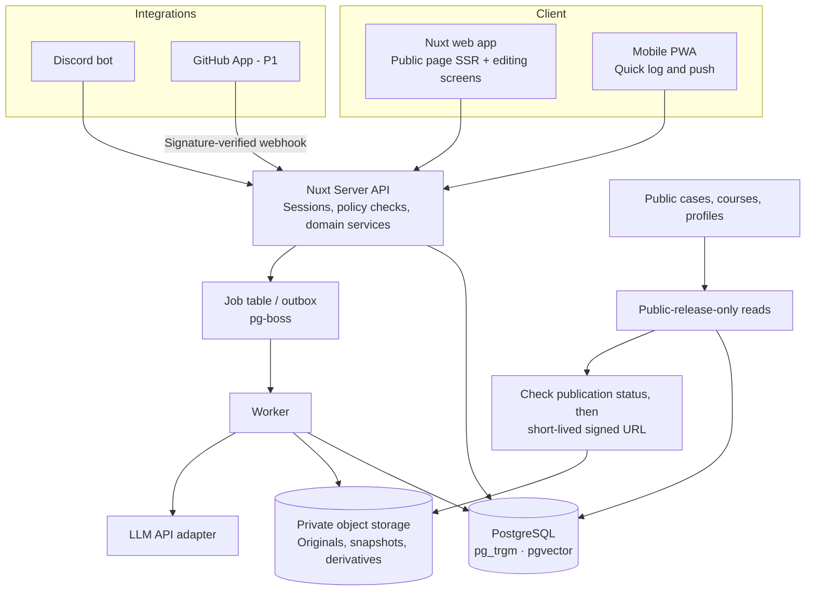
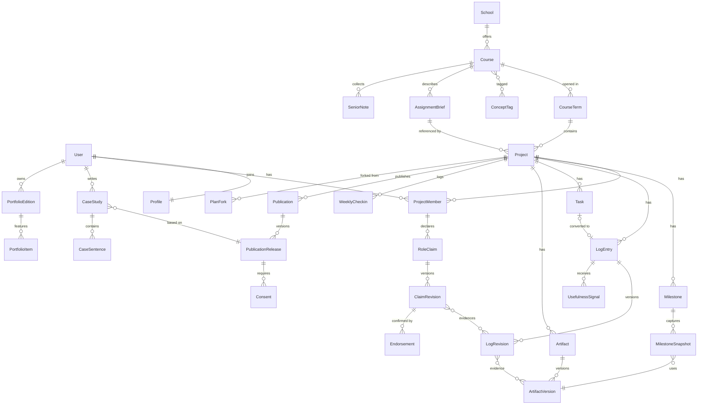
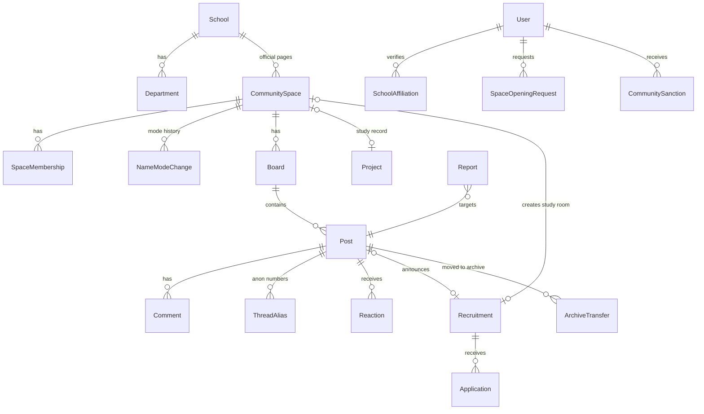
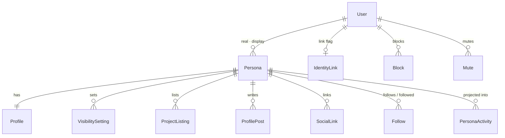
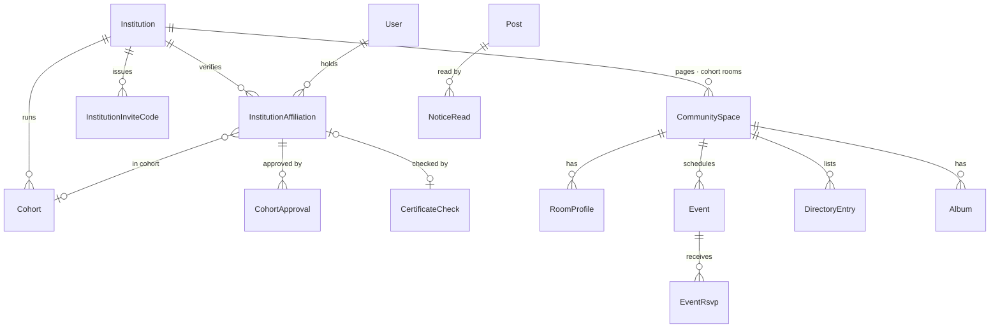
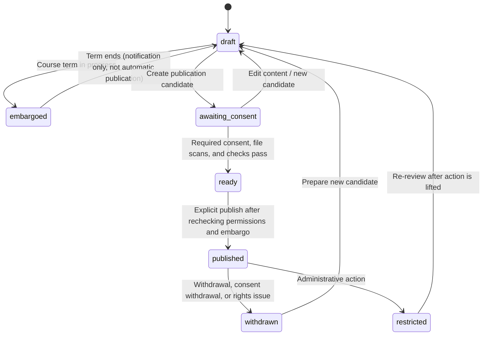

# Peerchive system design

[한국어](SYSTEM_DESIGN.md) | **English**

Written: 2026-10-18 · Updated: 2026-10-24 (campus community in §6.7, §8.1, §8.2, §9.1; identity, public profiles, and following in §6.7.1, §8.3, §9.2, §11.3; alumni, topics, and organizations in §6.7.2, §8.4) · Status: integrated proposal before implementation

[Product proposal](../PROOFU_EVOLUTION_PLAN.en.md) · [Delivery plan](DELIVERY_PLAN.en.md)

Peerchive is the new name for the project that continues from **ProofU**, an undergraduate graduation project developed in 2019. The preserved code is the original ProofU implementation; the structure below is a design proposal for a new app that has not yet been created.

## 1. Design goals and invariants

Without losing students' work records, the system must let them reuse those records as in-semester collaboration records → public learning cases → personal portfolios. It starts as a single service that one developer can operate, but separates the responsibilities of authentication, records, contribution, publication, archive, files, and AI into modules.

**Invariants**

1. Private work records never reach public APIs, search, course aggregates, previews, OG images, PDFs, or AI recruiter Q&A. Public paths read **only approved public release snapshots**.
2. A publication is a snapshot containing only selected log revisions, artifact versions, and displayed names, and consent is bound to the hash of that snapshot's manifest.
3. The server rejects publish requests for projects under embargo (disabling the client button is only supplementary).
4. When consent to shared material changes or is withdrawn, the public cases, portfolios, search, aggregates, and embeddings that use that material are also blocked. Read paths check state first, so nothing is exposed even if cleanup of derived data is delayed.
5. Distinguish the author's role claim, third-party confirmation, platform recording time, and self-reported work date from one another.
6. AI jobs receive only data the requesting user has permission to access. AI-generated output is labeled and remains a draft until the student approves it.
7. Editing a public version is handled by creating a new version, but when deletion/withdrawal is requested, the actual content can also be removed under the retention policy. "Change history is kept" is not implemented as "permanent deletion is impossible."
8. The original ProofU history and new service data are not used interchangeably as evidence of each other's authenticity.
9. Community posts are kept separate from the public archive. Unless the author explicitly moves them, they never reach public releases, course aggregates, public search, search engines, profiles, or portfolios (§6.7, §8.2).
10. Only operators can identify the actual author of an anonymous post or comment, and only with a recorded reason and audit entry. Responses to room owners, moderators, and other users carry no identifier from which the author could be inferred (§8.1).

## 2. Using the original ProofU

### 2.1 Why build the new app alongside it

Leave the original `frontend/` and `backend/` untouched as preserved records and add the new app to the same repository. The reasons for not incrementally upgrading the original (Vue 2 → 3, Sequelize cleanup) are:

- Because of a missing file (`backend/api/user.js`), an outdated build chain (Webpack 3, Babel 6), and native modules, merely restoring it to a runnable state takes considerable time.
- The cost of fixing the security structure — plaintext password comparison and logging, hardcoded DB credentials and JWT key, mutation APIs without ownership checks, long-lived tokens in localStorage — is comparable to the cost of building anew.
- The core of v2 (build log, contribution ledger, public snapshots, course hub) consists of domains that do not exist in the original.

Use the original's user flows, component purposes, and models as design references. Do not carry direct DOM manipulation, Vue 2 lifecycles, plaintext passwords, exposed file paths, or Sequelize sync-based schema changes into new code. Separate the DB, upload paths, secrets, and deployment of any research environment for running the original from those of the new service.

### 2.2 Concept inheritance mapping

| Original (2019) | What carries forward | Peerchive |
|---|---|---|
| `User` (email, name, git) | Purpose of gathering personal experience in one place | User + Profile (visibility controls), git → GitHub integration |
| `Team` + `Member` (field ENUM, part) | Relationship between teams and participants | Project + ProjectMember (part_label). field ENUM → competency/interest tags |
| `Join` (join request) | Participation requests | Invitation links (expiring, single-use) + questions to public case authors (P1) |
| `Board` (title, description, language) | Project space | Project (assignment summary, goal, constraints, period, course, technology tags) |
| `List` / `Card` (Todo/Doing/Done, pos) | Units of work and ordering | Task (to-do view) + conversion to LogEntry on completion. Card completion is not treated as a learning record |
| `BoardFile` / `CardFile` | Linking materials as evidence | Artifact / ArtifactVersion (scan status, version, usage terms) + milestone snapshot |
| `Message` + Socket.IO chat | Team discussion | No built-in chat → Discord bot + 🗣️ meeting log + per-log feedback |
| Calendar (DaySpan) | Schedule context | Milestones and deadlines, `.ics` export |
| YUnotice (school notice crawling) | University context | Course archive structured as School → Course (no crawling) |
| MyPage timeline and language/field charts | Overview of personal activity | Four-year assignment timeline + competency × evidence matrix |
| Search (LIKE, sorted by view count) | Public discovery | Search by course, stuck point, and concept; sorted by fork and usefulness signals |
| Images and logos | ProofU identity | Create separate Peerchive brand assets. Use existing assets only after checking rights and origin |

### 2.3 Running exhibit of the original (optional, time-boxed to 2–3 days)

Without modifying the original files, place a pinned-Node-version container configuration and an **explicitly labeled reimplementation overlay** (the missing `user.js`, etc.) in a separate directory (e.g., `legacy-runtime/`) to bring up the original screens as a read-only demo. The purpose is to provide snapshot evidence for the first ProofU case and a portfolio demonstration. If it fails within the time box, substitute screen captures. It is not included in the MVP schedule and must not break the preservation rules in AGENTS.md or `scripts/check_archive.py`.

## 3. Architecture



Do not build microservices, Kafka, or a generic plugin system from the start. Begin with one web service + one worker + one bot + managed DB and storage.

## 4. Technology stack

| Component | Proposal | Reason and constraints |
|---|---|---|
| Web | **Vue 3 + Nuxt + TypeScript** | Carries forward the original's Vue experience. Combines SSR for public pages (search visibility, OG) with editing screens |
| UI | Tailwind CSS + headless components | Document-style UI, accessibility |
| State | Centered on server state and form state; Pinia only for shared UI state | No ad hoc fetching inside components or global DOM manipulation |
| Server | Nuxt/Nitro server API + domain service modules | A single deployment narrows CORS and authentication boundaries. Handlers do not modify the ORM directly in scattered places |
| DB | **PostgreSQL** + explicit migrations, Drizzle as ORM candidate | Handle relationships, revisions, consent, and policy states transactionally. Settle the ORM in the initial technical experiment |
| Extensions | `pg_trgm`, `pgvector` | Korean partial matching and error-message search; semantic search for similar stuck points (P1) |
| Async | pg-boss (PostgreSQL job table) + outbox | Scanning, publication, withdrawal, AI, and PDF jobs without Redis |
| Files | Private S3-compatible storage (e.g., Cloudflare R2) | Separate contents from the DB, quarantine before scanning, signed URLs |
| Authentication | Established session/OAuth library, HttpOnly cookies. Email magic link + Google, GitHub, Kakao | No home-grown cryptographic protocols. Sign-up possible without GitHub. School email verification is an optional badge |
| AI | Provider-swappable LLM adapter. Higher-tier model for summaries, case drafts, and interviews (e.g., Claude Sonnet family); lightweight model for tag classification and sensitive-information checks (e.g., Claude Haiku family) | Control cost by separating models per job. API terms that exclude training on data |
| Bot | Separate process based on discord.js | Slash commands and emoji reaction collection |
| Verification | Vitest, integration tests against real PostgreSQL, Playwright, AI evaluation sets | Preventing regressions in authorization, consent, and public leakage is the top priority |
| Deployment | Containers (web, worker, bot) + managed Postgres | Choose a provider after comparing region, cost, backup, and processing terms |
| Observability | Sentry + structured logs | Do not log assignment content, tokens, or email addresses |

[Nuxt's server capabilities are built on Nitro](https://github.com/nuxt/nuxt/blob/main/docs/1.getting-started/13.server.md). This document does not pin version numbers; at implementation start, verify a supported Node LTS and library combination and pin the lockfile, runtime version, and CI together.

The alternative is a Vue 3 SPA + a standalone TypeScript API. It requires separate public-page rendering and split deployments, but becomes appropriate if demand grows for external clients or mobile apps to use the API. For now, prioritize a single Nuxt app. The move to PostgreSQL applies to the new app and does not mean deleting the original MySQL code.

## 5. Repository structure (proposed)

```text
peerchive/
├── frontend/                 # 2019 original (preserved)
├── backend/                  # 2019 original (preserved)
├── apps/
│   ├── web/
│   │   ├── app/pages/        # Discovery, assignment space, public cases, courses, portfolio
│   │   ├── app/components/   # Domain-specific UI
│   │   ├── server/api/v1/    # Request validation, policy checks, response mapping
│   │   └── server/modules/   # identity, projects, logs, contribution,
│   │                         # publication, archive, portfolio,
│   │                         # community (P1)
│   ├── worker/               # Scanning, publication, withdrawal, aggregation, AI, PDF jobs
│   └── bot/                  # Discord bot
├── packages/
│   ├── domain/               # Rules, state transitions, publication and embargo policy
│   ├── db/                   # Schema, migrations, repositories
│   ├── contracts/            # Input/response schemas, error codes
│   ├── ai/                   # Prompts, LLM adapter, evaluation sets
│   ├── integrations/         # storage, GitHub, Discord adapters
│   └── test-fixtures/        # Scenario data without personal information
├── ops/                      # Local setup, deployment, backup/recovery runbooks
├── docs/
└── scripts/check_archive.py  # Original preservation check (keeps running in CI)
```

Separate the DB schema from external responses so that emails, internal file keys, and the like never end up in public DTOs.

## 6. Domain model



### 6.1 Identity and profile

| Entity | Main fields | Rules |
|---|---|---|
| User | id, display_name, private_email, status | Separate login identifiers from public information |
| Profile | user_id, handle, headline, job_targets[], school_label?, grad_term?, contact_policy, open_to_work | School and expected graduation are optional. Public contact requires separate permission |
| Integration | user_id, provider(discord/github), external_id, scopes, status | Tokens stored encrypted, revocable |

### 6.2 Course archive

| Entity | Main fields | Rules |
|---|---|---|
| School | id, name, verified_label | Student input + operator merging. Carries no meaning of official certification |
| Course | id, school_id, code?, title, merged_into? | Unit of the course hub. Normalization via merging |
| CourseTerm | course_id, year, semester, ends_at | `ends_at` is the embargo reference |
| AssignmentBrief | id, course_id, term_id?, title, summary_by_student | Not the original assignment text. Only groups projects; does not treat them as the same assignment |
| ConceptTag | id, slug, label, parent_id? | Cross-school links between courses, stuck points, and cases |
| SeniorNote | id, course_id, author_id, display_mode(real/display/anonymous), answers(JSON), status | Publication flow follows Publication rules |
| PlanFork | source_release_id, target_project_id, copied_parts | Copies only milestones, checklists, time allocation, and references |
| UsefulnessSignal | target_log_entry_id, user_id, kind(me_too/helped) | Once per user. No summing into personal scores |
| Question / Answer (P1) | target_log_entry_id, author_id, body, status | Only when the author allows it |

### 6.3 Assignment space

| Entity | Main fields | Rules |
|---|---|---|
| Project | id, owner_id, title, summary_by_student, goal, constraints, kind(individual/team), lifecycle, course_term_id?, assignment_brief_id?, retro_mode | Private by default. The owner holds operational responsibility, not exclusive rights over shared material |
| ProjectMember | project_id, user_id, role(owner/editor/reviewer/viewer), part_label, status | `(project_id, user_id)` unique. Public display of names requires separate consent |
| Invitation | project_id, token_hash, role, expires_at, used_at | Expiring, single-use |
| Milestone | id, project_id, order, title, due_at?, claimed_at? | Reorderable; not a completion gate |
| MilestoneSnapshot | milestone_id, artifact_version_id, note | Unit of the evolution view |
| LogEntry | id, project_id, author_id, current_revision_id, source(web/discord/ai/task/retro) | Log identity |
| LogRevision | log_entry_id, revision_no, tag, body, payload(JSON), resolves_entry_id?, claimed_date?, recorded_at, ai_generated, approved_at? | `(log_entry_id, revision_no)` unique. Per-tag payload validated with JSON Schema |
| Task | id, project_id, title, assignee_id?, due_at?, status, position | Carries forward the original Card |
| Artifact | id, project_id, uploader_id, kind(file/link/repo/demo), usage_terms | Ownership and usage terms stated explicitly |
| ArtifactVersion | artifact_id, sha256, object_key, scan_status, media_type, bytes | New version when contents change. Paths are not built from original filenames |
| Reference | owner_scope, url, citation, license_note | Source of references. Shows when the original has been deleted |
| WeeklyCheckin | project_id, user_id, week, time_bucket, difficulty, note?, share_for_stats | Private by default; consent for statistics is separate |

`LogRevision.payload` examples:
- `stuck`: `{symptom, keywords[], error_text?, attempts[], time_bucket}`
- `solution`: `{method, time_bucket}` + `resolves_entry_id`
- `decision`: `{options[], criteria, choice, hindsight?}`
- `validation`: `{target, conditions, result, open_questions}`
- `meeting`: `{attendees[], decisions[], follow_ups[]}`

### 6.4 Contribution

| Entity | Main fields | Rules |
|---|---|---|
| RoleClaim | id, project_id, user_id, current_revision_id | Personal role claim. No enforced percentage totals |
| ClaimRevision | claim_id, revision_no, text, evidence_refs | Evidence is a specific LogRevision or ArtifactVersion |
| Endorsement | claim_revision_id, endorser_id, status, note | Members of the same project only. No self-endorsement. Does not carry over when the revision changes |
| ContributionReport | project_id, period, generated_at, object_key | Weekly summary and peer-evaluation PDF. Private to the team |

### 6.5 Publication and portfolio

| Entity | Main fields | Rules |
|---|---|---|
| Publication | id, project_id, slug, level(summary/full), current_release_id, status | Stable URL and withdrawal status. slug unique |
| PublicationRelease | publication_id, version, snapshot(JSON), manifest_hash, status, access_epoch | Contains only selected revisions and files. `(publication_id, version)` unique |
| Consent | release_manifest_hash, subject_id, scope, status | Consent to the contents of a specific candidate |
| Embargo | scope(course_term/project), until, reason, requested_by | Enforced on publishing and public reads |
| CaseStudy | id, user_id, release_id, job_target, generator(template/ai), status | Private until the student approves |
| CaseSentence | case_study_id, order, text, citations[] | Sentences without citations block publication |
| PortfolioEdition | id, user_id, version, visibility, status | Snapshot of profile, selected cases, and contributions |
| PortfolioItem | edition_id, case_study_id, claim_revision_id, order | Only materials that pass publication authorization |
| CompetencyEvidence | edition_id, competency, evidence_ref | No score field |
| InterviewPrep (P1) | claim_revision_id, question, answer_note, expose_to_reader | Private by default |
| ShareGrant (P1) | edition_id, token_hash, expires_at, revoked_at | Raw tokens are not stored |

### 6.6 Operations

| Entity | Main fields | Rules |
|---|---|---|
| Review | target_revision, author_id, visibility, content | Per-log feedback. Publication requires separate consent |
| Report | target_type, target_id, reason, status | Reports, actions, and appeals |
| AuditEvent | actor_id, action, target_id, at, minimal_metadata | Does not store bodies, tokens, or sensitive file contents |
| DeletionLedger | target, requested_at, purged_at | Reapply deletions on backup restore |

DB deletions do not cascade unconditionally; first calculate the ripple effects on shared records, consent, and withdrawal.

### 6.7 Campus community (P1)

The official school and department pages and user rooms from [product plan §8.9](../PROOFU_EVOLUTION_PLAN.en.md#89-campus-community-rooms-and-pages-p1) share a single `CommunitySpace` model. The board structure is the same; only permissions, the default name display mode, and visibility differ by `kind`. Community tables are owned by a separate module (`server/modules/community`) that never mixes with the public release read path (§11).



| Entity | Key fields | Rules |
|---|---|---|
| SchoolAffiliation | user_id, school_id, email_domain, verified_at, standing(student/alumni), department_id? (self-reported), status | Result of school email verification. The verified address stays private like `private_email`, and public DTOs never carry student ID numbers or departments. Verification history is kept after graduation even if the school mailbox disappears, marked `alumni`. The same record decides course hub writing eligibility (product plan §8.6) |
| Department | id, school_id, name, merged_into? | Merged by operators. Departments cannot be confirmed by email, so they are linked only by self-report |
| CommunitySpace | id, kind(official_school/official_department/user_room/study_room), school_id?, department_id?, linked_course_id?, name, slug, current_name_mode(real/display/anonymous), discovery(listed/unlisted), join_policy(open/approval/invite), capacity, status(active/archived/restricted) | Only operators create `official_*` spaces, and only they get the `Official` badge. Reserved words such as `Official` and `Student Council` are rejected in `user_room` and `study_room` names. User room capacity defaults to 300; more requires operator review. `real` rooms default to `join_policy = approval` (invite only is also allowed). `current_name_mode` is fixed to `anonymous` on official pages |
| SpaceOpeningRequest | school_id, department_id?, requester_id, source(student/student_council), created_at | Unique on `(school_id, department_id, requester_id)`. When requests from verified students of the same school reach the threshold (initial proposal: 10), or a student council asks, the request enters the operator review queue. Pages are never opened automatically |
| SpaceMembership | space_id, user_id, role(owner/admin/moderator/member), status(pending/active/left/removed), joined_at | Unique on `(space_id, user_id)`. Read access to official pages derives from `SchoolAffiliation`, not membership; membership there is used only for moderator assignment and department write restrictions. When the owner leaves, ownership passes to the longest-standing admin, then member; if none remain, the space becomes `archived` |
| NameModeChange | space_id, from_mode, to_mode, requested_by, requested_at, effective_at, status(scheduled/applied/cancelled) | Append-only change history. `effective_at = requested_at + 7 days`; all members are notified when it is scheduled. A worker updates `current_name_mode` at `effective_at` and never rewrites existing posts. At most one `scheduled` change per space |
| Board | id, space_id, kind(free/freshmen/alumni/question/info/recruiting/notice/general), title, write_role | Official pages get the default board set. Only moderators and above write to `notice` |
| Post | id, board_id, author_id, name_mode, title, body, linked_course_id?, status(visible/auto_hidden/hidden/removed), created_at, edited_at? | `name_mode` is **copied and frozen at write time**; edits and space mode changes never alter it. Official pages default to `anonymous` and allow only a per-post `display` choice (no `real`). User rooms use the space's `current_name_mode` at that moment |
| Comment | id, post_id, parent_id?, author_id, name_mode, body, status | Same name display and status rules as Post. Replies nest one level only |
| ThreadAlias | post_id, user_id, alias_no, created_at | Anonymous number mapping per thread. Unique on `(post_id, user_id)` and `(post_id, alias_no)`. The poster is `alias_no = 0` (shown as `Author`); commenters get 1, 2, … in order of first participation, and numbers are never reused after deletion. No numbers or keys are shared across threads. Stuck Q&A per-thread anonymity (product plan §8.5) uses the same table |
| Reaction | target_type(post/comment), target_id, user_id, kind(like) | Once per user. No downvotes. Used only to sort "Most liked" (P2), never summed into personal scores |
| Recruitment | id, post_id?, kind(study/team), topic?, course_id?, period, capacity, format, goal, target_name_mode, status(open/closed) | Same table as finding teammates (product plan §8.8). Created with `post_id` from an official page's Recruiting board or a user room, and with `course_id` only from a course hub. For study, `target_name_mode` defaults to `display`. On close, `study` creates a `study_room` space; `team` creates an assignment space and invitations |
| Application | recruitment_id, applicant_id, attached_profile?, attached_release_ids[], status(pending/accepted/declined/withdrawn) | Visible only to the recruiter. No ranking, score, or rejection reason fields. Even for recruiting on anonymous boards, applicant details go only to the recruiter |
| StudyRecord | space_id, project_id | When a study room turns on records, an internal `Project(kind=study)` is created so the build log and milestones are reused as is. Publication follows the Publication rules (§7.2) and member consent. Records from `anonymous` study rooms cannot be linked to portfolios or public profiles |
| ArchiveTransfer | source_type(post/comment), source_id, target_type(log_entry/question/senior_note), target_id?, required_consents[], chosen_name_mode, status(awaiting_consent/done/cancelled) | Once the asker and the accepted answerer (or, for advice posts, the author) all consent, a **copy** is created on the archive side and the original stays in the community. The name display mode is chosen again when moving |
| CommunitySanction | user_id, scope(community/space), space_id?, level(warning/write_suspended/permanent), until?, reason, report_id?, issued_by | Checked only by community write policy functions; no effect on assignment space or portfolio permissions. A `space`-scoped restriction can be applied without revealing the person's identity to the room owner |

- **Report extension.** `Report.target_type` in §6.6 gains `community_post`, `community_comment`, and `community_space`. When open reports from distinct school-verified users reach the threshold (initial proposal: 5 on official pages, 3 in user rooms), the same transaction sets the target to `auto_hidden` and queues it for review. Takedown requests claiming rights violations follow a separate procedure.
- **Separating anonymous posts from profiles.** `anonymous` posts and comments are never linked to public profiles, portfolios, contribution ledgers, activity totals, or the user key in analytics events. There are no anonymous activity score or level fields.
- **Small anonymous rooms.** When an `anonymous` space has fewer than 10 active members, response DTOs expose time only as `today`/`this_week` buckets. The database keeps exact timestamps.
- **Real names.** The name shown in `real` mode is an optional field the user enters on the account (`User.real_name`); Peerchive does not verify identity. School-linked spaces show only whether a `SchoolAffiliation` exists next to the name, and student ID numbers are not collected.
- **Embargo.** The embargo (§7.2, product plan §9.2) also applies to spaces and posts with `linked_course_id`. Community posting is not blocked, but sharing answers or code for same-semester assignments is a report reason. Any path that publishes a record moved into the archive still goes through the normal publication process and embargo checks.
- **What we won't build.** There are no tables for anonymous DMs, marketplaces, real-time chat, downvotes, activity rankings, or professor and course ratings (product plan §8.9.7).

#### 6.7.1 Identity levels, public profiles, and following (P1)

Covers the four identity levels in [product plan §4.4](../PROOFU_EVOLUTION_PLAN.en.md#44-identity-position-real-names-for-records-anonymity-for-lounges) and the per-item visibility, following, and social links in [§10.7](../PROOFU_EVOLUTION_PLAN.en.md#107-visibility-following-and-social-links-p1). Levels 2–3 (display name, real name) are stored as **personas**; levels 0–1 (anonymous, affiliation-labeled anonymous) create no persona and exist only as a per-post `name_mode`. Profiles, follows, and feeds are owned by a separate module (`server/modules/social`) that never reads community post tables (§8.3).



| Entity | Key fields | Rules |
|---|---|---|
| Persona | id, user_id, kind(real/display), handle, display_name, account_privacy(public/private), show_follower_count, status | In P1, at most one `real` and one `display` per account. Handles are unique in one global namespace shared by both kinds. The `real` name is `User.real_name` (§6.7) and is not identity-verified. Neither the persona row nor any public DTO carries the ID of the same user's other persona |
| IdentityLink | user_id, real_persona_id, display_persona_id, visible (default false), changed_at | **The display-name ↔ real-name link flag.** While `visible = false`, no public DTO, search, recommendation, follow list, OG card, or PDF emits the two personas together. Toggles are recorded only as AuditEvents |
| Profile (change to §6.1) | `persona_id` instead of `user_id` | headline, job_targets, contact_policy, etc. are per persona. `PortfolioEdition` also belongs to a persona, and recruiter-facing portfolios default to the `real` persona |
| VisibilitySetting | persona_id, item_kind(project_list/posts/notes_and_studies/follow_lists), audience(public/signed_in/same_institution/approved_followers/private) | Unique on `(persona_id, item_kind)`. `follow_lists` allows only public/private. Initial defaults: `project_list = private`; the rest `signed_in` for public accounts and `approved_followers` for private ones. Public cases and case studies are not governed by this setting (§8.3 invariant 2) |
| ProjectListing | project_member_id, persona_id, shown_at, hidden_at? | Only projects the member picks appear in the assignment list. Exposed fields are course, semester, and `Project.title` only — no other members' names, logs, or files. Projects in an embargoed course show course and semester without the title. The internal Project of an `anonymous` study room cannot be listed |
| ProfilePost | id, persona_id, body, media_version_ids[], status, created_at | Short posts written directly on the profile. Media only from versions that passed §10 file scanning. Visibility follows the `posts` setting |
| Follow | follower_persona_id, followee_persona_id, status(pending/active), created_at, approved_at? | Unique on `(follower, followee)`. Both sides are personas, so following as a display name never reveals the real name. A user's personas cannot follow each other. Private accounts go `pending → active` on approval. Removing a follower deletes the row without notifying them |
| Block | blocker_user_id, blocked_user_id, origin_persona_id, scope(origin_persona/all_personas), created_at | Stored per user; by default it hides only the persona the block was made from. `all_personas` applies only when the user chooses it, and while the link is private the UI warns that "hiding your other profile too may reveal that both are you." Blocking deletes follows in both directions and does not notify the other person. **Not applied to level 0–1 posts** (anonymous posts disappearing would itself be a clue to the author) |
| Mute | muter_user_id, muted_persona_id, created_at | Excluded only from the following feed and notifications. The other person is not told |
| SocialLink | id, persona_id, provider(instagram/youtube/linkedin/github/blog/other), url, verification(unverified/verified/lost), verified_at?, last_checked_at? | Separate per persona. Link-back checks run only in the link-fetching worker under §10 rules (allowed schemes, redirect limits, private IP blocking, timeouts); if a recheck no longer finds the link-back, the status becomes `lost`. `verified` confirms account ownership only, not the person or their career |
| PersonaActivity | id, persona_id, source_type(publication_release/senior_note/study_release/profile_post/community_post), source_id, item_kind, created_at, withdrawn_at? | **The only source** read by public profile activity lists and the following feed. `persona_id NOT NULL`. Source modules project into it via outbox; community posts are projected only when `name_mode ∈ {real, display}` and the space is `listed`. Hiding, deletion, withdrawal, or re-choosing the name mode sets `withdrawn_at` through the outbox in the same transaction |

- **Persona attribution of posts.** When `name_mode` on `Post`, `Comment`, `SeniorNote`, or `ArchiveTransfer` is `real` or `display`, the `persona_id` at write time is frozen with it. `anonymous` (level 0) and P2's `affiliated_anonymous` (level 1) always have a NULL `persona_id` (CHECK constraint). `author_id` stays for operator author lookup (§8.1), but the social module cannot read that column.
- **Relation to existing rules.** The §6.7 `StudyRecord` rule ("records from anonymous study rooms cannot be linked to portfolios") and `SeniorNote.display_mode = anonymous` are treated as level 0 here and are never projected into PersonaActivity.
- **Recommendations.** Follow recommendations are computed only from overlapping courses, organizations, and target roles, never sorted by follower counts or activity. There is no global popularity ranking table or view. With `show_follower_count = false`, public DTOs carry no number (shown only to the owner).

#### 6.7.2 Alumni spaces, topics, and organization expansion (P2)

Covers the alumni and club OB rooms, cross-school topics with affiliation-labeled anonymity, and bootcamp and education provider expansion in [product plan §8.9.9](../PROOFU_EVOLUTION_PLAN.en.md#899-alumni-spaces-alumni-and-club-ob-groups-and-commiseration-lounges-p2)–[§8.9.11](../PROOFU_EVOLUTION_PLAN.en.md#8911-organization-expansion-bootcamps-education-providers-training-programs-p2).



**Organizations: generalizing schools**

| Entity | Key fields | Rules |
|---|---|---|
| Institution | id, kind(university/bootcamp/training_program/club_federation), name, broad_label, merged_into?, status | Generalizes `School` in §6.2. `broad_label` is the category used when an affiliation label is broadened (e.g., `University`, `Bootcamp`). Courses and course hubs are used by default only with `kind = university` |
| Cohort | id, institution_id, label (e.g., `Cohort 12`), starts_on?, ends_on? | Cohorts of bootcamps, training programs, and clubs. Not used for universities (entry year stays in room names and bios only; student ID numbers are still not collected) |
| InstitutionAffiliation | fields of §6.7 `SchoolAffiliation` + institution_id, method(email/invite_code/cohort_approval/certificate_check), cohort_id?, standing(student/alumni/trainee/graduate), expires_at? | **Organization verification methods** are distinguished by `method`. Email verification works as before, and verification history is kept after graduation or completion, shown as `alumni` or `graduate`. A user can hold several organization affiliations |
| InstitutionInviteCode | id, institution_id, cohort_id, code_hash, issued_by, expires_at, max_uses, used_count, revoked_at? | Issued only by organization admins (`InstitutionAdmin`). Plaintext codes are not stored; expiry, use limits, revocation |
| CohortApproval | affiliation_id, approver_user_id, created_at | Approval by verified members of the same cohort when the organization does not participate. Initial proposal: 2 approvals required. **Approvers must have been verified by a method other than `cohort_approval`** (prevents fake cohorts built from approval chains). Approvals are recorded, and if a verification is later found to be impersonation, the approvers' approval rights can be restricted |
| CertificateCheck | affiliation_id, reviewed_by, result(approved/rejected), checked_at, file_purged_at | Manual operator check. The upload lives only in a quarantine bucket and is deleted as soon as a decision is made (within 7 days), recorded in `DeletionLedger`. The original, OCR text, and certificate numbers are not kept |
| InstitutionAdmin | institution_id, user_id, role(admin/cohort_manager) | Runs the organization page and issues invite codes. Cannot identify authors of anonymous or affiliation-labeled anonymous posts |

- **Migration principle.** Since the app does not exist yet, P1 implementation names the tables `institution` and `institution_affiliation` from the start, using only `kind = university` and `method = email`. `School` and `SchoolAffiliation` in this document refer to the university case of the same tables, and P2 adds organization kinds and verification methods without a separate migration.
- **More space kinds.** `CommunitySpace.kind` gains `topic` and `institution_page`, and user rooms get `template(none/alumni)`. An organization's per-cohort room is a user room with `template = alumni`, linked by `institution_id` and `cohort_id`.

**Alumni and club OB rooms**

| Entity | Key fields | Rules |
|---|---|---|
| RoomProfile | space_id, user_id, display_name?, avatar_version_id?, badges[](current/ob/alumni/cohort), cohort_label?, bio? | **Per-room profile.** Visible only to room members and never linked to Persona, PersonaActivity, or public profiles. In `real` rooms the name stays the real name and only the photo, badges, and bio vary per room; in `display` rooms the name can vary per room too. Cohort is self-reported and can be corrected by the owner or admins (with history). Not created in `anonymous` rooms |
| Event | id, space_id, title, starts_at, ends_at?, location_text?, recurrence(none/weekly/monthly), rsvp_deadline?, created_by, status | **Events.** Created only by owners and admins. Recurrence supports simple rules only; occurrences are distinguished by `occurrence_date` |
| EventRsvp | event_id, occurrence_date, user_id, response(going/not_going/maybe), updated_at | **RSVPs.** Unique on `(event_id, occurrence_date, user_id)`. Responders are listed by RoomProfile name to room members only |
| NoticeRead | post_id, user_id, read_at | Created only for `notice` board posts, idempotent. The API returns **only the read count**, never who read it |
| Poll / PollVote | post_id, options[], closes_at / poll_id, user_id, option_id | Date and venue polls. Same tables as the P2 polls in §8.9.1. Only totals are shown |
| Album / AlbumItem | space_id, title / album_id, artifact_version_id, uploader_id | Only versions that passed §10 scanning and quarantine. Short signed URLs for room members only. Photos stay after the uploader leaves, but the uploader can delete them |
| DirectoryEntry | space_id, user_id, cohort_label?, current_work?, interests[], contact_method?, consented_at, updated_at | **Member directory consent.** A row exists only for consenting members, and each field can be left empty. Withdrawing consent or leaving the room deletes the row immediately. No export API, CSV, PDF, or bulk read; page-size limits and read rate limits. The directory is never used for search, recommendations, or PersonaActivity outside the room |

- Alumni and OB rooms default to `real` or `display`; choosing `anonymous` at creation shows a note that it is not recommended for alumni networking. There are no dues or payment tables.
- **Lounge media.** Images and short videos in official school free boards and commiseration topics use the `ArtifactVersion` pipeline (§10) as is, with length and size limits for video. Media metadata (EXIF location, etc.) is stripped before storage. The A-04 implementation accepts images only (same quarantine, scan and stripping as the album, `community_post_media`, short signed URLs only for viewers who can read the post); video is deferred. Alumni verification history (`standing = alumni` + verified at some point + active/expired) grants read-only access to the official school page's alumni and free boards ([ADR 0041](../adr/0041-lounge-media-alumni-access.md)).

**Topics and affiliation-labeled anonymity**

| Entity | Key fields | Rules |
|---|---|---|
| CommunitySpace (`kind = topic`) | §6.7 fields + topic_category(career/grad_school/startup/military/campus_life/role) | Created only by operators. `current_name_mode = affiliated_anonymous` is fixed. Readable and writable by any account with at least one active `InstitutionAffiliation` |
| Post, Comment (extended) | `affiliated_anonymous` added to name_mode; affiliation_id?, label_scope_requested(institution/institution_kind/none), label_scope_applied, affiliation_label | `affiliation_label` is **frozen as a string at write time** (e.g., `○○ Univ. · Alumni`) and never changes with later affiliation changes or member growth. `affiliation_id` is an operator-only column; public DTOs carry only the string |
| InstitutionMemberCount | institution_id, standing, active_count, computed_at | Daily count of active verified members. Used only to apply the affiliation label threshold |

- **Affiliation label threshold.** At write time, if `active_count` for `(institution_id, standing)` is below the threshold (initial proposal: 50, configurable) or no count exists, `label_scope_applied` is automatically broadened to `institution_kind` (e.g., `Bootcamp graduate`, `University alumni`). The label is never narrower than the scope the author chose. Departments, cohorts, and entry years never appear in affiliation labels. The threshold extends the n ≥ 5 anonymous aggregation principle in product plan §6.4 to individual posts. The A-05 implementation does not keep a daily count table: inside the writing transaction it counts verified active affiliations (active accounts, once per person) for the canonical `(institution, standing)` and neither stores nor returns the number. If the broadened category (institution kind + standing across all institutions) is also below the threshold, no label is shown (`none`). The threshold is `PEERCHIVE_AFFILIATION_LABEL_THRESHOLD` (default 50, never below 5). Topics take no media ([ADR 0042](../adr/0042-topics-affiliation-labels.md)).
- **Numbers.** Topic posts also get per-thread numbers via `ThreadAlias`, with the affiliation label next to the number. They are never linked to the same author's other threads.
- **Moving practitioner answers.** Moving a topic answer into a senior note uses `ArchiveTransfer` (§6.7), and the name mode is chosen again. If it stays at level 1, the senior note carries only the affiliation label and is not linked to a persona.
- **Completion retrospectives.** Experiences of bootcamps and training programs are kept as structured retrospectives: a `SeniorNote` with `institution_id` and `cohort_id`. There are no star rating, salary, or recommendation score fields.

## 7. State transitions and publication flow

### 7.1 Project work state

`planning → active → completed → archived`. Reverse transitions are allowed. Work state and publication state are separate axes.

### 7.2 Publication state



- **Candidate creation:** Build a manifest from the selected log revisions, milestone snapshots, artifact versions, displayed names, and sources, and compute its hash. Names, logs, and shared materials of teammates who have not consented are excluded from the manifest or put on hold.
- **Pre-publication check:** The worker uses rules and a lightweight model to check for personal information, files suspected to be original assignment text, and other people's real names, and attaches warnings. These are warnings, not blocks.
- **Publish transaction:** Recheck publishing permission, membership status, consent validity, file `clean` status, embargo, hold/report status, and revision existence. Stale candidates return `409 Conflict` so the user previews again.
- Personal projects are published by the author's explicit publish; team projects are published with the consent of the people whose names, statements, or shared artifacts fall within the publication scope.
- Scheduled publication is P1, and all conditions are rechecked at execution.

### 7.3 Contribution confirmation state

Each `ClaimRevision` goes `unconfirmed → confirmed | disputed`. When a new revision is created, previous confirmations remain only on their revision, and the current claim starts as `unconfirmed`.

## 8. Authorization and access scope

The MVP implements `private` and `public(summary/full)`. `private` allows only approved members and invited reviewers; `public` allows anonymous reading of published releases only. P1's `restricted-share` is an expiring, revocable token link, distinct from `unlisted`, which anyone who knows the link can view.

| Action | Visitor | viewer/reviewer | editor | owner | Administrator |
|---|---|---|---|---|---|
| Read public releases and course pages | Allowed | Allowed | Allowed | Allowed | Allowed |
| Read private assignment space | Denied | That project only | That project only | That project only | Denied in principle |
| Create/edit logs | Denied | Reviewer: feedback only | Own logs | Own logs | Denied |
| Edit another person's role claim | Denied | Denied | Denied | Denied | Dispute actions only |
| Endorse a role claim | Denied | Reviewers only (except own); viewers denied | Allowed (except own) | Allowed (except own) | Denied |
| Manage team members | Denied | Denied | Denied | Allowed | Operational actions only |
| Publication consent involving oneself | Denied | Own scope only | Own scope only | Own scope only | No proxy consent |
| Prepare / publish publication candidate | Denied | Denied | Prepare candidate | Publish when conditions are met | No proxy publishing |
| Withdraw publication | Report | Withdraw own consent / report | Withdraw own consent / report | Withdraw entirely | Restrict/withdraw under policy |
| Plan fork / write senior notes | Login required | Allowed | Allowed | Allowed | – |

- Administrator access to private content for dispute investigation is an exception requiring a reason, duration, scope, and audit record. Separate deletion permission from permission to block publication.
- Apply the same policy functions to APIs, repositories, file access, search indexing, aggregates, PDFs, and AI jobs. PostgreSQL RLS is only a candidate defense layer and does not replace application policy ([PostgreSQL Row Security](https://www.postgresql.org/docs/current/ddl-rowsecurity.html)).
- To avoid exposing the existence of private objects, handle unauthorized lookups consistently with 404.

### 8.1 Community permissions (P1)

Community roles are separate from project roles. The same person can be the owner of an assignment space and an ordinary member of a room.

| Action | Logged out / other school | School-verified member / room member | Room owner / admin | Moderator (official pages) | Operator |
|---|---|---|---|---|---|
| Read and write an official school page | Denied (404) | Allowed when verified with that school | – | Allowed | Allowed |
| Read / write an official department page | Denied (404) | Read when school-verified / write when the department is selected | – | Allowed / restrict writing by obvious outsiders | Allowed |
| Read and write a user room | Denied (404). Listed rooms show only name, description, and member count to logged-in users | Active members only | Allowed | – | For moderation only |
| Choose the name display per post | – | On official pages, `anonymous`/`display` only. User rooms follow the space mode | Same | Same | – |
| Write and pin notices | Denied | Denied | Allowed | Allowed (`notice` board) | Allowed |
| Hide / unhide posts and comments | Denied | Report only | Own room | Own page | Allowed |
| Permanent deletion, takedown handling | Denied | Delete own posts | Denied | Denied | Per policy procedure |
| Approve and remove members | Denied | Denied | Own room (real-name and display-name members) | Department page write restrictions only | Allowed |
| Change the name display mode | Denied | Denied | User rooms only, scheduled 7 days ahead | Denied (fixed on official pages) | Allowed |
| **Identify the author of an anonymous post or comment** | Denied | Denied | **Denied** | **Denied** | **Only with a recorded reason, scope, and audit entry** |
| Warning, write suspension, permanent restriction | Denied | Denied | Request a sanction | Request a sanction | Decide and handle appeals |
| Report | Denied | Allowed | Allowed | Allowed | – |

- APIs and screens for room owners and moderators use the same public DTO as ordinary members. Responses for `anonymous` posts contain no `author_id`, handle, profile link, or `ThreadAlias.user_id`, and no stable key that could tie the same author's posts across threads. Hide and report handling screens also operate only on the target post ID.
- When an anonymous author needs a sanction, the owner or moderator **files a request naming the target post**, and an operator identifies the author and issues the `CommunitySanction`. Even when a `space`-scoped restriction is applied, the owner sees only "restricted from writing in this room", never who it is.
- Operator author identification works like the private-access exception in §8: it records an `operator_identity_lookup` AuditEvent (reason, target, report ID, operator, time), and only the report-handling role has this permission. The writing screen discloses this.
- Community policy functions are split into `canReadSpace`, `canWriteBoard`, `canModerate`, and `canResolveAuthor`, and APIs, notifications, and workers all go through the same functions.

### 8.2 Community visibility and search engine exclusion (P1)

- **School verification.** Official school pages and school-linked user rooms are readable only by accounts of that school with `SchoolAffiliation.status = active`. When verification expires or is revoked, or the account is deleted, access is blocked from the next request, and existing posts are kept or anonymized per policy. Department page writing is decided by the self-reported department.
- **Login only.** All community paths (`/c/**`, `/api/v1/community/**`) require a logged-in session, and unauthorized requests get 404 to hide whether the resource exists. Official page posts are not visible to logged-out users either.
- **Search engine exclusion.** Community responses carry `X-Robots-Tag: noindex, nofollow` and the equivalent meta tag, `robots.txt` disallows community paths, and they are left out of the sitemap. Robots rules are only a supplement; login and permission checks are the real barrier. Pasting a link elsewhere produces only a generic card, never an Open Graph preview containing the body.
- **Separation from the public archive.** Community bodies never enter the public search index (§11.1), `pgvector` embeddings, course aggregates (§11.2), public releases, or portfolios. Search inside the community is a separate query scoped to the spaces the user can read. In P1, community bodies are not sent to AI jobs.
- **When moving into the archive.** Only the copy created by `ArchiveTransfer` follows archive rules; the original post's visibility does not change.
- **Notifications.** Push and email notifications never include anonymous authors, and for school-linked spaces send only the title so the body preview does not appear on lock screens.

### 8.3 Identity separation and public profile permissions (P1)

Two rules are invariants across the whole community and profile design.

**Invariant 1. Level 0–1 posts are never joined into profile, follow, or feed queries.**
- Public profiles, follow lists, the following feed, follow recommendations, and "new post from someone you follow" notifications read only `PersonaActivity`, `Persona`, `Follow`, and public release views. The social module does not import `Post`, `Comment`, `ThreadAlias`, or `ArchiveTransfer` (module dependency rules checked by a CI lint), and the DB role used by the social module has no SELECT grant on community post tables.
- The community module emits PersonaActivity outbox events only for posts with `name_mode ∈ {real, display}`, and `PersonaActivity.persona_id` is NOT NULL. `anonymous` and `affiliated_anonymous` posts have no projection path at all.
- A later name mode change never promotes existing level 0–1 posts to levels 2–3 (`name_mode` is frozen, §6.7). If levels 2–3 are chosen again when moving to the archive, **only the copy** is attributed to the persona, and the link between original and copy is never put in public DTOs.
- Regression test: after generating arbitrary combinations of users, personas, spaces, and posts, a property-based test confirms that profile, feed, follow, recommendation, search, OG, and PDF responses contain zero IDs, body hashes, or timestamps of level 0–1 posts. Analytics events for level 0–1 posts also carry no user key (DELIVERY_PLAN §6.1).

**Invariant 2. Account visibility settings never bypass the publication process.**
- Public cases, case studies, and portfolio items appear on a profile only when `PublicationRelease.status = published` and the owner's consent is included. `VisibilitySetting` and `account_privacy` can only **narrow** this set, never widen it. Even on a private account, already published releases stay reachable at their public URLs and are only removed from the profile list.
- Setting the assignment list to `public` exposes only the fields allowed by `ProjectListing` (§6.7.1) and does not change read access to private assignment spaces (§8). Embargo, consent withdrawal, and report-based hiding apply before any visibility setting.
- Approving a follower widens only the visibility audience (`approved_followers`); it grants no project membership or community space access. Community posts appear on a profile only when they are in a `listed` space and the viewer passes `canReadSpace`.

| Action | Signed out | Signed-in user | Same organization verified | Approved follower | Owner | Blocked user | Operator |
|---|---|---|---|---|---|---|---|
| Basic profile (name, bio, social links) | Yes | Yes | Yes | Yes | Yes | **404** | Yes |
| List of public cases and case studies | Public releases only (not on private accounts) | Same | Same | Public releases only | All + private drafts | 404 | Policy actions |
| Assignment list, public posts, senior notes, study records | When `public` | `signed_in` or wider | `same_institution` or wider | `approved_followers` or wider | Yes | 404 | Enforcement only |
| Follower and following lists | When `public` | Same | Same | Same | Yes | 404 | Enforcement only |
| Request to follow | No | Yes | Yes | – | No (self or own persona) | No (404) | – |
| Approve or remove followers, block, mute | No | No | No | No | Yes | – | – |
| See the display-name ↔ real-name link | Only when `IdentityLink.visible` | Same | Same | Same | Yes | 404 | During report handling, with an audit record |

- **Private accounts** (`account_privacy = private`) show only basic information, Instagram-style, and limit other items to `approved_followers` or narrower. Switching public → private is immediate; switching private → public does not auto-approve pending follow requests but asks the owner.
- **`same_institution`** is evaluated by whether viewer and persona owner hold an active `InstitutionAffiliation` with the same organization. Using it on a display-name persona can let affiliation be inferred from whether access succeeds, so the settings screen says so.
- **Blocking** uses `Block.scope` (§6.7.1) for what to hide and returns 404 to the blocked user to hide existence. Blocks do not affect reading or writing level 0–1 posts; in level 2–3 spaces (real-name and display-name rooms), the blocked user's posts are shown collapsed.
- Policy functions are split into `canViewPersona`, `canViewPersonaItem(itemKind)`, `canFollow`, and `canSeeIdentityLink`, and APIs, feed generation, notifications, OG, and PDF all go through them.

### 8.4 Alumni space, topic, and organization permissions (P2)

| Action | Signed-in non-member | Room or organization verified member | Owner or admin | Organization admin (`InstitutionAdmin`) | Operator |
|---|---|---|---|---|---|
| Read and write alumni and OB rooms | No (404) | Active members only | Yes | Enforcement only, for the organization's cohort rooms | Enforcement only |
| See per-room profiles | No | Members of the same room only | Same | Same | Enforcement only |
| Edit cohort and badges | No | Self (self-reported) | Yes (with history) | Yes, for the organization's cohort rooms | Yes |
| Create events / RSVP | No | RSVP only | Create and edit | Create, for the organization's cohort rooms | – |
| Notice read receipts | No | Read count only | Read count only | Read count only | – |
| See the member directory | No | Consented fields of consenting members only | Same (no export) | Same | Enforcement only |
| Read and write topics | No (404) without an active organization verification | Yes with at least one active organization verification | – | – | Yes |
| Choose the affiliation label scope | – | The author, only toward broader scopes | – | – | – |
| Issue and revoke invite codes | No | No | No | Own organization only | Yes |
| Cohort approval | No | Same cohort, members verified by a method other than `cohort_approval` | Same | Yes | Yes |
| Certificate check | No | No | No | No | Operator review role only |
| **Identify authors of anonymous or affiliation-labeled anonymous posts** | No | No | **No** | **No** | **Only with a recorded reason, scope, and audit record** (§8.1) |

- Organization admins hold only the owner and moderator rights of their organization page; they cannot query public profiles, follows, or assignment spaces of affiliated users by organization. Organization-level statistics are offered only as aggregates under the same threshold as §11.2.
- When an organization verification expires or is revoked, topic writing rights and access to that organization's page and cohort rooms are blocked from the next request. The `affiliation_label` of existing posts does not change.
- Directory entries, RSVPs, and read records are deleted when a member leaves; events, albums, and poll results remain as room records.

## 9. Draft API contracts (`/api/v1`)

| Method and path | Purpose | Main conditions |
|---|---|---|
| `POST /projects` | Create assignment | Logged in, private by default |
| `POST /projects/:id/invitations` | Invite member | owner, expiring and single-use |
| `POST /projects/:id/fork-from/:releaseId` | Plan fork | Public release; copies plan elements only |
| `POST /projects/:id/logs` | Create log | editor, per-tag payload validation |
| `POST /logs/:id/revisions` | New log version | Author, `expectedRevision` |
| `POST /logs/:id/resolve` | Link a solution to a stuck point | Same project |
| `POST /projects/:id/tasks`, `POST /tasks/:id/complete` | Tasks, completion | Completion response includes a log-conversion prompt |
| `POST /projects/:id/milestones`, `POST /milestones/:id/snapshots` | Milestones and snapshots | Clean versions from the same project |
| `POST /projects/:id/checkins` | Weekly check-in | Self, one per week |
| `POST /projects/:id/artifacts/upload-intents` | Prepare upload | Size/type limits, quarantine key |
| `POST /artifacts/:id/complete` | Complete upload | Verify actual length, hash, and ownership; awaiting scan |
| `POST /projects/:id/claims`, `POST /claims/:id/revisions` | Role claim | Self |
| `POST /claim-revisions/:id/endorsements` | Teammate endorsement | Same project, no self-endorsement |
| `GET /projects/:id/contribution-report` | Contribution report | Members |
| `POST /projects/:id/publication-candidates` | Publication candidate | owner/editor, embargo check |
| `POST /candidates/:id/consents` | Consent | Own scope, current manifest |
| `POST /candidates/:id/publish` | Publish | owner, full recheck |
| `POST /publications/:id/withdraw` | Withdraw | owner or policy authority |
| `GET /publications/:slug` | Public DTO | published only, no private fields |
| `GET /publications/:id/artifacts/:versionId` | View file | Included in current release, status checks |
| `GET /schools/:id/courses`, `GET /courses/:id` | Course hub | Public releases and aggregate views only |
| `POST /courses/:id/senior-notes` | Senior notes | Logged in |
| `GET /search?q=&type=stuck` | Search | Active public releases only |
| `POST /case-studies/draft` | Case draft | Release that includes one's own contribution |
| `POST /portfolio-editions` | Create portfolio | Own public contributions only |
| `GET /profiles/:handle` | Public profile | Public fields and active edition only |
| `POST /ai/checkin-interview` (P1) | AI retrospective | Streaming, only data the user can access |
| `POST /integrations/discord/link`, `POST /webhooks/github` | Integrations | Verify signatures and delivery IDs |
| `POST /reports` | Report | Rate limit, reason and status |

Log creation example (evidence IDs must belong to the same project):

```json
{
  "tag": "decision",
  "body": "Adjusted the scope to use manual entry instead of real-time sensors.",
  "payload": {
    "options": ["Real-time sensors", "Manual entry"],
    "criteria": "Feasibility within one semester and operating cost",
    "choice": "Manual entry"
  },
  "evidenceVersionIds": ["artifact-version-id"],
  "claimedDate": "2026-10-13",
  "expectedRevision": 2
}
```

Responses distinguish `recordedAt` from `claimedDate` and return the revision number. Pagination uses cursors and a maximum item limit; publishing, file completion, bot collection, and webhooks use idempotency keys. Form errors use per-field codes, conflicts return 409, and invalid input returns 422.

### 9.1 Draft community API (P1)

| Method and path | Purpose | Key conditions |
|---|---|---|
| `POST /community/affiliations`, `POST /community/affiliations/:id/verify` | School email verification | Code expiry and retry limits; department is self-reported |
| `POST /community/opening-requests` | Request an official page | Verified with that school, once per person |
| `POST /community/spaces` | Create a user room | Logged in, reserved names rejected, capacity ≤ 300 |
| `GET /community/spaces/:slug` | Space and boards | `canReadSpace`, 404 on failure, `noindex`. Also returns `current_name_mode` and any scheduled change, which the writing screen always shows |
| `POST /community/spaces/:id/memberships`, `POST /memberships/:id/approve` | Join and approve | `join_policy`; school-linked rooms check verification |
| `POST /community/spaces/:id/name-mode-changes` | Schedule a name display mode change | Owner, user rooms only, applies 7 days later, members notified |
| `POST /community/boards/:id/posts`, `POST /posts/:id/comments` | Posts and comments | `canWriteBoard`, no active sanction, `name_mode` decided by the server |
| `POST /community/posts/:id/reactions` | Like | Once per user |
| `POST /community/posts/:id/hide`, `POST /posts/:id/unhide` | Hide | Owner, moderator, operator |
| `POST /community/recruitments`, `POST /recruitments/:id/applications`, `POST /recruitments/:id/close` | Recruit, apply, close | Applicant list visible only to the recruiter; closing creates the study room or assignment space |
| `POST /community/posts/:id/archive-transfers`, `POST /archive-transfers/:id/consents` | Move into the archive | Consent from asker and accepted answerer, name display mode chosen again |
| `POST /reports` (extended target_type) | Report | School-verified user, once per target, auto-hide on threshold |
| `POST /admin/community/posts/:id/resolve-author` | Identify the author | Operator report-handling role, reason and report ID required, audited |
| `POST /admin/community/sanctions` | Usage restriction | Operator, appeal path shown |

Example anonymous post response (identical for owners and moderators):

```json
{
  "id": "post-id",
  "nameMode": "anonymous",
  "authorLabel": "Author",
  "comments": [
    { "id": "c1", "authorLabel": "Anon 1", "body": "…" },
    { "id": "c2", "authorLabel": "Author", "body": "…" }
  ],
  "createdBucket": "this_week"
}
```

### 9.2 Draft public profile, follow, alumni, topic, and organization API (P1, P2)

| Method and path | Role | Key conditions |
|---|---|---|
| `POST /personas`, `PATCH /personas/:id` (P1) | Create and edit a display-name persona | Owner, one per kind, unique handle, reserved words rejected |
| `PUT /me/identity-link` (P1) | Show the display-name ↔ real-name link | Owner, AuditEvent on change |
| `PUT /personas/:id/visibility` (P1) | Per-item visibility | Owner; public case items are not accepted (they go through publication) |
| `POST /projects/:id/listing`, `DELETE /projects/:id/listing` (P1) | Show in the assignment list | Member of that project; title excluded during embargo |
| `GET /profiles/:handle` (changed, P1) | Persona public profile | `canViewPersona`, 404 when blocked, no data about the other persona while the link is private |
| `GET /profiles/:handle/activity?kind=` (P1) | Activity per item | `canViewPersonaItem`, reads `PersonaActivity` only |
| `POST /profiles/:handle/follow`, `POST /follow-requests/:id/approve`, `DELETE /followers/:personaId` (P1) | Follow, approve, remove follower | Following persona specified; own personas not allowed |
| `POST /blocks`, `POST /mutes` (P1) | Block and mute | Owner, block scope chosen, other person not notified |
| `GET /feed` (P1) | Following feed | Permissions rechecked at read time, cursor pagination |
| `POST /personas/:id/social-links`, `POST /social-links/:id/verify` (P1) | Social links and link-back check | Fetched only by the link worker, retry limits |
| `POST /community/affiliations` (extended, P2) | Organization verification | Per `method`: email code, invite code, cohort approval request, certificate upload |
| `POST /affiliations/:id/cohort-approvals` (P2) | Cohort approval | Same cohort, members verified by a non-approval method, once per person |
| `POST /institutions/:id/invite-codes`, `POST /invite-codes/:id/revoke` (P2) | Invite codes | Organization admins; plaintext shown once in the response only |
| `POST /community/spaces/:id/events`, `PUT /events/:id/rsvp` (P2) | Events and RSVPs | Owners and admins create, members respond |
| `POST /community/posts/:id/read` (P2) | Notice read | Idempotent, returns only the read count |
| `PUT /community/spaces/:id/room-profile`, `PUT /community/spaces/:id/directory-entry`, `DELETE …/directory-entry` (P2) | Per-room profile and directory consent | The room member themself; directory requires a consent checkbox |
| `GET /community/spaces/:id/directory` (P2) | View the directory | Room members, page-size limit, no export formats |
| `POST /community/topics/:id/posts` (P2) | Topic posts | Active organization verification; server sets `label_scope_applied` by threshold |

Example response for an affiliation-labeled anonymous post:

```json
{
  "id": "post-id",
  "nameMode": "affiliated_anonymous",
  "authorLabel": "Author",
  "affiliationLabel": "Bootcamp graduate",
  "comments": [
    { "id": "c1", "authorLabel": "Anon 1", "affiliationLabel": "○○ Univ. · Alumni", "body": "…" }
  ]
}
```

Whether the label was automatically broadened (`labelBroadened`) is included only in the author's own response and never sent to other users.

## 10. Files and external links

- States: `pending → scanning → clean / quarantined / failed`. Check allowed MIME types, extensions, actual signatures, and size together.
- Narrow MVP-allowed formats to materials that can be displayed safely, such as images and PDFs, plus repository and video links. Executables, archives, and arbitrary HTML/SVG execution are not allowed. For video, external links come first.
- All buckets are private and paths are not built from original filenames. Even public files have no permanent URLs; a short-lived (e.g., 60 seconds or less) signed URL is issued after checking that the release is active.
- The server does not directly connect to URLs users attach. Link previews are collected only in a worker with allowed domains, redirect limits, private-IP blocking, and timeouts.
- PDF and image thumbnails are generated in an isolated conversion environment without executing active content. Derived files are subject to the same withdrawal rules as the originals.
- Draft limits: 500MB per student, 20MB per file. Adjust after observing usage.

## 11. Consistency of withdrawal, search, aggregates, and derived data

- On a withdrawal request, first update the Publication state and the related releases' `access_epoch` in the DB. Store an outbox event in the same transaction, and the worker cleans up search indexes, caches, portfolio dependencies, case studies, embeddings, derived files, and course aggregates.
- Public pages do not query private tables. Include version and `access_epoch` in cache keys so withdrawal takes priority over content changes. Do not cache sensitive snapshots statically for long periods.
- Portfolio items that include a withdrawn case are automatically marked unavailable and stop serving the original sentences and files. Milestones and checklists already copied via a plan fork are the forker's data and remain, but the link to the source is severed.
- Explain that complete recall from external search engine caches and already-downloaded PDFs is not guaranteed.
- Deleted materials may remain briefly in backups. Maintain the DeletionLedger, and on restore, do not open external traffic until the latest withdrawals and deletions have been reapplied.

### 11.1 Search

Stage 1 is PostgreSQL full-text search + `pg_trgm` (course names, Korean partial matching, error messages) with structured filters (school, course, concept tags, log type). Stage 2 (P1) uses `pgvector` for "similar stuck points" semantic search, and **embeds only public release text**. A separate search cluster will be reconsidered when public cases exceed tens of thousands. Community bodies are never added to this index or to embeddings (§8.2).

### 11.2 Course aggregates and anonymity

Workload distribution and common stuck points are a separate materialized view computed only from public releases and check-ins with `share_for_stats=true`. If a group (same course and assignment type) is smaller than the threshold (draft: 5), no result is returned. Public aggregate paths never read private workspace tables directly.

### 11.3 Derived consistency of profiles and the following feed (P1)

- The following feed does no write-time fan-out; it is built **at read time** by joining `Follow` and `PersonaActivity`, rechecking `canViewPersonaItem` and source state (release active, post visible) per item. Withdrawals, hiding, blocks, and narrowed visibility apply from the next request, and caches are invalidated by a per-persona `access_epoch`.
- `PersonaActivity` is updated only through source-module outboxes. Even if the worker is late or fails, the read path's source-state recheck blocks first, so withdrawn cases and hidden posts do not linger in feeds.
- Follower counts are computed internally regardless of the owner's display setting but are never used for sorting or recommendation weight. Level 0–1 posts never enter any part of this path (§8.3).

## 12. Integrations

### 12.1 Discord bot

- Users link their Discord account on the web and map server channels to Peerchive projects.
- Collect `/log <tag> <content>` slash commands and 📌 reactions. Reaction collection is saved **only as a log of the message's own author**; pinning 📌 on someone else's message sends an approval request to its author.
- Meeting summaries (P1) are read only in channels where all teammates have consented, and only messages up to the time of the request. Original message text is not stored after the summary is generated.
- The bot sends weekly check-in reminders, weekly contribution summaries, and end-of-term publication notifications.

### 12.2 GitHub

- In the MVP, students link repositories, PRs, and commits manually. Report and design assignments without GitHub must be equally usable.
- P1 automatic linking uses a GitHub App, requesting only minimum permissions on repositories the user selects ([GitHub App selection guide](https://docs.github.com/en/apps/creating-github-apps/about-creating-github-apps/deciding-when-to-build-a-github-app)).
- Webhooks verify signatures and delivery IDs and handle duplicates and out-of-order delivery. If a repository becomes private or permission is revoked, do not leave a public copy; re-review the connection status and publication conditions. Private repository contents are not collected automatically, and commit author email alone does not establish a contribution.

### 12.3 Learning record standards

In the long term, consider CLR/Open Badges export, but standards compliance and institutional issuance require separate business and technical validation, and simple teammate endorsement is not issued as a credential ([1EdTech CLR](https://www.1edtech.org/standards/clr)).

## 13. AI pipeline

| Job | Input | Output | Safeguards | Phase |
|---|---|---|---|---|
| Tag suggestion | Quick log body | Tag candidates | Suggestions only; student confirms | MVP (optional) |
| Pre-publication check | Publication candidate snapshot | Warnings for personal information, original assignment text, others' real names | Warnings only | MVP (rules) / P1 (model) |
| Case draft | Public release | Template-assembled sentences + citations | No model used | MVP |
| Case polishing | Public release scope chosen by the student | Sentences + cited log IDs | Highlight and block publication of uncited sentences | P1 |
| Weekly retrospective interview | Own logs and tasks for this week | Questions → answers → log draft | Student approval required | P1 |
| Meeting summary | Messages from consented channels | 🗣️ meeting log draft | Draft until teammates approve; original text not stored | P1 |
| Interview question generation | Own decision and stuck logs | Anticipated questions | Private by default | P1 |
| Similar stuck point search | Public stuck-point embeddings | Similar cases | Public data only | P1 |
| Portfolio Q&A | Recruiter question + public snapshot | Answer citing evidence | "No record" when no evidence; active only when the student enables it | P2 |

**Principles**
- Do not generate content outside the evidence of the publication candidate, turn teammates' statements into one's own claims, or automatically send private materials to a model.
- Every AI result records `ai_generated` along with the model used and prompt version.
- Keep per-job evaluation sets in `packages/ai` (citation accuracy, rate of claims outside the evidence, sensitive-information detection recall) and run regression evaluations whenever prompts or models change.
- Control cost through monthly usage limits per user and team, response caching, and per-job model separation.
- All core features must be usable manually without AI.

## 14. Operational, performance, and security targets

The initial target is a constrained pilot of about 50 students and 20 assignments. The values below are design targets to validate, not SLAs.

| Item | Draft target | Validation |
|---|---|---|
| Public pages | LCP within 2.5 seconds in representative mobile conditions | Measure with actual networks and images |
| API | p95 within 500ms for ordinary reads/writes (excluding files and AI) | Test DB, pilot metrics |
| Bot collection | `/log` response within 3 seconds, zero missed collections | Retry and idempotency tests |
| Authorization | Zero exposures of private content to anonymous users or other teams | Integration/E2E tests, operational investigation |
| Community (P1) | Zero exposures of anonymous author identifiers in non-operator responses, zero exposures of community bodies to logged-out users or search engines, auto-hide applied immediately when reports reach the threshold | DTO snapshot tests, crawler simulation, audit log review |
| Withdrawal | Block new access immediately upon DB state change; derived cleanup target of 5 minutes | State propagation and worker failure experiments |
| Recovery | RPO 24 hours, RTO 4 hours | DB/file recovery + deletion ledger reapplication drills |

- From the start, include rate limiting, CSRF/session protection, OAuth state validation, output escaping, file access checks, secret management, and structured audit logs. Separate service data from pilot test materials.
- Job tables have retry counts, backoff, and dead-letter states, and repeated execution must not create duplicate data. There is no fallback in which a worker failure causes private materials to become public.
- Observability: authentication errors, unusual access, publication failures, consent withdrawals, quarantined files, worker backlog, deletion failures, AI cost and error rates. Provide an operational switch to temporarily block all public reads in case of authorization leaks or file disclosure errors.

## 15. Data migration and archive verification

- The original SQLite and upload samples may be examples, so do not create user accounts or consent from them. If actual production data is confirmed, a one-off importer reads the originals read-only, records the import run ID, source IDs, checksums, and warnings, and starts with a dry-run report.
- Boards can be migrated to assignment drafts, Lists/Cards to Tasks, and files to quarantined Artifacts. Chat is not migrated before personal information and consent are checked. Plaintext passwords are not migrated; users reauthenticate. Everything is imported as private, past creation dates are labeled `imported`, and no nonexistent logs or contributions are fabricated.
- The [archive verification script](../../scripts/check_archive.py) verifies the originals, the reconstructed 2019 history, and approved cleanup, while new tests verify the new app's behavior. Run the two verifications separately in CI. Avoid expanding the verification exception list while modernizing original files.
- The 2019 commits are reconstructed records, not actual development logs from that time, and this fact is disclosed whenever they are used in the new service, such as in the first ProofU case. The [original history backup](https://github.com/polynomeer/peerchive/tree/backup/pre-reconstruction-20261013) is retained.
