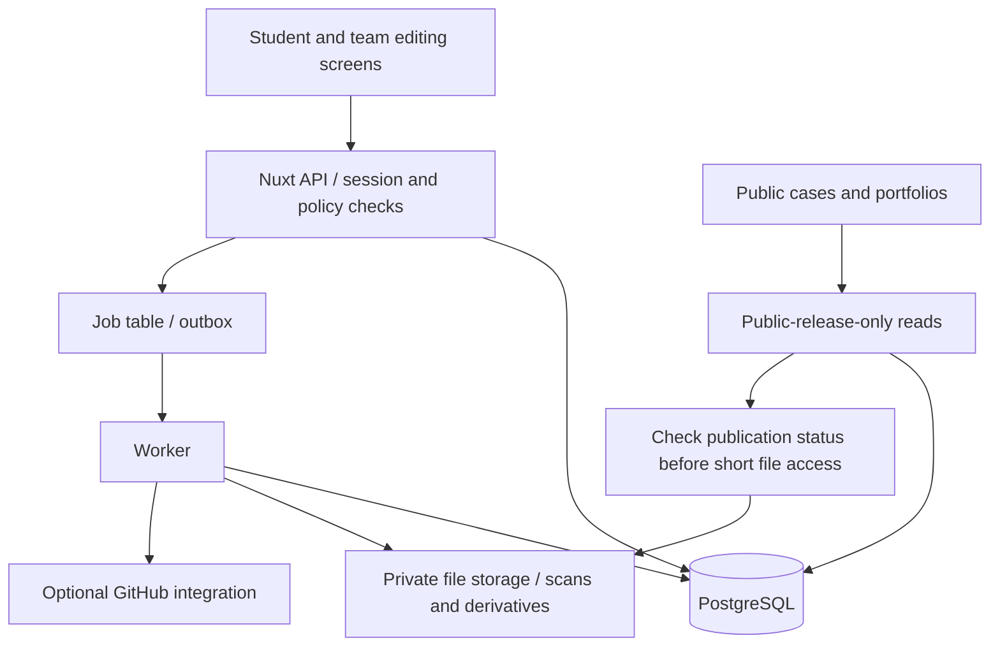
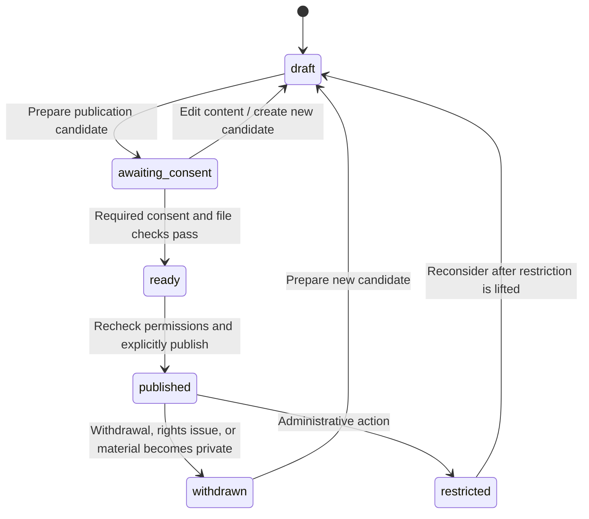

# ProofU evolution system design

[한국어](SYSTEM_DESIGN.md) | **English**

Written: October 13, 2026 · Status: proposal before implementation

[Product proposal](../PROOFU_EVOLUTION_PLAN.en.md) · [Delivery plan](DELIVERY_PLAN.en.md)

## 1. Design goals and principles

Preserve students' work records, turn them into publishable learning cases, and explain individual contributions within those cases. Begin as a single service a small team can operate, with modular responsibilities for identity, records, publication, and file processing.

The most important invariants are:

1. Private workspace records never enter public APIs, search, previews, or PDFs.
2. Publication uses an approved snapshot containing only selected record versions and files.
3. Changes to consent for shared artifacts also block public cases and portfolios using those materials.
4. Separate authors' role claims, third-party confirmations, and platform timestamps.
5. Editing a public release creates a new version, but deletion/withdrawal requests can remove actual content under retention policies.
6. Do not mix the original archive history and new service data as evidence of each other's authenticity.

Keeping revision history must not mean permanent inability to delete. Audit events retain only necessary minimal information, while personal data and file contents remain removable under policy.

## 2. How to use the existing code

Live service data and a compatible runtime have not been established for this repository. Recommend **preserving the existing directories and building the new application alongside them**. This continues the project's purpose, assets, and domain knowledge without carrying its runtime limitations into the new foundation.

| Existing element | What carries forward | Changes in the new implementation |
|---|---|---|
| User, Profile, MyPage | Bring personal experience into one place | Profile visibility controls, featured contributions, portfolio editions |
| Team, Member, Join | Relationships between teams and participants | Project-specific roles, shared-material consent, invitation/departure status |
| Board | A project workspace | Assignment/Project goals, constraints, period, publication policy |
| List, Card | Tasks and ordering | Optional Task feature; completion does not automatically constitute a learning record |
| BoardFile, CardFile | Materials linked as evidence | Scan status, file versions, license/publication permissions, withdrawal |
| Chat, Message | Need for feedback and discussion | Record-level feedback for the MVP; defer real-time chat |
| Calendar | Time context | Simple deadlines/periods first; defer a separate calendar engine |
| Images and logos | ProofU identity | Use after checking rights/origins; retain third-party usage conditions |
| Notice collection | University context | Exclude from the new MVP because it is separate from the core flow |

Use existing frontend flows, component purposes, and models as design references. Do not copy global DOM manipulation, Vue 2 lifecycles, plaintext passwords, long-lived localStorage tokens, exposed file paths, or Sequelize sync-based schema changes into new code.

Separate any research environment for running the original from the new service's database, upload paths, secrets, and deployment. Do not automatically import SQLite or sample uploads as production data.

## 3. Recommended technology and alternatives

| Component | Proposal | Reason and limitation |
|---|---|---|
| Web | Vue 3 + Nuxt + TypeScript | Retain Vue experience while combining server-rendered public cases and editing screens |
| Server | Nuxt/Nitro APIs with domain service modules | Reduce initial API deployment, CORS, and authentication boundaries |
| Database | PostgreSQL with explicit migrations; Drizzle as a candidate typed ORM | Manage relationships, versions, consent, and policy states transactionally; settle ORM choice in the initial technical experiment |
| Files | Private S3-compatible object storage | Separate file contents from the database, quarantine before scanning, manage backups/deletion |
| Background jobs | Node worker in the same repository with a PostgreSQL job table | Process scanning, publication, withdrawal, and PDFs without an initial Redis dependency |
| Authentication | Established session/OAuth implementation with HttpOnly cookies | Do not invent cryptographic protocols; GitHub login is optional and an email method is available |
| Search | PostgreSQL structured filters and normalized search columns first | Avoid a separate initial search cluster; test n-grams/dedicated search if Korean quality is inadequate |
| Testing | Vitest, integration tests against actual PostgreSQL, Playwright | Verify authorization, consent, disclosure risks, and core user flows |
| Deployment | One web service, one worker, managed database/storage | Reproduce with containers; select providers after reviewing region, cost, backup, and processing conditions |

Nuxt's server capabilities use Nitro. [Official Nuxt server documentation source](https://github.com/nuxt/nuxt/blob/main/docs/1.getting-started/13.server.md)

These technology choices are proposals; this document does not pin current version numbers. At implementation start, verify a supported Node LTS/library combination and pin the lockfile, runtime, and CI together. Use explicit server/form state instead of ad hoc fetching and global DOM manipulation in Vue components. Reserve Pinia for necessary shared UI state.

An alternative is a Vue 3 SPA with a separate TypeScript Express API. This requires additional public-page rendering and separate deployments but suits strong demand from independent API clients. With no current mobile app or external API consumers, prioritize a single Nuxt application. PostgreSQL applies to the new app; it does not imply deleting the existing MySQL implementation.

## 4. Proposed repository structure

These directories are not being created now. They describe a future implementation layout.

```text
frontend/                     # Preserve existing archive
backend/                      # Preserve existing archive
apps/
  web/
    app/pages/                # Discovery, workspace, public cases, portfolios
    app/components/           # Domain-specific UI
    server/api/v1/            # Input validation, policy checks, response mapping
    server/modules/           # identity, projects, evidence, publication, portfolio
  worker/                     # Scanning, publication, withdrawal, conversion
packages/
  domain/                     # Rules, state transitions, publication policy
  db/                         # Schema, migrations, repositories
  contracts/                  # Input/response schemas and error codes
  integrations/               # Storage and GitHub adapters
  test-fixtures/              # Scenario data without personal information
ops/                          # Local setup, deployment, backup/recovery guides
```

API handlers call domain services rather than updating the ORM in scattered locations. Separate database schemas from external responses so private emails and internal storage keys cannot enter public DTOs. Microservices, Kafka, and a generic plugin framework are unnecessary at the outset.



## 5. Domain model

| Entity | Main fields | Relationships and rules |
|---|---|---|
| User | id, display_name, private_email, status | Separate authentication identifiers from public information |
| Profile | user_id, headline, interests, contact_policy | Contact publication requires permission; school information is optional |
| Project | id, owner_id, title, context, goal, constraints, lifecycle | Personal/team assignment; owner has operational responsibility, not exclusive shared-material rights |
| ProjectMember | project_id, user_id, role, status | owner/editor/reviewer/viewer; name display requires separate consent |
| CourseContext | school_label, course_label, term, policy_note, policy_status | Optional context, not official school certification or instructor approval |
| ProcessEntry | id, project_id, author_id, type, stage | Record identity referencing the current revision |
| EntryRevision | entry_id, revision_no, work, learning, claimed_date, recorded_at | Content version; actual work date is labeled self-reported |
| Artifact | id, project_id, uploader_id, kind | file/link/demo with ownership and use conditions |
| ArtifactVersion | artifact_id, sha256, object_key, scan_status, media_type, bytes | New version for changed contents; upload SHA-256 identifies content |
| EvidenceLink | entry_revision_id, artifact_version_id or source_ref_id | Evidence attached to a particular version |
| ContributionClaim | id, user_id, project_id, text, revision | Personal role claim and evidence; no mandatory percentage totals |
| ClaimEvidence | claim_revision, entry_revision or artifact_version | Connect contribution claims to materials |
| ContributionConfirmation | claim_revision, confirmer_id, status, note | Confirmation does not carry over when the claim changes |
| Reference | owner_scope, url, citation, license_note | Sources of cases/materials; show if the original is deleted |
| Publication | id, project_id, slug, current_release_id, status | Stable public-case URL and withdrawal status |
| PublicationRelease | publication_id, version, snapshot, manifest_hash, status | Only selected public data and referenced files |
| Consent | release_manifest_hash, subject_id, scope, status | Consent to the contents of a specific publication candidate |
| PortfolioEdition | id, user_id, version, visibility, status | Snapshot of profile, selected cases, and contributions |
| PortfolioItem | edition_id, release_id, claim_revision, order | Only materials that pass publication authorization |
| ShareGrant | edition_id, token_hash, expires_at, revoked_at | P1 restricted sharing; do not store raw tokens |
| Review | target_revision, author_id, visibility, content | Public reviews also require publication consent |
| Report | target_type, target_id, reason, status | Reports, actions, and appeals |
| AuditEvent | actor_id, action, target_id, at, minimal_metadata | Do not log record bodies, tokens, or sensitive file contents |

A User participates in multiple Projects, each of which contains records, artifacts, and contributions. Public releases reference specific revisions only. PortfolioItem references PublicationRelease rather than live Project state, so editing a workspace does not immediately change public content.

Key constraints include unique `(project_id, user_id)` memberships, unique `(entry_id, revision_no)` and `(publication_id, version)`, unique public slugs, and verification of SHA-256/file length. Do not apply unconditional cascading deletion; calculate impacts on shared records, consent, and withdrawal first.

## 6. State transitions and publication flow

Project work state and publication state are separate axes. Work uses `planning → active → completed → archived`, with transitions that allow further changes. Publication state follows:



Build a candidate manifest from selected versions, displayed names, attachments, sources, and review items. Consent is tied to its hash. Changes to contents, visibility, or materials create a new candidate and require affected consent to be obtained again.

In the final publication transaction, recheck publishing permission, membership status, consent validity, file `clean` status, holds/reports, and revision existence. An enabled client-side button is not authorization. Return `409 Conflict` for stale versions and request another preview.

Scheduled publication is a P1 candidate. The date is only one condition; all conditions must be checked again at execution. An assignment deadline or semester ending does not establish permission under school policy.

A personal project can begin with explicit publication by its author. Team projects require consent from people whose names, statements, or shared artifacts are included. If a teammate does not respond, exclude the relevant shared materials or defer publication. A teammate's departure does not automatically remove existing use restrictions.

## 7. Authorization and access scope

Implement `private` and `public` in the MVP. `private` permits approved project members and invited reviewers. `public` permits anonymous reading of reviewed releases only. Add `restricted-share` in P1, distinct from an `unlisted` link readable by anyone who possesses it. Decide separately whether sensitive sharing should also require recipient authentication.

| Action | Visitor | Project viewer/reviewer | editor | owner | Administrator |
|---|---|---|---|---|---|
| Read public release | Allowed | Allowed | Allowed | Allowed | Allowed |
| Read private workspace | Denied | Own project only | Own project only | Own project only | Denied by default |
| Create/edit records | Denied | Reviewer feedback only | Own records; shared materials require separate permission | Within permission scope | Denied by default |
| Edit another person's contribution | Denied | Denied | Denied | Denied | Dispute actions only |
| Manage team members | Denied | Denied | Denied | Allowed | Operational actions only |
| Consent to publication involving oneself | Denied | Own scope only | Own scope only | Own scope only | No proxy consent |
| Request publication | Denied | Denied | Prepare draft | Execute if conditions pass | No arbitrary publication on others' behalf |
| Withdraw publication | Report | Withdraw own consent/report | Withdraw own consent/report | Withdraw entire publication | Restrict/withdraw under policy |

Administrator access to private content for dispute investigation is an exception requiring reason, duration, scope, and an audit record. An administrator account must not automatically permit unrestricted database content browsing. Distinguish permission to delete a record from permission to block publication.

Apply the same authorization rules in APIs, database repositories, file access, search indexing, and PDF jobs. PostgreSQL RLS is a possible defense layer, not a replacement for application policy, because owners or privileged roles can bypass it. Test using actual service database roles if adopted. [Official PostgreSQL row security documentation](https://www.postgresql.org/docs/current/ddl-rowsecurity.html)

## 8. Draft API contracts

| Method and path | Purpose | Main conditions |
|---|---|---|
| `POST /api/v1/projects` | Create assignment | Authenticated; private by default |
| `POST /api/v1/projects/:id/invitations` | Invite member | owner; expiry and single-use acceptance |
| `POST /api/v1/projects/:id/entries` | Create process record | editor; input validation |
| `POST /api/v1/entries/:id/revisions` | Create record revision | Author permission; expectedRevision |
| `POST /api/v1/projects/:id/artifacts/upload-intents` | Prepare file upload | Size/type limits; quarantine object key |
| `POST /api/v1/artifacts/:id/complete` | Confirm upload completion | Actual length/hash/ownership verified; awaiting scan |
| `POST /api/v1/projects/:id/contributions` | Claim personal contribution | Author is a member of that project |
| `POST /api/v1/contributions/:id/confirmations` | Teammate confirmation | Same project; no self-confirmation |
| `POST /api/v1/projects/:id/publication-candidates` | Prepare publication snapshot | Selected revisions; owner/editor |
| `POST /api/v1/candidates/:id/consents` | Give consent | Own scope; current manifest |
| `POST /api/v1/candidates/:id/publish` | Publish | owner; recheck all states |
| `POST /api/v1/publications/:id/withdraw` | Withdraw | owner or authorized operational role |
| `GET /api/v1/publications/:slug` | Read public DTO | Published only; no private fields |
| `GET /api/v1/publications/:id/artifacts/:versionId` | Read file | Included in current release; status checks |
| `POST /api/v1/portfolio-editions` | Create portfolio | Link own public contributions only |
| `GET /api/v1/profiles/:handle` | Read public profile | Permitted fields and active edition only |
| `GET /api/v1/discover` | Discover cases | Active public releases only |
| `POST /api/v1/reports` | Submit report | Verify target, rate limit, manage reason/status |

Example input follows. Actual evidence IDs must belong to the same project.

```json
{
  "type": "decision",
  "stage": "implementation",
  "work": "Adjusted scope to use manual entry instead of real-time sensors.",
  "learning": "Accuracy and operating costs needed to be evaluated together.",
  "evidenceVersionIds": ["artifact-version-id"],
  "claimedDate": "2026-10-13",
  "expectedRevision": 2
}
```

Responses distinguish `recordedAt` from `claimedDate` and return a revision number. Pagination uses cursors and maximum item limits. Publication, upload completion, and synchronization use idempotency keys. Propose field-level form error codes, 409 for conflicts, and 422 for invalid input. Use 404 consistently where lookup policy must not expose the existence of private objects.

## 9. Files and external links

Files use `pending → scanning → clean/quarantined/failed`. Narrow MVP formats to materials that can be displayed safely, such as images/PDFs, and links to code repositories. Propose excluding executables, archives, and arbitrary HTML/SVG execution. Check allowed MIME types, extensions, actual signatures, and size together.

Keep all buckets private and avoid paths constructed from original filenames. Upload to quarantine keys, validating permission, quotas, and actual results. Do not immediately fetch arbitrary user-submitted URLs on the server. Initially offer external navigation; preview collection belongs in a worker with allowed domains, redirect checks, private-IP blocking, and timeouts.

Do not create permanent public object URLs even for published files. Access them through a route checking active release status; if direct download URLs are needed, use a short validity period, such as 60 seconds or less. Withdrawal blocks new access immediately, but explain that existing URLs are bounded by TTL and downloaded copies remain with recipients.

Generate PDF/image previews in an isolated conversion environment. Do not execute active content in user documents. Link derivatives to original versions and apply the same withdrawal rules to public derivatives.

## 10. Consistency across withdrawal, search, and PDFs

On withdrawal, first update Publication state and the relevant materials' `access_epoch` in the database. Read paths check state immediately, blocking new access even if workers are slow. Store an outbox event in the same transaction; a worker removes or blocks search indexes, caches, portfolio dependencies, and derivatives.

Public pages do not query private workspace data. Initially avoid long-lived static caching of sensitive snapshots; use state checks and short cache policies. Include version and access_epoch in cache keys so withdrawal takes priority over content updates. Do not guarantee complete recall from external search caches or already downloaded PDFs.

When a case is withdrawn, dependent portfolio items become unavailable and stop serving the original text/files. Decide through user testing whether to leave gaps or show an explanation until a new edition is published. Shared links also check current dependency status on access.

Deleted materials may remain briefly in backups. Keep a separate deletion ledger and reapply the latest withdrawals/deletions during recovery before opening external traffic. Establish retention periods and purge intervals before launch, documenting them in user guidance and operational runbooks.

## 11. GitHub, AI, and learning-record integration

The MVP lets students manually attach repository, PR, and commit links. Reports/design assignments without GitHub accounts or code should be equally usable. For P1 automatic integration, consider a GitHub App and request minimum permissions for selected repositories only. GitHub's official guidance describes granular permissions and selected-repository access. [GitHub App selection guide](https://docs.github.com/en/apps/creating-github-apps/about-creating-github-apps/deciding-when-to-build-a-github-app)

Verify webhook signatures and delivery IDs; handle duplicate/out-of-order events. If a repository becomes private or access is revoked, reassess connection status and publication conditions rather than leaving collected content publicly copied. Do not automatically collect private repository contents in the MVP. Commit author email alone does not establish a ProofU user's contribution.

After P1, consider AI as an optional assistant for summarizing/translating records selected by students. Prevent claims unsupported by a publication candidate, teammates' statements becoming personal claims, and private materials being automatically sent to models. Require source attribution, editing, consent, final student approval, and a record of AI-generated scope. Core functionality remains usable without AI.

Longer term, connect achievement/evidence/learner-controlled exports with CLR/Open Badges. Standards compliance and institutional issuance require separate business/technical validation. Do not issue a credential based merely on teammate confirmation. [Official 1EdTech CLR description](https://www.1edtech.org/standards/clr)

## 12. Operational, performance, and security targets

An initial constrained pilot might contain 50 students and 20 assignments. These are design targets to validate, not guaranteed SLAs.

| Area | Draft target | Validation |
|---|---|---|
| Public pages | Quickly readable summaries in representative mobile conditions; initial LCP target within 2.5 seconds | Measure with actual networks and images |
| APIs | p95 within 500ms for ordinary reads/writes, excluding file conversion | Test database and pilot metrics |
| File storage | Draft limits of 500MB per student and 20MB per file | Adjust from usage and disclose limits before uploads |
| Authorization | Zero private-content exposure to anonymous users or other teams | Integration/E2E tests and operational investigation |
| Withdrawal | Block new access immediately after database state changes; derivative index cleanup target within five minutes | State propagation and worker failure experiments |
| Recovery | Pilot targets of RPO 24 hours and RTO four hours | Database/file recovery and deletion-ledger reapplication drills |

Include rate limiting, CSRF/session protection, OAuth state validation, output escaping, file access checks, secret management, and structured audit logs from the start. Separate service data from pilot test materials. Do not indiscriminately log assignment contents, tokens, or email addresses.

Job tables include retry counts, backoff, and dead-letter states. Outbox processing, file conversion, and PDF generation must remain safe to retry without creating duplicates. Worker failure never falls back to automatic publication of private materials.

Observe authentication errors, unusual access, publication failures, consent withdrawal, quarantined files, worker backlog, and deletion failures. Provide an operational switch to temporarily block all public reads following authorization leaks or file disclosure errors. Assign notification, response, and recovery responsibility before launch.

## 13. Data migration and archive verification

Before importing existing materials into the new app, determine whether they are actual production data. SQLite and uploads may be samples; do not fabricate user accounts or consent from them. A one-off importer reads originals without modifying them, records import run ID, source ID, checksums, and warnings, and starts with a dry-run report.

Boards can become assignment drafts, Lists/Cards optional tasks, and files quarantined materials. Do not import chat before reviewing personal information and publication consent. Do not migrate plaintext passwords; require reauthentication/reset. Import everything privately and label past dates as `imported`. Do not invent absent process records or personal contributions.

The [archive verification script](../../scripts/check_archive.py) verifies original materials, reconstructed 2019 history, and approved comment cleanup. New tests verify the new application. Avoid repeatedly expanding archive exceptions while modernizing original files. With the existing directories retained and a new app added, CI can run both verification paths separately.

The 2019 commits are reconstructed records, not actual development logs from that time. Any use as evidence examples in the new service must disclose this. Retain the [original history backup](https://github.com/polynomeer/proofu-univ/tree/backup/pre-reconstruction-20261013).
