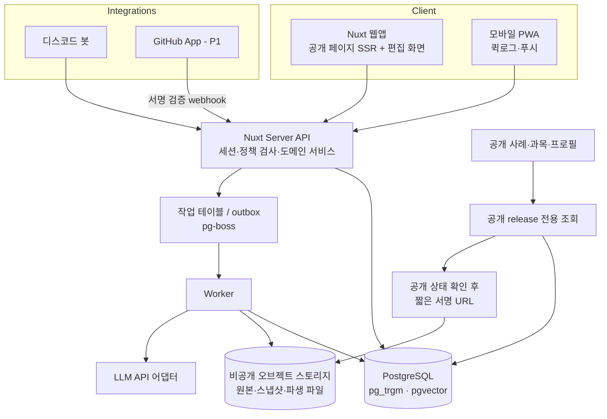
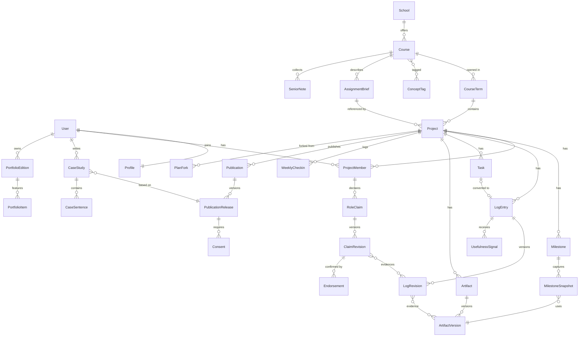
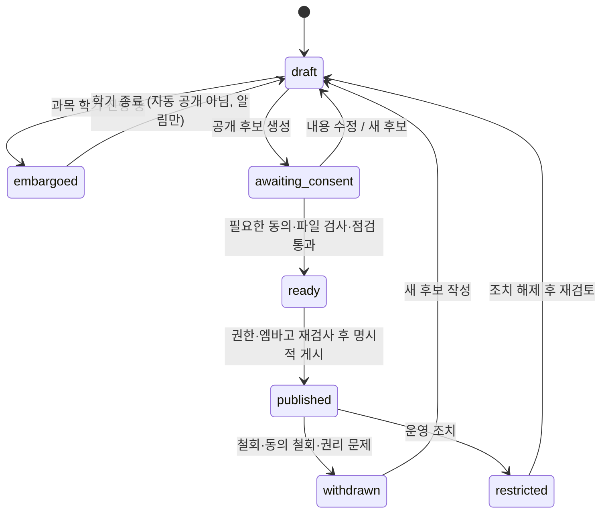

# Peerchive 시스템 설계

**한국어** | [English](SYSTEM_DESIGN.en.md)

작성일: 2026-10-18 · 상태: 구현 전 통합 제안

[제품 기획](../PROOFU_EVOLUTION_PLAN.md) · [실행 계획](DELIVERY_PLAN.md)

Peerchive(피어카이브)는 2019년 대학교 학부 졸업작품 **ProofU**에서 이어지는 프로젝트의 새 이름입니다. 보존된 코드는 기존 ProofU의 구현이며, 아래 구조는 아직 생성하지 않은 신규 앱의 설계 제안입니다.

## 1. 설계 목표와 불변조건

학생의 작업 기록을 잃지 않으면서, 학기 중 협업 기록 → 공개 학습 사례 → 개인 포트폴리오로 재사용할 수 있어야 합니다. 1인 개발자가 운영할 수 있는 단일 서비스로 시작하되 인증·기록·기여·공개·아카이브·파일·AI의 책임은 모듈로 분리합니다.

**불변조건**

1. 비공개 작업 기록이 공개 API·검색·과목 집계·미리보기·OG 이미지·PDF·AI 채용자 Q&A로 전달되지 않습니다. 공개 경로는 **승인된 공개 release 스냅샷만** 읽습니다.
2. 공개는 선택된 로그 revision·산출물 버전·노출 이름만 포함한 스냅샷이며, 동의는 그 스냅샷 manifest의 해시에 묶입니다.
3. 엠바고 기간인 프로젝트의 게시 요청은 서버가 거부합니다(클라이언트 버튼 비활성은 보조).
4. 공동 자료의 동의가 바뀌거나 철회되면 그 자료를 쓰는 공개 사례·포트폴리오·검색·집계·임베딩도 차단됩니다. 읽기 경로는 상태를 먼저 확인하므로 파생 데이터 정리가 늦어도 노출되지 않습니다.
5. 작성자의 역할 주장, 제3자의 확인, 플랫폼 기록 시각, 자기 기입 수행일을 서로 구분합니다.
6. AI 작업에는 요청 사용자가 접근 권한을 가진 데이터만 입력합니다. AI 생성물은 표시되고, 학생이 승인하기 전에는 초안입니다.
7. 공개 버전 수정은 새 버전 생성으로 처리하되, 삭제·철회 요구가 있으면 보존 정책에 따라 실제 내용도 제거할 수 있습니다. ‘변경 이력이 남는다’를 영구 삭제 불가로 구현하지 않습니다.
8. 원본 ProofU 이력과 신규 서비스 데이터는 서로의 진위를 입증하는 자료로 혼용하지 않습니다.

## 2. 기존 ProofU의 활용

### 2.1 새 앱을 옆에 만드는 이유

원본 `frontend/`·`backend/`는 기록 보존 대상으로 그대로 두고 새 앱을 같은 저장소에 추가합니다. 원본을 점진적으로 업그레이드(Vue 2 → 3, Sequelize 정비)하지 않는 이유는 다음과 같습니다.

- 누락 파일(`backend/api/user.js`)과 구버전 빌드 체인(Webpack 3, Babel 6), 네이티브 모듈 때문에 실행 복원에만 상당한 시간이 듭니다.
- 평문 비밀번호 비교·로그, 하드코딩된 DB 접속 정보·JWT 키, 소유권 검사 없는 변경 API, localStorage 장기 토큰 등 보안 구조를 고치는 비용이 새로 만드는 비용과 비슷합니다.
- v2의 핵심(빌드 로그·기여 장부·공개 스냅샷·과목 허브)은 원본에 없는 도메인입니다.

원본의 사용자 흐름·컴포넌트 목적·모델은 설계 참고자료로 씁니다. DOM 직접 조작, Vue 2 라이프사이클, 평문 비밀번호, 파일 경로 공개, Sequelize sync 기반 스키마 변경은 새 코드에 옮기지 않습니다. 원본을 실행해 보는 연구용 환경과 신규 서비스는 DB·업로드 경로·비밀키·배포를 분리합니다.

### 2.2 개념 계승 매핑

| 원본 (2019) | 계승할 것 | Peerchive |
|---|---|---|
| `User` (email, name, git) | 개인 경험을 한곳에 모으는 목적 | User + Profile(공개 제어), git → GitHub 연동 |
| `Team` + `Member`(field ENUM, part) | 팀과 참여자의 관계 | Project + ProjectMember(part_label). field ENUM → 역량·관심 태그 |
| `Join` (가입 신청) | 참여 요청 | 초대 링크(만료·일회성) + 공개 사례 작성자에게 질문(P1) |
| `Board` (title, description, language) | 프로젝트 공간 | Project(과제 요약·목표·제약·기간·과목·기술 태그) |
| `List` / `Card` (Todo/Doing/Done, pos) | 작업 단위와 정렬 | Task(할 일 보기) + 완료 시 LogEntry 전환. 카드 완료를 학습 기록으로 간주하지 않음 |
| `BoardFile` / `CardFile` | 자료를 근거로 연결 | Artifact / ArtifactVersion(검사 상태·버전·사용 조건) + 마일스톤 스냅샷 |
| `Message` + Socket.IO 채팅 | 팀 토론 | 자체 채팅 없음 → 디스코드 봇 + 🗣️ 회의 로그 + 로그별 피드백 |
| Calendar(DaySpan) | 일정 맥락 | 마일스톤·마감, `.ics` 내보내기 |
| YUnotice(학교 공지 크롤링) | 대학 맥락 | School → Course 구조의 강의 아카이브(크롤링 없음) |
| MyPage 타임라인·언어/분야 차트 | 개인 활동 조망 | 4년 과제 타임라인 + 역량×근거 매트릭스 |
| Search(LIKE, 조회수 정렬) | 공개 탐색 | 과목·막힘·개념 검색, 포크·유용성 신호 정렬 |
| 이미지·로고 | ProofU 정체성 | Peerchive 브랜드 자산은 별도 제작. 기존 자산은 권리·출처 확인 후 사용 |

### 2.3 원본 실행 전시 (선택, 시간 상자 2~3일)

원본 파일을 수정하지 않고 별도 디렉터리(예: `legacy-runtime/`)에 고정된 Node 버전 컨테이너 설정과 **명시적으로 표시된 재구현 overlay**(누락된 `user.js` 등)를 두어, 원본 화면을 읽기 전용 데모로 띄우는 방안입니다. 목적은 ProofU 첫 사례의 스냅샷 근거와 포트폴리오 시연입니다. 기한 내 실패하면 화면 캡처로 대체합니다. MVP 일정에 포함하지 않으며 AGENTS.md의 보존 규칙과 `scripts/check_archive.py`를 깨지 않아야 합니다.

## 3. 아키텍처



처음부터 마이크로서비스·Kafka·범용 플러그인 시스템을 만들지 않습니다. 웹 1개 + worker 1개 + 봇 1개 + 관리형 DB·스토리지로 시작합니다.

## 4. 기술 스택

| 구성 | 제안 | 이유·제약 |
|---|---|---|
| 웹 | **Vue 3 + Nuxt + TypeScript** | 원본 Vue 경험 계승. 공개 페이지 SSR(검색 노출·OG)과 편집 화면을 함께 |
| UI | Tailwind CSS + 헤드리스 컴포넌트 | 문서형 UI, 접근성 |
| 상태 | 서버 상태·폼 상태 중심, Pinia는 공유 UI 상태만 | 컴포넌트 내 임의 fetch·전역 DOM 조작 금지 |
| 서버 | Nuxt/Nitro 서버 API + 도메인 서비스 모듈 | 단일 배포로 CORS·인증 경계 축소. handler가 ORM을 직접 여러 곳에서 수정하지 않음 |
| DB | **PostgreSQL** + 명시적 migration, ORM 후보 Drizzle | 관계·revision·동의·정책 상태를 트랜잭션으로. ORM은 초기 기술 실험에서 확정 |
| 확장 | `pg_trgm`, `pgvector` | 한국어 부분 일치·오류 메시지 검색, 유사 막힘 의미 검색(P1) |
| 비동기 | pg-boss(PostgreSQL 작업 테이블) + outbox | Redis 없이 검사·공개·철회·AI·PDF 작업 |
| 파일 | 비공개 S3 호환 스토리지(예: Cloudflare R2) | 본문과 DB 분리, 검사 전 격리, 서명 URL |
| 인증 | 검증된 세션/OAuth 라이브러리, HttpOnly 쿠키. 이메일 매직링크 + Google·GitHub·카카오 | 자체 암호 프로토콜 금지. GitHub 없이도 가입. 학교 메일 인증은 선택 배지 |
| AI | 공급자 교체 가능한 LLM 어댑터. 요약·케이스 초안·인터뷰는 상위 모델(예: Claude Sonnet 계열), 태그 분류·민감정보 점검은 경량 모델(예: Claude Haiku 계열) | 작업별 모델 분리로 비용 제어. 학습 미사용 API 조건 |
| 봇 | discord.js 기반 별도 프로세스 | 슬래시 커맨드·이모지 반응 수집 |
| 검증 | Vitest, 실제 PostgreSQL 통합 테스트, Playwright, AI 평가 세트 | 권한·동의·공개 누출 회귀 방지가 최우선 |
| 배포 | 컨테이너(web·worker·bot) + 관리형 Postgres | 공급자는 지역·비용·백업·처리 조건 비교 후 결정 |
| 관측 | Sentry + 구조화 로그 | 과제 본문·토큰·메일 주소 미기록 |

[Nuxt 서버 기능은 Nitro 기반입니다](https://github.com/nuxt/nuxt/blob/main/docs/1.getting-started/13.server.md). 버전 번호는 이 문서에 고정하지 않고, 구현 시작 시 지원 중인 Node LTS와 라이브러리 조합을 확인해 lockfile·런타임 버전·CI를 함께 고정합니다.

대안은 Vue 3 SPA + 독립 TypeScript API입니다. 공개 페이지 렌더링을 따로 해야 하고 배포가 나뉘지만, 외부 클라이언트·모바일 앱이 API를 쓸 요구가 강해지면 적합합니다. 현재는 Nuxt 단일 앱을 우선합니다. PostgreSQL 전환은 새 앱 기준이며 원본 MySQL 코드를 삭제한다는 의미가 아닙니다.

## 5. 저장소 구조 (제안)

```text
peerchive/
├── frontend/                 # 2019 원본 (보존)
├── backend/                  # 2019 원본 (보존)
├── apps/
│   ├── web/
│   │   ├── app/pages/        # 탐색·과제 공간·공개 사례·과목·포트폴리오
│   │   ├── app/components/   # 도메인별 UI
│   │   ├── server/api/v1/    # 요청 검증·정책 확인·응답 변환
│   │   └── server/modules/   # identity, projects, logs, contribution,
│   │                         # publication, archive, portfolio
│   ├── worker/               # 검사·공개·철회·집계·AI·PDF 작업
│   └── bot/                  # 디스코드 봇
├── packages/
│   ├── domain/               # 규칙, 상태 전이, 공개·엠바고 정책
│   ├── db/                   # 스키마, migration, repository
│   ├── contracts/            # 입력/응답 스키마, 오류 코드
│   ├── ai/                   # 프롬프트, LLM 어댑터, 평가 세트
│   ├── integrations/         # storage, GitHub, Discord adapter
│   └── test-fixtures/        # 개인정보 없는 시나리오 데이터
├── ops/                      # 로컬 구성, 배포·백업·복구 runbook
├── docs/
└── scripts/check_archive.py  # 원본 보존 검증 (CI에서 계속 실행)
```

DB 스키마와 외부 응답을 분리해 이메일·내부 파일 키 등이 공개 DTO에 실리지 않게 합니다.

## 6. 도메인 모델



### 6.1 신원·프로필

| 엔티티 | 주요 필드 | 규칙 |
|---|---|---|
| User | id, display_name, private_email, status | 로그인 식별자와 공개 정보 분리 |
| Profile | user_id, handle, headline, job_targets[], school_label?, grad_term?, contact_policy, open_to_work | 학교·졸업 예정은 선택. 공개 연락은 별도 허용 |
| Integration | user_id, provider(discord/github), external_id, scopes, status | 토큰은 암호화 저장, 철회 가능 |

### 6.2 강의 아카이브

| 엔티티 | 주요 필드 | 규칙 |
|---|---|---|
| School | id, name, verified_label | 학생 입력 + 운영자 병합. 공식 인증 의미 없음 |
| Course | id, school_id, code?, title, merged_into? | 과목 허브 단위. 정규화는 병합으로 |
| CourseTerm | course_id, year, semester, ends_at | `ends_at`이 엠바고 기준 |
| AssignmentBrief | id, course_id, term_id?, title, summary_by_student | 과제 원문 아님. 같은 과제로 간주하지 않고 묶기만 |
| ConceptTag | id, slug, label, parent_id? | 과목·막힘·사례의 학교 간 연결 |
| SeniorNote | id, course_id, author_id, display_mode(real/display/anonymous), answers(JSON), status | 공개 흐름은 Publication 규칙 준용 |
| PlanFork | source_release_id, target_project_id, copied_parts | 마일스톤·체크리스트·시간 배분·참고 자료만 복사 |
| UsefulnessSignal | target_log_entry_id, user_id, kind(me_too/helped) | 사용자당 1회. 개인 점수 합산 금지 |
| Question / Answer (P1) | target_log_entry_id, author_id, body, status | 작성자 허용 시만 |

### 6.3 과제 공간

| 엔티티 | 주요 필드 | 규칙 |
|---|---|---|
| Project | id, owner_id, title, summary_by_student, goal, constraints, kind(individual/team), lifecycle, course_term_id?, assignment_brief_id?, retro_mode | 기본 private. owner는 운영 책임자이며 공동 권리 독점 아님 |
| ProjectMember | project_id, user_id, role(owner/editor/reviewer/viewer), part_label, status | `(project_id, user_id)` 유일. 공개 이름 노출은 별도 동의 |
| Invitation | project_id, token_hash, role, expires_at, used_at | 만료·일회성 |
| Milestone | id, project_id, order, title, due_at?, claimed_at? | 순서 변경 가능, 완료 게이트 아님 |
| MilestoneSnapshot | milestone_id, artifact_version_id, note | 진화 보기 단위 |
| LogEntry | id, project_id, author_id, current_revision_id, source(web/discord/ai/task/retro) | 로그 식별자 |
| LogRevision | log_entry_id, revision_no, tag, body, payload(JSON), resolves_entry_id?, claimed_date?, recorded_at, ai_generated, approved_at? | `(log_entry_id, revision_no)` 유일. tag별 payload는 JSON Schema로 검증 |
| Task | id, project_id, title, assignee_id?, due_at?, status, position | 원본 Card 계승 |
| Artifact | id, project_id, uploader_id, kind(file/link/repo/demo), usage_terms | 소유·사용 조건 명시 |
| ArtifactVersion | artifact_id, sha256, object_key, scan_status, media_type, bytes | 내용이 바뀌면 새 버전. 원 파일명으로 경로 생성 안 함 |
| Reference | owner_scope, url, citation, license_note | 참고 자료 출처. 원본 삭제 상태 표시 |
| WeeklyCheckin | project_id, user_id, week, time_bucket, difficulty, note?, share_for_stats | 기본 비공개, 통계 동의 분리 |

`LogRevision.payload` 예:
- `stuck`: `{symptom, keywords[], error_text?, attempts[], time_bucket}`
- `solution`: `{method, time_bucket}` + `resolves_entry_id`
- `decision`: `{options[], criteria, choice, hindsight?}`
- `validation`: `{target, conditions, result, open_questions}`
- `meeting`: `{attendees[], decisions[], follow_ups[]}`

### 6.4 기여

| 엔티티 | 주요 필드 | 규칙 |
|---|---|---|
| RoleClaim | id, project_id, user_id, current_revision_id | 개인 역할 주장. 비율 합산 강제 안 함 |
| ClaimRevision | claim_id, revision_no, text, evidence_refs | 근거는 특정 LogRevision·ArtifactVersion |
| Endorsement | claim_revision_id, endorser_id, status, note | 같은 프로젝트 멤버만. 자기 확인 불가. revision이 바뀌면 승계 안 됨 |
| ContributionReport | project_id, period, generated_at, object_key | 주간 요약·동료평가 PDF. 팀 비공개 |

### 6.5 공개·포트폴리오

| 엔티티 | 주요 필드 | 규칙 |
|---|---|---|
| Publication | id, project_id, slug, level(summary/full), current_release_id, status | 안정된 URL과 철회 상태. slug 유일 |
| PublicationRelease | publication_id, version, snapshot(JSON), manifest_hash, status, access_epoch | 선택된 revision·파일만 포함. `(publication_id, version)` 유일 |
| Consent | release_manifest_hash, subject_id, scope, status | 특정 후보 내용에 대한 동의 |
| Embargo | scope(course_term/project), until, reason, requested_by | 게시·공개 조회에서 강제 |
| CaseStudy | id, user_id, release_id, job_target, generator(template/ai), status | 학생 승인 전 비공개 |
| CaseSentence | case_study_id, order, text, citations[] | 인용 없는 문장은 발행 차단 |
| PortfolioEdition | id, user_id, version, visibility, status | 프로필·선택 사례·기여의 스냅샷 |
| PortfolioItem | edition_id, case_study_id, claim_revision_id, order | 공개 권한을 통과한 자료만 |
| CompetencyEvidence | edition_id, competency, evidence_ref | 점수 필드 없음 |
| InterviewPrep (P1) | claim_revision_id, question, answer_note, expose_to_reader | 기본 비공개 |
| ShareGrant (P1) | edition_id, token_hash, expires_at, revoked_at | 원문 토큰 저장 안 함 |

### 6.6 운영

| 엔티티 | 주요 필드 | 규칙 |
|---|---|---|
| Review | target_revision, author_id, visibility, content | 로그별 피드백. 공개는 별도 동의 |
| Report | target_type, target_id, reason, status | 신고·조치·이의제기 |
| AuditEvent | actor_id, action, target_id, at, minimal_metadata | 본문·토큰·민감 파일 내용 미저장 |
| DeletionLedger | target, requested_at, purged_at | 백업 복구 시 삭제 재적용 |

DB 삭제는 무조건 cascade하지 않고 공동 기록·동의·철회의 파급을 먼저 계산합니다.

## 7. 상태 전이와 공개 흐름

### 7.1 프로젝트 작업 상태

`planning → active → completed → archived`. 되돌리는 전이를 허용합니다. 작업 상태와 공개 상태는 별개의 축입니다.

### 7.2 공개 상태



- **후보 생성:** 선택한 로그 revision·마일스톤 스냅샷·산출물 버전·노출 이름·출처로 manifest를 만들고 해시를 계산합니다. 미동의 팀원의 이름·로그·공동 자료는 manifest에서 제외하거나 보류합니다.
- **공개 전 점검:** worker가 규칙·경량 모델로 개인정보·과제 원문 의심 파일·타인 실명을 검사해 경고를 첨부합니다. 차단이 아닌 경고입니다.
- **게시 트랜잭션:** 게시 권한, 참여 상태, 동의 유효성, 파일 `clean` 상태, 엠바고, 보류·신고 상태, revision 존재를 다시 검사합니다. 낡은 후보는 `409 Conflict`로 돌려 다시 미리보기하게 합니다.
- 개인 프로젝트는 작성자 명시 게시로, 팀 프로젝트는 공개 범위에 이름·발언·공동 산출물이 포함된 당사자의 동의로 게시합니다.
- 예약 공개는 P1이며 실행 시 모든 조건을 다시 확인합니다.

### 7.3 기여 확인 상태

`ClaimRevision`마다 `unconfirmed → confirmed | disputed`. 새 revision이 생기면 이전 확인은 해당 revision에만 남고 현재 선언은 `unconfirmed`로 시작합니다.

## 8. 권한과 접근 범위

MVP는 `private`, `public(summary/full)`을 구현합니다. `private`는 승인된 멤버와 초대된 reviewer만, `public`은 게시된 release만 익명 열람합니다. P1의 `restricted-share`는 만료·철회 가능한 토큰 링크로, 링크만 알면 누구나 보는 `unlisted`와 다릅니다.

| 행동 | 방문자 | viewer/reviewer | editor | owner | 관리자 |
|---|---|---|---|---|---|
| 공개 release·과목 페이지 읽기 | 가능 | 가능 | 가능 | 가능 | 가능 |
| 비공개 과제 공간 읽기 | 불가 | 해당 프로젝트만 | 해당 프로젝트만 | 해당 프로젝트만 | 원칙적 불가 |
| 로그 작성·수정 | 불가 | reviewer는 피드백만 | 본인 로그 | 본인 로그 | 불가 |
| 타인의 역할 선언 수정 | 불가 | 불가 | 불가 | 불가 | 분쟁 조치만 |
| 역할 선언 확인 | 불가 | 같은 프로젝트 멤버 | 가능(본인 제외) | 가능(본인 제외) | 불가 |
| 팀 멤버 관리 | 불가 | 불가 | 불가 | 가능 | 운영 조치만 |
| 자기 관련 공개 동의 | 불가 | 본인 관련만 | 본인 관련만 | 본인 관련만 | 대리 동의 불가 |
| 공개 후보 준비 / 게시 | 불가 | 불가 | 후보 준비 | 조건 충족 시 게시 | 대리 게시 불가 |
| 공개 철회 | 신고 | 자기 동의 철회·신고 | 자기 동의 철회·신고 | 전체 철회 | 정책상 제한·철회 |
| 계획 포크·선배 노트 작성 | 로그인 필요 | 가능 | 가능 | 가능 | – |

- 관리자의 분쟁 조사용 비공개 접근은 사유·기간·범위·감사 기록을 갖춘 예외입니다. 삭제 권한과 공개 차단 권한을 분리합니다.
- API·repository·파일 접근·검색 색인·집계·PDF·AI 작업에 같은 정책 함수를 적용합니다. PostgreSQL RLS는 방어층 후보일 뿐 애플리케이션 정책을 대신하지 않습니다([PostgreSQL Row Security](https://www.postgresql.org/docs/current/ddl-rowsecurity.html)).
- 비공개 객체의 존재를 노출하지 않도록 권한 없는 조회는 404로 일관되게 처리합니다.

## 9. API 계약 초안 (`/api/v1`)

| 메서드·경로 | 역할 | 주요 조건 |
|---|---|---|
| `POST /projects` | 과제 생성 | 로그인, private 기본 |
| `POST /projects/:id/invitations` | 멤버 초대 | owner, 만료·일회성 |
| `POST /projects/:id/fork-from/:releaseId` | 계획 포크 | 공개 release, 계획 요소만 복사 |
| `POST /projects/:id/logs` | 로그 작성 | editor, tag별 payload 검증 |
| `POST /logs/:id/revisions` | 로그 새 버전 | 작성자, `expectedRevision` |
| `POST /logs/:id/resolve` | 막힘에 해결 연결 | 같은 프로젝트 |
| `POST /projects/:id/tasks`, `POST /tasks/:id/complete` | 할 일, 완료 | 완료 응답에 로그 전환 프롬프트 |
| `POST /projects/:id/milestones`, `POST /milestones/:id/snapshots` | 마일스톤·스냅샷 | 같은 프로젝트의 clean 버전 |
| `POST /projects/:id/checkins` | 주간 체크인 | 본인, 주당 1건 |
| `POST /projects/:id/artifacts/upload-intents` | 업로드 준비 | 용량·종류 한도, 격리 키 |
| `POST /artifacts/:id/complete` | 업로드 완료 | 실제 길이·해시·소유권 확인, 검사 대기 |
| `POST /projects/:id/claims`, `POST /claims/:id/revisions` | 역할 선언 | 본인 |
| `POST /claim-revisions/:id/endorsements` | 팀원 확인 | 같은 프로젝트, 자기 확인 불가 |
| `GET /projects/:id/contribution-report` | 기여 리포트 | 멤버 |
| `POST /projects/:id/publication-candidates` | 공개 후보 | owner/editor, 엠바고 확인 |
| `POST /candidates/:id/consents` | 동의 | 본인 관련, 현재 manifest |
| `POST /candidates/:id/publish` | 게시 | owner, 전체 재검사 |
| `POST /publications/:id/withdraw` | 철회 | owner 또는 정책 권한 |
| `GET /publications/:slug` | 공개 DTO | published만, private 필드 없음 |
| `GET /publications/:id/artifacts/:versionId` | 파일 열람 | 현재 release 포함·상태 검사 |
| `GET /schools/:id/courses`, `GET /courses/:id` | 과목 허브 | 공개 release·집계 view만 |
| `POST /courses/:id/senior-notes` | 선배 노트 | 로그인 |
| `GET /search?q=&type=stuck` | 검색 | 활성 공개 release만 |
| `POST /case-studies/draft` | 케이스 초안 | 본인 기여가 포함된 release |
| `POST /portfolio-editions` | 포트폴리오 생성 | 본인 공개 기여만 |
| `GET /profiles/:handle` | 공개 프로필 | 공개 필드·활성 edition만 |
| `POST /ai/checkin-interview` (P1) | AI 회고 | 스트리밍, 본인 접근 데이터만 |
| `POST /integrations/discord/link`, `POST /webhooks/github` | 연동 | 서명·delivery ID 검증 |
| `POST /reports` | 신고 | rate limit, 사유·상태 |

로그 작성 예시(근거 ID는 같은 프로젝트에 속해야 함):

```json
{
  "tag": "decision",
  "body": "실시간 센서 대신 수동 입력 방식으로 범위를 조정했다.",
  "payload": {
    "options": ["실시간 센서", "수동 입력"],
    "criteria": "한 학기 안의 구현 가능성과 운영 비용",
    "choice": "수동 입력"
  },
  "evidenceVersionIds": ["artifact-version-id"],
  "claimedDate": "2026-10-13",
  "expectedRevision": 2
}
```

응답은 `recordedAt`과 `claimedDate`를 구분하고 revision 번호를 돌려줍니다. 페이지네이션은 cursor·최대 개수 제한, 게시·파일 완료·봇 수집·webhook에는 idempotency key를 씁니다. 폼 오류는 필드별 코드, 충돌은 409, 입력 오류는 422로 구분합니다.

## 10. 파일과 외부 링크

- 상태: `pending → scanning → clean / quarantined / failed`. 허용 MIME·확장자·실제 signature·용량을 함께 검사합니다.
- MVP 허용 형식은 이미지·PDF 등 안전하게 표시할 수 있는 자료와 저장소·영상 링크로 좁힙니다. 실행 파일·압축 파일·임의 HTML/SVG 실행은 허용하지 않습니다. 동영상은 외부 링크 우선입니다.
- 버킷은 모두 비공개이며 원 파일명으로 경로를 만들지 않습니다. 공개 파일도 영구 URL 없이 release 활성 상태를 확인한 뒤 짧은(예: 60초 이하) 서명 URL을 발급합니다.
- 서버는 사용자가 붙인 URL에 바로 접속하지 않습니다. 링크 미리보기는 허용 도메인·redirect 제한·사설 IP 차단·timeout을 갖춘 worker에서만 수집합니다.
- PDF·이미지 썸네일은 격리된 변환 환경에서 생성하고 active content를 실행하지 않습니다. 파생 파일에도 원본과 같은 철회 규칙을 적용합니다.
- 초안 한도: 학생당 500MB, 파일당 20MB. 사용량 관측 후 조정합니다.

## 11. 철회·검색·집계·파생 데이터의 일관성

- 철회 요청 시 Publication 상태와 관련 release의 `access_epoch`를 먼저 DB에서 갱신합니다. 같은 트랜잭션에 outbox 이벤트를 저장하고, worker가 검색 색인·캐시·포트폴리오 의존성·케이스 스터디·임베딩·파생 파일·과목 집계를 정리합니다.
- 공개 페이지는 private 테이블을 조회하지 않습니다. 캐시 키에 version·`access_epoch`를 포함해 콘텐츠 변경보다 철회가 우선하게 합니다. 민감한 스냅샷을 장기 정적 캐시하지 않습니다.
- 철회된 사례를 포함한 포트폴리오 항목은 자동으로 이용 불가 표시가 되고 원본 문장·파일을 계속 제공하지 않습니다. 계획 포크로 이미 복사된 마일스톤·체크리스트는 포크한 사람의 데이터이므로 남지만, 원본 링크는 끊깁니다.
- 외부 검색엔진 캐시, 이미 내려받은 PDF는 완전 회수를 보장하지 않는다고 안내합니다.
- 백업에는 삭제 자료가 잠시 남을 수 있습니다. DeletionLedger를 유지하고, 복구 시 최신 철회·삭제를 재적용하기 전에는 외부 트래픽을 열지 않습니다.

### 11.1 검색

1단계는 PostgreSQL 전문 검색 + `pg_trgm`(과목명·한국어 부분 일치·오류 메시지), 구조화 필터(학교·과목·개념 태그·로그 유형)입니다. 2단계(P1)는 `pgvector`로 “비슷한 막힘” 의미 검색을 하며 **공개 release 텍스트만 임베딩**합니다. 별도 검색 클러스터는 공개 사례가 수만 건을 넘을 때 재검토합니다.

### 11.2 과목 집계와 익명성

워크로드 분포·자주 막히는 지점은 공개 release와 `share_for_stats=true` 체크인만으로 계산하는 별도 materialized view입니다. 그룹(같은 과목·과제 유형) 크기가 임계값(초안 5) 미만이면 결과를 반환하지 않습니다. 비공개 작업 공간 테이블을 공개 집계 경로에서 직접 읽지 않습니다.

## 12. 연동

### 12.1 디스코드 봇

- 사용자는 웹에서 디스코드 계정을 연결하고, 서버 채널을 Peerchive 프로젝트에 매핑합니다.
- `/log <태그> <내용>` 슬래시 커맨드와 📌 반응을 수집합니다. 반응 수집은 **메시지 작성자 본인의 로그로만** 저장하며, 다른 사람의 메시지에 📌을 달면 작성자에게 승인 요청을 보냅니다.
- 회의 요약(P1)은 팀원 전원이 동의한 채널에서만, 요청 시점의 메시지만 읽습니다. 메시지 원문은 요약 생성 후 저장하지 않습니다.
- 봇은 주간 체크인 알림, 주간 기여 요약, 학기 종료 공개 알림을 보냅니다.

### 12.2 GitHub

- MVP는 저장소·PR·커밋 링크를 학생이 직접 연결합니다. GitHub 없는 보고서·디자인 과제도 같은 수준으로 쓸 수 있어야 합니다.
- P1 자동 연결은 GitHub App으로, 사용자가 선택한 저장소에 최소 권한만 요청합니다([GitHub App 선택 안내](https://docs.github.com/en/apps/creating-github-apps/about-creating-github-apps/deciding-when-to-build-a-github-app)).
- webhook은 서명·delivery ID를 검증하고 중복·순서 역전을 처리합니다. 저장소가 private이 되거나 권한이 철회되면 공개 복사본을 남겨 두지 않고 연결 상태와 공개 조건을 재검토합니다. 비공개 저장소 본문 자동 수집은 하지 않으며, 커밋 작성자 이메일만으로 기여를 확정하지 않습니다.

### 12.3 학습 기록 표준

장기적으로 CLR/Open Badges 내보내기를 검토하되, 표준 준수와 기관 발급은 별도 사업·기술 검증이 필요하며 단순 팀원 확인을 인증서로 발급하지 않습니다([1EdTech CLR](https://www.1edtech.org/standards/clr)).

## 13. AI 파이프라인

| 작업 | 입력 | 출력 | 안전장치 | 단계 |
|---|---|---|---|---|
| 태그 추천 | 퀵로그 본문 | 태그 후보 | 추천만, 학생 확정 | MVP(선택) |
| 공개 전 점검 | 공개 후보 스냅샷 | 개인정보·과제원문·타인 실명 경고 | 경고만 | MVP(규칙) / P1(모델) |
| 케이스 초안 | 공개 release | 템플릿 조합 문장 + 인용 | 모델 미사용 | MVP |
| 케이스 다듬기 | 학생이 고른 공개 release 범위 | 문장 + 인용 로그 ID | 인용 없는 문장 하이라이트·발행 차단 | P1 |
| 주간 회고 인터뷰 | 이번 주 본인 로그·할 일 | 질문 → 답변 → 로그 초안 | 학생 승인 필수 | P1 |
| 회의 요약 | 동의된 채널 메시지 | 🗣️ 회의 로그 초안 | 팀원 승인 전 초안, 원문 미저장 | P1 |
| 면접 질문 생성 | 본인 결정·막힘 로그 | 예상 질문 | 기본 비공개 | P1 |
| 유사 막힘 검색 | 공개 막힘 임베딩 | 비슷한 사례 | 공개 데이터만 | P1 |
| 포트폴리오 Q&A | 채용자 질문 + 공개 스냅샷 | 근거 인용 답변 | 근거 없으면 “기록 없음”, 학생이 켜야 활성 | P2 |

**원칙**
- 공개 후보의 근거 밖 내용을 생성하거나, 팀원 발언을 본인 주장으로 바꾸거나, 비공개 자료를 자동으로 모델에 보내지 않습니다.
- 모든 AI 결과는 `ai_generated`와 사용 모델·프롬프트 버전을 기록합니다.
- `packages/ai`에 작업별 평가 세트(인용 정확도, 근거 밖 주장 비율, 민감정보 탐지 재현율)를 두고 프롬프트·모델 변경 시 회귀 평가합니다.
- 사용자·팀별 월간 사용 한도, 응답 캐싱, 작업별 모델 분리로 비용을 통제합니다.
- AI 없이도 모든 핵심 기능을 수동으로 쓸 수 있어야 합니다.

## 14. 운영·성능·보안 목표

초기 목표는 학생 50명·과제 20개 수준의 제한된 pilot입니다. 아래 값은 검증할 설계 목표이며 SLA가 아닙니다.

| 항목 | 목표 초안 | 검증 |
|---|---|---|
| 공개 페이지 | 대표 모바일 환경에서 LCP 2.5초 이내 | 실제 네트워크·이미지 포함 측정 |
| API | 일반 읽기·쓰기 p95 500ms 이내(파일·AI 제외) | 테스트 DB, pilot 지표 |
| 봇 수집 | `/log` 응답 3초 이내, 수집 누락 0 | 재시도·idempotency 테스트 |
| 권한 | 익명·다른 팀의 비공개 내용 노출 0건 | 통합·E2E 테스트, 운영 조사 |
| 철회 | DB 상태 변경 즉시 신규 접근 차단, 파생 정리 5분 목표 | 상태 전파·worker 실패 실험 |
| 복구 | RPO 24시간, RTO 4시간 | DB·파일 복구 + 삭제 ledger 재적용 연습 |

- 시작부터 rate limit, CSRF·세션 보호, OAuth state 검증, 출력 escaping, 파일 접근 검사, 비밀 관리, 구조화 감사 로그를 둡니다. 서비스 데이터와 pilot 테스트 자료를 분리합니다.
- 작업 테이블은 retry 횟수·backoff·dead-letter 상태를 갖고, 반복 실행해도 중복 자료가 생기지 않아야 합니다. worker 장애로 비공개 자료가 공개되는 fallback은 없습니다.
- 관측: 인증 오류, 비정상 조회, 공개 실패, 동의 철회, 격리 파일, worker backlog, 삭제 실패, AI 비용·오류율. 권한 누출·파일 공개 오류 시 public 읽기 전체를 잠시 막는 운영 스위치를 둡니다.

## 15. 데이터 이관과 아카이브 검증

- 원본 SQLite·업로드 예제는 예제일 수 있으므로 사용자 계정이나 동의를 생성하지 않습니다. 실제 운영 데이터가 확인되면 일회성 importer가 원본을 읽기 전용으로 읽고 import run ID·원본 ID·checksum·경고를 기록하며 dry-run 보고서부터 만듭니다.
- Board는 과제 초안, List/Card는 Task, 파일은 격리 Artifact로 옮길 수 있습니다. 채팅은 개인정보·동의 확인 전 옮기지 않습니다. 평문 비밀번호는 옮기지 않고 재인증합니다. 모두 private으로, 과거 작성일은 `imported`로 표시하며 존재하지 않는 로그·기여를 만들어 넣지 않습니다.
- [아카이브 검증 스크립트](../../scripts/check_archive.py)는 원본·2019년 재구성 이력·허용된 정리를 검증하고, 새 앱의 동작은 신규 테스트가 검증합니다. 두 검증을 CI에서 각각 실행합니다. 원본 파일을 현대화하면서 검증 예외 목록을 늘리는 방식은 피합니다.
- 2019년 커밋은 실제 당시 개발 로그가 아닌 재구성 기록이며, ProofU 첫 사례 등 새 서비스에서 쓸 때 그 사실을 표시합니다. [기존 이력 백업](https://github.com/polynomeer/peerchive/tree/backup/pre-reconstruction-20261013)은 유지합니다.
