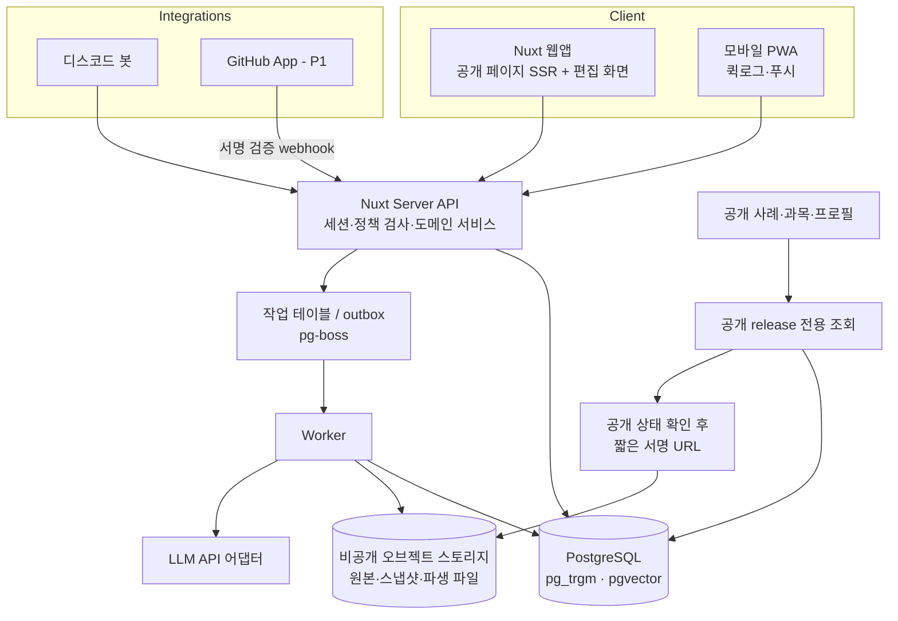
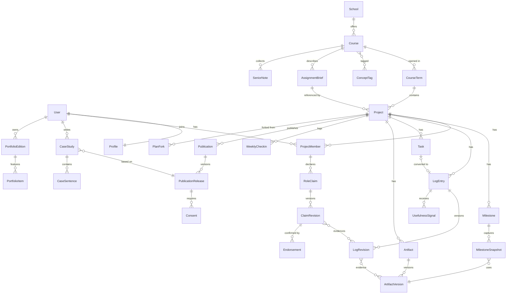
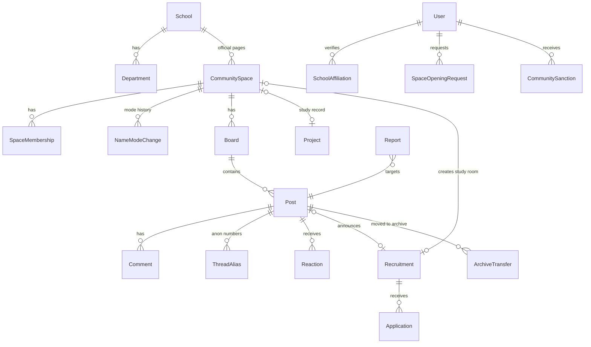
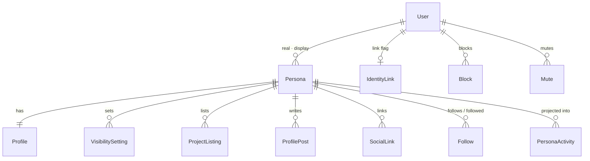
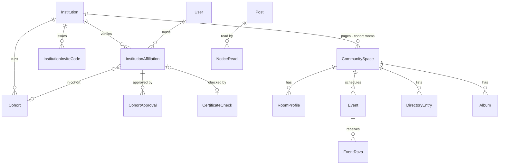
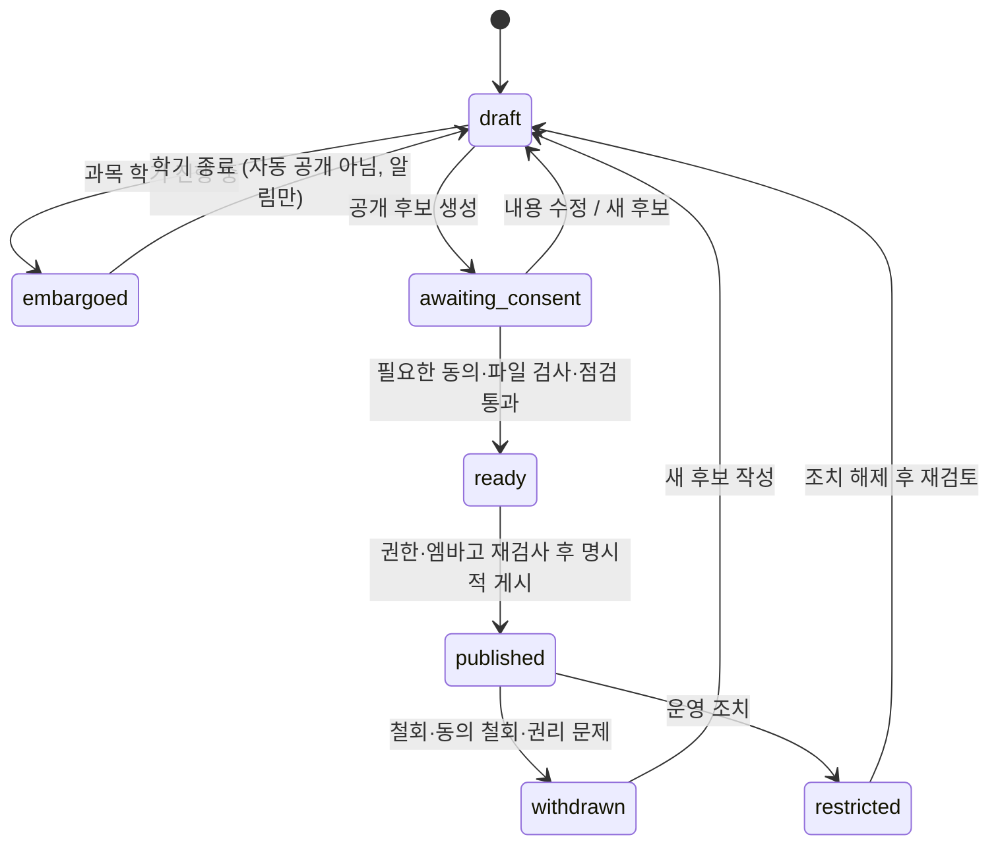

# Peerchive 시스템 설계

**한국어** | [English](SYSTEM_DESIGN.en.md)

작성일: 2026-10-18 · 갱신: 2026-10-24 (캠퍼스 커뮤니티 §6.7·§8.1·§8.2·§9.1, 정체성·공개 프로필·팔로우 §6.7.1·§8.3·§9.2·§11.3, 졸업생·토픽·기관 §6.7.2·§8.4 반영) · 상태: 구현 전 통합 제안

[제품 기획](../PROOFU_EVOLUTION_PLAN.md) · [실행 계획](DELIVERY_PLAN.md)

Peerchive(피어카이브)는 2019년 대학교 학부 졸업작품 **ProofU**에서 이어지는 프로젝트의 새 이름입니다. 보존된 코드는 기존 ProofU의 구현이며, 아래 구조는 아직 생성하지 않은 신규 앱의 설계 제안입니다.

## 1. 설계 목표와 불변조건

학생의 작업 기록을 잃지 않으면서, 학기 중 협업 기록 → 공개 학습 사례 → 개인 포트폴리오로 재사용할 수 있어야 합니다. 1인 개발자가 운영할 수 있는 단일 서비스로 시작하되 인증·기록·기여·공개·아카이브·파일·AI의 책임은 모듈로 분리합니다.

**불변조건**

1. 비공개 작업 기록이 공개 API·검색·과목 집계·미리보기·OG 이미지·PDF·AI 채용자 Q&A로 전달되지 않습니다. 공개 경로는 **승인된 공개 release 스냅샷만** 읽습니다.
2. 공개는 선택된 로그 revision·산출물 버전·노출 이름만 포함한 스냅샷이며, 동의는 그 스냅샷 manifest의 해시에 묶입니다.
3. 엠바고 기간인 프로젝트의 게시 요청은 서버가 거부합니다(클라이언트 버튼 비활성은 보조).
4. 공동 자료의 동의가 바뀌거나 철회되면 그 자료를 쓰는 공개 사례·포트폴리오·검색·집계·임베딩도 차단됩니다. 읽기 경로는 상태를 먼저 확인하므로 파생 데이터 정리가 늦어도 노출되지 않습니다.
5. 작성자의 역할 주장, 제3자의 확인, 플랫폼 기록 시각, 자기 기입 수행일을 서로 구분합니다.
6. AI 작업에는 요청 사용자가 접근 권한을 가진 데이터만 입력합니다. AI 생성물은 표시되고, 학생이 승인하기 전에는 초안입니다.
7. 공개 버전 수정은 새 버전 생성으로 처리하되, 삭제·철회 요구가 있으면 보존 정책에 따라 실제 내용도 제거할 수 있습니다. ‘변경 이력이 남는다’를 영구 삭제 불가로 구현하지 않습니다.
8. 원본 ProofU 이력과 신규 서비스 데이터는 서로의 진위를 입증하는 자료로 혼용하지 않습니다.
9. 커뮤니티 글은 공개 아카이브와 분리합니다. 작성자가 명시적으로 옮기지 않는 한 공개 release·과목 집계·공개 검색·검색엔진·프로필·포트폴리오로 전달되지 않습니다(§6.7, §8.2).
10. 익명 글·댓글의 실제 작성자는 운영자만 사유와 감사 기록을 남기고 확인할 수 있습니다. 방장·모더레이터·다른 사용자에게 가는 응답에는 작성자를 추정할 식별자가 실리지 않습니다(§8.1).

## 2. 기존 ProofU의 활용

### 2.1 새 앱을 옆에 만드는 이유

원본 `frontend/`·`backend/`는 기록 보존 대상으로 그대로 두고 새 앱을 같은 저장소에 추가합니다. 원본을 점진적으로 업그레이드(Vue 2 → 3, Sequelize 정비)하지 않는 이유는 다음과 같습니다.

- 누락 파일(`backend/api/user.js`)과 구버전 빌드 체인(Webpack 3, Babel 6), 네이티브 모듈 때문에 실행 복원에만 상당한 시간이 듭니다.
- 평문 비밀번호 비교·로그, 하드코딩된 DB 접속 정보·JWT 키, 소유권 검사 없는 변경 API, localStorage 장기 토큰 등 보안 구조를 고치는 비용이 새로 만드는 비용과 비슷합니다.
- v2의 핵심(빌드 로그·기여 장부·공개 스냅샷·과목 허브)은 원본에 없는 도메인입니다.

원본의 사용자 흐름·컴포넌트 목적·모델은 설계 참고자료로 씁니다. DOM 직접 조작, Vue 2 라이프사이클, 평문 비밀번호, 파일 경로 공개, Sequelize sync 기반 스키마 변경은 새 코드에 옮기지 않습니다. 원본을 실행해 보는 연구용 환경과 신규 서비스는 DB·업로드 경로·비밀키·배포를 분리합니다.

### 2.2 개념 계승 매핑

| 원본 (2019) | 계승할 것 | Peerchive |
|---|---|---|
| `User` (email, name, git) | 개인 경험을 한곳에 모으는 목적 | User + Profile(공개 제어), git → GitHub 연동 |
| `Team` + `Member`(field ENUM, part) | 팀과 참여자의 관계 | Project + ProjectMember(part_label). field ENUM → 역량·관심 태그 |
| `Join` (가입 신청) | 참여 요청 | 초대 링크(만료·일회성) + 공개 사례 작성자에게 질문(P1) |
| `Board` (title, description, language) | 프로젝트 공간 | Project(과제 요약·목표·제약·기간·과목·기술 태그) |
| `List` / `Card` (Todo/Doing/Done, pos) | 작업 단위와 정렬 | Task(할 일 보기) + 완료 시 LogEntry 전환. 카드 완료를 학습 기록으로 간주하지 않음 |
| `BoardFile` / `CardFile` | 자료를 근거로 연결 | Artifact / ArtifactVersion(검사 상태·버전·사용 조건) + 마일스톤 스냅샷 |
| `Message` + Socket.IO 채팅 | 팀 토론 | 자체 채팅 없음 → 디스코드 봇 + 🗣️ 회의 로그 + 로그별 피드백 |
| Calendar(DaySpan) | 일정 맥락 | 마일스톤·마감, `.ics` 내보내기 |
| YUnotice(학교 공지 크롤링) | 대학 맥락 | School → Course 구조의 강의 아카이브(크롤링 없음) |
| MyPage 타임라인·언어/분야 차트 | 개인 활동 조망 | 4년 과제 타임라인 + 역량×근거 매트릭스 |
| Search(LIKE, 조회수 정렬) | 공개 탐색 | 과목·막힘·개념 검색, 포크·유용성 신호 정렬 |
| 이미지·로고 | ProofU 정체성 | Peerchive 브랜드 자산은 별도 제작. 기존 자산은 권리·출처 확인 후 사용 |

### 2.3 원본 실행 전시 (선택, 시간 상자 2~3일)

원본 파일을 수정하지 않고 별도 디렉터리(예: `legacy-runtime/`)에 고정된 Node 버전 컨테이너 설정과 **명시적으로 표시된 재구현 overlay**(누락된 `user.js` 등)를 두어, 원본 화면을 읽기 전용 데모로 띄우는 방안입니다. 목적은 ProofU 첫 사례의 스냅샷 근거와 포트폴리오 시연입니다. 기한 내 실패하면 화면 캡처로 대체합니다. MVP 일정에 포함하지 않으며 AGENTS.md의 보존 규칙과 `scripts/check_archive.py`를 깨지 않아야 합니다.

## 3. 아키텍처



처음부터 마이크로서비스·Kafka·범용 플러그인 시스템을 만들지 않습니다. 웹 1개 + worker 1개 + 봇 1개 + 관리형 DB·스토리지로 시작합니다.

## 4. 기술 스택

| 구성 | 제안 | 이유·제약 |
|---|---|---|
| 웹 | **Vue 3 + Nuxt + TypeScript** | 원본 Vue 경험 계승. 공개 페이지 SSR(검색 노출·OG)과 편집 화면을 함께 |
| UI | Tailwind CSS + 헤드리스 컴포넌트 | 문서형 UI, 접근성 |
| 상태 | 서버 상태·폼 상태 중심, Pinia는 공유 UI 상태만 | 컴포넌트 내 임의 fetch·전역 DOM 조작 금지 |
| 서버 | Nuxt/Nitro 서버 API + 도메인 서비스 모듈 | 단일 배포로 CORS·인증 경계 축소. handler가 ORM을 직접 여러 곳에서 수정하지 않음 |
| DB | **PostgreSQL** + 명시적 migration, ORM 후보 Drizzle | 관계·revision·동의·정책 상태를 트랜잭션으로. ORM은 초기 기술 실험에서 확정 |
| 확장 | `pg_trgm`, `pgvector` | 한국어 부분 일치·오류 메시지 검색, 유사 막힘 의미 검색(P1) |
| 비동기 | pg-boss(PostgreSQL 작업 테이블) + outbox | Redis 없이 검사·공개·철회·AI·PDF 작업 |
| 파일 | 비공개 S3 호환 스토리지(예: Cloudflare R2) | 본문과 DB 분리, 검사 전 격리, 서명 URL |
| 인증 | 검증된 세션/OAuth 라이브러리, HttpOnly 쿠키. 이메일 매직링크 + Google·GitHub·카카오 | 자체 암호 프로토콜 금지. GitHub 없이도 가입. 학교 메일 인증은 선택 배지 |
| AI | 공급자 교체 가능한 LLM 어댑터. 요약·케이스 초안·인터뷰는 상위 모델(예: Claude Sonnet 계열), 태그 분류·민감정보 점검은 경량 모델(예: Claude Haiku 계열) | 작업별 모델 분리로 비용 제어. 학습 미사용 API 조건 |
| 봇 | discord.js 기반 별도 프로세스 | 슬래시 커맨드·이모지 반응 수집 |
| 검증 | Vitest, 실제 PostgreSQL 통합 테스트, Playwright, AI 평가 세트 | 권한·동의·공개 누출 회귀 방지가 최우선 |
| 배포 | 컨테이너(web·worker·bot) + 관리형 Postgres | 공급자는 지역·비용·백업·처리 조건 비교 후 결정 |
| 관측 | Sentry + 구조화 로그 | 과제 본문·토큰·메일 주소 미기록 |

[Nuxt 서버 기능은 Nitro 기반입니다](https://github.com/nuxt/nuxt/blob/main/docs/1.getting-started/13.server.md). 버전 번호는 이 문서에 고정하지 않고, 구현 시작 시 지원 중인 Node LTS와 라이브러리 조합을 확인해 lockfile·런타임 버전·CI를 함께 고정합니다.

대안은 Vue 3 SPA + 독립 TypeScript API입니다. 공개 페이지 렌더링을 따로 해야 하고 배포가 나뉘지만, 외부 클라이언트·모바일 앱이 API를 쓸 요구가 강해지면 적합합니다. 현재는 Nuxt 단일 앱을 우선합니다. PostgreSQL 전환은 새 앱 기준이며 원본 MySQL 코드를 삭제한다는 의미가 아닙니다.

## 5. 저장소 구조 (제안)

```text
peerchive/
├── frontend/                 # 2019 원본 (보존)
├── backend/                  # 2019 원본 (보존)
├── apps/
│   ├── web/
│   │   ├── app/pages/        # 탐색·과제 공간·공개 사례·과목·포트폴리오
│   │   ├── app/components/   # 도메인별 UI
│   │   ├── server/api/v1/    # 요청 검증·정책 확인·응답 변환
│   │   └── server/modules/   # identity, projects, logs, contribution,
│   │                         # publication, archive, portfolio,
│   │                         # community (P1)
│   ├── worker/               # 검사·공개·철회·집계·AI·PDF 작업
│   └── bot/                  # 디스코드 봇
├── packages/
│   ├── domain/               # 규칙, 상태 전이, 공개·엠바고 정책
│   ├── db/                   # 스키마, migration, repository
│   ├── contracts/            # 입력/응답 스키마, 오류 코드
│   ├── ai/                   # 프롬프트, LLM 어댑터, 평가 세트
│   ├── integrations/         # storage, GitHub, Discord adapter
│   └── test-fixtures/        # 개인정보 없는 시나리오 데이터
├── ops/                      # 로컬 구성, 배포·백업·복구 runbook
├── docs/
└── scripts/check_archive.py  # 원본 보존 검증 (CI에서 계속 실행)
```

DB 스키마와 외부 응답을 분리해 이메일·내부 파일 키 등이 공개 DTO에 실리지 않게 합니다.

## 6. 도메인 모델



### 6.1 신원·프로필

| 엔티티 | 주요 필드 | 규칙 |
|---|---|---|
| User | id, display_name, private_email, status | 로그인 식별자와 공개 정보 분리 |
| Profile | user_id, handle, headline, job_targets[], school_label?, grad_term?, contact_policy, open_to_work | 학교·졸업 예정은 선택. 공개 연락은 별도 허용 |
| Integration | user_id, provider(discord/github), external_id, scopes, status | 토큰은 암호화 저장, 철회 가능 |

### 6.2 강의 아카이브

| 엔티티 | 주요 필드 | 규칙 |
|---|---|---|
| School | id, name, verified_label | 학생 입력 + 운영자 병합. 공식 인증 의미 없음 |
| Course | id, school_id, code?, title, merged_into? | 과목 허브 단위. 정규화는 병합으로 |
| CourseTerm | course_id, year, semester, ends_at | `ends_at`이 엠바고 기준 |
| AssignmentBrief | id, course_id, term_id?, title, summary_by_student | 과제 원문 아님. 같은 과제로 간주하지 않고 묶기만 |
| ConceptTag | id, slug, label, parent_id? | 과목·막힘·사례의 학교 간 연결 |
| SeniorNote | id, course_id, author_id, display_mode(real/display/anonymous), answers(JSON), status | 공개 흐름은 Publication 규칙 준용 |
| PlanFork | source_release_id, target_project_id, copied_parts | 마일스톤·체크리스트·시간 배분·참고 자료만 복사 |
| UsefulnessSignal | target_log_entry_id, user_id, kind(me_too/helped) | 사용자당 1회. 개인 점수 합산 금지 |
| Question / Answer (P1) | target_log_entry_id, author_id, body, status | 작성자 허용 시만 |

### 6.3 과제 공간

| 엔티티 | 주요 필드 | 규칙 |
|---|---|---|
| Project | id, owner_id, title, summary_by_student, goal, constraints, kind(individual/team), lifecycle, course_term_id?, assignment_brief_id?, retro_mode | 기본 private. owner는 운영 책임자이며 공동 권리 독점 아님 |
| ProjectMember | project_id, user_id, role(owner/editor/reviewer/viewer), part_label, status | `(project_id, user_id)` 유일. 공개 이름 노출은 별도 동의 |
| Invitation | project_id, token_hash, role, expires_at, used_at | 만료·일회성 |
| Milestone | id, project_id, order, title, due_at?, claimed_at? | 순서 변경 가능, 완료 게이트 아님 |
| MilestoneSnapshot | milestone_id, artifact_version_id, note | 진화 보기 단위 |
| LogEntry | id, project_id, author_id, current_revision_id, source(web/discord/ai/task/retro) | 로그 식별자 |
| LogRevision | log_entry_id, revision_no, tag, body, payload(JSON), resolves_entry_id?, claimed_date?, recorded_at, ai_generated, approved_at? | `(log_entry_id, revision_no)` 유일. tag별 payload는 JSON Schema로 검증 |
| Task | id, project_id, title, assignee_id?, due_at?, status, position | 원본 Card 계승 |
| Artifact | id, project_id, uploader_id, kind(file/link/repo/demo), usage_terms | 소유·사용 조건 명시 |
| ArtifactVersion | artifact_id, sha256, object_key, scan_status, media_type, bytes | 내용이 바뀌면 새 버전. 원 파일명으로 경로 생성 안 함 |
| Reference | owner_scope, url, citation, license_note | 참고 자료 출처. 원본 삭제 상태 표시 |
| WeeklyCheckin | project_id, user_id, week, time_bucket, difficulty, note?, share_for_stats | 기본 비공개, 통계 동의 분리 |

`LogRevision.payload` 예:
- `stuck`: `{symptom, keywords[], error_text?, attempts[], time_bucket}`
- `solution`: `{method, time_bucket}` + `resolves_entry_id`
- `decision`: `{options[], criteria, choice, hindsight?}`
- `validation`: `{target, conditions, result, open_questions}`
- `meeting`: `{attendees[], decisions[], follow_ups[]}`

### 6.4 기여

| 엔티티 | 주요 필드 | 규칙 |
|---|---|---|
| RoleClaim | id, project_id, user_id, current_revision_id | 개인 역할 주장. 비율 합산 강제 안 함 |
| ClaimRevision | claim_id, revision_no, text, evidence_refs | 근거는 특정 LogRevision·ArtifactVersion |
| Endorsement | claim_revision_id, endorser_id, status, note | 같은 프로젝트 멤버만. 자기 확인 불가. revision이 바뀌면 승계 안 됨 |
| ContributionReport | project_id, period, generated_at, object_key | 주간 요약·동료평가 PDF. 팀 비공개 |

### 6.5 공개·포트폴리오

| 엔티티 | 주요 필드 | 규칙 |
|---|---|---|
| Publication | id, project_id, slug, level(summary/full), current_release_id, status | 안정된 URL과 철회 상태. slug 유일 |
| PublicationRelease | publication_id, version, snapshot(JSON), manifest_hash, status, access_epoch | 선택된 revision·파일만 포함. `(publication_id, version)` 유일 |
| Consent | release_manifest_hash, subject_id, scope, status | 특정 후보 내용에 대한 동의 |
| Embargo | scope(course_term/project), until, reason, requested_by | 게시·공개 조회에서 강제 |
| CaseStudy | id, user_id, release_id, job_target, generator(template/ai), status | 학생 승인 전 비공개 |
| CaseSentence | case_study_id, order, text, citations[] | 인용 없는 문장은 발행 차단 |
| PortfolioEdition | id, user_id, version, visibility, status | 프로필·선택 사례·기여의 스냅샷 |
| PortfolioItem | edition_id, case_study_id, claim_revision_id, order | 공개 권한을 통과한 자료만 |
| CompetencyEvidence | edition_id, competency, evidence_ref | 점수 필드 없음 |
| InterviewPrep (P1) | claim_revision_id, question, answer_note, expose_to_reader | 기본 비공개 |
| ShareGrant (P1) | edition_id, token_hash, expires_at, revoked_at | 원문 토큰 저장 안 함 |

### 6.6 운영

| 엔티티 | 주요 필드 | 규칙 |
|---|---|---|
| Review | target_revision, author_id, visibility, content | 로그별 피드백. 공개는 별도 동의 |
| Report | target_type, target_id, reason, status | 신고·조치·이의제기 |
| AuditEvent | actor_id, action, target_id, at, minimal_metadata | 본문·토큰·민감 파일 내용 미저장 |
| DeletionLedger | target, requested_at, purged_at | 백업 복구 시 삭제 재적용 |

DB 삭제는 무조건 cascade하지 않고 공동 기록·동의·철회의 파급을 먼저 계산합니다.

### 6.7 캠퍼스 커뮤니티 (P1)

[제품 기획 §8.9](../PROOFU_EVOLUTION_PLAN.md#89-캠퍼스-커뮤니티-방과-페이지-p1)의 공식 학교·학과 페이지와 사용자 방을 하나의 `CommunitySpace` 모델로 다룹니다. 게시판 구조는 같고 종류(`kind`)에 따라 권한·이름 표시 기본값·열람 범위만 달라집니다. 커뮤니티 테이블은 공개 release 조회 경로(§11)와 섞지 않는 별도 모듈(`server/modules/community`)이 소유합니다.



| 엔티티 | 주요 필드 | 규칙 |
|---|---|---|
| SchoolAffiliation | user_id, school_id, email_domain, verified_at, standing(student/alumni), department_id?(자기 신고), status | 학교 메일 인증 결과. 인증 메일 주소는 `private_email`처럼 비공개이며 공개 DTO에 학번·학과를 싣지 않음. 졸업 후 메일이 사라져도 재학 중 인증 이력을 유지하고 `alumni`로 표시. 과목 허브 작성 자격(제품 기획 §8.6)과 같은 레코드를 씀 |
| Department | id, school_id, name, merged_into? | 운영자 병합. 학과는 메일로 확인할 수 없어 자기 신고로만 연결 |
| CommunitySpace | id, kind(official_school/official_department/user_room/study_room), school_id?, department_id?, linked_course_id?, name, slug, current_name_mode(real/display/anonymous), discovery(listed/unlisted), join_policy(open/approval/invite), capacity, status(active/archived/restricted) | `official_*`는 운영자만 생성하고 `공식` 배지는 이 종류에만 붙음. `user_room`·`study_room` 이름에 `공식`·`학생회` 등 예약어 금지. 사용자 방 정원 기본 300, 초과는 운영자 검토. `real` 방의 `join_policy` 기본값은 `approval`(초대 전용도 가능). 공식 페이지의 `current_name_mode`는 `anonymous` 고정 |
| SpaceOpeningRequest | school_id, department_id?, requester_id, source(student/student_council), created_at | `(school_id, department_id, requester_id)` 유일. 같은 학교 인증 학생 요청이 기준 수(초기안 10)에 이르거나 학생회 요청이면 운영자 검토 큐에 올림. 자동 개설하지 않음 |
| SpaceMembership | space_id, user_id, role(owner/admin/moderator/member), status(pending/active/left/removed), joined_at | `(space_id, user_id)` 유일. 공식 페이지의 열람 자격은 멤버십이 아니라 `SchoolAffiliation`에서 파생하고, 멤버십은 모더레이터 지정·학과 쓰기 제한에만 씀. 방장이 떠나면 가장 오래된 admin → member 순으로 승계, 없으면 공간을 `archived`로 |
| NameModeChange | space_id, from_mode, to_mode, requested_by, requested_at, effective_at, status(scheduled/applied/cancelled) | append-only 변경 이력. `effective_at = requested_at + 7일`, 예약 시 멤버 전원에게 알림. worker가 `effective_at`에 `current_name_mode`를 바꾸며, 이미 쓴 글에는 소급하지 않음. 한 공간에 `scheduled`는 하나만 |
| Board | id, space_id, kind(free/freshmen/alumni/question/info/recruiting/notice/general), title, write_role | 공식 페이지는 기본 게시판 세트를 생성. `notice`는 moderator 이상만 씀 |
| Post | id, board_id, author_id, name_mode, title, body, linked_course_id?, status(visible/auto_hidden/hidden/removed), created_at, edited_at? | `name_mode`는 **작성 시점에 복사해 고정**하고 수정·공간 모드 변경으로 바뀌지 않음. 공식 페이지는 `anonymous` 기본에 글 단위 `display` 선택만 허용(`real` 불가). 사용자 방은 그 시점의 `current_name_mode`를 그대로 씀 |
| Comment | id, post_id, parent_id?, author_id, name_mode, body, status | Post와 같은 이름 표시·상태 규칙. 답글은 한 단계까지 |
| ThreadAlias | post_id, user_id, alias_no, created_at | 익명 스레드의 번호 매핑. `(post_id, user_id)`·`(post_id, alias_no)` 유일. 글쓴이는 `alias_no = 0`(`글쓴이` 표시), 댓글 참여자는 처음 쓴 순서대로 1, 2, …를 받고 삭제돼도 번호를 재사용하지 않음. 스레드 사이에 번호·키를 공유하지 않음. 막힘 Q&A의 스레드 익명 표시(제품 기획 §8.5)와 같은 테이블을 씀 |
| Reaction | target_type(post/comment), target_id, user_id, kind(like) | 사용자당 1회. 비추천 없음. ‘많이 공감한 글’(P2) 정렬에만 쓰고 개인 점수로 합산하지 않음 |
| Recruitment | id, post_id?, kind(study/team), topic?, course_id?, period, capacity, format, goal, target_name_mode, status(open/closed) | 팀원 찾기(제품 기획 §8.8)와 같은 테이블. 공식 페이지 모집 게시판·사용자 방에서는 `post_id`로, 과목 허브에서는 `course_id`만으로 만듦. study의 `target_name_mode` 기본값은 `display`. 마감 시 study는 `study_room` 공간을, team은 과제 공간과 초대를 생성 |
| Application | recruitment_id, applicant_id, attached_profile?, attached_release_ids[], status(pending/accepted/declined/withdrawn) | 모집자만 열람. 순위·점수·거절 사유 필드 없음. 익명 게시판의 모집이어도 지원자 정보는 모집자에게만 |
| StudyRecord | space_id, project_id | 스터디 방이 기록을 켜면 내부 `Project(kind=study)`를 만들어 빌드 로그·마일스톤을 그대로 재사용. 공개는 Publication 규칙(§7.2)과 멤버 동의를 따름. `anonymous` 스터디 방의 기록은 포트폴리오·공개 프로필에 연결할 수 없음 |
| ArchiveTransfer | source_type(post/comment), source_id, target_type(log_entry/question/senior_note), target_id?, required_consents[], chosen_name_mode, status(awaiting_consent/done/cancelled) | 질문자와 채택된 답변자(조언 글은 작성자)의 동의가 모두 모이면 **복사본**을 아카이브 쪽에 만들고, 원 글은 커뮤니티에 남음. 옮길 때 이름 표시 방식을 다시 고름 |
| CommunitySanction | user_id, scope(community/space), space_id?, level(warning/write_suspended/permanent), until?, reason, report_id?, issued_by | 커뮤니티 쓰기 정책 함수에서만 검사하고 과제 공간·포트폴리오 권한에는 영향 없음. `space` 범위 제한은 방장에게 대상자의 신원을 알리지 않고 적용 가능 |

- **Report 확장.** §6.6의 `Report.target_type`에 `community_post`·`community_comment`·`community_space`를 추가합니다. 서로 다른 학교 인증 사용자의 열린 신고가 기준 수(초기안: 공식 페이지 5건, 사용자 방 3건)에 이르면 같은 트랜잭션에서 대상을 `auto_hidden`으로 바꾸고 검토 큐에 올립니다. 권리 침해를 주장하는 게시 중단 요청은 별도 절차로 분리합니다.
- **익명 글과 프로필의 분리.** `anonymous` 글·댓글은 공개 프로필·포트폴리오·기여 장부·활동 집계·분석 이벤트의 사용자 키와 연결하지 않습니다. 익명 활동 점수·등급 필드는 두지 않습니다.
- **소규모 익명 방.** `anonymous` 공간의 활성 멤버가 10명 미만이면 응답 DTO의 시각을 `today`/`this_week` 버킷으로만 내보냅니다. DB에는 정확한 시각을 유지합니다.
- **실명.** `real` 모드에 표시하는 이름은 사용자가 계정에 입력한 선택 필드(`User.real_name`)이며 Peerchive가 신분을 검증하지 않습니다. 학교를 연결한 공간에서는 `SchoolAffiliation` 여부만 이름 옆에 표시하고, 학번은 수집하지 않습니다.
- **엠바고.** `linked_course_id`가 있는 공간·글에도 엠바고(§7.2, 제품 기획 §9.2)를 적용합니다. 커뮤니티 글은 게시를 막지 않지만, 같은 학기 과제의 답안·코드 공유는 신고 사유로 분류합니다. 아카이브로 옮긴 기록이 공개되는 경로는 원래의 공개 절차와 엠바고 검사를 그대로 거칩니다.
- **만들지 않는 것.** 익명 쪽지, 장터, 실시간 채팅, 비추천, 활동 순위, 교수·강의 평가 테이블은 두지 않습니다(제품 기획 §8.9.7).

#### 6.7.1 정체성 단계·공개 프로필·팔로우 (P1)

[제품 기획 §4.4](../PROOFU_EVOLUTION_PLAN.md#44-정체성-포지션-실명은-기록에-익명은-라운지에)의 정체성 4단계와 [§10.7](../PROOFU_EVOLUTION_PLAN.md#107-공개-범위팔로우소셜-링크-p1)의 항목별 공개 범위·팔로우·소셜 링크를 다룹니다. 2~3단계(표시명·실명)는 **페르소나**로 저장하고, 0~1단계(익명·소속 표시 익명)는 페르소나를 만들지 않고 글 단위 `name_mode`로만 남깁니다. 프로필·팔로우·피드는 별도 모듈(`server/modules/social`)이 소유하며, 이 모듈은 커뮤니티 글 테이블을 읽지 않습니다(§8.3).



| 엔티티 | 주요 필드 | 규칙 |
|---|---|---|
| Persona | id, user_id, kind(real/display), handle, display_name, account_privacy(public/private), show_follower_count, status | P1은 계정당 `real` 1개, `display` 1개까지. handle은 두 종류가 같은 전역 공간에서 유일. `real`의 이름은 `User.real_name`(§6.7)이며 신분 검증 아님. 페르소나 행과 공개 DTO에는 같은 사용자의 다른 페르소나 ID를 두지 않음 |
| IdentityLink | user_id, real_persona_id, display_persona_id, visible(기본 false), changed_at | **표시명과 실명의 연결 플래그.** `visible = false`이면 어떤 공개 DTO·검색·추천·팔로우 목록·OG·PDF도 두 페르소나를 함께 내보내지 않음. 켜고 끈 이력은 AuditEvent로만 남김 |
| Profile (§6.1 변경) | `user_id` 대신 `persona_id` | headline·job_targets·contact_policy 등은 페르소나별. `PortfolioEdition`도 페르소나에 귀속하고, 채용자용 포트폴리오는 `real` 페르소나를 기본으로 함 |
| VisibilitySetting | persona_id, item_kind(project_list/posts/notes_and_studies/follow_lists), audience(public/signed_in/same_institution/approved_followers/private) | `(persona_id, item_kind)` 유일. `follow_lists`는 public/private만. 초기안 기본값: `project_list = private`, 나머지는 공개 계정이면 `signed_in`, 비공개 계정이면 `approved_followers`. 공개 사례·케이스 스터디는 이 설정의 대상이 아님(§8.3 불변조건 2) |
| ProjectListing | project_member_id, persona_id, shown_at, hidden_at? | 멤버가 직접 고른 과제만 과제 수행 목록에 나타남. 노출 필드는 과목·학기·`Project.title`뿐이며 다른 멤버 이름·로그·파일은 없음. 엠바고 중인 과목 과제는 제목 없이 과목·학기만. `anonymous` 스터디 방의 내부 Project는 등록 불가 |
| ProfilePost | id, persona_id, body, media_version_ids[], status, created_at | 프로필에 직접 쓰는 짧은 글. 미디어는 §10 파일 검사를 거친 버전만. 노출은 `posts` 공개 범위를 따름 |
| Follow | follower_persona_id, followee_persona_id, status(pending/active), created_at, approved_at? | `(follower, followee)` 유일. 팔로우하는 쪽과 받는 쪽 모두 페르소나이므로 표시명으로 팔로우해도 실명은 드러나지 않음. 같은 사용자의 페르소나끼리는 팔로우 불가. 비공개 계정은 `pending → active` 승인. 팔로워 삭제는 행 삭제이며 상대에게 알리지 않음 |
| Block | blocker_user_id, blocked_user_id, origin_persona_id, scope(origin_persona/all_personas), created_at | 저장은 사용자 단위, 숨김 범위는 기본으로 차단을 건 페르소나. `all_personas`는 사용자가 고를 때만 적용하며, 연결이 비공개이면 “다른 프로필까지 숨기면 같은 사람임이 추정될 수 있습니다”를 안내. 차단 시 양방향 Follow 삭제, 상대에게 알림 없음. **0~1단계 글에는 적용하지 않음**(익명 글이 사라지는 것 자체가 작성자 추정 단서가 되므로) |
| Mute | muter_user_id, muted_persona_id, created_at | 팔로우 피드·알림에서만 제외. 상대에게 알리지 않음 |
| SocialLink | id, persona_id, provider(instagram/youtube/linkedin/github/blog/other), url, verification(unverified/verified/lost), verified_at?, last_checked_at? | 페르소나별로 별개. 되돌림 링크 확인은 §10의 링크 수집 worker 규칙(허용 스킴·redirect 제한·사설 IP 차단·timeout)으로만 수행하고, 재확인에서 되돌림 링크가 사라지면 `lost`. `verified`는 계정 소유 확인일 뿐 인물·경력 검증이 아님 |
| PersonaActivity | id, persona_id, source_type(publication_release/senior_note/study_release/profile_post/community_post), source_id, item_kind, created_at, withdrawn_at? | 공개 프로필의 활동 목록과 팔로우 피드가 읽는 **유일한 원천.** `persona_id NOT NULL` 제약. 원본 모듈이 outbox로 투영하며, 커뮤니티 글은 `name_mode ∈ {real, display}`이고 `listed` 공간의 글만 투영. 숨김·삭제·철회·이름 표시 재선택 시 같은 트랜잭션의 outbox로 `withdrawn_at`을 채움 |

- **글의 페르소나 귀속.** `Post`·`Comment`·`SeniorNote`·`ArchiveTransfer`의 `name_mode`가 `real` 또는 `display`이면 작성 시점의 `persona_id`를 함께 고정합니다. `anonymous`(0단계)와 P2의 `affiliated_anonymous`(1단계)는 `persona_id`가 항상 NULL입니다(CHECK 제약). `author_id`는 운영자 작성자 확인(§8.1)을 위해 유지하지만 social 모듈은 이 컬럼을 읽을 수 없습니다.
- **기존 규칙과의 관계.** §6.7의 `StudyRecord`(“익명 스터디 방 기록은 포트폴리오 연결 불가”)와 `SeniorNote.display_mode = anonymous`는 이 절의 0단계로 취급해 PersonaActivity로 투영하지 않습니다.
- **추천.** 팔로우 추천은 같은 과목·기관·관심 직무의 교집합으로만 계산하고, 팔로워 수·활동량으로 정렬하지 않습니다. 전체 인기 순위 테이블·뷰는 두지 않습니다. `show_follower_count = false`이면 공개 DTO에 숫자를 싣지 않습니다(본인에게만 표시).

#### 6.7.2 졸업생 공간·토픽·기관 확장 (P2)

[제품 기획 §8.9.9](../PROOFU_EVOLUTION_PLAN.md#899-졸업생-공간-동문회ob와-공감-라운지-p2)–[§8.9.11](../PROOFU_EVOLUTION_PLAN.md#8911-기관-확장-부트캠프교육기관교육-프로그램-p2)의 동문회·OB 방, 학교를 넘나드는 토픽과 소속 표시 익명, 부트캠프·교육기관 확장을 다룹니다.



**기관: 학교의 일반화**

| 엔티티 | 주요 필드 | 규칙 |
|---|---|---|
| Institution | id, kind(university/bootcamp/training_program/club_federation), name, broad_label, merged_into?, status | §6.2 `School`의 일반화. `broad_label`은 소속 표시를 넓힐 때 쓰는 범주(예: `대학`, `부트캠프`). 과목·과목 허브는 `kind = university`에서만 기본 사용 |
| Cohort | id, institution_id, label(예: `12기`), starts_on?, ends_on? | 부트캠프·교육 프로그램·동아리 기수. 대학에서는 쓰지 않음(입학연도는 방 이름·자기 소개로만, 학번 미수집 원칙 유지) |
| InstitutionAffiliation | §6.7 `SchoolAffiliation`의 필드 + institution_id, method(email/invite_code/cohort_approval/certificate_check), cohort_id?, standing(student/alumni/trainee/graduate), expires_at? | **기관 인증 수단**을 `method`로 구분. 메일 인증 결과는 기존과 같고, 졸업·수료 후에도 인증 이력을 유지해 `alumni`·`graduate`로 표시. 한 사용자가 여러 기관 소속을 가질 수 있음 |
| InstitutionInviteCode | id, institution_id, cohort_id, code_hash, issued_by, expires_at, max_uses, used_count, revoked_at? | 기관 운영진(`InstitutionAdmin`)만 발급. 원문 코드 저장 안 함, 만료·사용 한도·철회 |
| CohortApproval | affiliation_id, approver_user_id, created_at | 기관이 참여하지 않을 때 같은 기수 인증 멤버의 승인. 필요 승인 수 초기안 2명. **승인자는 `cohort_approval`이 아닌 수단으로 인증된 멤버여야 함**(승인 연쇄로 가짜 기수를 만드는 것 방지). 승인자는 승인 기록을 남기며 이후 그 인증이 사칭으로 판정되면 승인 자격을 제한 |
| CertificateCheck | affiliation_id, reviewed_by, result(approved/rejected), checked_at, file_purged_at | 운영자 수동 확인. 업로드 파일은 격리 버킷에만 두고 결정 즉시(최대 7일) 삭제해 `DeletionLedger`에 기록. 원본·OCR 텍스트·수료증 번호를 보관하지 않음 |
| InstitutionAdmin | institution_id, user_id, role(admin/cohort_manager) | 기관 페이지 운영과 초대 코드 발급. 익명·소속 표시 익명 글의 작성자 확인 권한 없음 |

- **이관 원칙.** 아직 앱이 없으므로 P1 구현부터 테이블 이름을 `institution`·`institution_affiliation`으로 만들고 `kind = university`, `method = email`만 씁니다. 이 문서의 `School`·`SchoolAffiliation`은 같은 테이블의 대학 사례를 가리키며, P2에서 별도 migration 없이 기관 종류·인증 수단을 추가합니다.
- **공간 종류 확장.** `CommunitySpace.kind`에 `topic`·`institution_page`를 더하고, 사용자 방에 `template(none/alumni)`을 둡니다. 기관의 기수별 방은 `template = alumni`인 사용자 방이며 `institution_id`·`cohort_id`로 연결합니다.

**동문회·OB 방**

| 엔티티 | 주요 필드 | 규칙 |
|---|---|---|
| RoomProfile | space_id, user_id, display_name?, avatar_version_id?, badges[](current/ob/alumni/cohort), cohort_label?, bio? | **방별 프로필.** 방 멤버에게만 보이고 Persona·PersonaActivity·공개 프로필과 연결하지 않음. `real` 방에서는 이름은 실명으로 고정하고 사진·배지·소개만 방별, `display` 방에서는 이름도 방별로 정할 수 있음. 기수는 자기 신고이며 방장·admin이 수정 가능(수정 이력 남김). `anonymous` 방에는 만들지 않음 |
| Event | id, space_id, title, starts_at, ends_at?, location_text?, recurrence(none/weekly/monthly), rsvp_deadline?, created_by, status | **일정.** 방장·admin만 생성. 반복은 단순 규칙만 지원하고 회차는 `occurrence_date`로 구분 |
| EventRsvp | event_id, occurrence_date, user_id, response(going/not_going/maybe), updated_at | **참석 응답.** `(event_id, occurrence_date, user_id)` 유일. 응답자 목록은 방 멤버에게만 RoomProfile 이름으로 표시 |
| NoticeRead | post_id, user_id, read_at | `notice` 게시판 글에만 생성, 멱등. API는 **읽음 수만** 반환하고 누가 읽었는지는 내보내지 않음 |
| Poll / PollVote | post_id, options[], closes_at / poll_id, user_id, option_id | 장소·날짜 투표. §8.9.1의 P2 투표와 같은 테이블. 결과는 집계만 표시 |
| Album / AlbumItem | space_id, title / album_id, artifact_version_id, uploader_id | §10 파일 검사·격리를 그대로 거친 버전만. 방 멤버에게만 짧은 서명 URL. 방을 나가도 올린 사진은 남되 본인이 삭제 가능 |
| DirectoryEntry | space_id, user_id, cohort_label?, current_work?, interests[], contact_method?, consented_at, updated_at | **멤버 명부 동의.** 동의한 멤버만 행이 존재하고 항목별로 비울 수 있음. 동의 철회·방 탈퇴 시 즉시 행 삭제. 내보내기 API·CSV·PDF·일괄 조회 없음, 페이지당 개수 제한과 조회 rate limit. 명부는 방 밖 검색·추천·PersonaActivity에 쓰지 않음 |

- 동문회·OB 방의 이름 표시 기본값은 `real` 또는 `display`이며, 만들 때 `anonymous`를 고르면 “동문 네트워킹에는 권장하지 않음”을 안내합니다. 회비·결제 테이블은 두지 않습니다.
- **공감 라운지 미디어.** 공식 학교 페이지 자유 게시판과 공감 토픽의 이미지·짧은 영상은 `ArtifactVersion` 파이프라인(§10)을 그대로 쓰고, 영상은 길이·용량 한도를 둡니다. 미디어 메타데이터(EXIF 위치 등)는 저장 전에 제거합니다. A-04 구현은 이미지만(앨범과 같은 격리·검사·제거, `community_post_media`, 그 글을 읽을 수 있는 사람에게만 짧은 서명 URL)이고 영상은 미뤘습니다. 졸업생 인증 이력(`standing = alumni` + 인증된 적 있음 + active/expired)으로는 공식 학교 페이지의 졸업생·자유 게시판을 읽기만 합니다([ADR 0041](../adr/0041-lounge-media-alumni-access.md)).

**토픽과 소속 표시 익명**

| 엔티티 | 주요 필드 | 규칙 |
|---|---|---|
| CommunitySpace (`kind = topic`) | §6.7 필드 + topic_category(career/grad_school/startup/military/campus_life/role) | 운영자만 생성. `current_name_mode = affiliated_anonymous` 고정. 열람·쓰기는 활성 `InstitutionAffiliation`이 하나라도 있는 계정 |
| Post·Comment (확장) | name_mode에 `affiliated_anonymous` 추가, affiliation_id?, label_scope_requested(institution/institution_kind/none), label_scope_applied, affiliation_label | `affiliation_label`은 **작성 시점 문자열로 고정**(예: `○○대 · 졸업생`). 이후 소속 변경·인원 증가로 바뀌지 않음. `affiliation_id`는 운영자 전용 컬럼이며 공개 DTO에는 문자열만 실림 |
| InstitutionMemberCount | institution_id, standing, active_count, computed_at | 활성 인증 회원 수의 일 단위 집계. 소속 표시 임계값 판정에만 씀 |

- **소속 표시 임계값.** 작성 시점에 `(institution_id, standing)`의 `active_count`가 임계값(초기안 50, 설정값) 미만이거나 집계가 없으면 `label_scope_applied`를 `institution_kind`(예: `부트캠프 수료생`, `대학 졸업생`)로 자동 상향합니다. 작성자가 고른 범위보다 좁게 표시하는 경우는 없습니다. 학과·기수·입학연도는 소속 표시에 넣지 않습니다. 임계값 판정은 제품 기획 §6.4의 n ≥ 5 익명 집계 원칙을 개인 글에 확장한 것입니다. A-05 구현은 일 단위 집계 표 대신 쓰는 트랜잭션 안에서 (정본 기관, 신분)의 인증된 active 소속(active 계정, 사람 단위)을 실시간으로 세고 결과를 저장·응답하지 않습니다. 넓힌 범주(기관 유형, 신분 — 모든 기관 합계)도 임계값 미만이면 소속을 표시하지 않습니다(`none`). 임계값은 `PEERCHIVE_AFFILIATION_LABEL_THRESHOLD`(기본 50, 5 미만 불가)입니다. 토픽에는 미디어를 붙이지 않습니다([ADR 0042](../adr/0042-topics-affiliation-labels.md)).
- **번호.** 토픽 글도 `ThreadAlias`로 스레드 안 번호를 붙이고, 소속 표시는 번호 옆에 붙습니다. 같은 작성자의 다른 스레드와는 연결하지 않습니다.
- **현직자 답변의 이동.** 토픽 답변을 선배 노트로 옮길 때는 `ArchiveTransfer`(§6.7)를 쓰고 이름 표시 방식을 다시 고릅니다. 1단계로 남기면 선배 노트에도 소속 표시만 붙고 페르소나와 연결되지 않습니다.
- **수료 회고.** 부트캠프·교육 프로그램 경험은 `SeniorNote`에 `institution_id`·`cohort_id`를 붙인 구조화된 회고로 남깁니다. 별점·연봉·추천 점수 필드는 두지 않습니다.

## 7. 상태 전이와 공개 흐름

### 7.1 프로젝트 작업 상태

`planning → active → completed → archived`. 되돌리는 전이를 허용합니다. 작업 상태와 공개 상태는 별개의 축입니다.

### 7.2 공개 상태



- **후보 생성:** 선택한 로그 revision·마일스톤 스냅샷·산출물 버전·노출 이름·출처로 manifest를 만들고 해시를 계산합니다. 미동의 팀원의 이름·로그·공동 자료는 manifest에서 제외하거나 보류합니다.
- **공개 전 점검:** worker가 규칙·경량 모델로 개인정보·과제 원문 의심 파일·타인 실명을 검사해 경고를 첨부합니다. 차단이 아닌 경고입니다.
- **게시 트랜잭션:** 게시 권한, 참여 상태, 동의 유효성, 파일 `clean` 상태, 엠바고, 보류·신고 상태, revision 존재를 다시 검사합니다. 낡은 후보는 `409 Conflict`로 돌려 다시 미리보기하게 합니다.
- 개인 프로젝트는 작성자 명시 게시로, 팀 프로젝트는 공개 범위에 이름·발언·공동 산출물이 포함된 당사자의 동의로 게시합니다.
- 예약 공개는 P1이며 실행 시 모든 조건을 다시 확인합니다.

### 7.3 기여 확인 상태

`ClaimRevision`마다 `unconfirmed → confirmed | disputed`. 새 revision이 생기면 이전 확인은 해당 revision에만 남고 현재 선언은 `unconfirmed`로 시작합니다.

## 8. 권한과 접근 범위

MVP는 `private`, `public(summary/full)`을 구현합니다. `private`는 승인된 멤버와 초대된 reviewer만, `public`은 게시된 release만 익명 열람합니다. P1의 `restricted-share`는 만료·철회 가능한 토큰 링크로, 링크만 알면 누구나 보는 `unlisted`와 다릅니다.

| 행동 | 방문자 | viewer/reviewer | editor | owner | 관리자 |
|---|---|---|---|---|---|
| 공개 release·과목 페이지 읽기 | 가능 | 가능 | 가능 | 가능 | 가능 |
| 비공개 과제 공간 읽기 | 불가 | 해당 프로젝트만 | 해당 프로젝트만 | 해당 프로젝트만 | 원칙적 불가 |
| 로그 작성·수정 | 불가 | reviewer는 피드백만 | 본인 로그 | 본인 로그 | 불가 |
| 타인의 역할 선언 수정 | 불가 | 불가 | 불가 | 불가 | 분쟁 조치만 |
| 역할 선언 확인 | 불가 | reviewer만(본인 제외), viewer 불가 | 가능(본인 제외) | 가능(본인 제외) | 불가 |
| 팀 멤버 관리 | 불가 | 불가 | 불가 | 가능 | 운영 조치만 |
| 자기 관련 공개 동의 | 불가 | 본인 관련만 | 본인 관련만 | 본인 관련만 | 대리 동의 불가 |
| 공개 후보 준비 / 게시 | 불가 | 불가 | 후보 준비 | 조건 충족 시 게시 | 대리 게시 불가 |
| 공개 철회 | 신고 | 자기 동의 철회·신고 | 자기 동의 철회·신고 | 전체 철회 | 정책상 제한·철회 |
| 계획 포크·선배 노트 작성 | 로그인 필요 | 가능 | 가능 | 가능 | – |

- 관리자의 분쟁 조사용 비공개 접근은 사유·기간·범위·감사 기록을 갖춘 예외입니다. 삭제 권한과 공개 차단 권한을 분리합니다.
- API·repository·파일 접근·검색 색인·집계·PDF·AI 작업에 같은 정책 함수를 적용합니다. PostgreSQL RLS는 방어층 후보일 뿐 애플리케이션 정책을 대신하지 않습니다([PostgreSQL Row Security](https://www.postgresql.org/docs/current/ddl-rowsecurity.html)).
- 비공개 객체의 존재를 노출하지 않도록 권한 없는 조회는 404로 일관되게 처리합니다.

### 8.1 커뮤니티 권한 (P1)

커뮤니티 역할은 프로젝트 역할과 별개입니다. 같은 사람이 과제 공간의 owner이면서 어떤 방의 일반 멤버일 수 있습니다.

| 행동 | 비로그인·다른 학교 | 학교 인증 구성원 / 방 멤버 | 방장·admin | 모더레이터(공식 페이지) | 운영자 |
|---|---|---|---|---|---|
| 공식 학교 페이지 읽기·쓰기 | 불가(404) | 해당 학교 인증 시 가능 | – | 가능 | 가능 |
| 공식 학과 페이지 읽기 / 쓰기 | 불가(404) | 학교 인증 시 읽기 / 학과 선택 시 쓰기 | – | 가능 / 명백한 외부인의 쓰기 제한 | 가능 |
| 사용자 방 읽기·쓰기 | 불가(404). listed 방도 이름·소개·멤버 수만 로그인 사용자에게 | active 멤버만 | 가능 | – | 조치 목적만 |
| 글 단위 이름 표시 선택 | – | 공식 페이지에서 `anonymous`/`display`만. 사용자 방은 공간 모드를 따름 | 같음 | 같음 | – |
| 공지 작성·고정 | 불가 | 불가 | 가능 | 가능(`notice` 게시판) | 가능 |
| 글·댓글 숨김 / 숨김 해제 | 불가 | 신고만 | 자기 방 | 자기 페이지 | 가능 |
| 영구 삭제·게시 중단 처리 | 불가 | 본인 글 삭제 | 불가 | 불가 | 정책 절차에 따라 |
| 멤버 승인·내보내기 | 불가 | 불가 | 자기 방(실명·표시명 멤버) | 학과 페이지 쓰기 제한만 | 가능 |
| 이름 표시 방식 변경 | 불가 | 불가 | 사용자 방만, 7일 예약 | 불가(공식 페이지는 고정) | 가능 |
| **익명 글·댓글의 작성자 확인** | 불가 | 불가 | **불가** | **불가** | **사유·범위·감사 기록을 남긴 경우만** |
| 경고·쓰기 제한·영구 제한 | 불가 | 불가 | 제재 요청 | 제재 요청 | 결정·이의제기 처리 |
| 신고 | 불가 | 가능 | 가능 | 가능 | – |

- 방장·모더레이터용 API와 화면도 일반 멤버와 같은 공개 DTO를 씁니다. `anonymous` 글의 응답에는 `author_id`·handle·프로필 링크·`ThreadAlias.user_id`가 없고, 같은 작성자의 다른 스레드를 묶을 수 있는 안정적인 키도 내보내지 않습니다. 숨김·신고 처리 화면 역시 대상 글 ID로만 동작합니다.
- 익명 작성자에게 제재가 필요하면 방장·모더레이터는 **대상 글을 지정해 요청**하고, 운영자가 작성자를 확인해 `CommunitySanction`을 발급합니다. `space` 범위 제한을 적용해도 방장에게는 “이 방에서 쓰기 제한됨” 상태만 보이고 누구인지는 알리지 않습니다.
- 운영자의 작성자 확인은 §8의 비공개 접근 예외와 같은 방식입니다. `operator_identity_lookup` AuditEvent(사유·대상·신고 ID·조회자·시각)를 남기고, 조회 권한은 신고 처리 역할에만 줍니다. 이 사실은 글쓰기 화면에 고지합니다.
- 커뮤니티 정책 함수는 `canReadSpace`·`canWriteBoard`·`canModerate`·`canResolveAuthor`로 나누고, API·알림·worker가 모두 같은 함수를 거칩니다.

### 8.2 커뮤니티 열람 범위와 검색 비노출 (P1)

- **학교 인증.** 공식 학교 페이지와 학교를 연결한 사용자 방은 `SchoolAffiliation.status = active`인 그 학교 계정만 읽습니다. 인증이 만료·취소되거나 탈퇴하면 다음 요청부터 접근을 막고, 이미 쓴 글은 정책에 따라 남기거나 익명화합니다. 학과 페이지 쓰기는 자기 신고 학과로 판단합니다.
- **로그인 전용.** 커뮤니티 경로(`/c/**`, `/api/v1/community/**`)는 모두 로그인 세션이 필요하고, 권한이 없으면 존재 여부를 숨기기 위해 404를 돌려줍니다. 공식 페이지 글도 비로그인 사용자에게 보이지 않습니다.
- **검색엔진 비노출.** 커뮤니티 응답에는 `X-Robots-Tag: noindex, nofollow`와 같은 meta를 붙이고, `robots.txt`에서 커뮤니티 경로를 막으며 사이트맵에 넣지 않습니다. robots 규칙은 보조 장치일 뿐이고 로그인·권한 검사가 실제 차단입니다. 링크를 외부에 붙여도 본문이 담긴 Open Graph 미리보기를 만들지 않고 일반 카드만 보여 줍니다.
- **공개 아카이브와 분리.** 커뮤니티 본문은 공개 검색 색인(§11.1)·`pgvector` 임베딩·과목 집계(§11.2)·공개 release·포트폴리오에 들어가지 않습니다. 커뮤니티 안의 검색은 사용자가 읽을 수 있는 공간으로 범위를 제한한 별도 질의로 처리합니다. P1에서는 커뮤니티 본문을 AI 작업에 보내지 않습니다.
- **아카이브로 옮길 때.** `ArchiveTransfer`로 만든 복사본만 아카이브 규칙을 따르며, 원 글의 열람 범위는 바뀌지 않습니다.
- **알림.** 푸시·메일 알림에는 익명 글의 작성자 정보를 넣지 않고, 학교 연결 공간의 본문 미리보기는 기기 잠금 화면에 노출되지 않게 제목만 보냅니다.

### 8.3 정체성 분리와 공개 프로필 권한 (P1)

두 가지를 커뮤니티·프로필 설계 전체의 불변조건으로 둡니다.

**불변조건 1. 0~1단계 글은 프로필·팔로우·피드 쿼리에 절대 조인되지 않습니다.**
- 공개 프로필·팔로우 목록·팔로우 피드·팔로우 추천·알림 “팔로우한 사람의 새 글”은 모두 `PersonaActivity`·`Persona`·`Follow`와 공개 release 뷰만 읽습니다. social 모듈은 `Post`·`Comment`·`ThreadAlias`·`ArchiveTransfer`를 import하지 않고(모듈 의존 규칙을 CI lint로 검사), social 모듈이 쓰는 DB 역할에는 커뮤니티 글 테이블의 SELECT 권한을 주지 않습니다.
- 커뮤니티 모듈은 `name_mode ∈ {real, display}`인 글에 대해서만 PersonaActivity outbox 이벤트를 만들고, `PersonaActivity.persona_id`는 NOT NULL입니다. `anonymous`·`affiliated_anonymous` 글은 투영 경로 자체가 없습니다.
- 이름 표시 방식이 이후 바뀌어도 이미 쓴 0~1단계 글이 2~3단계로 승격되지 않습니다(§6.7 `name_mode` 고정). 아카이브로 옮길 때 2~3단계를 다시 고르면 **복사본만** 페르소나에 귀속되고, 원 글과 복사본의 연결은 공개 DTO에 싣지 않습니다.
- 회귀 테스트: 임의의 사용자·페르소나·공간·글 조합을 생성한 뒤 프로필·피드·팔로우·추천·검색·OG·PDF 응답에 0~1단계 글의 ID·본문 해시·작성 시각이 0건인지 속성 기반 테스트로 확인합니다. 분석 이벤트에도 0~1단계 글은 사용자 키 없이 기록합니다(DELIVERY_PLAN §6.1).

**불변조건 2. 계정 공개 설정은 공개 절차를 우회하지 않습니다.**
- 공개 사례·케이스 스터디·포트폴리오 항목은 `PublicationRelease.status = published`이고 본인 동의가 포함된 것만 프로필에 나옵니다. `VisibilitySetting`·`account_privacy`는 이 집합을 **좁힐 수만** 있고 넓힐 수 없습니다. 비공개 계정이라도 이미 공개된 release는 공개 URL로 열람 가능하며, 프로필 목록에서만 빠집니다.
- 과제 수행 목록을 `public`으로 해도 노출 필드는 `ProjectListing` 규칙(§6.7.1)뿐이고 비공개 과제 공간의 읽기 권한(§8)은 바뀌지 않습니다. 엠바고·동의 철회·신고 숨김은 공개 범위 설정보다 먼저 적용합니다.
- 팔로워 승인은 열람 범위(`approved_followers`)만 넓히며, 프로젝트 멤버십·커뮤니티 공간 열람 권한을 주지 않습니다. 커뮤니티 글은 `listed` 공간의 글이라도 열람자가 `canReadSpace`를 통과할 때만 프로필에 보입니다.

| 행동 | 비로그인 | 로그인 사용자 | 같은 기관 인증 | 승인된 팔로워 | 본인 | 차단당한 사용자 | 운영자 |
|---|---|---|---|---|---|---|---|
| 프로필 기본 정보(이름·소개·소셜 링크) | 가능 | 가능 | 가능 | 가능 | 가능 | **404** | 가능 |
| 공개 사례·케이스 스터디 목록 | 공개 release만(비공개 계정이면 불가) | 같음 | 같음 | 공개 release만 | 전체 + 비공개 초안 | 404 | 정책 조치 |
| 과제 수행 목록·공개 글·선배 노트·스터디 기록 | `public`일 때 | `signed_in` 이상 | `same_institution` 이상 | `approved_followers` 이상 | 가능 | 404 | 조치 목적만 |
| 팔로워·팔로잉 목록 | `public`일 때 | 같음 | 같음 | 같음 | 가능 | 404 | 조치 목적만 |
| 팔로우 요청 | 불가 | 가능 | 가능 | – | 불가(자기·자기 페르소나) | 불가(404) | – |
| 팔로워 승인·삭제, 차단·뮤트 | 불가 | 불가 | 불가 | 불가 | 가능 | – | – |
| 표시명 ↔ 실명 연결 보기 | `IdentityLink.visible`일 때만 | 같음 | 같음 | 같음 | 가능 | 404 | 신고 처리 시 감사 기록과 함께 |

- **비공개 계정**(`account_privacy = private`)은 Instagram식으로 기본 정보만 보이고 나머지 항목은 `approved_followers` 이하로 제한됩니다. 공개 → 비공개 전환은 즉시, 비공개 → 공개 전환 시 대기 중인 팔로우 요청은 자동 승인하지 않고 본인에게 묻습니다.
- **`same_institution`** 판정은 열람자와 페르소나 소유자가 같은 기관의 활성 `InstitutionAffiliation`을 가졌는지로 합니다. 표시명 페르소나에 이 범위를 쓰면 열람 성공 여부로 소속이 추정될 수 있으므로 설정 화면에 안내합니다.
- **차단**은 §6.7.1 `Block.scope`로 숨김 범위를 정하고, 차단된 사용자에게는 존재 여부를 숨기기 위해 404를 돌려줍니다. 차단은 0~1단계 글의 열람·작성에 영향을 주지 않으며, 2~3단계 공간(실명·표시명 방)에서는 차단한 사용자의 글을 접어서 보여 줍니다.
- 정책 함수는 `canViewPersona`·`canViewPersonaItem(itemKind)`·`canFollow`·`canSeeIdentityLink`로 나누고, API·피드 생성·알림·OG·PDF가 같은 함수를 거칩니다.

### 8.4 졸업생 공간·토픽·기관 권한 (P2)

| 행동 | 비회원 로그인 사용자 | 방·기관 인증 멤버 | 방장·admin | 기관 운영진(`InstitutionAdmin`) | 운영자 |
|---|---|---|---|---|---|
| 동문회·OB 방 읽기·쓰기 | 불가(404) | active 멤버만 | 가능 | 기관 기수 방이면 운영 조치만 | 조치 목적만 |
| 방별 프로필 보기 | 불가 | 같은 방 멤버만 | 같음 | 같음 | 조치 목적만 |
| 기수·배지 수정 | 불가 | 본인(자기 신고) | 가능(이력 남김) | 기관 기수 방이면 가능 | 가능 |
| 일정 생성 / 참석 응답 | 불가 | 응답만 | 생성·수정 | 기관 기수 방이면 생성 | – |
| 공지 읽음 확인 | 불가 | 읽음 수만 | 읽음 수만 | 읽음 수만 | – |
| 멤버 명부 보기 | 불가 | 동의한 멤버의 동의 항목만 | 같음(내보내기 불가) | 같음 | 조치 목적만 |
| 토픽 읽기·쓰기 | 활성 기관 인증이 없으면 불가(404) | 활성 기관 인증이 하나라도 있으면 가능 | – | – | 가능 |
| 소속 표시 범위 선택 | – | 작성자 본인이 넓히는 방향으로만 | – | – | – |
| 초대 코드 발급·철회 | 불가 | 불가 | 불가 | 자기 기관만 | 가능 |
| 기수 승인 | 불가 | 같은 기수, `cohort_approval` 외 수단으로 인증된 멤버만 | 같음 | 가능 | 가능 |
| 수료증 확인 | 불가 | 불가 | 불가 | 불가 | 운영자 확인 역할만 |
| **익명·소속 표시 익명 글의 작성자 확인** | 불가 | 불가 | **불가** | **불가** | **사유·범위·감사 기록을 남긴 경우만**(§8.1) |

- 기관 운영진은 기관 페이지의 방장·모더레이터와 같은 권한만 가지며, 기관 소속 사용자의 공개 프로필·팔로우·과제 공간 정보를 기관 단위로 조회할 수 없습니다. 기관 대상 통계는 §11.2와 같은 임계값을 적용한 집계만 제공합니다.
- 기관 인증이 만료·철회되면 다음 요청부터 그 기관의 토픽 쓰기 자격과 기관 페이지·기수 방 접근을 막습니다. 이미 쓴 글의 `affiliation_label`은 바꾸지 않습니다.
- 명부·참석 응답·읽음 기록은 방 탈퇴 시 삭제하고, 일정·앨범·투표 결과는 방 기록으로 남깁니다.

## 9. API 계약 초안 (`/api/v1`)

| 메서드·경로 | 역할 | 주요 조건 |
|---|---|---|
| `POST /projects` | 과제 생성 | 로그인, private 기본 |
| `POST /projects/:id/invitations` | 멤버 초대 | owner, 만료·일회성 |
| `POST /projects/:id/fork-from/:releaseId` | 계획 포크 | 공개 release, 계획 요소만 복사 |
| `POST /projects/:id/logs` | 로그 작성 | editor, tag별 payload 검증 |
| `POST /logs/:id/revisions` | 로그 새 버전 | 작성자, `expectedRevision` |
| `POST /logs/:id/resolve` | 막힘에 해결 연결 | 같은 프로젝트 |
| `POST /projects/:id/tasks`, `POST /tasks/:id/complete` | 할 일, 완료 | 완료 응답에 로그 전환 프롬프트 |
| `POST /projects/:id/milestones`, `POST /milestones/:id/snapshots` | 마일스톤·스냅샷 | 같은 프로젝트의 clean 버전 |
| `POST /projects/:id/checkins` | 주간 체크인 | 본인, 주당 1건 |
| `POST /projects/:id/artifacts/upload-intents` | 업로드 준비 | 용량·종류 한도, 격리 키 |
| `POST /artifacts/:id/complete` | 업로드 완료 | 실제 길이·해시·소유권 확인, 검사 대기 |
| `POST /projects/:id/claims`, `POST /claims/:id/revisions` | 역할 선언 | 본인 |
| `POST /claim-revisions/:id/endorsements` | 팀원 확인 | 같은 프로젝트, 자기 확인 불가 |
| `GET /projects/:id/contribution-report` | 기여 리포트 | 멤버 |
| `POST /projects/:id/publication-candidates` | 공개 후보 | owner/editor, 엠바고 확인 |
| `POST /candidates/:id/consents` | 동의 | 본인 관련, 현재 manifest |
| `POST /candidates/:id/publish` | 게시 | owner, 전체 재검사 |
| `POST /publications/:id/withdraw` | 철회 | owner 또는 정책 권한 |
| `GET /publications/:slug` | 공개 DTO | published만, private 필드 없음 |
| `GET /publications/:id/artifacts/:versionId` | 파일 열람 | 현재 release 포함·상태 검사 |
| `GET /schools/:id/courses`, `GET /courses/:id` | 과목 허브 | 공개 release·집계 view만 |
| `POST /courses/:id/senior-notes` | 선배 노트 | 로그인 |
| `GET /search?q=&type=stuck` | 검색 | 활성 공개 release만 |
| `POST /case-studies/draft` | 케이스 초안 | 본인 기여가 포함된 release |
| `POST /portfolio-editions` | 포트폴리오 생성 | 본인 공개 기여만 |
| `GET /profiles/:handle` | 공개 프로필 | 공개 필드·활성 edition만 |
| `POST /ai/checkin-interview` (P1) | AI 회고 | 스트리밍, 본인 접근 데이터만 |
| `POST /integrations/discord/link`, `POST /webhooks/github` | 연동 | 서명·delivery ID 검증 |
| `POST /reports` | 신고 | rate limit, 사유·상태 |

로그 작성 예시(근거 ID는 같은 프로젝트에 속해야 함):

```json
{
  "tag": "decision",
  "body": "실시간 센서 대신 수동 입력 방식으로 범위를 조정했다.",
  "payload": {
    "options": ["실시간 센서", "수동 입력"],
    "criteria": "한 학기 안의 구현 가능성과 운영 비용",
    "choice": "수동 입력"
  },
  "evidenceVersionIds": ["artifact-version-id"],
  "claimedDate": "2026-10-13",
  "expectedRevision": 2
}
```

응답은 `recordedAt`과 `claimedDate`를 구분하고 revision 번호를 돌려줍니다. 페이지네이션은 cursor·최대 개수 제한, 게시·파일 완료·봇 수집·webhook에는 idempotency key를 씁니다. 폼 오류는 필드별 코드, 충돌은 409, 입력 오류는 422로 구분합니다.

### 9.1 커뮤니티 API 초안 (P1)

| 메서드·경로 | 역할 | 주요 조건 |
|---|---|---|
| `POST /community/affiliations`, `POST /community/affiliations/:id/verify` | 학교 메일 인증 | 인증 코드 만료·재시도 제한, 학과는 자기 신고 |
| `POST /community/opening-requests` | 공식 페이지 개설 요청 | 해당 학교 인증, 1인 1회 |
| `POST /community/spaces` | 사용자 방 생성 | 로그인, 예약어 이름 거부, 정원 300 이하 |
| `GET /community/spaces/:slug` | 공간·게시판 | `canReadSpace`, 실패 시 404, `noindex`. 글쓰기 화면이 항상 표시할 `current_name_mode`와 예약된 변경을 함께 반환 |
| `POST /community/spaces/:id/memberships`, `POST /memberships/:id/approve` | 가입·승인 | `join_policy`, 학교 연결 방은 인증 확인 |
| `POST /community/spaces/:id/name-mode-changes` | 이름 표시 방식 변경 예약 | 방장, 사용자 방만, 7일 뒤 적용, 멤버 알림 |
| `POST /community/boards/:id/posts`, `POST /posts/:id/comments` | 글·댓글 | `canWriteBoard`, 활성 제재 없음, `name_mode` 서버 결정 |
| `POST /community/posts/:id/reactions` | 공감 | 사용자당 1회 |
| `POST /community/posts/:id/hide`, `POST /posts/:id/unhide` | 숨김 | 방장·모더레이터·운영자 |
| `POST /community/recruitments`, `POST /recruitments/:id/applications`, `POST /recruitments/:id/close` | 모집·지원·마감 | 지원 목록은 모집자만, 마감 시 스터디 방·과제 공간 생성 |
| `POST /community/posts/:id/archive-transfers`, `POST /archive-transfers/:id/consents` | 아카이브로 옮기기 | 질문자·채택 답변자 동의, 이름 표시 방식 재선택 |
| `POST /reports` (target_type 확장) | 신고 | 학교 인증 사용자, 대상당 1회, 누적 시 자동 숨김 |
| `POST /admin/community/posts/:id/resolve-author` | 작성자 확인 | 운영자 신고 처리 역할, 사유·신고 ID 필수, 감사 기록 |
| `POST /admin/community/sanctions` | 이용 제한 | 운영자, 이의제기 경로 안내 |

익명 글 응답 예시(방장·모더레이터에게도 같음):

```json
{
  "id": "post-id",
  "nameMode": "anonymous",
  "authorLabel": "글쓴이",
  "comments": [
    { "id": "c1", "authorLabel": "익명1", "body": "…" },
    { "id": "c2", "authorLabel": "글쓴이", "body": "…" }
  ],
  "createdBucket": "this_week"
}
```

### 9.2 공개 프로필·팔로우·졸업생·토픽·기관 API 초안 (P1·P2)

| 메서드·경로 | 역할 | 주요 조건 |
|---|---|---|
| `POST /personas`, `PATCH /personas/:id` (P1) | 표시명 페르소나 생성·수정 | 본인, 종류별 1개, handle 유일·예약어 거부 |
| `PUT /me/identity-link` (P1) | 표시명 ↔ 실명 연결 표시 | 본인, 변경 시 AuditEvent |
| `PUT /personas/:id/visibility` (P1) | 항목별 공개 범위 | 본인, 공개 사례 항목은 받지 않음(공개 절차 경유) |
| `POST /projects/:id/listing`, `DELETE /projects/:id/listing` (P1) | 과제 수행 목록 표시 | 해당 프로젝트 멤버, 엠바고 중이면 제목 제외 |
| `GET /profiles/:handle` (변경, P1) | 페르소나 공개 프로필 | `canViewPersona`, 차단 시 404, 연결 비공개면 다른 페르소나 정보 없음 |
| `GET /profiles/:handle/activity?kind=` (P1) | 항목별 활동 | `canViewPersonaItem`, `PersonaActivity`만 조회 |
| `POST /profiles/:handle/follow`, `POST /follow-requests/:id/approve`, `DELETE /followers/:personaId` (P1) | 팔로우·승인·팔로워 삭제 | 팔로우 주체 페르소나 지정, 자기 페르소나 불가 |
| `POST /blocks`, `POST /mutes` (P1) | 차단·뮤트 | 본인, 차단 범위 선택, 상대에게 알림 없음 |
| `GET /feed` (P1) | 팔로우 피드 | 읽기 시점 권한 재검사, cursor 페이지네이션 |
| `POST /personas/:id/social-links`, `POST /social-links/:id/verify` (P1) | 소셜 링크·되돌림 확인 | 링크 수집 worker에서만 접속, 재시도 제한 |
| `POST /community/affiliations` (확장, P2) | 기관 인증 | `method`별 검증: 메일 코드·초대 코드·기수 승인 요청·수료증 업로드 |
| `POST /affiliations/:id/cohort-approvals` (P2) | 기수 승인 | 같은 기수·비승인 수단 인증 멤버, 1인 1회 |
| `POST /institutions/:id/invite-codes`, `POST /invite-codes/:id/revoke` (P2) | 초대 코드 | 기관 운영진, 응답에만 원문 1회 표시 |
| `POST /community/spaces/:id/events`, `PUT /events/:id/rsvp` (P2) | 일정·참석 | 방장·admin 생성, 멤버 응답 |
| `POST /community/posts/:id/read` (P2) | 공지 읽음 | 멱등, 읽음 수만 반환 |
| `PUT /community/spaces/:id/room-profile`, `PUT /community/spaces/:id/directory-entry`, `DELETE …/directory-entry` (P2) | 방별 프로필·명부 동의 | 방 멤버 본인, 명부는 동의 체크 필수 |
| `GET /community/spaces/:id/directory` (P2) | 명부 보기 | 방 멤버, 페이지 크기 제한, 내보내기 형식 없음 |
| `POST /community/topics/:id/posts` (P2) | 토픽 글 | 활성 기관 인증, 서버가 임계값으로 `label_scope_applied` 결정 |

소속 표시 익명 글 응답 예시:

```json
{
  "id": "post-id",
  "nameMode": "affiliated_anonymous",
  "authorLabel": "글쓴이",
  "affiliationLabel": "부트캠프 수료생",
  "comments": [
    { "id": "c1", "authorLabel": "익명1", "affiliationLabel": "○○대 · 졸업생", "body": "…" }
  ]
}
```

소속 표시가 자동으로 넓혀졌는지(`labelBroadened`)는 작성자 본인 응답에만 싣고, 다른 사용자에게는 보내지 않습니다.

## 10. 파일과 외부 링크

- 상태: `pending → scanning → clean / quarantined / failed`. 허용 MIME·확장자·실제 signature·용량을 함께 검사합니다.
- MVP 허용 형식은 이미지·PDF 등 안전하게 표시할 수 있는 자료와 저장소·영상 링크로 좁힙니다. 실행 파일·압축 파일·임의 HTML/SVG 실행은 허용하지 않습니다. 동영상은 외부 링크 우선입니다.
- 버킷은 모두 비공개이며 원 파일명으로 경로를 만들지 않습니다. 공개 파일도 영구 URL 없이 release 활성 상태를 확인한 뒤 짧은(예: 60초 이하) 서명 URL을 발급합니다.
- 서버는 사용자가 붙인 URL에 바로 접속하지 않습니다. 링크 미리보기는 허용 도메인·redirect 제한·사설 IP 차단·timeout을 갖춘 worker에서만 수집합니다.
- PDF·이미지 썸네일은 격리된 변환 환경에서 생성하고 active content를 실행하지 않습니다. 파생 파일에도 원본과 같은 철회 규칙을 적용합니다.
- 초안 한도: 학생당 500MB, 파일당 20MB. 사용량 관측 후 조정합니다.

## 11. 철회·검색·집계·파생 데이터의 일관성

- 철회 요청 시 Publication 상태와 관련 release의 `access_epoch`를 먼저 DB에서 갱신합니다. 같은 트랜잭션에 outbox 이벤트를 저장하고, worker가 검색 색인·캐시·포트폴리오 의존성·케이스 스터디·임베딩·파생 파일·과목 집계를 정리합니다.
- 공개 페이지는 private 테이블을 조회하지 않습니다. 캐시 키에 version·`access_epoch`를 포함해 콘텐츠 변경보다 철회가 우선하게 합니다. 민감한 스냅샷을 장기 정적 캐시하지 않습니다.
- 철회된 사례를 포함한 포트폴리오 항목은 자동으로 이용 불가 표시가 되고 원본 문장·파일을 계속 제공하지 않습니다. 계획 포크로 이미 복사된 마일스톤·체크리스트는 포크한 사람의 데이터이므로 남지만, 원본 링크는 끊깁니다.
- 외부 검색엔진 캐시, 이미 내려받은 PDF는 완전 회수를 보장하지 않는다고 안내합니다.
- 백업에는 삭제 자료가 잠시 남을 수 있습니다. DeletionLedger를 유지하고, 복구 시 최신 철회·삭제를 재적용하기 전에는 외부 트래픽을 열지 않습니다.

### 11.1 검색

1단계는 PostgreSQL 전문 검색 + `pg_trgm`(과목명·한국어 부분 일치·오류 메시지), 구조화 필터(학교·과목·개념 태그·로그 유형)입니다. 2단계(P1)는 `pgvector`로 “비슷한 막힘” 의미 검색을 하며 **공개 release 텍스트만 임베딩**합니다. 별도 검색 클러스터는 공개 사례가 수만 건을 넘을 때 재검토합니다. 커뮤니티 본문은 이 색인과 임베딩에 넣지 않습니다(§8.2).

### 11.2 과목 집계와 익명성

워크로드 분포·자주 막히는 지점은 공개 release와 `share_for_stats=true` 체크인만으로 계산하는 별도 materialized view입니다. 그룹(같은 과목·과제 유형) 크기가 임계값(초안 5) 미만이면 결과를 반환하지 않습니다. 비공개 작업 공간 테이블을 공개 집계 경로에서 직접 읽지 않습니다.

### 11.3 프로필·팔로우 피드의 파생 일관성 (P1)

- 팔로우 피드는 쓰기 시점 fan-out을 하지 않고 **읽기 시점에** `Follow`와 `PersonaActivity`를 조인해 만들며, 항목마다 `canViewPersonaItem`과 원본 상태(release 활성·글 visible)를 다시 확인합니다. 철회·숨김·차단·공개 범위 축소는 다음 요청부터 반영되고, 캐시는 페르소나 단위 `access_epoch`로 무효화합니다.
- `PersonaActivity`는 원본 모듈의 outbox로만 갱신합니다. worker가 늦거나 실패해도 읽기 경로의 원본 상태 재확인이 먼저 차단하므로, 철회된 사례·숨긴 글이 피드에 남지 않습니다.
- 팔로워 수는 본인 표시 설정과 관계없이 내부에서 계산하지만 정렬·추천 가중치로 쓰지 않습니다. 0~1단계 글은 이 경로 어디에도 들어오지 않습니다(§8.3).

## 12. 연동

### 12.1 디스코드 봇

- 사용자는 웹에서 디스코드 계정을 연결하고, 서버 채널을 Peerchive 프로젝트에 매핑합니다.
- `/log <태그> <내용>` 슬래시 커맨드와 📌 반응을 수집합니다. 반응 수집은 **메시지 작성자 본인의 로그로만** 저장하며, 다른 사람의 메시지에 📌을 달면 작성자에게 승인 요청을 보냅니다.
- 회의 요약(P1)은 팀원 전원이 동의한 채널에서만, 요청 시점의 메시지만 읽습니다. 메시지 원문은 요약 생성 후 저장하지 않습니다.
- 봇은 주간 체크인 알림, 주간 기여 요약, 학기 종료 공개 알림을 보냅니다.

### 12.2 GitHub

- MVP는 저장소·PR·커밋 링크를 학생이 직접 연결합니다. GitHub 없는 보고서·디자인 과제도 같은 수준으로 쓸 수 있어야 합니다.
- P1 자동 연결은 GitHub App으로, 사용자가 선택한 저장소에 최소 권한만 요청합니다([GitHub App 선택 안내](https://docs.github.com/en/apps/creating-github-apps/about-creating-github-apps/deciding-when-to-build-a-github-app)).
- webhook은 서명·delivery ID를 검증하고 중복·순서 역전을 처리합니다. 저장소가 private이 되거나 권한이 철회되면 공개 복사본을 남겨 두지 않고 연결 상태와 공개 조건을 재검토합니다. 비공개 저장소 본문 자동 수집은 하지 않으며, 커밋 작성자 이메일만으로 기여를 확정하지 않습니다.

### 12.3 학습 기록 표준

장기적으로 CLR/Open Badges 내보내기를 검토하되, 표준 준수와 기관 발급은 별도 사업·기술 검증이 필요하며 단순 팀원 확인을 인증서로 발급하지 않습니다([1EdTech CLR](https://www.1edtech.org/standards/clr)).

## 13. AI 파이프라인

| 작업 | 입력 | 출력 | 안전장치 | 단계 |
|---|---|---|---|---|
| 태그 추천 | 퀵로그 본문 | 태그 후보 | 추천만, 학생 확정 | MVP(선택) |
| 공개 전 점검 | 공개 후보 스냅샷 | 개인정보·과제원문·타인 실명 경고 | 경고만 | MVP(규칙) / P1(모델) |
| 케이스 초안 | 공개 release | 템플릿 조합 문장 + 인용 | 모델 미사용 | MVP |
| 케이스 다듬기 | 학생이 고른 공개 release 범위 | 문장 + 인용 로그 ID | 인용 없는 문장 하이라이트·발행 차단 | P1 |
| 주간 회고 인터뷰 | 이번 주 본인 로그·할 일 | 질문 → 답변 → 로그 초안 | 학생 승인 필수 | P1 |
| 회의 요약 | 동의된 채널 메시지 | 🗣️ 회의 로그 초안 | 팀원 승인 전 초안, 원문 미저장 | P1 |
| 면접 질문 생성 | 본인 결정·막힘 로그 | 예상 질문 | 기본 비공개 | P1 |
| 유사 막힘 검색 | 공개 막힘 임베딩 | 비슷한 사례 | 공개 데이터만 | P1 |
| 포트폴리오 Q&A | 채용자 질문 + 공개 스냅샷 | 근거 인용 답변 | 근거 없으면 “기록 없음”, 학생이 켜야 활성 | P2 |

**원칙**
- 공개 후보의 근거 밖 내용을 생성하거나, 팀원 발언을 본인 주장으로 바꾸거나, 비공개 자료를 자동으로 모델에 보내지 않습니다.
- 모든 AI 결과는 `ai_generated`와 사용 모델·프롬프트 버전을 기록합니다.
- `packages/ai`에 작업별 평가 세트(인용 정확도, 근거 밖 주장 비율, 민감정보 탐지 재현율)를 두고 프롬프트·모델 변경 시 회귀 평가합니다.
- 사용자·팀별 월간 사용 한도, 응답 캐싱, 작업별 모델 분리로 비용을 통제합니다.
- AI 없이도 모든 핵심 기능을 수동으로 쓸 수 있어야 합니다.

## 14. 운영·성능·보안 목표

초기 목표는 학생 50명·과제 20개 수준의 제한된 pilot입니다. 아래 값은 검증할 설계 목표이며 SLA가 아닙니다.

| 항목 | 목표 초안 | 검증 |
|---|---|---|
| 공개 페이지 | 대표 모바일 환경에서 LCP 2.5초 이내 | 실제 네트워크·이미지 포함 측정 |
| API | 일반 읽기·쓰기 p95 500ms 이내(파일·AI 제외) | 테스트 DB, pilot 지표 |
| 봇 수집 | `/log` 응답 3초 이내, 수집 누락 0 | 재시도·idempotency 테스트 |
| 권한 | 익명·다른 팀의 비공개 내용 노출 0건 | 통합·E2E 테스트, 운영 조사 |
| 커뮤니티 (P1) | 익명 작성자 식별자의 비운영자 응답 노출 0건, 커뮤니티 본문의 비로그인·검색엔진 노출 0건, 신고 누적 시 자동 숨김 즉시 적용 | DTO 스냅샷 테스트, 크롤러 시뮬레이션, 감사 로그 점검 |
| 철회 | DB 상태 변경 즉시 신규 접근 차단, 파생 정리 5분 목표 | 상태 전파·worker 실패 실험 |
| 복구 | RPO 24시간, RTO 4시간 | DB·파일 복구 + 삭제 ledger 재적용 연습 |

- 시작부터 rate limit, CSRF·세션 보호, OAuth state 검증, 출력 escaping, 파일 접근 검사, 비밀 관리, 구조화 감사 로그를 둡니다. 서비스 데이터와 pilot 테스트 자료를 분리합니다.
- 작업 테이블은 retry 횟수·backoff·dead-letter 상태를 갖고, 반복 실행해도 중복 자료가 생기지 않아야 합니다. worker 장애로 비공개 자료가 공개되는 fallback은 없습니다.
- 관측: 인증 오류, 비정상 조회, 공개 실패, 동의 철회, 격리 파일, worker backlog, 삭제 실패, AI 비용·오류율. 권한 누출·파일 공개 오류 시 public 읽기 전체를 잠시 막는 운영 스위치를 둡니다.

## 15. 데이터 이관과 아카이브 검증

- 원본 SQLite·업로드 예제는 예제일 수 있으므로 사용자 계정이나 동의를 생성하지 않습니다. 실제 운영 데이터가 확인되면 일회성 importer가 원본을 읽기 전용으로 읽고 import run ID·원본 ID·checksum·경고를 기록하며 dry-run 보고서부터 만듭니다.
- Board는 과제 초안, List/Card는 Task, 파일은 격리 Artifact로 옮길 수 있습니다. 채팅은 개인정보·동의 확인 전 옮기지 않습니다. 평문 비밀번호는 옮기지 않고 재인증합니다. 모두 private으로, 과거 작성일은 `imported`로 표시하며 존재하지 않는 로그·기여를 만들어 넣지 않습니다.
- [아카이브 검증 스크립트](../../scripts/check_archive.py)는 원본·2019년 재구성 이력·허용된 정리를 검증하고, 새 앱의 동작은 신규 테스트가 검증합니다. 두 검증을 CI에서 각각 실행합니다. 원본 파일을 현대화하면서 검증 예외 목록을 늘리는 방식은 피합니다.
- 2019년 커밋은 실제 당시 개발 로그가 아닌 재구성 기록이며, ProofU 첫 사례 등 새 서비스에서 쓸 때 그 사실을 표시합니다. [기존 이력 백업](https://github.com/polynomeer/peerchive/tree/backup/pre-reconstruction-20261013)은 유지합니다.
