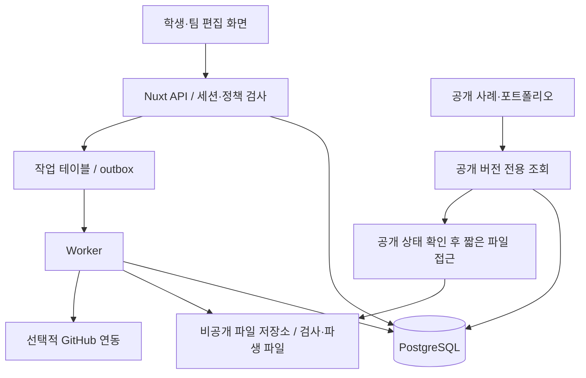
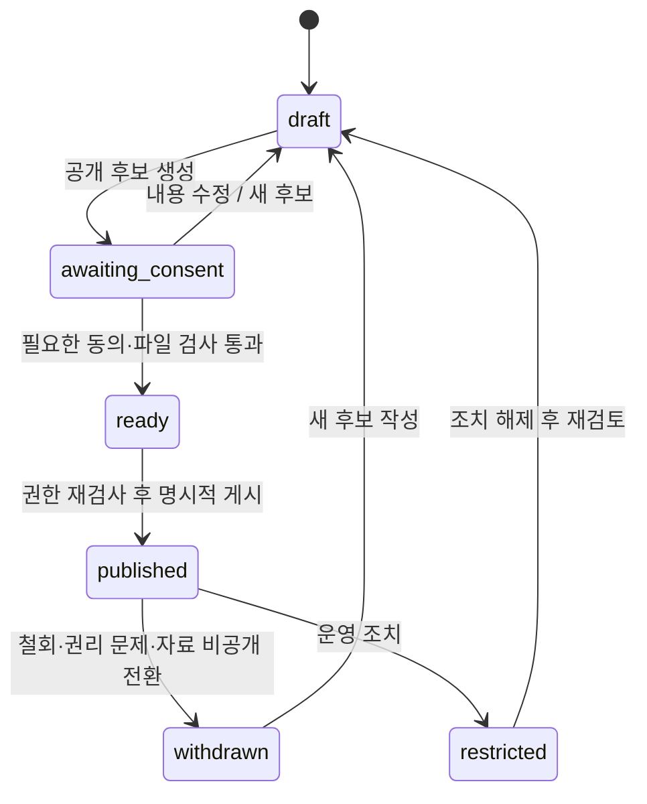

# Peerchive 고도화 시스템 설계

작성일: 2026-10-13 · 상태: 구현 전 제안

Peerchive(피어카이브)는 2019년 대학교 학부 졸업작품 **ProofU**에서 이어지는 프로젝트의 새 이름입니다. *Peer + Archive*를 결합해 학생들이 서로의 과제·프로젝트 경험에서 배우는 공개 아카이브라는 목적을 담았습니다. 별도의 커리어 관리 프로젝트 `proofu`와 구분하기 위해 이름을 변경했습니다. 현재 저장소 주소 `proofu-univ`와 문서 파일 경로는 유지하며, 보존된 코드는 기존 ProofU의 구현입니다.

[제품 기획](../PROOFU_EVOLUTION_PLAN.md) · [실행 계획](DELIVERY_PLAN.md)

## 1. 설계 목표와 원칙

학생의 작업 기록을 잃지 않고 공개 가능한 학습 사례로 만들고, 그 사례에서 개인의 기여를 설명할 수 있어야 합니다. 작은 팀이 운영할 수 있는 단일 서비스로 시작하되 인증·기록·공개·파일 처리의 책임은 모듈로 분리합니다.

가장 중요한 불변조건은 다음과 같습니다.

1. 비공개 작업 기록이 공개 API·검색·미리보기·PDF로 전달되지 않습니다.
2. 공개는 선택된 기록 버전과 파일만 포함한 승인된 스냅샷을 대상으로 합니다.
3. 공동 산출물의 동의가 바뀌면 그 자료를 사용하는 공개 사례와 포트폴리오도 차단됩니다.
4. 작성자의 역할 주장과 제3자의 확인, 플랫폼 기록 시각을 서로 구분합니다.
5. 공개 버전 수정은 새 버전 생성으로 처리하지만 삭제·철회 요구가 있으면 보존 정책에 따라 실제 내용도 제거할 수 있습니다.
6. 기존 원본 이력과 신규 서비스 데이터는 서로의 진위를 입증하는 자료로 혼용하지 않습니다.

‘변경 이력이 남는다’는 제품 약속을 영구 삭제 불가로 구현하지 않습니다. 감사 이벤트에는 필요한 최소 정보만 남기고 개인정보와 파일 본문은 정책에 따라 삭제할 수 있어야 합니다.

## 2. 기존 코드의 활용 방식

현재 저장소는 운영 중인 서비스의 데이터나 호환 가능한 실행 환경이 확인된 상태가 아닙니다. 이에 따라 **기존 디렉터리를 보존하고 새로운 앱을 옆에 구현하는 방식**을 권합니다. 프로젝트를 폐기하는 것이 아니라 목적·자산·도메인 이해를 이어 가면서 현재 실행 제약을 새 기반으로 옮기지 않는 선택입니다.

| 기존 요소 | 계승할 것 | 새 구현에서 달라질 것 |
|---|---|---|
| User·Profile·MyPage | 개인 경험을 한곳에 모으는 목적 | 프로필 공개 제어, 대표 기여, 포트폴리오 버전 |
| Team·Member·Join | 팀과 참여자의 관계 | 프로젝트별 역할, 공동 자료 동의, 초대·탈퇴 상태 |
| Board | 프로젝트 공간 | Assignment/Project의 목표·제약·기간·공개 정책 |
| List·Card | 작업 단위와 정렬 | 선택적 Task 기능. 카드 완료를 학습 기록으로 간주하지 않음 |
| BoardFile·CardFile | 자료를 근거로 연결 | 검사 상태, 파일 버전, 라이선스·공개 권한, 철회 |
| Chat·Message | 피드백·토론 필요 | MVP는 기록별 피드백. 실시간 채팅은 보류 |
| Calendar | 일정 맥락 | 간단한 마감·기간부터; 별도 캘린더 엔진은 보류 |
| 이미지·로고 | 기존 ProofU의 정체성 참고 | Peerchive 브랜드 자산은 별도 제작; 기존 자산은 권리·출처 확인 후 사용하고 타사 허용 조건 유지 |
| 공지 수집 | 대학 맥락 | 핵심 흐름과 떨어져 있어 신규 MVP에서 제외 |

기존 프론트엔드의 사용자 흐름·컴포넌트 목적과 모델은 설계 참고자료로 사용합니다. DOM 조작, Vue 2 라이프사이클, 평문 비밀번호, localStorage의 장기 토큰, 파일 경로 공개, Sequelize sync 기반 스키마 변경은 새 코드에 복사하지 않습니다.

원본을 실행해 보려는 연구용 환경과 실제 신규 서비스는 DB·업로드 경로·비밀키·배포를 분리합니다. 기존 SQLite·업로드 예제를 운영 데이터로 자동 가져오지 않습니다.

## 3. 권장 기술 구성과 대안

| 구성 | 제안 | 선택 이유·제약 |
|---|---|---|
| 웹 | Vue 3 + Nuxt + TypeScript | Vue 경험을 계승하고 공개 사례의 서버 렌더링과 편집 화면을 함께 다룸 |
| 서버 | Nuxt/Nitro의 서버 API, 도메인 서비스 모듈 | 초기에는 별도 API 배포·CORS·인증 경계를 줄임 |
| DB | PostgreSQL + 명시적 migration, 타입을 연결하는 ORM 후보 Drizzle | 관계·버전·동의·정책 상태를 트랜잭션으로 관리. ORM 선택은 초기 기술 실험에서 확정 |
| 파일 | 비공개 S3 호환 object storage | 파일 본문과 DB 분리, 검사 전 격리, 백업과 삭제 관리 |
| 비동기 작업 | 같은 저장소의 Node worker + PostgreSQL 작업 테이블 | 초기 Redis 의존성 없이 검사·공개·철회·PDF 작업 처리 |
| 로그인 | 검증된 세션/OAuth 구현, HttpOnly 쿠키 | 자체 암호 프로토콜을 만들지 않음. GitHub 로그인은 선택이며 이메일 방식도 제공 |
| 검색 | PostgreSQL의 구조화 필터와 정규화 검색 컬럼부터 | 초기 별도 검색 클러스터 생략. 한국어 품질이 부족하면 n-gram/전용 검색을 실험 |
| 검증 | Vitest, 실제 PostgreSQL 통합 테스트, Playwright | 핵심 위험인 권한·동의·공개 누출과 주요 사용자 흐름 검증 |
| 배포 | 웹 1개 + worker 1개 + 관리형 DB·스토리지 | 컨테이너로 재현, 공급자 선택은 지역·비용·백업·처리 조건 확인 후 |

Nuxt의 서버 기능은 Nitro를 기반으로 합니다. [Nuxt 공식 서버 문서 소스](https://github.com/nuxt/nuxt/blob/main/docs/1.getting-started/13.server.md)

기술 이름은 제안이며 최신 버전 번호를 이 문서에 고정하지 않습니다. 구현 시작 시 지원 중인 Node LTS와 라이브러리 조합을 확인하고 lockfile, 런타임 버전, CI를 함께 고정합니다. Vue 컴포넌트 내 임의 fetch와 전역 DOM 조작 대신 명확한 서버 상태·폼 상태를 사용하며, Pinia는 필요한 공유 UI 상태에만 둡니다.

대안은 Vue 3 SPA + 독립 TypeScript Express API입니다. 공개 페이지 렌더링을 추가해야 하고 배포가 나뉘지만 API를 별도 클라이언트에서 사용할 요구가 강하면 적합합니다. 현재는 모바일 앱·외부 API 소비자가 없으므로 Nuxt 단일 앱을 우선 제안합니다. PostgreSQL 전환은 새 앱 기준이며 기존 MySQL을 삭제한다는 의미가 아닙니다.

## 4. 목표 저장소 구조

아래 디렉터리는 아직 생성하지 않습니다. 향후 구현 구조의 제안입니다.

```text
frontend/                     # 기존 아카이브 유지
backend/                      # 기존 아카이브 유지
apps/
  web/
    app/pages/                # 탐색·작업 공간·공개 사례·포트폴리오
    app/components/           # 도메인별 UI
    server/api/v1/            # 요청 검증·정책 확인·응답 변환
    server/modules/           # identity, projects, evidence, publication, portfolio
  worker/                     # 검사·공개·철회·변환 작업
packages/
  domain/                     # 규칙, 상태 전이, 공개 정책
  db/                         # 스키마, migration, repository
  contracts/                  # 입력/응답 스키마, 오류 코드
  integrations/               # storage, GitHub adapter
  test-fixtures/              # 개인정보 없는 시나리오 데이터
ops/                          # 로컬 구성, 배포·백업·복구 안내
```

API handler가 ORM을 직접 여러 곳에서 수정하지 않고 도메인 서비스를 호출하게 합니다. DB 스키마와 외부 응답을 분리해 사용자 이메일·내부 파일키 등이 공개 DTO에 실리지 않게 합니다. 처음부터 마이크로서비스·Kafka·범용 플러그인 시스템을 만들 필요는 없습니다.



## 5. 도메인 모델

| 엔티티 | 주요 필드 | 관계·규칙 |
|---|---|---|
| User | id, display_name, private_email, status | 로그인 식별자와 공개 정보 분리 |
| Profile | user_id, headline, interests, contact_policy | 공개 연락은 별도 허용, 학교 정보 선택 |
| Project | id, owner_id, title, context, goal, constraints, lifecycle | 개인 또는 팀 과제. owner는 운영 책임자이며 공동 권리 독점 아님 |
| ProjectMember | project_id, user_id, role, status | owner/editor/reviewer/viewer; 외부 공개 이름은 별도 동의 |
| CourseContext | school_label, course_label, term, policy_note, policy_status | 선택 정보, 학교 공식 인증·교수 승인으로 오인하지 않음 |
| ProcessEntry | id, project_id, author_id, type, stage | 기록 식별자. 현재 버전 참조 |
| EntryRevision | entry_id, revision_no, work, learning, claimed_date, recorded_at | 내용 버전, 실제 수행일은 자기 기입 표시 |
| Artifact | id, project_id, uploader_id, kind | file/link/demo, 소유·사용 조건 명시 |
| ArtifactVersion | artifact_id, sha256, object_key, scan_status, media_type, bytes | 내용 바뀌면 새 버전. 업로드 SHA-256은 내용 식별용 |
| EvidenceLink | entry_revision_id, artifact_version_id 또는 source_ref_id | 특정 버전의 근거 연결 |
| ContributionClaim | id, user_id, project_id, text, revision | 개인 역할 주장과 근거. 비율 합산 강제 안 함 |
| ClaimEvidence | claim_revision, entry_revision 또는 artifact_version | 실제 개인 기여와 자료 연결 |
| ContributionConfirmation | claim_revision, confirmer_id, status, note | 주장 변경 시 기존 확인 승계 안 됨 |
| Reference | owner_scope, url, citation, license_note | 참고한 사례·자료 출처. 삭제된 원본 상태 표시 |
| Publication | id, project_id, slug, current_release_id, status | 공개 사례의 안정된 URL과 철회 상태 |
| PublicationRelease | publication_id, version, snapshot, manifest_hash, status | 선택된 공개 데이터와 참조 파일만 포함 |
| Consent | release_manifest_hash, subject_id, scope, status | 특정 공개 후보 내용에 대한 동의 |
| PortfolioEdition | id, user_id, version, visibility, status | 프로필·선택 사례·기여의 스냅샷 |
| PortfolioItem | edition_id, release_id, claim_revision, order | 공개 권한을 통과한 자료만 포함 |
| ShareGrant | edition_id, token_hash, expires_at, revoked_at | P1의 제한 공유. 원문 토큰 저장 안 함 |
| Review | target_revision, author_id, visibility, content | 공개 리뷰도 별도 동의 필요 |
| Report | target_type, target_id, reason, status | 신고·조치·이의제기 |
| AuditEvent | actor_id, action, target_id, at, minimal_metadata | 본문·토큰·민감 파일 내용을 로그에 저장 안 함 |

User는 여러 Project에 참여하고 Project는 여러 기록·산출물·기여를 가집니다. 공개 버전은 각각의 특정 revision만 참조합니다. PortfolioItem은 Project의 실시간 상태가 아니라 PublicationRelease를 참조하므로 작업 중 수정이 바로 공개되지 않습니다.

주요 제약은 `(project_id, user_id)` 멤버 중복 방지, `(entry_id, revision_no)` 유일성, `(publication_id, version)` 유일성, 공개 slug 유일성, `sha256`과 파일 길이 검증입니다. DB 삭제는 무조건 cascade하지 않고 공동 기록·동의·철회 파급을 먼저 계산합니다.

## 6. 상태 전이와 공개 흐름

프로젝트 작업 상태와 공개 상태는 다른 축입니다. 작업은 `planning → active → completed → archived`로 표현하되 수정 가능한 전이가 있습니다. 공개 상태는 아래와 같습니다.



공개 후보 생성은 선택한 버전·노출 이름·첨부·출처·검토 항목으로 manifest를 만듭니다. 동의는 이 manifest의 해시에 연결됩니다. 내용·노출 범위·자료가 바뀌면 새 후보를 만들고 영향받는 동의를 다시 받습니다.

최종 게시 트랜잭션에서 게시 권한, 참여 상태, 동의 유효성, 파일 `clean` 상태, 보류·신고 상태, revision의 존재를 다시 검사합니다. 클라이언트에서 버튼이 켜졌다는 이유로 게시를 허용하지 않습니다. 낡은 버전은 `409 Conflict`로 돌려주고 다시 미리보기하게 합니다.

예약 공개는 P1 후보입니다. 날짜는 게시 조건 하나일 뿐이며 실행 시 모든 조건을 다시 확인합니다. 제출일이나 학기 종료만으로 학교 정책상 공개 가능하다고 판정하지 않습니다.

개인 프로젝트는 작성자 명시적 공개로 시작할 수 있습니다. 팀 프로젝트는 공개 범위에 이름·발언·공동 산출물이 포함되는 당사자의 동의를 요구합니다. 팀원이 무응답이면 해당 공동 자료를 제외하거나 공개를 보류합니다. 팀원이 탈퇴해도 기존 공동 자료 사용 조건은 자동으로 자유화되지 않습니다.

## 7. 권한과 접근 범위

MVP는 `private`와 `public`을 구현합니다. `private`는 프로젝트별 승인된 멤버와 초대된 reviewer만 볼 수 있습니다. `public`은 검토된 공개 release만 익명 열람할 수 있습니다. P1에서 `restricted-share`를 추가하며, 이는 링크를 가진 누구나 볼 수 있는 `unlisted`와 다릅니다. 민감 자료는 수신자 로그인까지 요구하는 공유를 지원할지 별도 결정합니다.

| 행동 | 방문자 | 프로젝트 viewer/reviewer | editor | owner | 관리자 |
|---|---|---|---|---|---|
| 공개 release 읽기 | 가능 | 가능 | 가능 | 가능 | 가능 |
| 비공개 작업 공간 읽기 | 불가 | 해당 프로젝트만 | 해당 프로젝트만 | 해당 프로젝트만 | 원칙적 불가 |
| 기록 작성·수정 | 불가 | reviewer는 피드백만 | 본인 기록, 공동 자료는 별도 권한 | 권한 범위 내 | 원칙적 불가 |
| 타인의 개인 기여 수정 | 불가 | 불가 | 불가 | 불가 | 분쟁 조치만 |
| 팀 멤버 관리 | 불가 | 불가 | 불가 | 가능 | 운영 조치만 |
| 자기 관련 공개 동의 | 불가 | 본인 관련만 | 본인 관련만 | 본인 관련만 | 대리 동의 불가 |
| 게시 요청 | 불가 | 불가 | 초안 준비 | 조건 충족 시 실행 | 임의 대리 게시 불가 |
| 공개 철회 | 신고 | 자기 동의 철회·신고 | 자기 동의 철회·신고 | 전체 철회 | 정책상 제한·철회 |

관리자의 분쟁 조사용 비공개 접근은 사유·기간·범위·감사 기록을 갖춘 예외로 설계하며 관리자 계정이라고 항상 DB 본문을 탐색할 수 있게 하지 않습니다. 특정 기록을 삭제할 권한과 공개를 막을 권한도 분리합니다.

API·DB repository·파일 접근·검색 색인·PDF 작업에서 같은 권한 규칙을 적용합니다. PostgreSQL RLS는 방어층 후보이며 owner나 특권 역할이 우회할 수 있으므로 애플리케이션 정책을 대신하지 않습니다. 도입 시 실제 서비스 DB 역할로 권한 테스트를 합니다. [PostgreSQL 공식 Row Security 설명](https://www.postgresql.org/docs/current/ddl-rowsecurity.html)

## 8. API 계약 초안

| 메서드·경로 | 역할 | 주요 조건 |
|---|---|---|
| `POST /api/v1/projects` | 과제 생성 | 로그인, private 기본값 |
| `POST /api/v1/projects/:id/invitations` | 멤버 초대 | owner, 만료·일회성 수락 |
| `POST /api/v1/projects/:id/entries` | 과정 기록 | editor, 입력 검증 |
| `POST /api/v1/entries/:id/revisions` | 기록 새 버전 | 작성자 권한, expectedRevision |
| `POST /api/v1/projects/:id/artifacts/upload-intents` | 파일 업로드 준비 | 용량·종류 한도, 격리 파일키 |
| `POST /api/v1/artifacts/:id/complete` | 업로드 완료 확인 | 실제 길이·해시·소유권 확인, 검사 대기 |
| `POST /api/v1/projects/:id/contributions` | 개인 기여 주장 | 본인·해당 프로젝트 멤버 |
| `POST /api/v1/contributions/:id/confirmations` | 팀원 확인 | 같은 프로젝트, 본인 주장 자체 확인 제외 |
| `POST /api/v1/projects/:id/publication-candidates` | 공개 스냅샷 준비 | 선택 revision, owner/editor |
| `POST /api/v1/candidates/:id/consents` | 동의 | 본인 관련 범위, 현재 manifest |
| `POST /api/v1/candidates/:id/publish` | 공개 | owner, 모든 상태 재검사 |
| `POST /api/v1/publications/:id/withdraw` | 철회 | owner 또는 운영 정책상 권한 |
| `GET /api/v1/publications/:slug` | 공개 DTO | published 상태만, private 필드 없음 |
| `GET /api/v1/publications/:id/artifacts/:versionId` | 파일 열람 | 현재 release 포함 여부·상태 검사 |
| `POST /api/v1/portfolio-editions` | 포트폴리오 생성 | 본인 공개 기여만 연결 |
| `GET /api/v1/profiles/:handle` | 공개 프로필 | 공개 허용된 필드·활성 edition만 |
| `GET /api/v1/discover` | 공개 탐색 | 활성 공개 release만 |
| `POST /api/v1/reports` | 신고 | 대상 확인, rate limit, 사유·상태 관리 |

입력 예시는 다음과 같습니다. 실제 근거 ID는 같은 프로젝트에 속해야 합니다.

```json
{
  "type": "decision",
  "stage": "implementation",
  "work": "실시간 센서 대신 수동 입력 방식으로 범위를 조정했다.",
  "learning": "정확도와 운영 비용을 동시에 검토해야 했다.",
  "evidenceVersionIds": ["artifact-version-id"],
  "claimedDate": "2026-10-13",
  "expectedRevision": 2
}
```

응답은 `recordedAt`과 `claimedDate`를 구분하고 revision 번호를 돌려줍니다. 페이지네이션은 cursor와 최대 개수 제한을 사용합니다. 게시·파일 완료·동기화에는 idempotency key를 적용합니다. 폼 오류는 필드별 코드, 충돌은 409, 입력 오류는 422로 구분하는 계약을 제안합니다. 비공개 객체의 존재를 노출하지 않는 조회 정책은 404로 일관되게 처리합니다.

## 9. 파일과 외부 링크 처리

파일은 `pending → scanning → clean/quarantined/failed` 상태를 가집니다. MVP 허용 형식은 이미지·PDF 등 안전하게 표시할 수 있는 자료와 코드 저장소 링크로 좁히고, 실행 파일·압축파일·임의 HTML/SVG 실행은 허용하지 않는 것을 제안합니다. 허용 MIME·확장자·실제 signature·용량을 함께 검사합니다.

스토리지 bucket은 모두 비공개로 두고 원래 파일명으로 경로를 만들지 않습니다. 업로드는 격리 key로 진행하며 권한·한도·실제 업로드 결과를 검증합니다. 서버는 사용자가 붙인 임의 URL에 바로 접속하지 않습니다. 링크는 처음에는 외부 이동으로 제공하고, 미리보기 수집은 허용 도메인·redirect·사설 IP 차단·timeout을 갖춘 worker에서 처리합니다.

공개 파일도 영구 object URL을 만들지 않습니다. release의 활성 상태를 확인하는 경로를 통해 접근하고 직접 다운로드 URL이 필요하면 예를 들어 60초 이하의 짧은 유효기간을 사용합니다. 철회 즉시 신규 접근을 차단하지만 이미 발급된 URL은 TTL, 다운로드된 사본은 수신자의 보관에 영향을 받는다는 한계를 안내합니다.

PDF·이미지 미리보기는 격리된 변환 환경에서 생성합니다. 사용자 문서에 포함된 active content를 실행하지 않고 파생 파일과 원본 버전을 연결합니다. 공개 파생 파일도 동일 철회 규칙을 적용합니다.

## 10. 공개 철회·검색·PDF의 일관성

철회 요청에서 Publication 상태와 관련 자료의 `access_epoch`를 먼저 DB에서 갱신합니다. 읽기 경로는 상태를 즉시 확인하므로 worker가 느려도 신규 열람을 막습니다. 같은 트랜잭션에 outbox 이벤트를 저장하고 worker가 검색 색인·캐시·포트폴리오 의존성·파생 파일을 제거하거나 차단합니다.

공개 페이지는 private workspace 쿼리를 사용하지 않습니다. 초기에는 민감한 스냅샷을 장기 정적 캐시하지 않고 상태 검사와 짧은 캐시 정책을 적용합니다. 콘텐츠 변경보다 철회가 우선하도록 캐시 키에 version·access_epoch를 포함합니다. 외부 검색엔진의 캐시나 이미 내려받은 PDF는 완전 회수를 보장하지 않습니다.

공개 사례가 철회되면 이를 포함한 포트폴리오 항목은 자동으로 이용 불가 표시가 되며 원본 문장·파일을 계속 제공하지 않습니다. 새 edition 발행까지 단순 빈칸으로 처리할지 안내문을 넣을지는 사용자 테스트에서 결정합니다. 공유 링크도 접근 시 현재 의존 자료의 상태를 확인합니다.

백업에는 삭제된 자료가 잠시 남을 수 있습니다. 별도 삭제 ledger를 유지하고 복구 시 최신 철회·삭제를 재적용하기 전에는 외부 트래픽을 열지 않습니다. 보존 기간과 purge 주기는 출시 전에 확정해 사용자 안내와 운영 runbook에 기록합니다.

## 11. GitHub·AI·학습 기록 연동

MVP는 저장소·PR·commit 링크를 학생이 직접 연결하는 방식입니다. GitHub 계정·코드가 없는 보고서·디자인 과제도 같은 수준으로 사용할 수 있어야 합니다. P1 자동 연결은 GitHub App을 후보로 두고 사용자가 선택한 저장소에 최소 권한만 요청합니다. GitHub App은 세분화된 권한과 선택한 저장소 접근을 제공한다는 공식 설명을 확인했습니다. [GitHub App 선택 안내](https://docs.github.com/en/apps/creating-github-apps/about-creating-github-apps/deciding-when-to-build-a-github-app)

webhook은 서명과 delivery ID를 검증하고 중복·순서 역전을 처리합니다. 저장소가 private이 되거나 접근 권한이 철회되면 원래 자료를 공개 복사한 채 남겨두지 않고 연결 상태와 공개 사용 조건을 재검토합니다. 비공개 저장소 본문 자동 수집은 MVP에서 하지 않습니다. commit 작성자 이메일만으로 Peerchive 사용자의 기여를 확정하지 않습니다.

AI 기능은 P1 이후 학생이 선택한 기록을 요약·번역하는 보조 도구로 검토합니다. 공개 후보의 근거 밖 내용을 생성하거나, 팀원 발언을 본인 주장으로 바꾸거나, 비공개 자료를 자동으로 모델에 보내지 않게 합니다. 원문 출처·편집·동의 절차를 거쳐 학생이 최종 승인하고 AI 생성 범위를 남깁니다. AI 없이 핵심 기능을 사용할 수 있어야 합니다.

장기적으로 성취·근거·학습자 중심의 내보내기를 CLR/Open Badges와 연결할 수 있습니다. 표준 준수와 기관 발급 체계는 별도 사업·기술 검증이 필요하며 단순 팀원 확인을 인증서로 발급하지 않습니다. [1EdTech CLR 공식 설명](https://www.1edtech.org/standards/clr)

## 12. 운영·성능·보안 목표

초기 목표는 예를 들어 50명·20개 과제의 제한된 pilot입니다. 아래 값은 검증할 설계 목표이며 보장된 SLA가 아닙니다.

| 항목 | 목표 초안 | 검증 |
|---|---|---|
| 공개 페이지 | 대표 모바일 환경에서 핵심 요약을 빠르게 읽을 수 있음, 초기 LCP 목표 2.5초 이내 | 실제 네트워크·이미지 포함 측정 |
| API | 일반 읽기·쓰기 p95 500ms 이내, 파일 변환 제외 | 테스트 DB와 pilot 지표 |
| 파일 저장 | 학생당 500MB, 파일당 20MB 초안 | 사용량 관측 후 조정, 추가 업로드 사전 안내 |
| 권한 | 익명·다른 팀 사용자의 비공개 내용 노출 0건 | 통합·E2E 테스트와 운영 조사 |
| 철회 | DB 상태 변경 즉시 신규 접근 차단, 파생 인덱스 정리 5분 목표 | 상태 전파·worker 실패 실험 |
| 복구 | pilot 기준 RPO 24시간·RTO 4시간 목표 | DB·파일 복구 및 삭제 ledger 재적용 연습 |

시작부터 rate limit, CSRF·세션 보호, OAuth state 검증, 출력 escaping, 파일 접근 검사, 비밀 관리, 구조화 감사 로그를 둡니다. 서비스 데이터와 pilot 테스트 자료를 분리합니다. 운영 로그는 과제 본문·토큰·메일 주소를 무분별하게 남기지 않습니다.

작업 테이블은 retry 횟수·backoff·dead-letter 상태를 갖습니다. outbox, 파일 변환, PDF 생성은 실패해도 동일 요청을 반복해 중복 자료가 생기지 않아야 합니다. worker 장애로 비공개 자료가 자동 공개되는 fallback은 없습니다.

관측 항목은 인증 오류, 비정상 조회, 공개 실패, 동의 철회, 격리 파일, worker backlog, 삭제 실패입니다. 권한 누출·파일 공개 오류가 있으면 전체 public 읽기를 잠시 차단할 수 있는 운영 스위치를 둡니다. 알림·조치·복구 담당자는 출시 전에 지정합니다.

## 13. 데이터 이관과 아카이브 검증의 관계

새 앱으로 기존 자료를 가져오려면 먼저 실제 운영 데이터인지 확인합니다. SQLite·업로드 예제는 예제일 수 있으므로 사용자 계정이나 동의를 생성하지 않습니다. 일회성 importer는 원본을 읽기 전용으로 읽고 import run ID, 원본 ID, checksum, 경고를 기록하며 dry-run 보고서부터 만듭니다.

Board는 과제 초안, List/Card는 선택적 작업, 파일은 격리 자료로 이관할 수 있습니다. 채팅은 개인 정보·공개 동의 확인 전 이관하지 않습니다. 평문 비밀번호는 옮기지 않고 재인증·재설정합니다. 모두 private으로 가져오며 과거 작성일은 `imported`로 표시합니다. 존재하지 않는 과정 기록이나 개인 기여를 새로 만들어 넣지 않습니다.

[아카이브 검증 스크립트](../../scripts/check_archive.py)는 기존 원본·2019년 재구성 이력·허용된 주석 정리를 검증합니다. 새 앱 코드의 정상 동작은 신규 테스트가 검증합니다. 원본 파일을 현대화하면서 검증 예외 목록만 계속 늘리는 방식은 피합니다. 기존 디렉터리를 유지하고 새 앱을 추가하는 구조에서는 두 검증을 각각 CI에서 실행할 수 있습니다.

2019년 커밋은 실제 당시 개발 로그가 아닌 재구성 기록이며 새 서비스의 증빙 예제로 쓰려면 그 사실을 표시해야 합니다. [기존 이력 백업](https://github.com/polynomeer/proofu-univ/tree/backup/pre-reconstruction-20261013)은 유지합니다.
